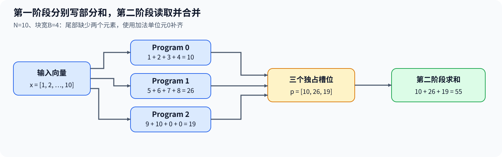
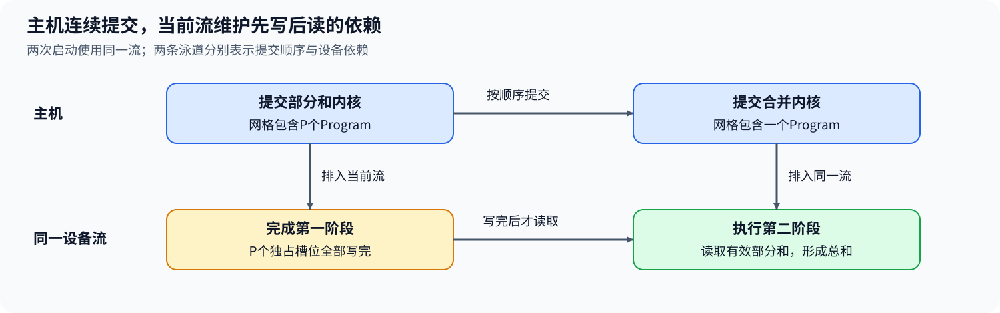

# 22. Triton Two Stage Reduction | 多Program归约与分阶段合并

**难度：** 进阶 | **环境：** [NVIDIA GPU 必需](#runtime-environment) | **标签：** `Triton`、`归约`、`部分和` | **目标人群：** 掌握索引与行内归约

> 🚀 **云端运行环境**
>
> 本章节的实战代码可以点击以下链接在免费 GPU 算力平台上直接运行：
>
> [](https://colab.research.google.com/github/datawhalechina/llm-algo-leetcode/blob/main/03_Triton_Kernels/22_Triton_Two_Stage_Reduction.ipynb)
> [](https://modelscope.cn/my/mynotebook) *(国内推荐：魔搭社区免费实例)*


## 本节导读

把十个数分给三个Program，各自算出一段和，怎样才能得到整条向量的总和？若每个Program都直接写同一个输出，结果可能只剩其中一段；若先写部分和，下一步又该怎样读取并合并？本节从一维求和出发，用两个依次提交的内核连接局部归约与全局结果，跟踪尾块、临时空间和阶段依赖。

<a id="runtime-environment"></a>

## 运行环境

- **GPU练习：** 使用[算子环境](../topic_discussion/operator_optimization/quickstart.md#triton-environment)，运行[题目与测试](#mechanism-practice)。需要NVIDIA GPU、CUDA版PyTorch与Triton。

## 前置阅读

先会按步长定位元素，再回顾一个Program如何归约自己的数据。

- [02 二维布局与访存](./02_Triton_Layouts_and_Memory_Access.md)：逻辑索引、真实步长与尾部屏蔽。
- [04 RMSNorm](./04_Triton_Fused_RMSNorm.md)：行内求和与多个元素共享归约结果；本节把求和范围扩展到多个Program。

## Step 1：把一条向量的总和拆成部分和

归约是把多个元素按某种运算合并成较少的结果，本节只计算一维向量的加法总和。输入有 $N$ 个元素，每个Program处理最多 $B$ 个位置，共需 $P=\lceil N/B\rceil$ 个Program。编号为 $g$ 的Program处理从 $gB$ 开始的一段，输出部分和 $p_g$；第二阶段再把这些部分和合成一个标量 $s$。

$$
p_g=\sum_{i=gB}^{\min((g+1)B,N)-1}x_i,\qquad
s=\sum_{g=0}^{P-1}p_g.
$$

以 $x=[1,2,\ldots,10]$、 $B=4$ 为例，三个Program分别得到10、26、19，合并后为55。第一阶段的各个Program只写自己的槽位，保留了所有输入段的贡献；第二阶段读取这三个槽位。拆分后多了一次内核提交和临时缓冲读写，是否值得拆分，需在确定输入规模与配置后再测量。



## Step 2：输入尾块与部分和尾块分别怎样屏蔽

第一阶段按逻辑位置生成偏移，再乘输入步长寻址。最后一段可能不足 $B$ 项，例如上述Program 2只有位置8、9有效，另外两个位置用零补齐，因为零是加法的单位元。输入来自切片时，逻辑位置1可能位于底层存储的第2、3或其他位置；读取时仍须使用实际步长。

第二阶段只读取 $P$ 个真实部分和，而块内归约宽度可以补到二次幂。 $P=3$ 时计算宽度为4，第四项以零参与局部计算，缓冲本身仍只需要3个FP32槽位，共12字节。一般情况下，部分和缓冲占 $4P$ 字节，第一阶段写入和第二阶段读取的逻辑流量合计为 $8P$ 字节。两个阶段都处理尾部，但第一阶段检查输入长度，第二阶段检查部分和数量，二者使用不同的有效范围。

| 阶段 | Program负责什么 | 真实有效范围 | 补齐值 |
| --- | --- | --- | --- |
| 第一阶段 | 一个输入段及其独占部分和槽位 | 逻辑位置小于N | 0 |
| 第二阶段 | 所有有效部分和及一个最终输出 | 槽位编号小于P | 0 |

## Step 3：第二阶段何时可以读取全部部分和

不同Program的执行先后由设备安排。即使一个Program已经写完自己的部分和，它也无法据此判断其他Program是否完成。两阶段方案把依赖放在内核之间：在同一个CUDA流中先提交第一阶段，再提交第二阶段，设备会按流内依赖先完成部分和写入，再执行读取。CUDA流是组织设备操作顺序的执行队列；Python在提交后可以继续运行，包装器保持调用方当前流即可，不需要在两次提交之间等待整个设备。

部分和与最终输出都采用FP32。改变分组会改变浮点加法的结合顺序，因此使用FP64参考和预定容差检查结果；整数样例则能精确暴露漏段和重复段。每次调用重新覆盖各个部分和槽位即可得到独立结果；若改用原子累加方案，还需另外设计输出初始化与浮点累加顺序。两阶段方案首先用独占写入和完整覆盖把这些问题分开。



<a id="mechanism-practice"></a>

## Step 4：实现部分和、最终合并与流内启动

补全第一阶段的分段加载与独占写入、第二阶段的有效部分和归约，以及包装器的两次启动。输入是一维CUDA FP32张量，支持正步长切片，长度为1至2²⁰；块宽选择256、512或1024，因此第二阶段最多合并4096个部分和。骨架提供输入检查、分配与参考计算；在对应位置补全变量和表达式后，移除局部未完成保护。

| TODO / 函数 | 待实现的机制 | 必须满足的约束 | 测试证据 |
| --- | --- | --- | --- |
| TODO 1 / partial_sum_kernel | 分段读取、局部求和并写入自己的槽位 | 按输入步长寻址，尾部补零，每段恰好写一次 | 部分和逐项对照、非连续切片、写入两端哨兵 |
| TODO 2 / merge_sum_kernel | 合并真实部分和并输出标量 | P以外位置补零，覆盖所有真实槽位 | 非二次幂部分和数量与最终输出哨兵 |
| TODO 3 / triton_two_stage_sum | 依次提交两阶段内核 | 当前CUDA流、第一阶段P个Program、第二阶段一个Program | 总和、重复调用、最大长度；实际启动顺序、网格、缓冲与非默认流 |


```python
from unittest.mock import patch

import torch
import triton
import triton.language as tl

```


```python
@triton.jit
def partial_sum_kernel(X, PARTIAL, N, STRIDE_X, BLOCK: tl.constexpr):
    """每个Program独占一个部分和槽位，尾部以加法单位元补齐。"""
    program = tl.program_id(0)
    # TODO 1：从Program编号定位本段输入，归约后写入自己的槽位。
    # offsets = ???：本Program负责的逻辑位置，访存再乘STRIDE_X。
    # values = ???：只读offsets < N的位置，求和的补齐值是什么？
    # partial = ???：沿当前块的元素轴求和，写到PARTIAL + program。
    tl.static_assert(False, "TODO 1：输入段偏移、屏蔽读取与独占写入")


@triton.jit
def merge_sum_kernel(PARTIAL, OUTPUT, PARTS, MERGE_BLOCK: tl.constexpr):
    """一个Program合并有效部分和，补齐槽位不参与求和。"""
    # TODO 2：按真实部分和数量屏蔽补齐位置，再归约成最终标量。
    # slots = ???：MERGE_BLOCK个候选槽位。
    # values = ???：只有slots < PARTS的槽位有效，补齐不能增加结果。
    # total = ???：合并有效部分和，写入OUTPUT。
    tl.static_assert(False, "TODO 2：有效部分和屏蔽与最终合并")


def triton_two_stage_sum(x: torch.Tensor, block_size: int = 256):
    """返回FP32标量和与部分和向量；两阶段在当前CUDA流中依次提交。"""
    if x.ndim != 1 or x.dtype != torch.float32 or not x.is_cuda:
        raise ValueError("x须为一维CUDA FP32张量")
    if not 1 <= x.numel() <= 1 << 20 or x.stride(0) <= 0:
        raise ValueError("长度须为1至2**20，输入步长须为正")
    if type(block_size) is not int or block_size not in (256, 512, 1024):
        raise ValueError("block_size须为256、512或1024")
    n_elements = x.numel()
    parts = triton.cdiv(n_elements, block_size)
    partials = torch.empty((parts,), dtype=torch.float32, device=x.device)
    output = torch.empty((), dtype=torch.float32, device=x.device)
    # TODO 3：先产生所有部分和，再合并；两次启动留在调用方当前流。
    # stage1_grid = ???：需要多少个Program覆盖输入？
    # merge_block = ???：覆盖parts个槽位的二次幂宽度。
    # 按上述网格先启动partial_sum_kernel，再启动merge_sum_kernel。
    raise NotImplementedError("请完成 TODO 3：两阶段启动顺序与网格")
    return output, partials

```

## 正确性与阶段测试

先分别核对每个输入段和最终合并，再检查包装器。用例包含块宽前后、三个以上输入段、非连续切片、正负抵消、全零与最大支持长度；FP64参考使用预定容差，精确整数样例检查完整覆盖。设备不可用时会明确标记GPU测试未运行。


```python
class KernelLaunchRecorder:
    """记录真实启动的顺序、网格、流和缓冲地址，再调用原内核。"""

    def __init__(self, name, kernel, calls):
        self.name, self.kernel, self.calls = name, kernel, calls

    def __getitem__(self, grid):
        def launch(*args, **kwargs):
            self.calls.append({
                "name": self.name, "grid": grid,
                "input_ptr": args[0].data_ptr(),
                "output_ptr": args[1].data_ptr(),
                "stream": int(torch.cuda.current_stream(args[0].device).cuda_stream),
            })
            return self.kernel[grid](*args, **kwargs)
        return launch


def expected_partials(x, block_size):
    """在FP64参考中分别计算每个输入段，再按FP32存储。"""
    return torch.stack([
        x[start:start + block_size].double().sum().float()
        for start in range(0, x.numel(), block_size)
    ])


def test_two_stage_sum():
    """逐阶段核对尾块、槽位、布局、重复调用与当前流中的完整求和。"""
    if not torch.cuda.is_available():
        print("SKIPPED: 两阶段归约需要NVIDIA GPU，GPU正确性未验证。")
        return
    torch.manual_seed(42)
    device = torch.device("cuda", torch.cuda.current_device())
    cases = 0
    for block in (256, 512, 1024):
        for size in (1, block - 1, block, block + 1, 3 * block + 7, 65537):
            base = torch.randn(2 * size + 3, device=device, dtype=torch.float32)
            x = base[1:1 + 2 * size:2]
            before = base.clone()
            parts = triton.cdiv(size, block)
            # 两端哨兵检查部分和写入与最终输出没有改变相邻位置。
            storage = torch.full((parts + 2,), -777.0, device=device, dtype=torch.float32)
            scratch = storage[1:-1]
            partial_sum_kernel[(parts,)](
                x, scratch, size, x.stride(0), BLOCK=block, num_warps=4
            )
            torch.testing.assert_close(
                scratch, expected_partials(x, block), rtol=2e-5, atol=1e-3,
                msg=f"第一阶段错误：size={size}, block={block}",
            )
            assert storage[0].item() == storage[-1].item() == -777.0
            output_storage = torch.full((3,), -991.0, device=device, dtype=torch.float32)
            merge_sum_kernel[(1,)](
                scratch, output_storage[1:2], parts,
                MERGE_BLOCK=triton.next_power_of_2(parts), num_warps=4,
            )
            expected = x.double().sum().float()
            torch.testing.assert_close(
                output_storage[1], expected, rtol=2e-5, atol=1e-3,
                msg=f"第二阶段错误：size={size}, block={block}",
            )
            assert output_storage[0].item() == output_storage[-1].item() == -991.0
            for current in (x, x * -0.5, torch.zeros_like(x)):
                total, actual_partials = triton_two_stage_sum(current, block)
                assert total.shape == torch.Size([]) and total.dtype == torch.float32
                assert total.device == current.device
                assert actual_partials.shape == (parts,)
                torch.testing.assert_close(
                    total, current.double().sum().float(), rtol=2e-5, atol=1e-3
                )
                torch.testing.assert_close(
                    actual_partials, expected_partials(current, block),
                    rtol=2e-5, atol=1e-3,
                )
            torch.testing.assert_close(base, before, rtol=0, atol=0)
            cases += 1

    # 整数样本可精确检查符号和抵消，不能只用全正数。
    integer_input = (torch.arange(1027, device=device) % 17 - 8).float()
    total, _ = triton_two_stage_sum(integer_input)
    torch.testing.assert_close(total, integer_input.sum(), rtol=0, atol=0)
    largest = torch.ones((1 << 20,), device=device, dtype=torch.float32)
    total, partials = triton_two_stage_sum(largest, 256)
    assert partials.numel() == 4096
    torch.testing.assert_close(total, largest.sum(), rtol=0, atol=0)

    # 在非默认流中生成输入并连续执行两阶段，最终只等待该流。
    stream = torch.cuda.Stream(device=device)
    calls = []
    first = KernelLaunchRecorder("partial", partial_sum_kernel, calls)
    second = KernelLaunchRecorder("merge", merge_sum_kernel, calls)
    with torch.cuda.stream(stream), patch.dict(
        globals(), {"partial_sum_kernel": first, "merge_sum_kernel": second}
    ):
        streamed = torch.arange(1031, device=device, dtype=torch.float32) - 512
        streamed_total, streamed_partials = triton_two_stage_sum(streamed, 512)
        streamed_expected = streamed.double().sum().float()
    stream.synchronize()
    torch.testing.assert_close(streamed_total, streamed_expected, rtol=0, atol=0)
    assert [row["name"] for row in calls] == ["partial", "merge"], calls
    assert [row["grid"] for row in calls] == [(3,), (1,)], calls
    assert all(row["stream"] == int(stream.cuda_stream) for row in calls), calls
    assert calls[0]["input_ptr"] == streamed.data_ptr()
    assert calls[0]["output_ptr"] == calls[1]["input_ptr"] == streamed_partials.data_ptr()
    assert calls[1]["output_ptr"] == streamed_total.data_ptr()

    for bad in (
        torch.empty(0, device=device), torch.ones((2, 3), device=device),
        torch.ones(3, device=device, dtype=torch.float16), torch.ones(3),
        torch.ones((1 << 20) + 1, device=device),
        torch.ones(1, device=device).expand(3),
    ):
        try:
            triton_two_stage_sum(bad)
        except ValueError:
            pass
        else:
            raise AssertionError("非法输入应被拒绝")
    for bad_block in (0, 128, 255, 2048, True):
        try:
            triton_two_stage_sum(integer_input, bad_block)
        except ValueError:
            pass
        else:
            raise AssertionError(f"非法块宽应被拒绝：{bad_block}")
    print({
        "status": "passed", "cases": cases,
        "device": str(device), "scope": "two_stage_reduction_correctness",
    })


test_two_stage_sum()

```

---
> 先完成题目区并运行测试，再查看参考实现。

## 参考代码与解析

### 代码


```python
@triton.jit
def partial_sum_kernel(X, PARTIAL, N, STRIDE_X, BLOCK: tl.constexpr):
    """每个Program独占一个部分和槽位，尾部以加法单位元补齐。"""
    program = tl.program_id(0)
    # TODO 1：从Program编号定位本段输入，归约后写入自己的槽位。
    offsets = program * BLOCK + tl.arange(0, BLOCK)
    values = tl.load(X + offsets * STRIDE_X, mask=offsets < N, other=0.0)
    partial = tl.sum(values, axis=0)
    tl.store(PARTIAL + program, partial)


@triton.jit
def merge_sum_kernel(PARTIAL, OUTPUT, PARTS, MERGE_BLOCK: tl.constexpr):
    """一个Program合并有效部分和，补齐槽位不参与求和。"""
    # TODO 2：按真实部分和数量屏蔽补齐位置，再归约成最终标量。
    slots = tl.arange(0, MERGE_BLOCK)
    values = tl.load(PARTIAL + slots, mask=slots < PARTS, other=0.0)
    total = tl.sum(values, axis=0)
    tl.store(OUTPUT, total)


def triton_two_stage_sum(x: torch.Tensor, block_size: int = 256):
    """返回FP32标量和与部分和向量；两阶段在当前CUDA流中依次提交。"""
    if x.ndim != 1 or x.dtype != torch.float32 or not x.is_cuda:
        raise ValueError("x须为一维CUDA FP32张量")
    if not 1 <= x.numel() <= 1 << 20 or x.stride(0) <= 0:
        raise ValueError("长度须为1至2**20，输入步长须为正")
    if type(block_size) is not int or block_size not in (256, 512, 1024):
        raise ValueError("block_size须为256、512或1024")
    n_elements = x.numel()
    parts = triton.cdiv(n_elements, block_size)
    partials = torch.empty((parts,), dtype=torch.float32, device=x.device)
    output = torch.empty((), dtype=torch.float32, device=x.device)
    # TODO 3：先产生所有部分和，再合并；两次启动留在调用方当前流。
    with torch.cuda.device(x.device):
        partial_sum_kernel[(parts,)](
            x, partials, n_elements, x.stride(0), BLOCK=block_size, num_warps=4
        )
        merge_sum_kernel[(1,)](
            partials, output, parts,
            MERGE_BLOCK=triton.next_power_of_2(parts), num_warps=4,
        )
    return output, partials

```

### 解析

#### TODO 1：输入段与部分和槽位一一对应

Program编号乘块宽确定当前输入段的起点，块内位置补足该段的候选索引，再乘实际输入步长定位数据。尾部读取补零后执行局部求和，结果写到与Program编号相同的部分和槽位。测试逐项比较部分和，并检查缓冲两端哨兵；它能定位重复读取首段、忽略切片步长或写入错误槽位，而不是只看总和是否碰巧一致。

#### TODO 2：合并范围使用真实部分和数量

合并宽度取能覆盖P个部分和的二次幂，加载有效条件仍然是槽位小于P。P=3时第四个候选位置补零，最终写出一个标量。输入长度为块宽加一、或若干块加尾部的用例，会产生非二次幂的部分和数量；这些用例能发现把计算宽度当成真实缓冲长度的错误。单段和最大4096段分别检查最小与最大合并范围。

#### TODO 3：把两个内核放在同一当前流中

第一阶段网格大小为向上取整的输入段数，第二阶段网格大小为1。包装器在输入设备上下文中顺序提交，两次启动沿用调用方当前流，部分和张量持续存活到第二次提交完成。重复输入、负比例输入和全零输入检查每次写入是否完整；非默认流用例在该流上生成输入，观察器记录两次真实启动的名称、网格、流与缓冲地址，再调用原内核；检查第一阶段的输出正是第二阶段的输入，并只等待该流后比较总和。这样也能发现绕开目标内核、用另一实现替代两阶段计算的情况。GPU运行时再验证这些启动与数值断言。

## 相关阅读

理解两阶段汇总后，可以对照参数梯度的跨行累加，再了解CUDA线程块内部的归约方式。

- [Triton：Layer Normalization](https://triton-lang.org/main/getting-started/tutorials/05-layer-norm.html)：重点看共享参数梯度的部分和缓冲及最终归约；本节先使用独占槽位，教程进一步采用锁保护共享缓冲。
- [Part04·03 Warp级归约](../04_CUDA_and_System_Optimization/03_Warp_Level_Primitives.md)：区分warp、线程块内交换与本节的跨Program阶段依赖。
