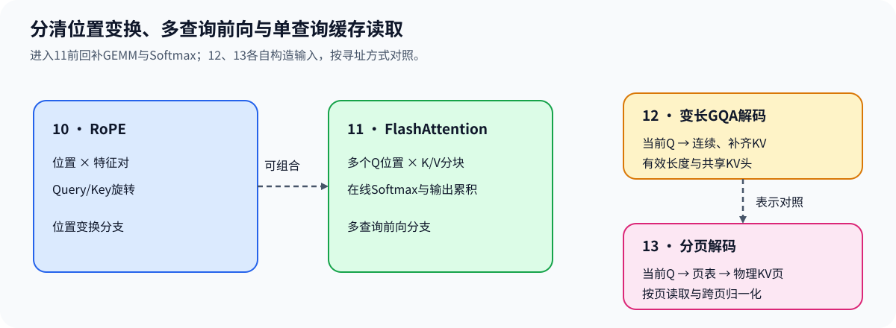

# Group 3.3: Attention and Sequence Kernels | 3.3: Attention 与序列计算

本组按位置变换、注意力计算和解码缓存寻址展开：10处理RoPE，11一次处理多个查询位置，12与13则为每个请求的当前查询读取历史K/V。12使用带有效长度的连续缓存并共享KV头，13通过页表读取物理缓存；两者用于比较寻址与归一化关系，各自独立构造输入。

## Group Asset Overview | 组内资产总览

| 页面 | 核心问题 | 实现与证据产物 | 在本组中的作用 |
|:---|:---|:---|:---|
| [10 RoPE](./10_Triton_Fused_RoPE.md) | 如何按位置索引变换 Query/Key？ | RoPE 输出与参考实现数值核对 | 位置编码分支 |
| [11 FlashAttention](./11_Triton_Flash_Attention.md) | 多个查询位置怎样分块消费K/V？ | 前向结果与PyTorch SDPA核对 | 多查询分块前向，可用于预填充计算理解 |
| [12 变长GQA解码](./12_Triton_Variable_Length_GQA.md) | 当前查询怎样按请求长度读取共享KV头？ | GQA/MQA与有效长度掩码数值核对 | 单查询、连续补齐缓存 |
| [13 PagedAttention解码](./13_Triton_PagedAttention.md) | 当前查询怎样通过页表读取物理KV页？ | 间接寻址与跨页Online Softmax核对 | 单查询、分页只读计算 |

## Learning Path | 学习路径

### Recommended Order | 推荐顺序

- **多查询前向：** 回补[05 GEMM](./05_Triton_GEMM_Tutorial.md)的矩阵分块与[07 Softmax](./07_Triton_Fused_Softmax.md)的行归一化，再进入[11 FlashAttention](./11_Triton_Flash_Attention.md)。位置变换按需读[10 RoPE](./10_Triton_Fused_RoPE.md)。
- **单查询解码：** 用[12 变长GQA解码](./12_Triton_Variable_Length_GQA.md)检查头映射、每请求有效长度与连续缓存，再对照[13 PagedAttention](./13_Triton_PagedAttention.md)中的页表读取。12的输入保留每请求预留容量，变长指有效上下文不同；13把寻址改为逻辑页到物理页。需要理解缓存追加、分配与回收时，再读[Part02·37 缓存生命周期](../02_PyTorch_Algorithms/37_KV_Cache_Lifecycle_and_Capacity_Control.md)。

### Next Steps | 后续衔接

- 需要比较权重量化、LoRA 路由或 KV Cache 量化等推理算子时，按目标进入 [3.4](./3_4.md)；不必先完成本组全部页面。

## Environment Notes | 环境说明

| 运行目标 | 环境与证据边界 |
|:---|:---|
| 10–13 kernel 正确性 | 需要 NVIDIA GPU、CUDA 可用的 PyTorch 与 Triton；环境创建和预检见[算子优化实验 Quickstart](../topic_discussion/operator_optimization/quickstart.md) |
| Attention / KV 性能判断 | 本组数值对照只验证机制正确性；性能主张须使用目标设备上的独立基准与测量协议 |
