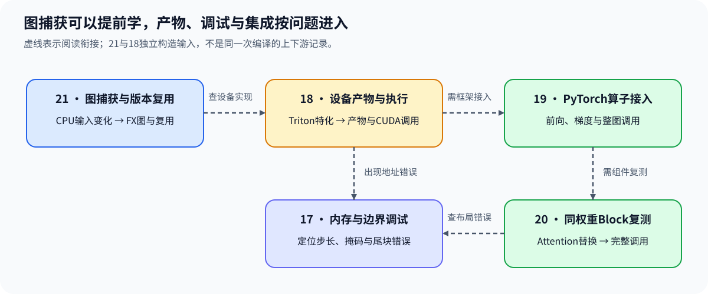

# Group 3.5: Debugging, Compilation and Integration | 3.5: 调试、编译与集成

本组按问题提供三类入口：21观察PyTorch图捕获与版本复用，18核对Triton源码、特化产物与真实CUDA调用，17定位步长和尾块错误。需要接入PyTorch时进入19，检查前向、梯度与编译；需要判断局部替换能否保留到组件时进入20。21是可提前学习的独立CPU页，其他页面按各自的内核与框架基础进入，不构成从21到20的必经顺序。

## Group Asset Overview | 组内资产总览

| 页面 | 核心问题 | 实现与证据产物 | 在本组中的作用 |
|:---|:---|:---|:---|
| [21 图捕获与版本复用](./21_Torch_Compile_Graph_Reuse.md) | 输入变化后能否复用，主动边界怎样切开计算图？ | 真实FX图、后端回调、图执行计数与CPU数值对照 | 可提前进入的编译前端观察 |
| [17 内存模型与调试](./17_Triton_Memory_Model_and_Debug.md) | 如何区分步长换算与尾块填值错误？ | 不同输入／输出布局、存储间隙及逐块点积核对 | 调试基础 |
| [18 编译产物与实际执行核对](./18_Triton_Compilation_Artifacts_and_Execution.md) | 同一源码生成哪份特化代码，本次实际启动了哪份？ | 数值、产物摘要、对象启动记录、导出文件与 CUDA 入口核对 | 编译与执行身份核对 |
| [19 PyTorch 算子集成](./19_Triton_PyTorch_Op_Integration.md) | 缩放与Softmax怎样保存前向状态并传回梯度？ | 输出、保存与委派、一阶梯度及fullgraph核对代码 | 从缩放到行归约的框架接入 |
| [20 LLaMA风格Block集成](./20_Triton_Llama3_Block_Project.md) | 拆头、因果Attention和合头怎样保留组件含义，替换是否影响完整调用？ | 分段数值与目标路径核对；独立Step5配置、配对保存和读取 | 模型组件集成路线 |

## Learning Path | 学习路径

### Recommended Order | 推荐顺序

- **图捕获入口：** 从[21](./21_Torch_Compile_Graph_Reuse.md)观察输入条件变化、版本复用与图中断；它依赖Part01的计算图概念，不要求先运行本Part其他页。需要继续追踪设备实现时，再回补Triton基础并进入18；两者不是同一个函数的上下游编译实验。
- **编译与执行：** 完成基础 kernel 后，从 [09 的编译／搜索／稳态区分](./09_Triton_Autotune_and_Profiling.md) 进入[编译产物核对](./18_Triton_Compilation_Artifacts_and_Execution.md)。该页独立构造输入，不要求先完成 Attention 或模型组件项目。
- **PyTorch 算子集成：** 在[19](./19_Triton_PyTorch_Op_Integration.md)先以缩放理解保存系数与链式法则，再接入[07](./07_Triton_Fused_Softmax.md)／[08](./08_Triton_Softmax_Backward.md)中的Softmax前反向，检查保存概率、上游梯度布局及整图调用；遇到索引／掩码问题时按[17](./17_Triton_Memory_Model_and_Debug.md)定位。
- **模型组件集成：** [20 Block集成](./20_Triton_Llama3_Block_Project.md)提供共享Attention实现，练习布局适配、因果调用与分段核对；无需先运行11。独立Step5默认显示计划，新协议尚未登记实测；已有证据范围见[实验资产表](../topic_discussion/operator_optimization/experiment_assets.md)。修改Attention算法时再回看[3.3](./3_3.md)。
- **故障查找：** 地址、步长与尾块填值问题见[17](./17_Triton_Memory_Model_and_Debug.md)；并发写入的排查说明可作进一步阅读，不等于本页已有竞态工具验证。结果正确但耗时异常时，先按[09](./09_Triton_Autotune_and_Profiling.md)核对输入、预热和计时范围。

### Next Steps | 后续衔接

- 按项目或集成目标回看 [3.1](./3_1.md)–[3.4](./3_4.md) 中对应的布局、算子或推理 kernel；无需将四组全部重读。

## Environment Notes | 环境说明

| 运行目标 | 环境与证据边界 |
|:---|:---|
| 21图捕获与版本复用 | 带PyTorch的CPU执行入口，可复用现有算子环境；见[图捕获CPU入口](../topic_discussion/operator_optimization/quickstart.md#graph-capture-cpu)，不调用Triton内核 |
| 17、19、20 运行级核对 | 目标 Triton kernel 需要 NVIDIA GPU、CUDA 可用的 PyTorch 与 Triton；环境创建和预检见[算子优化实验 Quickstart](../topic_discussion/operator_optimization/quickstart.md) |
| 编译产物与实际执行核对 | 复用同一环境；额外需要 profiler 能采集 CUDA 活动。只有 CPU 标记或编译结果时，不能登记为设备路径通过；不要求 Nsight 硬件计数器 |
