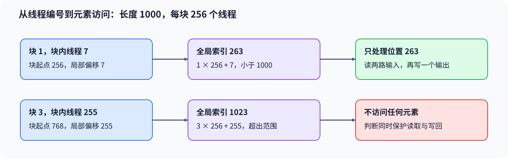

# 01. CUDA Custom Kernel Intro | CUDA 向量加法：线程索引与边界检查
**难度：** 进阶 | **环境：** [NVIDIA GPU 必需](#runtime-environment) | **标签：** `CUDA C++`、`线程索引`、`边界检查` | **目标人群：** 熟悉张量运算、希望理解 CUDA 线程映射

> 🚀 **云端运行环境**
>
> 本章节的实战代码可以点击以下链接在免费 GPU 算力平台上直接运行：
>
> [](https://colab.research.google.com/github/datawhalechina/llm-algo-leetcode/blob/main/04_CUDA_and_System_Optimization/01_CUDA_Custom_Kernel_Intro.ipynb)
> [](https://modelscope.cn/my/mynotebook) *(国内推荐：魔搭社区免费实例)*


## 本节导读

长度为 1000 的向量，按每块 256 个线程启动后，会有 24 个线程没有对应元素。如果忽略线程块编号，不同块还会反复写入开头的同一段数据。向量加法因此不只是写出加法表达式，还需要确定每个元素由哪个线程计算，以及哪些线程不应访问内存。

沿着输入到输出的对应关系，先计算全局索引，再分析尾块和设备上的执行顺序。把 CUDA 输出与同输入的 PyTorch 结果对照，可以检查索引与边界；访存效率则需要另外的地址分析和计时。

<a id="runtime-environment"></a>

## 运行环境

- **GPU练习：** 使用[算子优化环境](../topic_discussion/operator_optimization/quickstart.md#triton-environment)，运行[向量加法练习与测试](#mechanism-practice)；需要NVIDIA GPU和CUDA PyTorch。
- **工具链条件：** 本机CUDA Toolkit（`nvcc`）和兼容C++主机编译器。

首次调用会编译扩展；GPU不可用时数值测试跳过，工具链或编译失败保留错误。

## 前置阅读

先理解网格、线程块与线程的编号关系，再把它们映射到一维元素。

- [Part 01 · 15 CUDA 执行模型](../01_Hardware_Math_and_Systems/15_CUDA_Execution_Model.md)
## Step 1：线程如何对应输出元素

线程（Thread）是CUDA程序的一个执行实例，有自己的索引和局部状态。CUDA 将线程组织为线程块（Block），将这些块组织为一次启动的网格（Grid）；线程块也称CTA。同一块的线程可以协作使用共享内存和块内同步。Triton Program 描述的是逻辑分工，不是一个CUDA线程，数据块宽也不直接等于线程数。对一维向量，每个线程可以负责一个输出位置。块编号为 $b$，每块有 $T$ 个线程，块内线程编号为 $t$ 时，全局元素索引为 $i=bT+t$。

例如每块有 256 个线程：块 0 负责位置 0–255，块 1 从位置 256 开始。块 1 的线程 7 对应位置 263，而不是位置 7。不同块的线程编号可以相同，但它们的全局索引必须不同，才能让输出各有一个写入者。


## Step 2：向量长度与线程总数如何匹配

向量长度为 $N$ 时，按向上取整启动 $\lceil N/T\rceil$ 个块，才能覆盖所有元素。长度 1000、块大小 256 对应四个块和 1024 个线程：索引 0–999 有效，1000–1023 不访问内存。少启动一个块会漏算尾部，多出的线程则必须在读入和写回之前检查范围。

边界判断同时保护两路输入和输出。仅对写回加判断，仍可能先发生越界读取；仅让每块处理相同的局部编号，则会产生重复写入。连续有效线程的索引相差一，说明逻辑地址连续，但具体事务与性能还取决于对齐、访问宽度和设备。
## Step 3：提交顺序怎样保护输入和输出

准备输入、执行加法和使用输出是有依赖的操作。设备执行流（Stream）是组织提交顺序的操作队列；同一流中的操作按顺序执行，因此前面的输入准备完成后，加法才能读取它们；后续消费者也要在加法写完后读取结果。若扩展忽略调用方正在使用的流，就可能绕过这一顺序。

设备保护确定操作在哪张 GPU 上发生，当前流确定它与 PyTorch 操作怎样衔接。启动错误应在调用后报告；无需为了返回一个输出张量就等待整个设备。主机端读取结果或测量完成时间时，再使用覆盖相应工作的等待方式。线程索引决定谁写，执行依赖决定何时可读，两者共同保证输出正确。
<a id="mechanism-practice"></a>

## Step 4：实现并核对向量加法

填写 `build_cuda_source` 中的两个具名表达式，再调用 `vector_add_cuda`。完整 CUDA 模板、当前设备与当前流启动、扩展编译缓存均已提供；无需修改这些设施。题目与参考实现使用相同测试，未填写的变量在实际调用时报告对应 TODO。

| TODO / 函数 | 待实现的机制 | 必须满足的约束 | 测试证据 |
| --- | --- | --- | --- |
| TODO 1 / `build_cuda_source` | 计算 `index_expression` | 块起点加块内偏移，每个有效元素只有一个写入者 | 多块输入与 PyTorch 结果一致 |
| TODO 2 / `build_cuda_source` | 计算 `valid_expression` | 同时保护两路读取与输出写回 | 1、255、256、257、10000 元素及输出属性 |

```python
from functools import lru_cache
from string import Template
import torch
from torch.utils.cpp_extension import load_inline
```


```python
def build_cuda_source():
    """组装 CUDA 源码，空缺在实际测试调用时报告。"""
    # ==========================================
    # TODO 1：计算全局元素索引
    # 作用：相邻线程处理相邻元素，block 起点不能遗漏。
    # index_expression = r"""???"""
    # ==========================================
    index_expression = None
    if index_expression is None:
        raise NotImplementedError("TODO 1：请填写 index_expression")
    # ==========================================
    # TODO 2：判断读写是否有效
    # 作用：使用 index 和 size；判断同时保护读取与写回。
    # valid_expression = r"""???"""
    # ==========================================
    valid_expression = None
    if valid_expression is None:
        raise NotImplementedError("TODO 2：请填写 valid_expression")
    template = r'''
#include <torch/extension.h>
#include <cuda_runtime.h>
#include <ATen/cuda/CUDAContext.h>
#include <c10/cuda/CUDAException.h>
#include <c10/cuda/CUDAGuard.h>

__global__ void vector_add_kernel(const float* x, const float* y, float* output, int64_t size) {
    int64_t index = $index_expression;
    if ($valid_expression) {
        output[index] = x[index] + y[index];
    }
}

torch::Tensor vector_add_cuda(torch::Tensor x, torch::Tensor y) {
    c10::cuda::CUDAGuard guard(x.device());
    auto output = torch::empty_like(x);
    constexpr int threads = 256;
    int blocks = (x.numel() + threads - 1) / threads;
    vector_add_kernel<<<blocks, threads, 0, at::cuda::getCurrentCUDAStream()>>>(x.data_ptr<float>(), y.data_ptr<float>(), output.data_ptr<float>(), x.numel());
    C10_CUDA_KERNEL_LAUNCH_CHECK();
    return output;
}
'''
    return Template(template).substitute(
        index_expression=index_expression,
        valid_expression=valid_expression,
    )


@lru_cache(maxsize=1)
def compile_cuda_source(source):
    """按完整源码缓存扩展，不检查源码中的 TODO 注释。"""
    return load_inline(
        name='tutorial_vector_add_v3',
        cpp_sources='torch::Tensor vector_add_cuda(torch::Tensor x, torch::Tensor y);',
        cuda_sources=source,
        functions=['vector_add_cuda'],
        with_cuda=True,
        extra_cflags=['-O3'],
        extra_cuda_cflags=['-O3'],
    )


def vector_add_cuda(x, y):
    """相加同设备、同形状的连续非空一维 FP32 CUDA 张量。"""
    if any(not value.is_cuda or value.ndim != 1 or value.dtype != torch.float32 or not value.is_contiguous() or value.numel() == 0 for value in (x, y)) or x.shape != y.shape or x.device != y.device:
        raise ValueError("输入须为同设备、同形状的连续非空一维 float32 CUDA 张量")
    extension = compile_cuda_source(build_cuda_source())
    return extension.vector_add_cuda(x, y)
```

## 测试

先检查整块、单元素和尾块输入，再检查输入约束；另外在非默认流中连续准备输入、调用扩展并读取输出，核对完整依赖链。

```python
def test_cuda_vector_add():
    """核对多块、尾块、输出属性、输入约束和调用流依赖。"""
    if not torch.cuda.is_available():
        print("SKIPPED: CUDA 向量加法需要 NVIDIA GPU。")
        return {"status": "skipped", "reason": "cuda_unavailable"}
    torch.manual_seed(42)
    cases = (1, 255, 256, 257, 10000)
    for size in cases:
        x = torch.randn(size, device="cuda", dtype=torch.float32)
        y = torch.randn_like(x)
        actual = vector_add_cuda(x, y)
        torch.testing.assert_close(actual, x + y, atol=1e-6, rtol=1e-6)
        assert actual.shape == x.shape and actual.dtype == x.dtype and actual.device == x.device
        assert actual.data_ptr() not in (x.data_ptr(), y.data_ptr())

    reference = torch.ones(4, device="cuda")
    invalid_pairs = (
        (reference.cpu(), reference),
        (reference, reference[:3]),
        (reference.double(), reference.double()),
        (reference.reshape(2, 2), reference.reshape(2, 2)),
        (torch.ones(8, device="cuda")[::2], reference),
        (reference[:0], reference[:0]),
    )
    for x, y in invalid_pairs:
        try:
            vector_add_cuda(x, y)
        except ValueError:
            pass
        else:
            raise AssertionError("非法输入应在编译和启动前被拒绝")

    # 输入准备、扩展调用和消费均处于调用方当前流，不使用设备级同步修补依赖。
    stream = torch.cuda.Stream()
    with torch.cuda.stream(stream):
        x = torch.arange(10000, device="cuda", dtype=torch.float32)
        y = torch.full_like(x, 3)
        actual = vector_add_cuda(x, y)
        consumed = actual * 2
    stream.synchronize()
    torch.testing.assert_close(consumed, (x + y) * 2)
    print({"status": "passed", "numeric_cases": len(cases), "invalid_cases": len(invalid_pairs), "current_stream": "passed"})
    return {"status": "passed"}


test_cuda_vector_add()
```

---

🛑 **STOP HERE** 🛑

先完成题目区并运行测试，再查看参考实现。
## 参考代码与解析

### 代码

```python
def build_cuda_source():
    """组装 CUDA 源码，空缺在实际测试调用时报告。"""
    # ==========================================
    # TODO 1：计算全局元素索引
    # 作用：相邻线程处理相邻元素，block 起点不能遗漏。
    # index_expression = r"""???"""
    # ==========================================
    index_expression = "static_cast<int64_t>(blockIdx.x) * blockDim.x + threadIdx.x"
    if index_expression is None:
        raise NotImplementedError("TODO 1：请填写 index_expression")
    # ==========================================
    # TODO 2：判断读写是否有效
    # 作用：使用 index 和 size；判断同时保护读取与写回。
    # valid_expression = r"""???"""
    # ==========================================
    valid_expression = "index < size"
    if valid_expression is None:
        raise NotImplementedError("TODO 2：请填写 valid_expression")
    template = r'''
#include <torch/extension.h>
#include <cuda_runtime.h>
#include <ATen/cuda/CUDAContext.h>
#include <c10/cuda/CUDAException.h>
#include <c10/cuda/CUDAGuard.h>

__global__ void vector_add_kernel(const float* x, const float* y, float* output, int64_t size) {
    int64_t index = $index_expression;
    if ($valid_expression) {
        output[index] = x[index] + y[index];
    }
}

torch::Tensor vector_add_cuda(torch::Tensor x, torch::Tensor y) {
    c10::cuda::CUDAGuard guard(x.device());
    auto output = torch::empty_like(x);
    constexpr int threads = 256;
    int blocks = (x.numel() + threads - 1) / threads;
    vector_add_kernel<<<blocks, threads, 0, at::cuda::getCurrentCUDAStream()>>>(x.data_ptr<float>(), y.data_ptr<float>(), output.data_ptr<float>(), x.numel());
    C10_CUDA_KERNEL_LAUNCH_CHECK();
    return output;
}
'''
    return Template(template).substitute(
        index_expression=index_expression,
        valid_expression=valid_expression,
    )


@lru_cache(maxsize=1)
def compile_cuda_source(source):
    """按完整源码缓存扩展，不检查源码中的 TODO 注释。"""
    return load_inline(
        name='tutorial_vector_add_v3',
        cpp_sources='torch::Tensor vector_add_cuda(torch::Tensor x, torch::Tensor y);',
        cuda_sources=source,
        functions=['vector_add_cuda'],
        with_cuda=True,
        extra_cflags=['-O3'],
        extra_cuda_cflags=['-O3'],
    )


def vector_add_cuda(x, y):
    """相加同设备、同形状的连续非空一维 FP32 CUDA 张量。"""
    if any(not value.is_cuda or value.ndim != 1 or value.dtype != torch.float32 or not value.is_contiguous() or value.numel() == 0 for value in (x, y)) or x.shape != y.shape or x.device != y.device:
        raise ValueError("输入须为同设备、同形状的连续非空一维 float32 CUDA 张量")
    extension = compile_cuda_source(build_cuda_source())
    return extension.vector_add_cuda(x, y)
```


```python
# 复用题目区的同一组测试，不另写较弱的答案测试。
test_cuda_vector_add()
```

### 解析

#### TODO 1：把块起点与局部偏移合成全局索引

- 块编号乘每块线程数得到块起点，再加块内线程编号。乘法前转为64位，使中间索引计算与长度类型一致。
- 10000元素跨越多个完整块；遗漏块起点会让后续块重复处理开头，逐元素对照因此能发现漏算。

#### TODO 2：在全部访问之前判断有效位置

- `index < size`同时包住两路读取与输出写回，使尾块的无效线程不访问数据；只保护写回仍可能先读越界。
- 255／256／257元素分别检查不足、恰好和超过一块的边界，单元素用例进一步缩小有效范围。非默认流测试另核对启动骨架的调用依赖，不是这个条件本身的性能证据。


## 相关阅读

索引与边界正确后，可以继续分析相邻线程的地址，或对照另一种分块表达方式。

- [Part 04 · 02 合并访存](./02_CUDA_Global_Memory_Coalescing.md)：连续、错位与跨步地址怎样形成不同事务范围。
- [Part 03 · 01 Triton 向量加法](../03_Triton_Kernels/01_Triton_Vector_Addition.md)：比较显式线程索引与 Program／tile 的工作范围表达。
