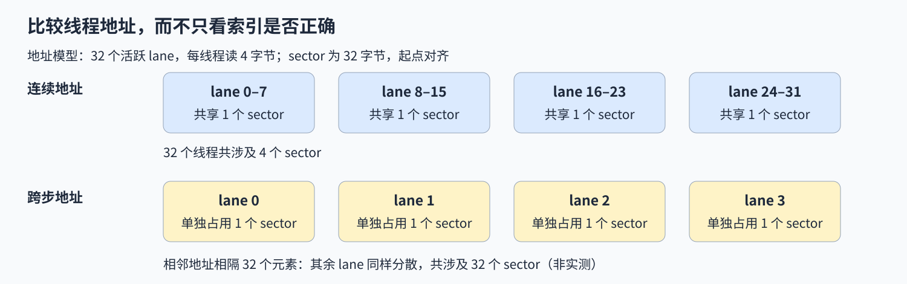

# 02. CUDA Global Memory Coalescing | CUDA 全局内存合并访问
**难度：** 进阶 | **环境：** [NVIDIA GPU 必需](#runtime-environment) | **标签：** `CUDA C++`、`全局内存`、`线程映射` | **目标人群：** 理解 CUDA 线程索引、希望分析线程访存地址的读者

> 🚀 **云端运行环境**
>
> 本章节的实战代码可以点击以下链接在免费 GPU 算力平台上直接运行：
>
> [](https://colab.research.google.com/github/datawhalechina/llm-algo-leetcode/blob/main/04_CUDA_and_System_Optimization/02_CUDA_Global_Memory_Coalescing.ipynb)
> [](https://modelscope.cn/my/mynotebook) *(国内推荐：魔搭社区免费实例)*


## 本节导读
一个 warp 的线程访问相邻地址，和访问相隔多个元素的地址，虽然都能得到正确结果，但内存事务并不相同。本节先比较两种地址映射，再实现连续拷贝 kernel；测试核对边界结果，不把正确性测试当作性能结论。

<a id="runtime-environment"></a>
## 运行环境

- **GPU练习：** 使用[算子优化环境](../topic_discussion/operator_optimization/quickstart.md#triton-environment)，运行[连续拷贝练习与测试](#mechanism-practice)；需要NVIDIA GPU和CUDA PyTorch。
- **工具链条件：** 本机CUDA Toolkit（`nvcc`）和兼容C++主机编译器。

## 前置阅读
先回顾线程索引，再看相邻线程的地址如何决定访存合并。

- [01. CUDA kernel 入门](./01_CUDA_Custom_Kernel_Intro.md)

## Step 1：同一个 warp 的地址怎样合并

NVIDIA GPU把32个线程组织为一个线程束（warp），束内编号称为lane；活跃线程是当前参与该指令的线程。一个 warp 的线程分别读一个 FP32 元素时，硬件需要覆盖这些线程请求的地址范围。连续访问让多个线程共享同一内存事务；跨较大步长访问则可能只使用每个事务中的少量字节。要分析访存，先写出 lane 对应的地址，再看这些地址落在哪些事务范围内。

sector是这里用于统计覆盖地址的32字节存储扇区；不是一个元素，也不等于一次完整的HBM读写。以 32 个活跃线程、每线程读取 4 字节、按 32 字节 sector 计数为例：起点对齐时，连续 32 个元素覆盖 128 字节，涉及 4 个 sector；整体偏移一个元素后跨到第 5 个 sector；若相邻线程相隔 32 个元素，则涉及 32 个 sector。这是给定访问模型下的地址推导，不是本页采集的硬件计数。



## Step 2：行列映射怎样改变地址间距

行优先矩阵的元素地址为 `row * cols + col`。固定行、让 lane 对应列时，相邻线程访问相邻元素；固定列、让 lane 对应行时，相邻地址相隔一整行。两种公式都可能算对结果，但形成的访存足迹不同，正确性测试不能区分它们的访存效率。


合并访存与向量化也不是同一个概念：前者比较多个线程的地址，后者让一条指令处理多个相邻元素。每线程读取 `float4` 需要满足对齐和边界条件；即使使用向量类型，线程间地址跨度很大时仍可能访问许多 sector。向量类型本身不能替代线程地址和边界的检查。


| 映射 | lane 地址（元素单位） | 需要核对的条件 |
| --- | --- | --- |
| 固定行、列递增 | `base + lane` | 行起点对齐、有效列数 |
| 固定列、行递增 | `base + lane * cols` | 行跨度、有效行数 |
## Step 3：连续访问仍需处理尾部

一维拷贝中，每个线程通过块起点与块内编号确定一个元素。以每块 256 个线程处理 257 个元素为例，第二块只有第一个线程对应有效输入，其余线程不得读取或写回。有效线程地址连续，并不能让越界线程自动安全。

比较连续与跨步访问时，还要固定有效数据量。正确拷贝说明元素映射和边界成立；若要判断哪种映射更高效，需要对同样的工作量测量耗时或访问事务。
<a id="mechanism-practice"></a>

## Step 4：实现连续索引与边界保护

补全连续拷贝 kernel，使每个有效线程复制一个元素，越界线程不访问输入或输出。

题目只填写 `build_cuda_source()` 中标出的 CUDA 表达式或语句，保留其余模板和启动代码。空缺值为 `None` 时，测试调用会在对应 TODO 处停止；填写后会编译实际源码并核对输出，不扫描注释判断完成状态。

| TODO / 函数 | 待实现的机制 | 必须满足的约束 | 测试证据 |
| --- | --- | --- | --- |
| TODO 1 / `build_cuda_source` → `copy_kernel` | 根据 block 和线程计算全局索引 | 相邻线程对应相邻元素 | 与输入逐元素比较 |
| TODO 2 / `build_cuda_source` → `copy_kernel` | 保护读写边界 | 仅 `index < size` 时访问数据 | 非 block 整除长度核对 |

```python
import torch
from functools import lru_cache
from string import Template
from torch.utils.cpp_extension import load_inline

```


```python
def build_cuda_source():
    """组装 CUDA 源码，空缺在实际测试调用时报告。"""
    # ==========================================
    # TODO 1：计算全局元素索引
    # 作用：相邻线程处理相邻元素，block 起点不能遗漏。
    # index_expression = r"""???"""
    # ==========================================
    index_expression = None
    if index_expression is None:
        raise NotImplementedError("TODO 1：请填写 index_expression")
    # ==========================================
    # TODO 2：判断读写是否有效
    # 作用：使用 index 和 size；判断同时保护读取与写回。
    # valid_expression = r"""???"""
    # ==========================================
    valid_expression = None
    if valid_expression is None:
        raise NotImplementedError("TODO 2：请填写 valid_expression")
    template = r'''
#include <torch/extension.h>
#include <cuda_runtime.h>
#include <ATen/cuda/CUDAContext.h>
#include <c10/cuda/CUDAException.h>
#include <c10/cuda/CUDAGuard.h>

__global__ void copy_kernel(const float* input, float* output, int size) {
    int index = $index_expression;
    if ($valid_expression) {
        output[index] = input[index];
    }
}

torch::Tensor copy_cuda(torch::Tensor input) {
    c10::cuda::CUDAGuard guard(input.device());
    auto output = torch::empty_like(input);
    constexpr int threads = 256;
    int blocks = (input.numel() + threads - 1) / threads;
    copy_kernel<<<blocks, threads, 0, at::cuda::getCurrentCUDAStream()>>>(input.data_ptr<float>(), output.data_ptr<float>(), input.numel());
    C10_CUDA_KERNEL_LAUNCH_CHECK();
    return output;
}
'''
    return Template(template).substitute(
        index_expression=index_expression,
        valid_expression=valid_expression,
    )


@lru_cache(maxsize=1)
def compile_cuda_source(source):
    """按完整源码缓存扩展，不检查源码中的 TODO 注释。"""
    return load_inline(
        name='tutorial_coalesced_copy_v2',
        cpp_sources='torch::Tensor copy_cuda(torch::Tensor input);',
        cuda_sources=source,
        functions=['copy_cuda'],
        with_cuda=True,
        extra_cflags=['-O3'],
        extra_cuda_cflags=['-O3'],
    )


def copy_cuda(x):
    """连续复制一维 FP32 CUDA 输入。"""
    if not x.is_cuda or x.ndim != 1 or x.dtype != torch.float32 or not x.is_contiguous() or x.numel() == 0:
        raise ValueError("本节要求连续、非空的一维 float32 CUDA 输入")
    extension = compile_cuda_source(build_cuda_source())
    return extension.copy_cuda(x)

```

## 正确性测试


```python
def test_coalesced_copy():
    """核对普通、整除、尾部输入及输出属性。"""
    if not torch.cuda.is_available():
        print("SKIPPED: 本节 CUDA 数值核对需要 NVIDIA GPU。")
        return {"status": "skipped", "reason": "cuda_unavailable"}
    torch.manual_seed(42)
    cases = (1, 255, 256, 257, 10003)
    for size in cases:
        x = torch.randn(size, device="cuda", dtype=torch.float32)
        actual = copy_cuda(x)
        expected = x
        torch.testing.assert_close(actual, expected, atol=0, rtol=0, msg=f"elements={size}")
        assert actual.shape == x.shape and actual.dtype == x.dtype and actual.device == x.device
    print({"status": "passed", "cases": len(cases), "device": torch.cuda.get_device_name(0)})
    return {"status": "passed", "cases": len(cases)}


test_coalesced_copy()

```

---
> 先完成题目区，再运行测试并查看参考实现。

## 参考代码与解析

### 代码


```python
def build_cuda_source():
    """组装 CUDA 源码，空缺在实际测试调用时报告。"""
    # ==========================================
    # TODO 1：计算全局元素索引
    # 作用：相邻线程处理相邻元素，block 起点不能遗漏。
    # index_expression = r"""???"""
    # ==========================================
    index_expression = "blockIdx.x * blockDim.x + threadIdx.x"
    if index_expression is None:
        raise NotImplementedError("TODO 1：请填写 index_expression")
    # ==========================================
    # TODO 2：判断读写是否有效
    # 作用：使用 index 和 size；判断同时保护读取与写回。
    # valid_expression = r"""???"""
    # ==========================================
    valid_expression = "index < size"
    if valid_expression is None:
        raise NotImplementedError("TODO 2：请填写 valid_expression")
    template = r'''
#include <torch/extension.h>
#include <cuda_runtime.h>
#include <ATen/cuda/CUDAContext.h>
#include <c10/cuda/CUDAException.h>
#include <c10/cuda/CUDAGuard.h>

__global__ void copy_kernel(const float* input, float* output, int size) {
    int index = $index_expression;
    if ($valid_expression) {
        output[index] = input[index];
    }
}

torch::Tensor copy_cuda(torch::Tensor input) {
    c10::cuda::CUDAGuard guard(input.device());
    auto output = torch::empty_like(input);
    constexpr int threads = 256;
    int blocks = (input.numel() + threads - 1) / threads;
    copy_kernel<<<blocks, threads, 0, at::cuda::getCurrentCUDAStream()>>>(input.data_ptr<float>(), output.data_ptr<float>(), input.numel());
    C10_CUDA_KERNEL_LAUNCH_CHECK();
    return output;
}
'''
    return Template(template).substitute(
        index_expression=index_expression,
        valid_expression=valid_expression,
    )


@lru_cache(maxsize=1)
def compile_cuda_source(source):
    """按完整源码缓存扩展，不检查源码中的 TODO 注释。"""
    return load_inline(
        name='tutorial_coalesced_copy_v2',
        cpp_sources='torch::Tensor copy_cuda(torch::Tensor input);',
        cuda_sources=source,
        functions=['copy_cuda'],
        with_cuda=True,
        extra_cflags=['-O3'],
        extra_cuda_cflags=['-O3'],
    )


def copy_cuda(x):
    """连续复制一维 FP32 CUDA 输入。"""
    if not x.is_cuda or x.ndim != 1 or x.dtype != torch.float32 or not x.is_contiguous() or x.numel() == 0:
        raise ValueError("本节要求连续、非空的一维 float32 CUDA 输入")
    extension = compile_cuda_source(build_cuda_source())
    return extension.copy_cuda(x)

```

### 解析

#### TODO 1：确定唯一的元素坐标

- 块起点加线程局部偏移，给每个线程一个全局元素位置；相邻线程由此访问连续标量地址，而不是让每个block都从输入开头复制。
- 10003元素的逐元素比较检查多个block是否覆盖自己的范围，可暴露只使用`threadIdx.x`的错误；数值结果不测实际访存事务。

#### TODO 2：在访问之前检查边界

- 有效条件同时保护读取和写回，无效线程不能先读取再决定是否输出。
- 255／256／257元素覆盖尾块与整块边界，单元素用例只允许一个线程访问；这些用例检查有效范围与输出内容，读取安全仍需结合条件所在位置审查。

## 相关阅读

继续核对地址如何形成事务，或转入块内复用同一批数据的问题。

- [CUDA Best Practices：合并访存](https://docs.nvidia.com/cuda/cuda-c-best-practices-guide/index.html#coalesced-access-to-global-memory)：连续、错位和跨步访问的事务模型。
- [06. CUDA 共享内存分块 GEMM](./06_CUDA_Shared_Memory_Optimization.md)：多个输出如何复用输入。
