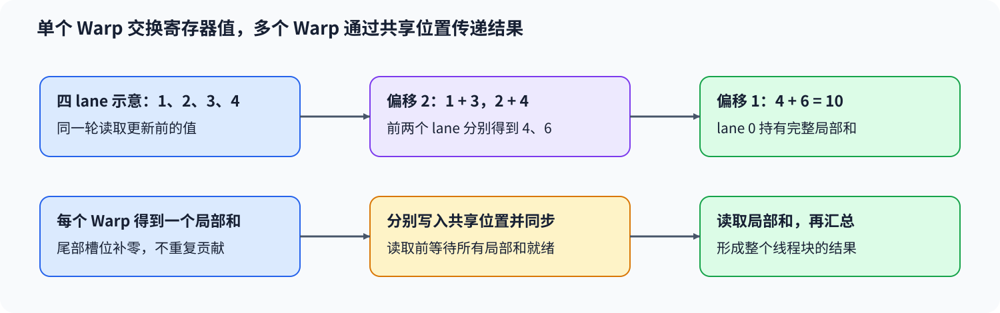
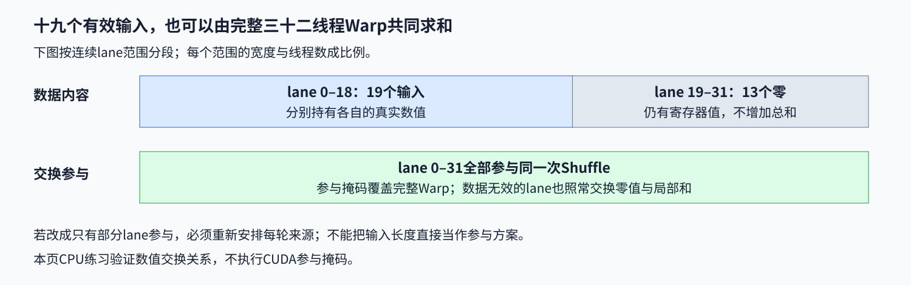

# 03. Warp Level Primitives | Warp 内归约与线程协作
**难度：** 进阶 | **环境：** [CPU 主线](#runtime-environment) | **标签：** `Warp`, `Shuffle`, `归约` | **目标人群：** 理解线程块索引、希望分析线程间数据交换

> 🚀 **云端运行环境**
>
> 本章节的实战代码可以点击以下链接在免费 GPU 算力平台上直接运行：
>
> [](https://colab.research.google.com/github/datawhalechina/llm-algo-leetcode/blob/main/04_CUDA_and_System_Optimization/03_Warp_Level_Primitives.ipynb)
> [](https://modelscope.cn/my/mynotebook) *(国内推荐：魔搭社区免费实例)*


## 本节导读

32 个线程各有一个数，最后的总和应放到哪里？让每个线程反复读取全部输入会重复做很多工作；树形归约则先交换和合并局部值，再逐步缩小参与范围。沿着单个 Warp 的局部和与多个 Warp 的汇总，可以看清尾部补零、参与线程和跨 Warp 传递分别保护什么。

**关键词：** lane、shuffle、归约、活跃线程

<a id="runtime-environment"></a>

## 运行环境

- **基础练习：** 使用[基础CPU环境](../guide.md#base-cpu)，运行[题目与测试](#mechanism-practice)。仅需Python标准库，核对列表中的归约数据流。

## 前置阅读

先区分线程块和 Warp 的协作范围，再跟踪局部值如何传给其他线程。

- [Part 01 · 16 Warp、Block 与共享内存](../01_Hardware_Math_and_Systems/16_Warp_Block_SharedMemory_Basics.md)

## Step 1：Warp 内归约如何交换局部值

Warp 是一组共同执行指令的线程，组内编号称为 lane；CUDA Warp 的宽度为 32。归约是把多个值按同一种运算合成一个结果，例如把各 lane 的 $x_l$ 合成 $S=\sum_{l=0}^{31}x_l$。Shuffle 让线程取得另一个 lane 的寄存器值，从而在 Warp 内交换局部结果。

用四个 lane 的数值 $[1,2,3,4]$ 缩小观察：先交换相隔 2 的值，前两个 lane 得到 4 和 6；再交换相隔 1 的局部和，lane 0 得到 10。每轮都读取该轮开始时的局部值，而不是依次读取已经被其他线程更新的值；完整 Warp 则使用 16、8、4、2、1 的偏移。



## Step 2：参与掩码与有效数据怎样配合

参与掩码指定哪些 lane 共同执行交换，它不同于输入有多少个有效元素。以 19 个数放入完整 Warp 为例，lane 0–18 持有输入，lane 19–31 可持有求和的中性值零；全部 32 个 lane 仍参与交换，尾部不会增加总和。

若实际只有部分线程参与，就必须按真实参与范围安排交换，不能从未参与的来源 lane 读取有效贡献。屏蔽最终写回无法修复此前已经混入归约的无效值。CPU 数组模型可以检验各轮的数据流，但不会执行设备参与掩码。



## Step 3：跨 Warp 归约为什么需要块级传递

一个线程块有 40 个有效输入时，可以先形成 32 个输入和 8 个输入的两份局部和。第一个 Warp 得到前 32 个数的和，第二个 Warp 为剩余位置补零后得到另一份局部和；只有把这两份结果合起来，才是整个线程块的结果。

真实块级实现可由各 Warp 写出一个共享内存局部和，等写入完成后，再由一个 Warp 读取并归约。写入前的数据不能提前消费，读取局部和时的无效位置仍要补零；Warp 内交换不能充当跨 Warp 屏障。

| 阶段 | 协作范围 | 数据位置 | 需要保持的条件 |
| --- | --- | --- | --- |
| 局部归约 | 单个 Warp | 寄存器 | 读取本轮开始时的值，补齐项为零 |
| 局部和传递 | 多个 Warp | 共享内存 | 各 Warp 写入不同位置，读取前等待就绪 |
| 汇总 | 一个 Warp | 局部和 | 每个局部和只计入一次 |

<a id="mechanism-practice"></a>

## Step 4：实现单轮交换并汇总多个Warp

先补全`shuffle_down_sum_step`的一轮交换，再完成`block_reduce_sum`的补齐和汇总。后者接收当前轮的完整lane值和偏移，返回同长度新列表；来源越界时保留当前值，不能修改输入。模拟宽度可取正的2的幂，真实CUDA Warp宽度不因此改变。

测试先逐值检查四lane的两轮结果，再检查完整两级归约。总和相同不代表每轮正确，测试还观察汇总函数是否把当前轮交给交换函数，以及传入的旧状态是否保持不变。

| TODO / 函数 | 待实现的机制 | 必须满足的约束 | 测试证据 |
| --- | --- | --- | --- |
| TODO 1：生成下一轮状态<br>`shuffle_down_sum_step` | 生成`next_lanes` | 各lane读取同一份旧状态，来源越界保留当前值 | 四lane两轮的全部元素、正负混合、不同偏移及旧列表不变 |
| TODO 2：切分并补齐局部值<br>`block_reduce_sum` | 生成`lanes` | 每份输入只进入一个Warp，末尾补零到模拟宽度 | 空输入、19／32／40元素、输入不变 |
| TODO 3：汇总局部结果<br>`block_reduce_sum` | 生成`total` | 每个Warp的局部和只累计一次 | 多Warp及不同宽度，实际交换调用和状态序列 |


```python
# 本节仅使用Python内置类型和运算，无额外导入。

```


```python
def shuffle_down_sum_step(lanes, offset):
    """模拟一轮向下交换与加法，返回新列表，不改变当前轮输入。"""
    width = len(lanes)
    if width == 0 or width & (width - 1):
        raise ValueError("lane列表长度须为正的2的幂")
    if (isinstance(offset, bool) or not isinstance(offset, int)
            or offset <= 0 or offset >= width or offset & (offset - 1)):
        raise ValueError("偏移须为小于宽度的正的2的幂")
    # TODO 1：形成所有lane的下一轮值。
    # next_lanes = ???  # 使用lanes、offset和width；始终从旧列表读，越界来源不贡献。
    next_lanes = None
    if next_lanes is None:
        raise NotImplementedError("请完成 TODO 1：next_lanes")
    return next_lanes


def block_reduce_sum(values, warp_width=32):
    """模拟局部归约树，再汇总各Warp的结果；空输入返回零。"""
    if (isinstance(warp_width, bool) or not isinstance(warp_width, int)
            or warp_width <= 0 or warp_width & (warp_width - 1)):
        raise ValueError("warp_width必须是正的2的幂整数")
    if not values:
        return 0
    partial_sums = []
    for start in range(0, len(values), warp_width):
        # TODO 2：切出当前Warp的输入，补齐到模拟宽度。
        # lanes = ???  # 使用values、start和warp_width，不更改调用方输入。
        lanes = None
        if lanes is None:
            raise NotImplementedError("请完成 TODO 2：lanes")
        offset = warp_width // 2
        while offset:
            lanes = shuffle_down_sum_step(lanes, offset)
            offset //= 2
        partial_sums.append(lanes[0])
    # TODO 3：每份局部和参与一次最终汇总。
    # total = ???  # 使用partial_sums，不重新遍历原始输入。
    total = None
    if total is None:
        raise NotImplementedError("请完成 TODO 3：total")
    return total

```

## 测试


```python
def test_block_reduce_sum():
    """核对归约总和、输入不变、尾部、多Warp和模拟宽度。"""
    cases = (
        ([], 32), ([1, 2, 3, 4], 4), ([3, -2, 7, -9, 5], 4),
        (list(range(19)), 32), (list(range(32)), 32),
        (list(range(40)), 32), ([0.25, -1.5, 2.0], 2), ([-3, 8, 2], 1),
    )
    for values, width in cases:
        before = values.copy()
        assert block_reduce_sum(values, width) == sum(values), (values, width)
        assert values == before
    for invalid_width in (0, -1, 3, True, 2.5):
        try:
            block_reduce_sum([1, 2], invalid_width)
        except ValueError:
            pass
        else:
            raise AssertionError("非法模拟宽度应被拒绝")


def test_shuffle_round_states():
    """逐lane核对每轮状态，拒绝只返回总和或覆盖旧列表的实现。"""
    cases = (
        ([1, 2, 3, 4], 2, [4, 6, 3, 4]),
        ([4, 6, 3, 4], 1, [10, 9, 7, 4]),
        ([3, -2, 7, -9], 2, [10, -11, 7, -9]),
        ([10, -11, 7, -9], 1, [-1, -4, -2, -9]),
        ([0.25, -1.5], 1, [-1.25, -1.5]),
        (list(range(8)), 4, [4, 6, 8, 10, 4, 5, 6, 7]),
    )
    for lanes, offset, expected in cases:
        before = lanes.copy()
        actual = shuffle_down_sum_step(lanes, offset)
        assert actual == expected, (lanes, offset, actual)
        assert actual is not lanes and lanes == before
    invalid = (([], 1), ([1, 2, 3], 1), ([1, 2, 3, 4], 0),
               ([1, 2, 3, 4], 4), ([1, 2, 3, 4], 3),
               ([1, 2, 3, 4], True), ([1, 2], 0.5))
    for lanes, offset in invalid:
        try:
            shuffle_down_sum_step(lanes, offset)
        except ValueError:
            pass
        else:
            raise AssertionError("非法轮次参数应被拒绝")


def test_reduction_uses_round_states():
    """观察真实归约路径中每轮输入，检查两个Warp分别重新开始。"""
    original_step = shuffle_down_sum_step
    observed = []

    def record_step(lanes, offset):
        before = list(lanes)
        result = original_step(lanes, offset)
        observed.append((before, offset, list(result)))
        return result

    globals()["shuffle_down_sum_step"] = record_step
    try:
        assert block_reduce_sum([1, 2, 3, 4, 5], 4) == 15
    finally:
        globals()["shuffle_down_sum_step"] = original_step
    assert observed == [
        ([1, 2, 3, 4], 2, [4, 6, 3, 4]),
        ([4, 6, 3, 4], 1, [10, 9, 7, 4]),
        ([5, 0, 0, 0], 2, [5, 0, 0, 0]),
        ([5, 0, 0, 0], 1, [5, 0, 0, 0]),
    ]


test_shuffle_round_states()
test_block_reduce_sum()
test_reduction_uses_round_states()
print("PASS: 8组归约、6组轮次状态、两Warp实际调用及参数约束通过。")

```

---

🛑 **STOP HERE** 🛑

先完成题目区，再查看参考实现。

## 参考代码与解析

### 代码


```python
def shuffle_down_sum_step(lanes, offset):
    """模拟一轮向下交换与加法，返回新列表，不改变当前轮输入。"""
    width = len(lanes)
    if width == 0 or width & (width - 1):
        raise ValueError("lane列表长度须为正的2的幂")
    if (isinstance(offset, bool) or not isinstance(offset, int)
            or offset <= 0 or offset >= width or offset & (offset - 1)):
        raise ValueError("偏移须为小于宽度的正的2的幂")
    # TODO 1：形成所有lane的下一轮值。
    # next_lanes = ???  # 使用lanes、offset和width；始终从旧列表读，越界来源不贡献。
    next_lanes = [lanes[lane] + lanes[lane + offset] if lane + offset < width
                  else lanes[lane] for lane in range(width)]
    if next_lanes is None:
        raise NotImplementedError("请完成 TODO 1：next_lanes")
    return next_lanes


def block_reduce_sum(values, warp_width=32):
    """模拟局部归约树，再汇总各Warp的结果；空输入返回零。"""
    if (isinstance(warp_width, bool) or not isinstance(warp_width, int)
            or warp_width <= 0 or warp_width & (warp_width - 1)):
        raise ValueError("warp_width必须是正的2的幂整数")
    if not values:
        return 0
    partial_sums = []
    for start in range(0, len(values), warp_width):
        # TODO 2：切出当前Warp的输入，补齐到模拟宽度。
        # lanes = ???  # 使用values、start和warp_width，不更改调用方输入。
        lanes = list(values[start:start + warp_width]) + [0] * max(
            0, warp_width - len(values[start:start + warp_width]))
        if lanes is None:
            raise NotImplementedError("请完成 TODO 2：lanes")
        offset = warp_width // 2
        while offset:
            lanes = shuffle_down_sum_step(lanes, offset)
            offset //= 2
        partial_sums.append(lanes[0])
    # TODO 3：每份局部和参与一次最终汇总。
    # total = ???  # 使用partial_sums，不重新遍历原始输入。
    total = sum(partial_sums)
    if total is None:
        raise NotImplementedError("请完成 TODO 3：total")
    return total

```

### 解析

#### TODO 1：整轮都从旧状态读取

- 每个lane在来源有效时加上偏移位置的旧值，否则保留自身值，并将结果放入新列表。四lane的两轮状态应为[4,6,3,4]、[10,9,7,4]，而非只返回总和。
- 逐位置期望和旧列表不变检查共同约束读取与更新顺序；只核对最终和，会放过跳过轮次、直接求和的替代实现。

#### TODO 2：让每份输入有唯一归属，再补齐局部槽位

- 按起点切出一份局部输入，再补零到模拟宽度；零不改变加法归约，局部列表也不改写调用方输入。
- 19项配32槽位需补13个零，40项则分成32项和8项；尾部、多Warp及输入不变用例检查切片归属与补齐方式。

#### TODO 3：每个Warp只交出一份局部和

- 每份局部归约完成后取lane 0，将这些局部和各累计一次；下一份必须从自己的输入重新开始，不能继承上一份状态。
- 实际调用观察要求第二份从[5,0,0,0]开始，并检查全部轮次与最终和。这是CPU状态模型，不验证设备参与掩码、共享内存可见性或块级屏障。

## 相关阅读

把局部结果放进共享内存后，还要核对协作读写和可见性。

- [Part 04 · 06 共享内存 GEMM](./06_CUDA_Shared_Memory_Optimization.md)：加载、读取与覆盖之间的块级同步。
- [CUDA 12.8：Warp Shuffle](https://docs.nvidia.com/cuda/archive/12.8.1/cuda-c-programming-guide/index.html#warp-shuffle-functions)：核对参与掩码、来源lane与同步调用条件。
