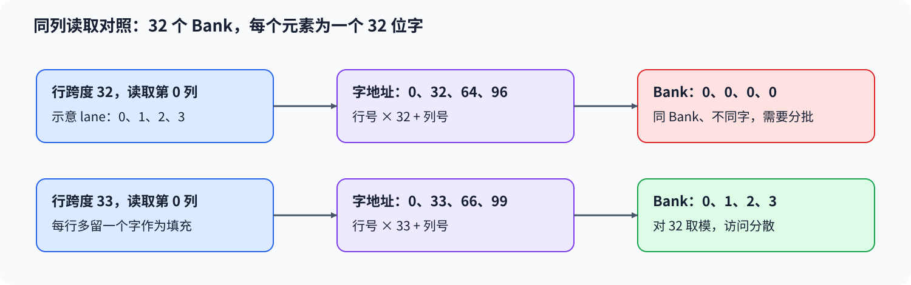

# 04. Bank Conflict Deep Dive | Bank 冲突与共享内存布局
**难度：** 进阶 | **环境：** [CPU 主线](#runtime-environment) | **标签：** `共享内存`, `地址映射`, `Bank Conflict` | **目标人群：** 理解 CUDA 线程块索引、希望分析共享内存访问布局

> 🚀 **云端运行环境**
>
> 本章节的实战代码可以点击以下链接在免费 GPU 算力平台上直接运行：
>
> [](https://colab.research.google.com/github/datawhalechina/llm-algo-leetcode/blob/main/04_CUDA_and_System_Optimization/04_Bank_Conflict_Deep_Dive.ipynb)
> [](https://modelscope.cn/my/mynotebook) *(国内推荐：魔搭社区免费实例)*


## 本节导读

相邻线程读取共享数组的一行，和读取它的一列，都可能得到正确数值，却不一定能同样高效地并行访问。问题不只在数组大小，还在每个线程的地址落入了哪个存储分组。沿着行列位置、字地址和 bank 编号，可以解释为什么增加一列填充有时能分散冲突，以及为什么读取同一个字应单独考虑。

**关键词：** 共享内存、bank 映射、行跨度、padding
<a id="runtime-environment"></a>

## 运行环境

- **基础练习：** 使用[基础CPU环境](../guide.md#base-cpu)，运行[题目与测试](#mechanism-practice)。仅需Python标准库，按32位字地址模型判读访问分组。

## 前置阅读

先区分线程协作与共享内存的作用范围，再分析同一 Warp 的访问地址。

- [Part 01 · 16 Warp、Block 与共享内存](../01_Hardware_Math_and_Systems/16_Warp_Block_SharedMemory_Basics.md)
## Step 1：线程访问如何映射到 Bank

共享内存由多个可并行访问的存储分组组成，称为 Bank。以下使用 32 个 Bank、每个元素为 32 位字的地址模型；若字地址偏移为 $w$，则 Bank 编号为 $w\bmod32$。这里的偏移以字为单位，不是字节；一个 FP32 元素占一个字。

行优先数组中，第 $r$ 行、第 $c$ 列的字地址为 $rR+c$，$R$ 为相邻行起点相隔的字数。先由 lane 确定行列，再由字地址确定 Bank，不能只根据二维数组的形状判断冲突。


## Step 2：同一 Bank 为什么不一定都是冲突

行跨度为 32 时，lane $l$ 读取第 $l$ 行第 0 列，字地址为 $32l$，Bank 编号都为零。不同线程请求同一 Bank 中的不同字，需要分批处理。反过来，固定第 0 行、让 lane 对应列，地址 0–31 分散到全部 32 个 Bank。

多个 lane 读取同一个字则可以广播，例如都读取第 0 行第 0 列。这与上面的“同 Bank、不同字”不是一回事；只统计 Bank 编号相同的次数，无法区分两种情况。广播也不能说明多个线程写同一地址是安全的。
## Step 3：多留一列怎样改变同列访问

行跨度从 32 改成 33 后，同样读取第 $l$ 行第 2 列，字地址变成 $33l+2$，Bank 编号为 $(l+2)\bmod32$。相邻 lane 的 Bank 编号依次推进，原先集中在同一 Bank 的同列访问因而分散。

这需要为每行多保留一个字，并让加载和消费使用一致的行跨度。若原先访问已经分散，增加填充可能只增加存储需求；对其他元素宽度和指令访问模式，也不能直接照搬这个标量模型。判读时，应在每个Bank内继续按字地址分组：同一字被多个lane读取形成广播组，不同字仍是不同请求。布局是否值得采用，最终还要结合完整内核的资源与耗时。

<a id="mechanism-practice"></a>

## Step 4：从地址映射区分广播与不同字请求

补全地址换算、Bank编号及Bank内分组四个机制点。输入检查与分组骨架已给出，每个元素按一个32位字计算；`bank_ids_for_indices`保留逐lane编号，`analyze_bank_accesses`返回按Bank排序的字地址、lane组和访问类别。类别描述给定标量模型，不是设备冲突计数。

测试同时检查连续行、同列、padding、同字广播及同Bank中多个广播组。后两者可能有完全相同的Bank编号，必须继续比较字地址；只统计lane数量或重复编号不能完成判读。

| TODO / 函数 | 待实现的机制 | 必须满足的约束 | 测试证据 |
| --- | --- | --- | --- |
| TODO 1：计算字地址<br>`bank_ids_for_indices` | 生成`word_offsets` | 以字为单位使用真实行跨度 | 普通、填充与非默认Bank数 |
| TODO 2：映射Bank编号<br>`bank_ids_for_indices` | 生成`bank_ids` | 按Bank数循环映射，保留lane顺序 | 连续、同列与空输入 |
| TODO 3：按字地址归并lane<br>`analyze_bank_accesses` | 生成`word_lanes` | 同字lane合组，不把同Bank不同字合并 | 同字广播、混合广播组与输入顺序 |
| TODO 4：判读访问类别<br>`analyze_bank_accesses` | 生成`access_kind` | 区分单lane、同字广播和多个不同字 | 相同Bank列表却不同类别，改变Bank数与空输入 |


```python
# 本节仅使用Python内置容器和运算，无额外导入。

```


```python
def bank_ids_for_indices(rows, cols, row_stride, bank_count=32):
    """按32位字模型返回各lane的Bank编号，不据此推断硬件冲突次数。"""
    if len(rows) != len(cols):
        raise ValueError("rows和cols长度必须相同")
    if any(isinstance(value, bool) or not isinstance(value, int) or value <= 0
           for value in (row_stride, bank_count)):
        raise ValueError("行跨度与Bank数必须为正整数")
    if any(isinstance(index, bool) or not isinstance(index, int) or index < 0
           for index in (*rows, *cols)):
        raise ValueError("行列坐标必须是非负整数")
    if any(col >= row_stride for col in cols):
        raise ValueError("列坐标必须小于行跨度")
    # TODO 1：由行列位置计算字地址。
    # word_offsets = ???  # 使用rows、cols和row_stride，每行起点相隔row_stride个字。
    word_offsets = None
    if word_offsets is None:
        raise NotImplementedError("请完成 TODO 1：word_offsets")
    # TODO 2：将字地址映射到Bank编号。
    # bank_ids = ???  # 使用word_offsets和bank_count，不用行跨度代替Bank数。
    bank_ids = None
    if bank_ids is None:
        raise NotImplementedError("请完成 TODO 2：bank_ids")
    return bank_ids


def analyze_bank_accesses(rows, cols, row_stride, bank_count=32):
    """返回按Bank排序的标量读请求分组，组内字地址及lane均按升序。

    kind取single_lane、broadcast或multiple_words，分别描述单lane、
    同字广播、同Bank内多个不同字；不换算真实事务数、串行次数或耗时。
    """
    bank_ids = bank_ids_for_indices(rows, cols, row_stride, bank_count)
    bank_rows = {}
    for lane, (row, col, bank) in enumerate(zip(rows, cols, bank_ids)):
        bank_rows.setdefault(bank, []).append((lane, row * row_stride + col))
    result = []
    for bank, requests in sorted(bank_rows.items()):
        # TODO 3：每个字地址对应实际请求它的lane组。
        # word_lanes = ???  # 使用requests中的(lane, word)，每个lane只归入自己的字地址。
        word_lanes = None
        if word_lanes is None:
            raise NotImplementedError("请完成 TODO 3：word_lanes")
        # TODO 4：根据不同字数和请求lane数判断类别。
        # access_kind = ???  # 使用word_lanes与requests；类别定义见函数说明。
        access_kind = None
        if access_kind is None:
            raise NotImplementedError("请完成 TODO 4：access_kind")
        words = tuple(sorted(word_lanes))
        lane_groups = tuple(tuple(word_lanes[word]) for word in words)
        result.append({"bank": bank, "words": words, "lane_groups": lane_groups,
                       "broadcast_groups": tuple(group for group in lane_groups if len(group) > 1),
                       "kind": access_kind})
    return result

```

## 测试

```python
def test_bank_ids_for_indices():
    """核对普通、填充、广播、空输入与非法地址参数。"""
    lanes = list(range(32))
    assert bank_ids_for_indices(lanes, [0] * 32, 32) == [0] * 32
    assert bank_ids_for_indices([0] * 32, lanes, 32) == lanes
    assert bank_ids_for_indices(lanes, [2] * 32, 33) == [(lane + 2) % 32 for lane in lanes]
    assert bank_ids_for_indices([0] * 32, [0] * 32, 32) == [0] * 32
    assert bank_ids_for_indices([0, 1, 2], [1, 2, 0], 5, 8) == [1, 7, 2]
    assert bank_ids_for_indices([], [], 32) == []
    rows, cols = [1, 2], [2, 1]
    bank_ids_for_indices(rows, cols, 4)
    assert rows == [1, 2] and cols == [2, 1]
    invalid = (([0], [], 32, 32), ([0], [0], 0, 32),
               ([0], [0], 32, 0), ([0], [32], 32, 32),
               ([-1], [0], 32, 32), ([0.5], [0], 32, 32),
               ([0], [0], True, 32), ([0], [0], 32, 2.5))
    for args in invalid:
        try:
            bank_ids_for_indices(*args)
        except ValueError:
            pass
        else:
            raise AssertionError(f"非法参数应被拒绝：{args}")


def test_bank_address_groups():
    """用同Bank不同字、同字广播及混合广播组检查模型判读。"""
    lanes = list(range(32))
    column = analyze_bank_accesses(lanes, [0] * 32, 32)
    broadcast = analyze_bank_accesses([0] * 32, [0] * 32, 32)
    assert bank_ids_for_indices(lanes, [0] * 32, 32) == bank_ids_for_indices([0] * 32, [0] * 32, 32)
    assert column == [{"bank": 0, "words": tuple(32 * lane for lane in lanes),
                       "lane_groups": tuple((lane,) for lane in lanes),
                       "broadcast_groups": (), "kind": "multiple_words"}]
    assert broadcast == [{"bank": 0, "words": (0,), "lane_groups": (tuple(lanes),),
                          "broadcast_groups": (tuple(lanes),), "kind": "broadcast"}]
    row = analyze_bank_accesses([0] * 32, lanes, 32)
    assert row == [{"bank": lane, "words": (lane,), "lane_groups": ((lane,),),
                    "broadcast_groups": (), "kind": "single_lane"} for lane in lanes]
    padded = analyze_bank_accesses(lanes, [2] * 32, 33)
    assert all(entry["kind"] == "single_lane" for entry in padded)
    assert [entry["bank"] for entry in padded] == lanes
    for entry in padded:
        lane = (entry["bank"] - 2) % 32
        assert entry["words"] == (33 * lane + 2,)
        assert entry["lane_groups"] == ((lane,),)
    rows, cols = [0, 0, 1, 1], [0, 0, 0, 0]
    mixed = analyze_bank_accesses(rows, cols, 32)
    assert mixed == [{"bank": 0, "words": (0, 32), "lane_groups": ((0, 1), (2, 3)),
                      "broadcast_groups": ((0, 1), (2, 3)), "kind": "multiple_words"}]
    assert rows == [0, 0, 1, 1] and cols == [0, 0, 0, 0]
    nondefault = analyze_bank_accesses([0, 1, 2], [1, 2, 0], 5, 8)
    assert nondefault == [
        {"bank": 1, "words": (1,), "lane_groups": ((0,),), "broadcast_groups": (), "kind": "single_lane"},
        {"bank": 2, "words": (10,), "lane_groups": ((2,),), "broadcast_groups": (), "kind": "single_lane"},
        {"bank": 7, "words": (7,), "lane_groups": ((1,),), "broadcast_groups": (), "kind": "single_lane"},
    ]
    assert analyze_bank_accesses([], [], 32) == []
    try:
        analyze_bank_accesses([0], [32], 32)
    except ValueError:
        pass
    else:
        raise AssertionError("分组入口不能绕过地址检查")


test_bank_ids_for_indices()
test_bank_address_groups()
print("PASS: 地址映射、7组Bank分组／广播判读及参数约束通过。")

```

---

🛑 **STOP HERE** 🛑

先完成题目区，再查看参考实现。
## 参考代码与解析

### 代码

```python
def bank_ids_for_indices(rows, cols, row_stride, bank_count=32):
    """按32位字模型返回各lane的Bank编号，不据此推断硬件冲突次数。"""
    if len(rows) != len(cols):
        raise ValueError("rows和cols长度必须相同")
    if any(isinstance(value, bool) or not isinstance(value, int) or value <= 0
           for value in (row_stride, bank_count)):
        raise ValueError("行跨度与Bank数必须为正整数")
    if any(isinstance(index, bool) or not isinstance(index, int) or index < 0
           for index in (*rows, *cols)):
        raise ValueError("行列坐标必须是非负整数")
    if any(col >= row_stride for col in cols):
        raise ValueError("列坐标必须小于行跨度")
    # TODO 1：由行列位置计算字地址。
    # word_offsets = ???  # 使用rows、cols和row_stride，每行起点相隔row_stride个字。
    word_offsets = [row * row_stride + col for row, col in zip(rows, cols)]
    if word_offsets is None:
        raise NotImplementedError("请完成 TODO 1：word_offsets")
    # TODO 2：将字地址映射到Bank编号。
    # bank_ids = ???  # 使用word_offsets和bank_count，不用行跨度代替Bank数。
    bank_ids = [offset % bank_count for offset in word_offsets]
    if bank_ids is None:
        raise NotImplementedError("请完成 TODO 2：bank_ids")
    return bank_ids


def analyze_bank_accesses(rows, cols, row_stride, bank_count=32):
    """返回按Bank排序的标量读请求分组，组内字地址及lane均按升序。

    kind取single_lane、broadcast或multiple_words，分别描述单lane、
    同字广播、同Bank内多个不同字；不换算真实事务数、串行次数或耗时。
    """
    bank_ids = bank_ids_for_indices(rows, cols, row_stride, bank_count)
    bank_rows = {}
    for lane, (row, col, bank) in enumerate(zip(rows, cols, bank_ids)):
        bank_rows.setdefault(bank, []).append((lane, row * row_stride + col))
    result = []
    for bank, requests in sorted(bank_rows.items()):
        # TODO 3：每个字地址对应实际请求它的lane组。
        # word_lanes = ???  # 使用requests中的(lane, word)，每个lane只归入自己的字地址。
        word_lanes = {word: tuple(lane for lane, candidate in requests if candidate == word)
                      for word in sorted({word for _, word in requests})}
        if word_lanes is None:
            raise NotImplementedError("请完成 TODO 3：word_lanes")
        # TODO 4：根据不同字数和请求lane数判断类别。
        # access_kind = ???  # 使用word_lanes与requests；类别定义见函数说明。
        access_kind = ("multiple_words" if len(word_lanes) > 1
                       else "broadcast" if len(requests) > 1 else "single_lane")
        if access_kind is None:
            raise NotImplementedError("请完成 TODO 4：access_kind")
        words = tuple(sorted(word_lanes))
        lane_groups = tuple(tuple(word_lanes[word]) for word in words)
        result.append({"bank": bank, "words": words, "lane_groups": lane_groups,
                       "broadcast_groups": tuple(group for group in lane_groups if len(group) > 1),
                       "kind": access_kind})
    return result

```

### 解析

#### TODO 1：先计算字地址，再讨论Bank

- 行号乘实际行跨度，再加列号，得到以32位字为单位的地址。行跨度决定相邻两行相隔多远，与Bank数量不是同一个参数。
- 跨度33的填充用例检查行起点是否随跨度改变；跨度5、Bank数8的用例进一步区分这两个参数，防止都写死为32。

#### TODO 2：用Bank数映射每个字

- 字地址对Bank数取模，得到对应Bank编号，并保留原有lane顺序。这一步只定位Bank，尚不能区分同字广播与不同字请求。
- 连续行的编号分散，同列与同字广播却都可得到全零列表；两组相同编号说明后续仍须按字地址分组。空输入则应保留空结果。

#### TODO 3：同一个Bank中，继续区分字地址

- 在Bank内部以字地址为键归并lane，才能保留“同一个字被谁读取”的关系。不能直接把同Bank的所有lane合成一个广播组。
- 混合用例的四个lane分别读取字0、0、32、32，期望得到两个字组和各自的广播组；逐项比较检查字地址、lane归属与排序，而不只检查分组数量。

#### TODO 4：按不同字请求与lane数量判读

- 先看同Bank内是否有多个不同字；只有一个字时，再按请求lane数区分broadcast与single_lane。因此两个广播组仍应归为multiple_words。
- 同列与同字广播用例有相同Bank列表，却应得到不同类别；混合用例再检查局部广播不会覆盖整体的不同字请求。类别属于本题标量模型，不是设备事务或冲突计数。

## 相关阅读

将地址推导放回共享数据的加载与消费，再检查填充新增的资源需求。

- [Part 04 · 06 共享内存 GEMM](./06_CUDA_Shared_Memory_Optimization.md)：跨线程加载、复用和两处同步。
- [Part 04 · 05 线程块资源与驻留](./05_CUDA_Block_Resources_and_Residency.md)：额外共享内存怎样约束可驻留块数。
