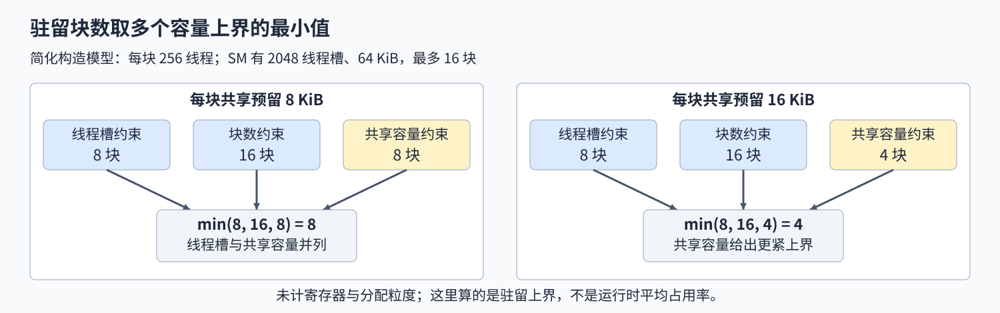

# 05. CUDA Block Resources and Residency | CUDA 线程块资源与驻留权衡

**难度：** 进阶 | **环境：** [NVIDIA GPU 必需](#runtime-environment) | **标签：** `CUDA`、`共享内存`、`驻留上界` | **目标人群：** 理解线程块和共享内存，准备分析 kernel 资源限制

> 🚀 **云端运行环境**
>
> 本章节的实战代码可以点击以下链接在免费 GPU 算力平台上直接运行：
>
> [](https://colab.research.google.com/github/datawhalechina/llm-algo-leetcode/blob/main/04_CUDA_and_System_Optimization/05_CUDA_Block_Resources_and_Residency.ipynb)
> [](https://modelscope.cn/my/mynotebook) *(国内推荐：魔搭社区免费实例)*


## 本节导读

GEMM 的子块增大后，输入复用更多，却不一定更快：每块同时需要的线程、寄存器和共享内存也可能增加，设备能容纳的并行任务随之变化。

要区分这些影响，可以先保持计算与线程数不变，仅改变每块预留的共享内存，再对照容量上界、CUDA 查询和耗时。这样可以理解“请求是否合法”“最多可驻留多少块”与“实际有多快”为什么是三个不同问题。

<a id="runtime-environment"></a>
## 运行环境

- **GPU练习：** 使用[算子优化环境](../topic_discussion/operator_optimization/quickstart.md#triton-environment)，运行[资源推导与CUDA查询](#mechanism-practice)。CPU可先核对资源公式；完整练习还需GPU读取设备与函数资源。
- **独立实验（可选）：** 运行[Step 5](#gpu-experiment)，环境与固定负载见[5.1](#gpu-experiment-setup)；读取记录仍需本页已有框架导入。
- **工具链条件：** NVIDIA GPU、CUDA PyTorch、本机CUDA Toolkit（`nvcc`）与兼容C++编译器。本页采用设备与函数的默认共享内存限额；opt-in指通过显式设置启用更大的每块额度，本页保持默认设置。

## 前置阅读

先理解线程块、warp 和共享内存容量，再推导每块资源；不要求先实现 GEMM。

- [01. CUDA kernel 入门](./01_CUDA_Custom_Kernel_Intro.md)：线程索引、线程块和边界。
- [Part01·16：Warp、Block 与共享内存](../01_Hardware_Math_and_Systems/16_Warp_Block_SharedMemory_Basics.md)：执行层级与片上存储。
## Step 1：相同计算，为什么会有不同驻留数量

流式多处理器（SM）在执行一个线程块（Block）前，需要为它分配线程／warp 槽位、寄存器和共享内存等资源。这些资源通常要占用到该 block 结束；尚未获得资源的 block 留在待调度网格中，而不是因为网格足够大就全部同时执行。增大每块需求，可能让同一个 SM 容纳更少的 block。 一线程一输出的 FP32 GEMM 中，16×16 子块需要 256 个线程和 2 KiB 两路输入缓存，32×32 则需要 1024 个线程和 8 KiB；计算分工和寄存器需求也随之变化，不能把两者的耗时差全部归因于驻留。

以每个有效线程计算 $y_i=1.5x_i+0.25$ 为例，每块线程数、代码和输入保持不变。启动时额外预留的动态共享内存不参与算术，只用于隔离“预留容量”对驻留的影响，因此不增加共享数据装载或同步工作。图中假设 SM 有 64 KiB 共享内存和 2048 个线程槽，不代表本机规格；真实分析时需读取目标设备容量。


## Step 2：怎样同时计算多个资源上界

每块有 $T$ 个线程，一个 warp 有 $W$ 个线程槽，需要 $W_b=\lceil T/W\rceil$ 个 warp，实际占用的线程槽按 $W_bW$ 计算。例如 33 个线程仍需要两个 32 槽的 warp，不能把两个未满的 block 合并成三个 warp。共享内存则先把静态字节和本次动态预留相加，得到每块用户需求 $S_b$。 设SM线程槽容量为 $T_{\mathrm{SM}}$、共享内存容量为 $S_{\mathrm{SM}}$、最多驻留 $B_{\max}$ 个block。先核对单块请求满足设备和已编译函数的启动限制，再取三项容量约束的最小值；当 $S_b=0$ 时忽略共享内存项，不做除零，也不将其当成零块上限。

$$
B_{\mathrm{upper}}=
\min\left(
\left\lfloor\frac{T_{\mathrm{SM}}}{W_bW}\right\rfloor,
B_{\max},
\left\lfloor\frac{S_{\mathrm{SM}}}{S_b}\right\rfloor
\right).
$$

以假设的2048个线程槽、64 KiB共享内存和最多16块为例，256线程／块给出8块的线程上界；每块8 KiB时，共享内存同样允许8块，两项并列；每块16 KiB时则只允许4块。该模型未计寄存器分配粒度、驱动预留共享空间等条件，所以只是简化上界；真实CUDA预测比它更小时，应继续从函数资源解释差距。



## Step 3：预测的驻留比例和实际速度有什么关系

CUDA occupancy 查询根据目标函数、块大小和动态共享内存，给出可驻留 block 数的预测；由它换算出的活跃 warp 比例仍是理论可驻留比例，不是运行时平均活跃 warp 的测量。还可读取函数的寄存器数、静态共享内存、本地内存大小和设备限制，但不把“寄存器数乘线程数”直接当作准确分配量，也不仅凭本地内存字段断言发生了寄存器溢出。

更多可运行 warp 可能帮助隐藏等待，但达到足够并行度后，也可能受带宽、指令吞吐或其他因素限制。固定计算与多轮计时可以检查这种取舍，而不是将驻留比例最高等同于速度最快。 换设备后，还需按[GPU架构与设备能力](../01_Hardware_Math_and_Systems/03_GPU_Architecture_and_Memory.md)重新核对支持的路径及资源，不能沿用另一型号的预算，或从SM数直接推断每次启动的块数。

| 结果 | 核对方式 | 可以回答什么 |
| --- | --- | --- |
| 简化驻留上界 | 线程／warp、块数、用户共享内存的整数约束 | 哪项在简化模型中最紧，是否并列 |
| CUDA 可驻留预测 | 对同一个已编译 kernel 调用 occupancy API | 结合实际函数资源后最多可驻留多少块 |
| GPU 耗时 | 独立的 CUDA event 重复窗口 | 固定负载下，预留变化是否伴随时间变化 |
| achieved occupancy | 需要运行时采集 | 不能由前两行补写为实测值 |
<a id="mechanism-practice"></a>

## Step 4：计算资源、筛查启动条件并推导驻留上界

补全三个 CPU 函数，并把它们用于真实 CUDA 查询。固定 kernel、扩展编译、设备读取和计时骨架均已给出。题目中的内存量全部以字节计，不能把 KiB 数直接送入容量公式。

GPU 部分固定每块 256 个线程，对默认限制内的多档共享内存预留检查结果。超限请求应在启动前拒绝；没有 GPU 时只登记 CPU 推导通过。


| TODO / 函数 | 待实现的机制 | 必须满足的约束 | 测试证据 |
| --- | --- | --- | --- |
| TODO 1 / `block_resources` | 计算 warp 数和每块共享字节 | warp 向上取整；静态和动态共享内存相加 | 33 线程、非零静态／动态需求及非法输入 |
| TODO 2 / `launch_admissible` | 同时核对设备和函数的单块上限 | 线程、动态共享量及共享总量均合法 | 恰好到界、函数线程超限和共享总量超限 |
| TODO 3 / `residency_upper_bound` | 合并各项上界并保留并列限制 | 取最小值；无共享需求时该项不限；不放行非法请求 | 线程、块数、共享内存分别主导及并列场景，再对照真实 CUDA 查询 |


```python
from datetime import datetime, timezone
import hashlib
from functools import lru_cache
import json
import math
from pathlib import Path
import statistics
import subprocess

import torch
from torch.utils.cpp_extension import CUDA_HOME, get_cxx_compiler, load_inline

from tools.project_runtime import resolve_project_root, save_json_record_once

```


```python
def block_resources(threads, static_bytes, dynamic_bytes, warp_size):
    """计算一个 block 的逻辑 warp 数与用户共享内存字节。"""
    for name, value in (("threads", threads), ("warp_size", warp_size)):
        if type(value) is not int or value <= 0:
            raise ValueError(f"{name} 必须是正整数")
    for name, value in (("static_bytes", static_bytes), ("dynamic_bytes", dynamic_bytes)):
        if type(value) is not int or value < 0:
            raise ValueError(f"{name} 必须是非负整数")
    # ==========================================
    # TODO 1：计算 warp 槽位和每块共享字节
    # 作用：部分 warp 仍占一个 warp，静态与动态共享内存同时存在。
    # warps = ???
    # shared_bytes = ???
    # ==========================================
    warps = None
    shared_bytes = None
    if warps is None or shared_bytes is None:
        raise NotImplementedError("TODO 1：请填写 warps 和 shared_bytes")
    return {
        "threads": threads, "warps": warps, "warp_size": warp_size,
        "thread_slots": warps * warp_size,
        "static_shared_bytes": static_bytes, "dynamic_shared_bytes": dynamic_bytes,
        "shared_bytes": shared_bytes,
    }


def launch_admissible(resources, info):
    """在当前设备和函数的默认共享内存配置下筛查单块请求。"""
    # ==========================================
    # TODO 2：同时核对设备上限与函数上限
    # 作用：不能只看 SM 总容量，也不能把函数的动态容量当总容量。
    # legal = ???  # 核对线程、动态共享字节、静态与动态共享字节之和。
    # ==========================================
    legal = None
    if legal is None:
        raise NotImplementedError("TODO 2：请填写 legal")
    return legal


def residency_upper_bound(resources, info):
    """给出仅含 warp/线程、块数和共享内存约束的驻留上界。"""
    if not launch_admissible(resources, info):
        return {
            "admitted": False, "blocks_upper_bound": 0, "warps_upper_bound": 0,
            "occupancy_upper_bound": 0.0, "resource_bounds": {},
            "limiting_resources": ["launch_constraints"],
        }
    # ==========================================
    # TODO 3：组合各项上界并保留并列限制
    # 作用：共同可行数量取最小值，无共享内存需求时该项不施加限制。
    # bounds = {"thread_slots": ???, "block_slots": ???, "shared_memory": ???}
    # blocks = ???
    # limiting = ???  # 收集所有达到最小值的资源名。
    # ==========================================
    bounds = None
    blocks = None
    limiting = None
    if bounds is None or blocks is None or limiting is None:
        raise NotImplementedError("TODO 3：请填写 bounds、blocks 和 limiting")
    max_warps = info["max_threads_per_sm"] // resources["warp_size"]
    return {
        "admitted": True, "blocks_upper_bound": blocks,
        "warps_upper_bound": blocks * resources["warps"],
        "occupancy_upper_bound": blocks * resources["warps"] / max_warps,
        "resource_bounds": bounds, "limiting_resources": limiting,
    }


CUDA_SOURCE = r'''
#include <torch/extension.h>
#include <cuda_runtime.h>
#include <ATen/cuda/CUDAContext.h>
#include <ATen/cuda/CUDAEvent.h>
#include <c10/cuda/CUDAException.h>
#include <c10/cuda/CUDAGuard.h>
#include <map>
#include <string>
#include <cstdint>

constexpr int THREADS = 256;

// 计算、线程配置和编译产物固定；动态共享内存只在启动参数中预留，不参与计算。
__global__ __launch_bounds__(THREADS) void residency_scale_kernel(
        const float* input, float* output, int64_t n) {
    int64_t index = static_cast<int64_t>(blockIdx.x) * THREADS + threadIdx.x;
    if (index < n) output[index] = input[index] * 1.5f + 0.25f;
}

void check_input(const torch::Tensor& input) {
    TORCH_CHECK(input.is_cuda(), "input must be CUDA");
    TORCH_CHECK(input.scalar_type() == torch::kFloat32, "input must be float32");
    TORCH_CHECK(input.is_contiguous() && input.dim() == 1 && input.numel() > 0,
                "input must be a nonempty contiguous vector");
}

std::map<std::string, int64_t> residency_info(torch::Tensor input) {
    check_input(input);
    c10::cuda::CUDAGuard guard(input.device());
    cudaDeviceProp prop{};
    cudaFuncAttributes attr{};
    C10_CUDA_CHECK(cudaGetDeviceProperties(&prop, input.get_device()));
    C10_CUDA_CHECK(cudaFuncGetAttributes(&attr, residency_scale_kernel));
    int runtime_version = 0;
    C10_CUDA_CHECK(cudaRuntimeGetVersion(&runtime_version));
    return {
        {"warp_size", prop.warpSize},
        {"max_threads_per_sm", prop.maxThreadsPerMultiProcessor},
        {"max_blocks_per_sm", prop.maxBlocksPerMultiProcessor},
        {"device_max_threads_per_block", prop.maxThreadsPerBlock},
        {"shared_bytes_per_sm", static_cast<int64_t>(prop.sharedMemPerMultiprocessor)},
        {"device_shared_bytes_per_block", static_cast<int64_t>(prop.sharedMemPerBlock)},
        {"reserved_shared_bytes_per_block", static_cast<int64_t>(prop.reservedSharedMemPerBlock)},
        {"registers_per_sm", prop.regsPerMultiprocessor},
        {"function_max_threads_per_block", attr.maxThreadsPerBlock},
        {"function_static_shared_bytes", static_cast<int64_t>(attr.sharedSizeBytes)},
        {"function_max_dynamic_shared_bytes", attr.maxDynamicSharedSizeBytes},
        {"registers_per_thread", attr.numRegs},
        {"local_bytes_per_thread", static_cast<int64_t>(attr.localSizeBytes)},
        {"binary_version", attr.binaryVersion},
        {"runtime_version", runtime_version},
        {"threads", THREADS},
    };
}

int64_t residency_query(torch::Tensor input, int64_t dynamic_bytes) {
    check_input(input);
    c10::cuda::CUDAGuard guard(input.device());
    auto info = residency_info(input);
    TORCH_CHECK(dynamic_bytes >= 0 &&
                dynamic_bytes <= info.at("function_max_dynamic_shared_bytes") &&
                dynamic_bytes + info.at("function_static_shared_bytes") <=
                    info.at("device_shared_bytes_per_block"),
                "dynamic shared-memory request exceeds the default launch limit");
    int blocks = 0;
    C10_CUDA_CHECK(cudaOccupancyMaxActiveBlocksPerMultiprocessor(
        &blocks, residency_scale_kernel, THREADS, static_cast<size_t>(dynamic_bytes)));
    return blocks;
}

torch::Tensor residency_run(torch::Tensor input, int64_t dynamic_bytes) {
    check_input(input);
    c10::cuda::CUDAGuard guard(input.device());
    // C++ 也检查请求，Python 题目判断错误不能导致非法启动。
    TORCH_CHECK(residency_query(input, dynamic_bytes) > 0, "no resident block predicted");
    auto output = torch::empty_like(input);
    const int blocks = static_cast<int>((input.numel() + THREADS - 1) / THREADS);
    residency_scale_kernel<<<blocks, THREADS, static_cast<size_t>(dynamic_bytes),
                             at::cuda::getCurrentCUDAStream()>>>(
        input.data_ptr<float>(), output.data_ptr<float>(), input.numel());
    C10_CUDA_KERNEL_LAUNCH_CHECK();
    return output;
}

double residency_measure(torch::Tensor input, int64_t dynamic_bytes,
                         int64_t iterations, int64_t warmup) {
    check_input(input);
    c10::cuda::CUDAGuard guard(input.device());
    TORCH_CHECK(iterations > 0 && warmup >= 0, "invalid measurement counts");
    TORCH_CHECK(residency_query(input, dynamic_bytes) > 0, "no resident block predicted");
    auto output = torch::empty_like(input);
    const int blocks = static_cast<int>((input.numel() + THREADS - 1) / THREADS);
    auto stream = at::cuda::getCurrentCUDAStream();
    for (int64_t i = 0; i < warmup; ++i) {
        residency_scale_kernel<<<blocks, THREADS, static_cast<size_t>(dynamic_bytes), stream>>>(
            input.data_ptr<float>(), output.data_ptr<float>(), input.numel());
    }
    C10_CUDA_KERNEL_LAUNCH_CHECK();
    c10::cuda::CUDAEvent start(cudaEventDefault), end(cudaEventDefault);
    start.record(stream);
    for (int64_t i = 0; i < iterations; ++i) {
        residency_scale_kernel<<<blocks, THREADS, static_cast<size_t>(dynamic_bytes), stream>>>(
            input.data_ptr<float>(), output.data_ptr<float>(), input.numel());
    }
    end.record(stream);
    C10_CUDA_KERNEL_LAUNCH_CHECK();
    end.synchronize();
    return start.elapsed_time(end) / iterations;
}
'''
CPP_SOURCE = r'''
#include <map>
#include <string>
#include <cstdint>
std::map<std::string, int64_t> residency_info(torch::Tensor input);
int64_t residency_query(torch::Tensor input, int64_t dynamic_bytes);
torch::Tensor residency_run(torch::Tensor input, int64_t dynamic_bytes);
double residency_measure(torch::Tensor input, int64_t dynamic_bytes, int64_t iterations, int64_t warmup);
'''


@lru_cache(maxsize=1)
def load_residency_extension():
    """延迟编译页内固定 kernel；不改变共享内存 opt-in 或寄存器选项。"""
    return load_inline(
        name="cuda_block_residency_v1", cpp_sources=CPP_SOURCE,
        cuda_sources=CUDA_SOURCE,
        functions=["residency_info", "residency_query", "residency_run", "residency_measure"],
        with_cuda=True, extra_cflags=["-O3"], extra_cuda_cflags=["-O3"],
    )


def inspect_request(x, dynamic_bytes):
    """将题目中的资源筛查和上界用于实际输入与占用查询。"""
    extension = load_residency_extension()
    info = extension.residency_info(x)
    resources = block_resources(
        info["threads"], info["function_static_shared_bytes"], dynamic_bytes, info["warp_size"]
    )
    model = residency_upper_bound(resources, info)
    if not model["admitted"]:
        raise ValueError("请求超过当前设备／函数的默认启动上限")
    api_blocks = extension.residency_query(x, dynamic_bytes)
    if not 0 < api_blocks <= model["blocks_upper_bound"]:
        raise AssertionError("CUDA 查询不在当前简化上界内，请复核模型和设备字段")
    max_warps = info["max_threads_per_sm"] // info["warp_size"]
    return {
        "dynamic_shared_bytes": dynamic_bytes,
        "resources": resources, "model": model,
        "cuda_blocks_per_sm": api_blocks,
        "cuda_theoretical_occupancy": api_blocks * resources["warps"] / max_warps,
    }


def reserved_scale(x, dynamic_bytes):
    """在同一 kernel 中计算 1.5*x+0.25，仅改变动态共享内存预留。"""
    record = inspect_request(x, dynamic_bytes)
    output = load_residency_extension().residency_run(x, dynamic_bytes)
    return output, record


def available_reservations(info):
    """选择默认配置内的代表性预留，不为了扩大实验调整 opt-in。"""
    cap = min(
        info["function_max_dynamic_shared_bytes"],
        info["device_shared_bytes_per_block"] - info["function_static_shared_bytes"],
    )
    requests = [value for value in (0, 8192, 16384, 32768, 49152) if value <= cap]
    if len(requests) < 3:
        raise RuntimeError("默认动态共享内存范围不足三档，请先核对设备与函数限制")
    return requests


def runtime_versions():
    """记录当前驱动、工具链和 Python 构建，不用支持版本冒充安装版本。"""
    if CUDA_HOME is None:
        raise RuntimeError("找不到 CUDA_HOME，请先检查本机工具链")
    return {
        "torch": torch.__version__, "torch_cuda": torch.version.cuda,
        "nvcc": subprocess.check_output(
            [str(Path(CUDA_HOME) / "bin" / "nvcc"), "--version"], text=True
        ).strip(),
        "cxx": subprocess.check_output([get_cxx_compiler(), "--version"], text=True).splitlines()[0],
        "driver_versions": sorted(set(subprocess.check_output(
            ["nvidia-smi", "--query-gpu=driver_version", "--format=csv,noheader"], text=True
        ).splitlines())),
    }

```

## 正确性与资源核对


```python
def synthetic_info():
    """提供不依赖设备的测试容量，所有内存单位均为字节。"""
    return {
        "warp_size": 32, "max_threads_per_sm": 2048, "max_blocks_per_sm": 16,
        "device_max_threads_per_block": 1024, "function_max_threads_per_block": 256,
        "shared_bytes_per_sm": 65536, "device_shared_bytes_per_block": 49152,
        "function_static_shared_bytes": 0, "function_max_dynamic_shared_bytes": 49152,
    }


def test_residency():
    """核对资源取整、合法性、上界和真实 CUDA 查询及输出。"""
    info = synthetic_info()
    r = block_resources(33, 4096, 8192, 32)
    assert r["warps"] == 2 and r["thread_slots"] == 64 and r["shared_bytes"] == 12288
    assert launch_admissible(r, info)
    zero = residency_upper_bound(block_resources(256, 0, 0, 32), info)
    assert zero["blocks_upper_bound"] == 8 and zero["resource_bounds"]["shared_memory"] is None
    assert zero["limiting_resources"] == ["thread_slots"]
    tied = residency_upper_bound(block_resources(256, 0, 8192, 32), info)
    assert tied["blocks_upper_bound"] == 8
    assert tied["limiting_resources"] == ["shared_memory", "thread_slots"]
    assert residency_upper_bound(block_resources(256, 0, 16384, 32), info)["blocks_upper_bound"] == 4
    assert residency_upper_bound(block_resources(256, 4096, 8192, 32), info)["blocks_upper_bound"] == 5
    assert residency_upper_bound(block_resources(32, 0, 0, 32), info)["limiting_resources"] == ["block_slots"]

    # 暴露漏掉 warp 向上取整的错误。
    many_blocks = dict(info, max_blocks_per_sm=64)
    partial = residency_upper_bound(block_resources(33, 0, 0, 32), many_blocks)
    assert partial["blocks_upper_bound"] == 32 and partial["occupancy_upper_bound"] == 1.0
    assert launch_admissible(block_resources(256, 0, 49152, 32), info)
    for resources in (
        block_resources(257, 0, 0, 32),        # 未超过设备线程上限，却超过函数上限
        block_resources(256, 0, 49153, 32),   # 默认动态／每块共享内存超限
        block_resources(256, 4096, 49152, 32),# 动态合法，但总共享内存超限
    ):
        assert not launch_admissible(resources, info)
        rejected = residency_upper_bound(resources, info)
        assert not rejected["admitted"] and rejected["blocks_upper_bound"] == 0
    for args in ((0, 0, 0, 32), (256, -1, 0, 32), (256, 0, -1, 32), (256, 0, 0, 0)):
        try:
            block_resources(*args)
        except ValueError:
            pass
        else:
            raise AssertionError(f"未拒绝非法资源 {args}")
    print("PASS: CPU 资源、启动条件、并列限制及 warp 取整核对通过。")
    if not torch.cuda.is_available():
        print("SKIPPED: GPU 资源查询和输出核对需要 NVIDIA GPU 与 CUDA 工具链。")
        return {"status": "skipped", "cpu_model": "passed"}

    torch.manual_seed(31)
    extension = load_residency_extension()
    probe = torch.randn(1025, device="cuda", dtype=torch.float32)
    actual_info = extension.residency_info(probe)
    requests = available_reservations(actual_info)
    rows = []
    for dynamic_bytes in requests:
        before = extension.residency_info(probe)
        for size in (1, 256, 257, 1025):
            x = torch.randn(size, device="cuda", dtype=torch.float32)
            actual, record = reserved_scale(x, dynamic_bytes)
            expected = x * 1.5 + 0.25
            torch.testing.assert_close(actual, expected, atol=1e-6, rtol=1e-6)
            assert actual.shape == x.shape and actual.dtype == x.dtype and actual.device == x.device
        assert extension.residency_info(probe) == before == actual_info
        rows.append(record)
    assert all(
        left["cuda_blocks_per_sm"] >= right["cuda_blocks_per_sm"]
        for left, right in zip(rows, rows[1:])
    )
    cap = min(
        actual_info["function_max_dynamic_shared_bytes"],
        actual_info["device_shared_bytes_per_block"] - actual_info["function_static_shared_bytes"],
    )
    try:
        reserved_scale(probe, cap + 1)
    except ValueError:
        pass
    else:
        raise AssertionError("超限请求应在实际启动前拒绝")
    report = {
        "status": "passed", "evidence_scope": "resource_bounds_and_cuda_query",
        "device": torch.cuda.get_device_name(0), "versions": runtime_versions(),
        "cuda_resource_info": actual_info, "cases_per_reservation": 4,
        "rows": rows, "achieved_occupancy": None,
    }
    print(json.dumps(report, ensure_ascii=False, indent=2))
    return report


test_residency()

```

---
> 先完成题目区并运行测试，再查看参考实现。

## 参考代码与解析

### 代码


```python
def block_resources(threads, static_bytes, dynamic_bytes, warp_size):
    """计算一个 block 的逻辑 warp 数与用户共享内存字节。"""
    for name, value in (("threads", threads), ("warp_size", warp_size)):
        if type(value) is not int or value <= 0:
            raise ValueError(f"{name} 必须是正整数")
    for name, value in (("static_bytes", static_bytes), ("dynamic_bytes", dynamic_bytes)):
        if type(value) is not int or value < 0:
            raise ValueError(f"{name} 必须是非负整数")
    # ==========================================
    # TODO 1：计算 warp 槽位和每块共享字节
    # 作用：部分 warp 仍占一个 warp，静态与动态共享内存同时存在。
    # warps = ???
    # shared_bytes = ???
    # ==========================================
    warps = (threads + warp_size - 1) // warp_size
    shared_bytes = static_bytes + dynamic_bytes
    if warps is None or shared_bytes is None:
        raise NotImplementedError("TODO 1：请填写 warps 和 shared_bytes")
    return {
        "threads": threads, "warps": warps, "warp_size": warp_size,
        "thread_slots": warps * warp_size,
        "static_shared_bytes": static_bytes, "dynamic_shared_bytes": dynamic_bytes,
        "shared_bytes": shared_bytes,
    }


def launch_admissible(resources, info):
    """在当前设备和函数的默认共享内存配置下筛查单块请求。"""
    # ==========================================
    # TODO 2：同时核对设备上限与函数上限
    # 作用：不能只看 SM 总容量，也不能把函数的动态容量当总容量。
    # legal = ???  # 核对线程、动态共享字节、静态与动态共享字节之和。
    # ==========================================
    legal = (
        resources["threads"] <= info["device_max_threads_per_block"]
        and resources["threads"] <= info["function_max_threads_per_block"]
        and resources["dynamic_shared_bytes"] <= info["function_max_dynamic_shared_bytes"]
        and resources["shared_bytes"] <= info["device_shared_bytes_per_block"]
    )
    if legal is None:
        raise NotImplementedError("TODO 2：请填写 legal")
    return legal


def residency_upper_bound(resources, info):
    """给出仅含 warp/线程、块数和共享内存约束的驻留上界。"""
    if not launch_admissible(resources, info):
        return {
            "admitted": False, "blocks_upper_bound": 0, "warps_upper_bound": 0,
            "occupancy_upper_bound": 0.0, "resource_bounds": {},
            "limiting_resources": ["launch_constraints"],
        }
    # ==========================================
    # TODO 3：组合各项上界并保留并列限制
    # 作用：共同可行数量取最小值，无共享内存需求时该项不施加限制。
    # bounds = {"thread_slots": ???, "block_slots": ???, "shared_memory": ???}
    # blocks = ???
    # limiting = ???  # 收集所有达到最小值的资源名。
    # ==========================================
    bounds = {
        "thread_slots": info["max_threads_per_sm"] // resources["thread_slots"],
        "block_slots": info["max_blocks_per_sm"],
        "shared_memory": (
            info["shared_bytes_per_sm"] // resources["shared_bytes"]
            if resources["shared_bytes"] else None
        ),
    }
    blocks = min(value for value in bounds.values() if value is not None)
    limiting = sorted(name for name, value in bounds.items() if value is not None and value == blocks)
    if bounds is None or blocks is None or limiting is None:
        raise NotImplementedError("TODO 3：请填写 bounds、blocks 和 limiting")
    max_warps = info["max_threads_per_sm"] // resources["warp_size"]
    return {
        "admitted": True, "blocks_upper_bound": blocks,
        "warps_upper_bound": blocks * resources["warps"],
        "occupancy_upper_bound": blocks * resources["warps"] / max_warps,
        "resource_bounds": bounds, "limiting_resources": limiting,
    }


CUDA_SOURCE = r'''
#include <torch/extension.h>
#include <cuda_runtime.h>
#include <ATen/cuda/CUDAContext.h>
#include <ATen/cuda/CUDAEvent.h>
#include <c10/cuda/CUDAException.h>
#include <c10/cuda/CUDAGuard.h>
#include <map>
#include <string>
#include <cstdint>

constexpr int THREADS = 256;

// 计算、线程配置和编译产物固定；动态共享内存只在启动参数中预留，不参与计算。
__global__ __launch_bounds__(THREADS) void residency_scale_kernel(
        const float* input, float* output, int64_t n) {
    int64_t index = static_cast<int64_t>(blockIdx.x) * THREADS + threadIdx.x;
    if (index < n) output[index] = input[index] * 1.5f + 0.25f;
}

void check_input(const torch::Tensor& input) {
    TORCH_CHECK(input.is_cuda(), "input must be CUDA");
    TORCH_CHECK(input.scalar_type() == torch::kFloat32, "input must be float32");
    TORCH_CHECK(input.is_contiguous() && input.dim() == 1 && input.numel() > 0,
                "input must be a nonempty contiguous vector");
}

std::map<std::string, int64_t> residency_info(torch::Tensor input) {
    check_input(input);
    c10::cuda::CUDAGuard guard(input.device());
    cudaDeviceProp prop{};
    cudaFuncAttributes attr{};
    C10_CUDA_CHECK(cudaGetDeviceProperties(&prop, input.get_device()));
    C10_CUDA_CHECK(cudaFuncGetAttributes(&attr, residency_scale_kernel));
    int runtime_version = 0;
    C10_CUDA_CHECK(cudaRuntimeGetVersion(&runtime_version));
    return {
        {"warp_size", prop.warpSize},
        {"max_threads_per_sm", prop.maxThreadsPerMultiProcessor},
        {"max_blocks_per_sm", prop.maxBlocksPerMultiProcessor},
        {"device_max_threads_per_block", prop.maxThreadsPerBlock},
        {"shared_bytes_per_sm", static_cast<int64_t>(prop.sharedMemPerMultiprocessor)},
        {"device_shared_bytes_per_block", static_cast<int64_t>(prop.sharedMemPerBlock)},
        {"reserved_shared_bytes_per_block", static_cast<int64_t>(prop.reservedSharedMemPerBlock)},
        {"registers_per_sm", prop.regsPerMultiprocessor},
        {"function_max_threads_per_block", attr.maxThreadsPerBlock},
        {"function_static_shared_bytes", static_cast<int64_t>(attr.sharedSizeBytes)},
        {"function_max_dynamic_shared_bytes", attr.maxDynamicSharedSizeBytes},
        {"registers_per_thread", attr.numRegs},
        {"local_bytes_per_thread", static_cast<int64_t>(attr.localSizeBytes)},
        {"binary_version", attr.binaryVersion},
        {"runtime_version", runtime_version},
        {"threads", THREADS},
    };
}

int64_t residency_query(torch::Tensor input, int64_t dynamic_bytes) {
    check_input(input);
    c10::cuda::CUDAGuard guard(input.device());
    auto info = residency_info(input);
    TORCH_CHECK(dynamic_bytes >= 0 &&
                dynamic_bytes <= info.at("function_max_dynamic_shared_bytes") &&
                dynamic_bytes + info.at("function_static_shared_bytes") <=
                    info.at("device_shared_bytes_per_block"),
                "dynamic shared-memory request exceeds the default launch limit");
    int blocks = 0;
    C10_CUDA_CHECK(cudaOccupancyMaxActiveBlocksPerMultiprocessor(
        &blocks, residency_scale_kernel, THREADS, static_cast<size_t>(dynamic_bytes)));
    return blocks;
}

torch::Tensor residency_run(torch::Tensor input, int64_t dynamic_bytes) {
    check_input(input);
    c10::cuda::CUDAGuard guard(input.device());
    // C++ 也检查请求，Python 题目判断错误不能导致非法启动。
    TORCH_CHECK(residency_query(input, dynamic_bytes) > 0, "no resident block predicted");
    auto output = torch::empty_like(input);
    const int blocks = static_cast<int>((input.numel() + THREADS - 1) / THREADS);
    residency_scale_kernel<<<blocks, THREADS, static_cast<size_t>(dynamic_bytes),
                             at::cuda::getCurrentCUDAStream()>>>(
        input.data_ptr<float>(), output.data_ptr<float>(), input.numel());
    C10_CUDA_KERNEL_LAUNCH_CHECK();
    return output;
}

double residency_measure(torch::Tensor input, int64_t dynamic_bytes,
                         int64_t iterations, int64_t warmup) {
    check_input(input);
    c10::cuda::CUDAGuard guard(input.device());
    TORCH_CHECK(iterations > 0 && warmup >= 0, "invalid measurement counts");
    TORCH_CHECK(residency_query(input, dynamic_bytes) > 0, "no resident block predicted");
    auto output = torch::empty_like(input);
    const int blocks = static_cast<int>((input.numel() + THREADS - 1) / THREADS);
    auto stream = at::cuda::getCurrentCUDAStream();
    for (int64_t i = 0; i < warmup; ++i) {
        residency_scale_kernel<<<blocks, THREADS, static_cast<size_t>(dynamic_bytes), stream>>>(
            input.data_ptr<float>(), output.data_ptr<float>(), input.numel());
    }
    C10_CUDA_KERNEL_LAUNCH_CHECK();
    c10::cuda::CUDAEvent start(cudaEventDefault), end(cudaEventDefault);
    start.record(stream);
    for (int64_t i = 0; i < iterations; ++i) {
        residency_scale_kernel<<<blocks, THREADS, static_cast<size_t>(dynamic_bytes), stream>>>(
            input.data_ptr<float>(), output.data_ptr<float>(), input.numel());
    }
    end.record(stream);
    C10_CUDA_KERNEL_LAUNCH_CHECK();
    end.synchronize();
    return start.elapsed_time(end) / iterations;
}
'''
CPP_SOURCE = r'''
#include <map>
#include <string>
#include <cstdint>
std::map<std::string, int64_t> residency_info(torch::Tensor input);
int64_t residency_query(torch::Tensor input, int64_t dynamic_bytes);
torch::Tensor residency_run(torch::Tensor input, int64_t dynamic_bytes);
double residency_measure(torch::Tensor input, int64_t dynamic_bytes, int64_t iterations, int64_t warmup);
'''


@lru_cache(maxsize=1)
def load_residency_extension():
    """延迟编译页内固定 kernel；不改变共享内存 opt-in 或寄存器选项。"""
    return load_inline(
        name="cuda_block_residency_v1", cpp_sources=CPP_SOURCE,
        cuda_sources=CUDA_SOURCE,
        functions=["residency_info", "residency_query", "residency_run", "residency_measure"],
        with_cuda=True, extra_cflags=["-O3"], extra_cuda_cflags=["-O3"],
    )


def inspect_request(x, dynamic_bytes):
    """将题目中的资源筛查和上界用于实际输入与占用查询。"""
    extension = load_residency_extension()
    info = extension.residency_info(x)
    resources = block_resources(
        info["threads"], info["function_static_shared_bytes"], dynamic_bytes, info["warp_size"]
    )
    model = residency_upper_bound(resources, info)
    if not model["admitted"]:
        raise ValueError("请求超过当前设备／函数的默认启动上限")
    api_blocks = extension.residency_query(x, dynamic_bytes)
    if not 0 < api_blocks <= model["blocks_upper_bound"]:
        raise AssertionError("CUDA 查询不在当前简化上界内，请复核模型和设备字段")
    max_warps = info["max_threads_per_sm"] // info["warp_size"]
    return {
        "dynamic_shared_bytes": dynamic_bytes,
        "resources": resources, "model": model,
        "cuda_blocks_per_sm": api_blocks,
        "cuda_theoretical_occupancy": api_blocks * resources["warps"] / max_warps,
    }


def reserved_scale(x, dynamic_bytes):
    """在同一 kernel 中计算 1.5*x+0.25，仅改变动态共享内存预留。"""
    record = inspect_request(x, dynamic_bytes)
    output = load_residency_extension().residency_run(x, dynamic_bytes)
    return output, record


def available_reservations(info):
    """选择默认配置内的代表性预留，不为了扩大实验调整 opt-in。"""
    cap = min(
        info["function_max_dynamic_shared_bytes"],
        info["device_shared_bytes_per_block"] - info["function_static_shared_bytes"],
    )
    requests = [value for value in (0, 8192, 16384, 32768, 49152) if value <= cap]
    if len(requests) < 3:
        raise RuntimeError("默认动态共享内存范围不足三档，请先核对设备与函数限制")
    return requests


def runtime_versions():
    """记录当前驱动、工具链和 Python 构建，不用支持版本冒充安装版本。"""
    if CUDA_HOME is None:
        raise RuntimeError("找不到 CUDA_HOME，请先检查本机工具链")
    return {
        "torch": torch.__version__, "torch_cuda": torch.version.cuda,
        "nvcc": subprocess.check_output(
            [str(Path(CUDA_HOME) / "bin" / "nvcc"), "--version"], text=True
        ).strip(),
        "cxx": subprocess.check_output([get_cxx_compiler(), "--version"], text=True).splitlines()[0],
        "driver_versions": sorted(set(subprocess.check_output(
            ["nvidia-smi", "--query-gpu=driver_version", "--format=csv,noheader"], text=True
        ).splitlines())),
    }

```

### 解析

#### TODO 1：先确定一个block实际需要的槽位和字节

- Warp数向上取整后再换算线程槽位；共享内存需求则合计静态与动态字节。33个线程占两个Warp，不能把33直接作为驻留公式中的槽位需求。
- 33线程用例要求64槽位，4096＋8192字节用例要求12288字节；后续提高块数上限的测试还能暴露遗漏Warp取整造成的驻留高估。

#### TODO 2：单块合法性先于SM驻留推导

- 一个block同时受设备和已编译函数限制；线程数、动态共享量与共享总量都合法，才可继续计算驻留上界。SM总容量不能替代单块限制。
- 257线程用例未超过设备的1024上限，却超过函数的256上限；另一用例让动态量合法而共享总量超限，检查实现没有只判断其中一项。

#### TODO 3：对多个上界求交，而不是相加

- 线程槽、块数和共享内存共同约束驻留数量，取各上界的最小值，并保留全部并列限制；没有共享需求时用`None`表示不限，而不是零块。
- CPU用例分别让三项资源主导，并构造线程槽与共享内存同时限制为8块的情景。GPU分支再对照CUDA查询：查询值可以低于简化模型上界，二者不要求相等；它们都不是运行时活跃度或速度。


<a id="gpu-experiment"></a>

## Step 5：比较共享内存预留、驻留预测与耗时（可选）

CPU推导给出了资源容量上界。现在固定缩放加偏置的计算与线程数，只增加每块共享内存预留，观察CUDA驻留预测在哪一档下降，以及这种变化怎样反映到耗时；由此区分简化模型、设备查询和实际计时。

<a id="gpu-experiment-setup"></a>

### 5.1 环境与固定工作负载

使用[算子优化Quickstart](../topic_discussion/operator_optimization/quickstart.md#triton-environment)准备环境与仓库运行时，设备与工具链要求沿用本页运行环境；已有记录见[实验资产表](../topic_discussion/operator_optimization/experiment_assets.md)。读取只核对JSON，整页仍需要导入本节所用框架。

固定缩放加偏置的计算、256线程／块与输入类型，只改变动态共享内存预留。预留档位由实际设备和函数默认限额筛选；记录简化上界与CUDA可驻留预测。

| 配置或协议 | 默认值与含义 | 修改规则 |
| --- | --- | --- |
| 模式、标签与结果 | read；default；根目录已有记录 | 测量时改为measure，使用唯一标签和新文件名 |
| 工作负载 | 1048576个FP32元素，种子31 | 元素数可改；线程数、计算与预留档位筛选规则固定 |
| 重复策略 | 预热、窗口次数与六轮正逆序或AB/BA配对 | 次数在下方集中配置；轮数取正的偶数 |
| 比较要求 | 数值检查先通过，再解释执行、资源与耗时 | 门槛沿用已给实现，变慢样本同样保留 |


```python
RUN_MODE = "read"  # 默认read读取已有记录；改为measure才执行设备实验。
RUN_LABEL = "default"  # 默认default；测量前换为唯一字母数字标签，可含下划线或连字符。
RESULT_PATH = "benchmarks/results/cuda_residency_rtx5070ti_20261110.json"  # 默认已有记录；测量时换新文件名，拒绝覆盖。
ELEMENTS = 1048576  # 默认2^20个FP32元素；改变后另存记录。
ITERATIONS = 50  # 默认每个设备计时窗口启动50次固定kernel。
WARMUP = 5  # 默认每轮每档预热5次，不进入计时窗口。
REPEATS = 6  # 默认6轮；使用正的偶数，平衡各档正序与逆序。

```

### 5.2 执行并保存结果

先完成数值检查，再比较设备与函数默认共享内存限额内的多档预留。默认处理$2^{20}$个FP32元素、256线程／块；按5.1配置交替测量各档，CUDA event记录重复启动窗口，保留每轮样本。

编译、分配、输入准备和 occupancy 查询都在计时窗口外。窗口内没有输入传输或不同算法，动态预留也不参与计算；设备可能仍有等待，因此窗口均值不是指令级纯计算耗时。此对照解释资源预留的局部影响，不代表增加无用共享内存是一种优化方案。

measure模式检查新标签与输出路径后执行，完成才以独占方式保存；read模式跳过设备执行。数值、编译或计时异常保留为失败，已有结果不会覆盖。


```python
def benchmark_residency(elements=1048576, iterations=50, warmup=5, repeats=6):
    """在固定计算与线程配置下，按六轮交替顺序测量共享内存预留。"""
    if not torch.cuda.is_available():
        print("SKIPPED: 驻留权衡计时需要 NVIDIA GPU。")
        return {"status": "skipped"}
    torch.manual_seed(31)
    x = torch.randn(elements, device="cuda", dtype=torch.float32)
    extension = load_residency_extension()
    info = extension.residency_info(x)
    requests = available_reservations(info)
    records = {}
    for dynamic_bytes in requests:
        actual, records[dynamic_bytes] = reserved_scale(x, dynamic_bytes)
        torch.testing.assert_close(actual, x * 1.5 + 0.25, atol=1e-6, rtol=1e-6)
    samples = {value: [] for value in requests}
    for repeat in range(repeats):
        order = requests if repeat % 2 == 0 else list(reversed(requests))
        for position, dynamic_bytes in enumerate(order):
            elapsed = extension.residency_measure(x, dynamic_bytes, iterations, warmup)
            assert math.isfinite(elapsed) and elapsed > 0
            samples[dynamic_bytes].append({
                "repeat": repeat + 1, "order_position": position + 1, "ms": elapsed,
            })
    rows = []
    for dynamic_bytes in requests:
        values = [item["ms"] for item in samples[dynamic_bytes]]
        paired_ratios = [base["ms"] / item["ms"] for base, item in zip(samples[0], samples[dynamic_bytes])]
        rows.append({
            "dynamic_shared_bytes": dynamic_bytes,
            "blocks_upper_bound": records[dynamic_bytes]["model"]["blocks_upper_bound"],
            "cuda_blocks_per_sm": records[dynamic_bytes]["cuda_blocks_per_sm"],
            "cuda_theoretical_occupancy": records[dynamic_bytes]["cuda_theoretical_occupancy"],
            "median_ms": statistics.median(values),
            "median_paired_speedup_vs_zero_reserved": statistics.median(paired_ratios),
            "samples": samples[dynamic_bytes],
        })
    report = {
        "schema_version": "cuda-residency-tradeoff/v1",
        "measured_at_utc": datetime.now(timezone.utc).isoformat(),
        "kernel_source_sha256": hashlib.sha256(CUDA_SOURCE.encode("utf-8")).hexdigest(),
        "compile_options": ["-O3"],
        "status": "measured", "evidence_scope": "local_reserved_shared_memory_tradeoff",
        "device": torch.cuda.get_device_name(0), "versions": runtime_versions(),
        "elements": elements, "dtype": str(x.dtype), "threads": info["threads"],
        "iterations": iterations, "warmup": warmup, "repeats": repeats,
        "timing": "cuda_event_window_per_launch",
        "timed": "fixed kernel launches only; no input transfer, allocation, occupancy query or compilation",
        "cuda_resource_info": info, "rows": rows, "achieved_occupancy": None,
    }
    print(json.dumps(report, ensure_ascii=False, indent=2))
    return report


```


```python
relative_result = Path(RESULT_PATH)
if relative_result.is_absolute() or ".." in relative_result.parts:
    raise ValueError("结果路径须为仓库内相对路径")
project_root = resolve_project_root()
if not (project_root / "03_Triton_Kernels").is_dir():
    raise RuntimeError("未定位到仓库，请按Quickstart注册仓库运行时")
result_path = (project_root / relative_result).resolve()
if not result_path.is_relative_to((project_root / "benchmarks/results").resolve()):
    raise ValueError("结果必须位于根目录benchmarks/results")
if RUN_MODE not in {"read", "measure"}:
    raise ValueError("RUN_MODE仅支持read或measure")
if RUN_MODE == "measure":
    if (RUN_LABEL == "default" or not RUN_LABEL
            or any(ch not in "abcdefghijklmnopqrstuvwxyzABCDEFGHIJKLMNOPQRSTUVWXYZ0123456789_-" for ch in RUN_LABEL)):
        raise ValueError("测量前请填写唯一的字母数字标签")
    if result_path.exists():
        raise FileExistsError(f"已有结果不得覆盖，请更换RESULT_PATH：{result_path}")
    if type(REPEATS) is not int or REPEATS <= 0 or REPEATS % 2:
        raise ValueError("REPEATS须为正的偶数")
    if any(type(v) is not int or v <= 0 for v in (ELEMENTS, ITERATIONS, WARMUP)):
        raise ValueError("元素数、窗口启动数与预热次数须为正整数")
    measured = benchmark_residency(elements=ELEMENTS, iterations=ITERATIONS, warmup=WARMUP, repeats=REPEATS)
    if measured["status"] != "measured":
        raise RuntimeError("设备实验未完成，不保存成功记录")
    payload = dict(measured, run_label=RUN_LABEL, source_notebook="04_CUDA_and_System_Optimization/05_CUDA_Block_Resources_and_Residency.ipynb")
    save_json_record_once(result_path, payload)
    print(f"已保存：{result_path}")
else:
    print(f"读取已有记录，不执行设备实验：{result_path}")

```

### 5.3 读取与核对结果

运行导入和5.1配置后，可直接运行下面的读取单元，无需执行5.2。它按记录本身的协议核对样本、配对次序和汇总值，随后显示该记录的比较结果。


```python
relative_result = Path(RESULT_PATH)
if relative_result.is_absolute() or ".." in relative_result.parts:
    raise ValueError("结果路径须为仓库内相对路径")
project_root = resolve_project_root()
if not (project_root / "03_Triton_Kernels").is_dir():
    raise RuntimeError("未定位到仓库，请按Quickstart注册仓库运行时")
result_path = (project_root / relative_result).resolve()
if not result_path.is_relative_to((project_root / "benchmarks/results").resolve()):
    raise ValueError("结果必须位于根目录benchmarks/results")
record = json.loads(result_path.read_text(encoding="utf-8"))
report = record.get("report", record)
assert report["status"] == "measured" and report["rows"]
assert type(report["repeats"]) is int and report["repeats"] > 0 and report["repeats"] % 2 == 0
assert report["schema_version"] == "cuda-residency-tradeoff/v1"
assert report["timing"] == "cuda_event_window_per_launch"
assert report["elements"] > 0 and report["iterations"] > 0
assert report["threads"] == 256 and report["dtype"] == "torch.float32"
requests = [r["dynamic_shared_bytes"] for r in report["rows"]]
assert requests[0] == 0 and requests == sorted(set(requests))
base = report["rows"][0]
for position, row in enumerate(report["rows"], 1):
    assert row["cuda_blocks_per_sm"] > 0 and row["blocks_upper_bound"] > 0
    assert 0 < row["cuda_theoretical_occupancy"] <= 1
    samples = row["samples"]
    assert len(samples) == report["repeats"]
    for index, sample in enumerate(samples, 1):
        assert sample["repeat"] == index
        assert sample["order_position"] == (position if index % 2 else len(requests) + 1 - position)
        assert math.isfinite(sample["ms"]) and sample["ms"] > 0
    assert math.isclose(row["median_ms"], statistics.median(s["ms"] for s in samples), rel_tol=1e-12)
    ratios = [a["ms"] / b["ms"] for a, b in zip(base["samples"], samples)]
    assert math.isclose(row["median_paired_speedup_vs_zero_reserved"], statistics.median(ratios), rel_tol=1e-12)
summary = [{"dynamic_shared_bytes": r["dynamic_shared_bytes"], "model_blocks": r["blocks_upper_bound"],
            "cuda_blocks": r["cuda_blocks_per_sm"], "median_ms": r["median_ms"]}
           for r in report["rows"]]

print(json.dumps({"status": "record_checked", "source": RESULT_PATH,
                  "device": report["device"], "repeats": report["repeats"], "rows": summary},
                 ensure_ascii=False, indent=2))

```

### 5.4 解释结果与适用条件

2026-11-10，在 RTX 5070 Ti Laptop GPU、PyTorch 2.11.0+cu128、CUDA Toolkit 12.8 上完成五档预留的数值与六轮计时。完整环境、源码摘要和逐轮样本见[原始记录](../../benchmarks/results/cuda_residency_rtx5070ti_20261110.json)；下表时间仅覆盖本页固定向量 kernel。

16 KiB 一档的简化上界为 6 块，CUDA 查询为 5 块。设备报告每块另有 1 KiB 驱动预留；在该共享容量计算中加入这部分后，上界降为 5，与查询一致。该例说明忽略预留空间会高估容量，不是准确寄存器分配或运行时 achieved occupancy 的验证。

| 动态预留（KiB／块） | 简化上界（块／SM） | CUDA 可驻留预测（块／SM） | 耗时中位数（μs） |
| ---: | ---: | ---: | ---: |
| 0 | 6 | 6 | 6.175 |
| 8 | 6 | 6 | 6.175 |
| 16 | 6 | 5 | 8.182 |
| 32 | 3 | 3 | 10.272 |
| 48 | 2 | 2 | 14.368 |

## 相关阅读

把资源解释放回实际分块计算时，先区分数据复用变化与单纯容量预留。

- [Part 04 · 06 共享内存 GEMM](./06_CUDA_Shared_Memory_Optimization.md)：线程数、输入缓存与两次同步怎样随分块设计改变。
- [CUDA Runtime：Occupancy](https://docs.nvidia.com/cuda/cuda-runtime-api/group__CUDART__OCCUPANCY.html)：结合目标函数与设备限制查询可驻留块数。
