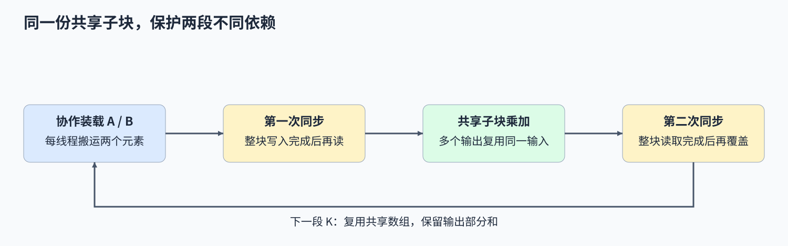
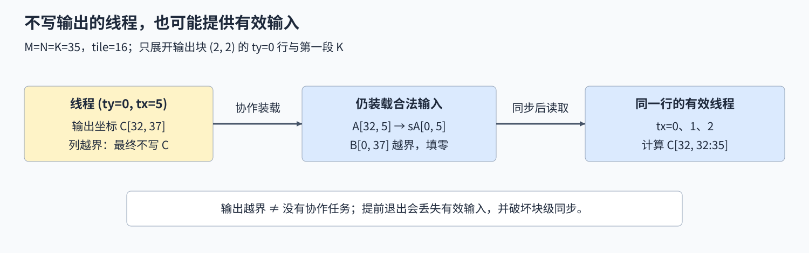

# 06. CUDA Shared Memory Optimization | CUDA 共享内存：分块 GEMM 与块内同步
**难度：** 进阶 | **环境：** [NVIDIA GPU 必需](#runtime-environment) | **标签：** `CUDA C++`、`共享内存`、`GEMM` | **目标人群：** 理解线程块索引、希望实现块内数据复用

> 🚀 **云端运行环境**
>
> 本章节的实战代码可以点击以下链接在免费 GPU 算力平台上直接运行：
>
> [](https://colab.research.google.com/github/datawhalechina/llm-algo-leetcode/blob/main/04_CUDA_and_System_Optimization/06_CUDA_Shared_Memory_Optimization.ipynb)
> [](https://modelscope.cn/my/mynotebook) *(国内推荐：魔搭社区免费实例)*


## 本节导读

相邻输出往往需要重复读取同一段矩阵输入。让线程先协作搬入共享内存，再各自计算输出，可以复用这些数据；但一个线程正在读取时，另一个线程能否开始搬下一块？沿着加载、消费和覆盖的次序，可以看清两次块内同步分别保护了什么。

<a id="runtime-environment"></a>
## 运行环境

- **GPU练习：** 使用[算子优化环境](../topic_discussion/operator_optimization/quickstart.md#triton-environment)，运行[共享内存GEMM练习与测试](#mechanism-practice)；需要NVIDIA GPU和CUDA PyTorch。
- **工具链条件：** 本机CUDA Toolkit（`nvcc`）和兼容C++主机编译器。

## 前置阅读

先回顾线程如何确定输出位置，再理解线程块内共享数据的作用范围。

- [Part 04 · 01 线程索引与边界](./01_CUDA_Custom_Kernel_Intro.md)
- [Part 01 · 16 Warp、Block 与共享内存](../01_Hardware_Math_and_Systems/16_Warp_Block_SharedMemory_Basics.md)
## Step 1：共享子块怎样减少重复加载

计算一个 16×16 输出子块的一段 K=16 乘积，需要完成 4096 次乘加。若 256 个线程各算一个输出、每次都单独加载两个输入，逻辑上要加载 8192 个元素；协作加载两个 16×16 输入子块只需 512 个元素，然后在块内复用。每个 A 元素参与 16 列输出，每个 B 元素参与 16 行输出。

上述16倍差异来自代码层面的逻辑加载次数。真实显存流量还取决于缓存命中；共享内存路径也增加了协作搬运和同步。要判断是否值得采用，需要继续检查线程的数据归属、读写次序和完整调用耗时。



## Step 2：线程怎样装载输入并累加输出

每个线程用 `threadIdx.y`、`threadIdx.x` 确定一个输出坐标，同时分别搬运一个 A 和一个 B 元素。每轮沿 K 前进 16，线程将对应元素装入共享数组，再遍历共享子块的 K 坐标更新自己的部分和。两个 FP32 输入子块共占 $2\times16^2\times4=2048$ 字节，即 2 KiB；输出部分和跨轮保留。

当矩阵边长为 35 时，共有三轮 K 子块，最后一轮只有三个有效 K 位置，其他位置填零。输出末行、末列对应的线程仍须参与装载与同步，只在最终写回时排除无效输出，不能提前退出整个 kernel。



## Step 3：两次同步保护什么，tile 又受什么限制

装载后的第一次 `__syncthreads()` 保证整块数据准备好，线程才能读取其他线程写入的位置；乘加后的第二次同步保证当前子块读完，快线程才能用下一段数据覆盖共享数组。边界判断只包住数据访问，不能让部分线程跳过块级屏障。这两次同步分别保护“写入→读取”和“读取→覆盖”。

扩大 tile 会增加复用，也会改变每块线程数和共享内存需求。按一线程一个输出的映射，tile=16 对应 256 个线程、2 KiB 输入缓存；tile=32 对应 1024 个线程、8 KiB。tile=64则需要4096个线程，超出CUDA每块最多1024线程的限制，需要改成每线程处理多个输出等映射。启动合法后，再结合目标设备限制、编译寄存器分配和共享内存需求计算驻留上界，最后测量耗时。
<a id="mechanism-practice"></a>

## Step 4：实现协作加载与两处同步

补全`build_cuda_source`中的四个具名CUDA片段，让固定tile的方阵GEMM在边缘不完整时仍与PyTorch一致。输出坐标、写回、模板和启动器已给出；变量为`None`时，实际测试在对应TODO停止，补全后才编译并运行。

测试覆盖非整块边长、多轮K累加、单位与常量矩阵。数值对照检查当前输入输出；同步的必要性仍需依据装载、消费和覆盖顺序解释，不能把数值一致当作已完成动态竞争检测。

| TODO / 函数 | 待实现的机制 | 必须满足的约束 | 测试证据 |
| --- | --- | --- | --- |
| TODO 1 / `build_cuda_source` → `shared_gemm_kernel` | 协作加载 A、B 子块 | 无效行、列和 K 位置填零 | 1、17、35、65 等边长及单位矩阵比较 |
| TODO 2 / `build_cuda_source` → `shared_gemm_kernel` | 装载完成后同步 | 所有线程到达屏障后才读取共享数组 | 实际 GPU 输出数值核对 |
| TODO 3 / `build_cuda_source` → `shared_gemm_kernel` | 在共享子块上乘加 | 累加器跨 K 子块保留 | 随机、常量矩阵与 PyTorch 参考比较 |
| TODO 4 / `build_cuda_source` → `shared_gemm_kernel` | 覆盖共享数组前同步 | 当前子块读取结束后才进入下一轮 | 多轮 K 累加与尾块核对 |

```python
import torch
from functools import lru_cache
from string import Template
from torch.utils.cpp_extension import load_inline

```


```python
def build_cuda_source():
    """组装 CUDA 源码，空缺在实际测试调用时报告。"""
    # ==========================================
    # TODO 1：协作加载两路子块
    # 作用：使用 row、col、t 和 threadIdx；越界位置填零。
    # load_statements = r"""???"""
    # ==========================================
    load_statements = None
    if load_statements is None:
        raise NotImplementedError("TODO 1：请填写 load_statements")
    # ==========================================
    # TODO 2：等待整块装载完成
    # 作用：在读共享子块之前，让块内所有线程到达屏障。
    # ready_barrier = r"""???"""
    # ==========================================
    ready_barrier = None
    if ready_barrier is None:
        raise NotImplementedError("TODO 2：请填写 ready_barrier")
    # ==========================================
    # TODO 3：累加当前共享子块
    # 作用：更新 sum；使用两路共享数组，不重新初始化部分和。
    # accumulate_statements = r"""???"""
    # ==========================================
    accumulate_statements = None
    if accumulate_statements is None:
        raise NotImplementedError("TODO 3：请填写 accumulate_statements")
    # ==========================================
    # TODO 4：等待读取结束再覆盖
    # 作用：所有线程读完本轮数据后，才进入下一轮装载。
    # reuse_barrier = r"""???"""
    # ==========================================
    reuse_barrier = None
    if reuse_barrier is None:
        raise NotImplementedError("TODO 4：请填写 reuse_barrier")
    template = r'''
#include <torch/extension.h>
#include <cuda_runtime.h>
#include <ATen/cuda/CUDAContext.h>
#include <c10/cuda/CUDAException.h>
#include <c10/cuda/CUDAGuard.h>

#define TILE_SIZE 16

__global__ void shared_gemm_kernel(const float* A, const float* B, float* C, int N) {
    int row = blockIdx.y * TILE_SIZE + threadIdx.y;
    int col = blockIdx.x * TILE_SIZE + threadIdx.x;

    __shared__ float s_A[TILE_SIZE][TILE_SIZE];
    __shared__ float s_B[TILE_SIZE][TILE_SIZE];

    float sum = 0.0f;
    int num_tiles = (N + TILE_SIZE - 1) / TILE_SIZE;

    for (int t = 0; t < num_tiles; ++t) {
        $load_statements
        $ready_barrier

        $accumulate_statements
        $reuse_barrier
    }

    if (row < N && col < N) {
        C[row * N + col] = sum;
    }
}

torch::Tensor shared_gemm_cuda(torch::Tensor A, torch::Tensor B) {
    c10::cuda::CUDAGuard guard(A.device());
    int N = A.size(0);
    auto C = torch::empty_like(A);

    dim3 threads(TILE_SIZE, TILE_SIZE);
    dim3 blocks((N + TILE_SIZE - 1) / TILE_SIZE, (N + TILE_SIZE - 1) / TILE_SIZE);

    shared_gemm_kernel<<<blocks, threads, 0, at::cuda::getCurrentCUDAStream()>>>(
        A.data_ptr<float>(),
        B.data_ptr<float>(),
        C.data_ptr<float>(),
        N
    );

    C10_CUDA_KERNEL_LAUNCH_CHECK();
    return C;
}
'''
    return Template(template).substitute(
        load_statements=load_statements,
        ready_barrier=ready_barrier,
        accumulate_statements=accumulate_statements,
        reuse_barrier=reuse_barrier,
    )


@lru_cache(maxsize=1)
def compile_cuda_source(source):
    """按完整源码缓存扩展，不检查源码中的 TODO 注释。"""
    return load_inline(
        name='tutorial_shared_gemm_v2',
        cpp_sources='torch::Tensor shared_gemm_cuda(torch::Tensor A, torch::Tensor B);',
        cuda_sources=source,
        functions=['shared_gemm_cuda'],
        with_cuda=True,
        extra_cflags=['-O3'],
        extra_cuda_cflags=['-O3'],
    )


def shared_gemm_cuda(a, b):
    """计算同设备、连续 FP32 方阵的分块矩阵乘法。"""
    if a.ndim != 2 or b.shape != a.shape or a.shape[0] != a.shape[1] or a.numel() == 0:
        raise ValueError("本节要求同形状的非空方阵")
    if not (a.is_cuda and b.is_cuda) or a.device != b.device:
        raise ValueError("输入必须位于同一 CUDA 设备")
    if a.dtype != torch.float32 or b.dtype != torch.float32 or not (a.is_contiguous() and b.is_contiguous()):
        raise ValueError("本节要求连续 float32 输入")
    extension = compile_cuda_source(build_cuda_source())
    return extension.shared_gemm_cuda(a, b)

```

## 测试
使用非 16 整除的方阵边长，核对输出数值及最后一个 tile 的边界处理。


```python
def test_shared_gemm():
    """核对边缘输入、跨 K 累加、结构化矩阵、输入约束与当前流。"""
    if not torch.cuda.is_available():
        print("SKIPPED: 共享内存 GEMM 需要 NVIDIA GPU。")
        return {"status": "skipped", "reason": "cuda_unavailable"}
    torch.manual_seed(42)
    sizes = (1, 16, 17, 31, 32, 35, 65)
    cases = [(torch.randn(size, size, device="cuda"), torch.randn(size, size, device="cuda")) for size in sizes]
    cases.extend((
        (torch.eye(35, device="cuda"), torch.randn(35, 35, device="cuda")),
        (torch.ones(35, 35, device="cuda"), torch.full((35, 35), 2, device="cuda", dtype=torch.float32)),
    ))
    for a, b in cases:
        actual = shared_gemm_cuda(a, b)
        expected = (a.cpu().double() @ b.cpu().double()).float()
        torch.testing.assert_close(actual.cpu(), expected, atol=2e-4, rtol=2e-4)
        assert actual.shape == a.shape and actual.dtype == a.dtype and actual.device == a.device
    valid = torch.ones(16, 16, device="cuda")
    invalid = ((valid.cpu(), valid), (valid.double(), valid.double()),
               (valid.t(), valid), (valid[:, :15], valid),
               (valid[:0, :0], valid[:0, :0]), (valid, valid[:8]),
               (valid.flatten(), valid.flatten()))
    for a, b in invalid:
        try:
            shared_gemm_cuda(a, b)
        except ValueError:
            pass
        else:
            raise AssertionError("非法 GEMM 输入应被拒绝")
    stream = torch.cuda.Stream()
    with torch.cuda.stream(stream):
        a = torch.full((35, 35), 0.5, device="cuda")
        b = torch.full((35, 35), 2, device="cuda", dtype=torch.float32)
        consumed = shared_gemm_cuda(a, b) + 1
    stream.synchronize()
    torch.testing.assert_close(consumed, torch.full_like(consumed, 36), atol=0, rtol=0)
    print({"status": "passed", "numeric_cases": len(cases), "invalid_cases": len(invalid), "current_stream": "passed"})
    return {"status": "passed"}


test_shared_gemm()
```

---
> 先完成题目区并运行测试，再查看参考实现。

## 参考代码与解析

### 代码


```python
def build_cuda_source():
    """组装 CUDA 源码，空缺在实际测试调用时报告。"""
    # ==========================================
    # TODO 1：协作加载两路子块
    # 作用：使用 row、col、t 和 threadIdx；越界位置填零。
    # load_statements = r"""???"""
    # ==========================================
    load_statements = r"""
int a_col = t * TILE_SIZE + threadIdx.x;
        int b_row = t * TILE_SIZE + threadIdx.y;
        s_A[threadIdx.y][threadIdx.x] = (row < N && a_col < N) ? A[row * N + a_col] : 0.0f;
        s_B[threadIdx.y][threadIdx.x] = (b_row < N && col < N) ? B[b_row * N + col] : 0.0f;
"""
    if load_statements is None:
        raise NotImplementedError("TODO 1：请填写 load_statements")
    # ==========================================
    # TODO 2：等待整块装载完成
    # 作用：在读共享子块之前，让块内所有线程到达屏障。
    # ready_barrier = r"""???"""
    # ==========================================
    ready_barrier = "__syncthreads();"
    if ready_barrier is None:
        raise NotImplementedError("TODO 2：请填写 ready_barrier")
    # ==========================================
    # TODO 3：累加当前共享子块
    # 作用：更新 sum；使用两路共享数组，不重新初始化部分和。
    # accumulate_statements = r"""???"""
    # ==========================================
    accumulate_statements = r"""
for (int k = 0; k < TILE_SIZE; ++k) {
            sum += s_A[threadIdx.y][k] * s_B[k][threadIdx.x];
        }
"""
    if accumulate_statements is None:
        raise NotImplementedError("TODO 3：请填写 accumulate_statements")
    # ==========================================
    # TODO 4：等待读取结束再覆盖
    # 作用：所有线程读完本轮数据后，才进入下一轮装载。
    # reuse_barrier = r"""???"""
    # ==========================================
    reuse_barrier = "__syncthreads();"
    if reuse_barrier is None:
        raise NotImplementedError("TODO 4：请填写 reuse_barrier")
    template = r'''
#include <torch/extension.h>
#include <cuda_runtime.h>
#include <ATen/cuda/CUDAContext.h>
#include <c10/cuda/CUDAException.h>
#include <c10/cuda/CUDAGuard.h>

#define TILE_SIZE 16

__global__ void shared_gemm_kernel(const float* A, const float* B, float* C, int N) {
    int row = blockIdx.y * TILE_SIZE + threadIdx.y;
    int col = blockIdx.x * TILE_SIZE + threadIdx.x;

    __shared__ float s_A[TILE_SIZE][TILE_SIZE];
    __shared__ float s_B[TILE_SIZE][TILE_SIZE];

    float sum = 0.0f;
    int num_tiles = (N + TILE_SIZE - 1) / TILE_SIZE;

    for (int t = 0; t < num_tiles; ++t) {
        $load_statements
        $ready_barrier

        $accumulate_statements
        $reuse_barrier
    }

    if (row < N && col < N) {
        C[row * N + col] = sum;
    }
}

torch::Tensor shared_gemm_cuda(torch::Tensor A, torch::Tensor B) {
    c10::cuda::CUDAGuard guard(A.device());
    int N = A.size(0);
    auto C = torch::empty_like(A);

    dim3 threads(TILE_SIZE, TILE_SIZE);
    dim3 blocks((N + TILE_SIZE - 1) / TILE_SIZE, (N + TILE_SIZE - 1) / TILE_SIZE);

    shared_gemm_kernel<<<blocks, threads, 0, at::cuda::getCurrentCUDAStream()>>>(
        A.data_ptr<float>(),
        B.data_ptr<float>(),
        C.data_ptr<float>(),
        N
    );

    C10_CUDA_KERNEL_LAUNCH_CHECK();
    return C;
}
'''
    return Template(template).substitute(
        load_statements=load_statements,
        ready_barrier=ready_barrier,
        accumulate_statements=accumulate_statements,
        reuse_barrier=reuse_barrier,
    )


@lru_cache(maxsize=1)
def compile_cuda_source(source):
    """按完整源码缓存扩展，不检查源码中的 TODO 注释。"""
    return load_inline(
        name='tutorial_shared_gemm_v2',
        cpp_sources='torch::Tensor shared_gemm_cuda(torch::Tensor A, torch::Tensor B);',
        cuda_sources=source,
        functions=['shared_gemm_cuda'],
        with_cuda=True,
        extra_cflags=['-O3'],
        extra_cuda_cflags=['-O3'],
    )


def shared_gemm_cuda(a, b):
    """计算同设备、连续 FP32 方阵的分块矩阵乘法。"""
    if a.ndim != 2 or b.shape != a.shape or a.shape[0] != a.shape[1] or a.numel() == 0:
        raise ValueError("本节要求同形状的非空方阵")
    if not (a.is_cuda and b.is_cuda) or a.device != b.device:
        raise ValueError("输入必须位于同一 CUDA 设备")
    if a.dtype != torch.float32 or b.dtype != torch.float32 or not (a.is_contiguous() and b.is_contiguous()):
        raise ValueError("本节要求连续 float32 输入")
    extension = compile_cuda_source(build_cuda_source())
    return extension.shared_gemm_cuda(a, b)

```

### 解析

#### TODO 1：把两路输入装入共享数组

- A的列与B的行随K段推进，每个线程各搬运一个A、B元素；无效行、列或K位置填零，使完整子块的乘加仍表示原矩阵。
- 边长35分成三轮K，末轮只有三个有效位置；随机尾块、单位矩阵与常量矩阵分别检查补零和两路输入的对应关系。

#### TODO 2：先写完，再共同读取

- 线程将读取其他线程装入的共享值，因此第一次屏障必须位于装载之后、共同读取之前。输出位置越界的线程也可能承担有效装载，不能提前退出屏障。
- 边缘矩阵与参考结果的比较核对当前数据路径；解释屏障时，再沿“哪个线程写入、哪个线程读取”检查生产与消费的先后关系。

#### TODO 3：复用输入并保留部分和

- 每个线程沿当前共享子块的K方向乘加，累加器在整个K循环之前初始化，从而保留前面子块的贡献。
- 35×35常量矩阵要求完整累计三段，能暴露每轮清零或只保留末段的错误；当前答案用标量乘加完成这些累积。

#### TODO 4：先读完，再覆盖下一轮

- 第二次屏障保护共享地址的复用：整块读完当前K段后，快线程才能把下一段写入同一数组；它与第一次屏障分别保护“写后读”和“读后写”。
- 35、65等边长包含多次覆盖，数值对照检查跨段贡献是否保留。同步顺序由上述依赖关系解释，竞态另需专门工具核对；不同block各自计算独立的输出子块。


## 相关阅读

继续分析共享数组的地址映射，或把装载与消费改成异步阶段。

- [Part 04 · 04 Bank 冲突](./04_Bank_Conflict_Deep_Dive.md)：区分同址广播与同 bank 的不同地址访问，不能把同 bank 一律视为冲突。
- [09. CUDA 异步拷贝流水线](./09_CUDA_Async_Copy_Pipeline.md)：缓冲轮换及提交、等待的配合。
