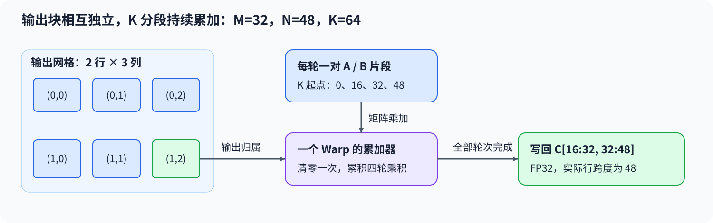
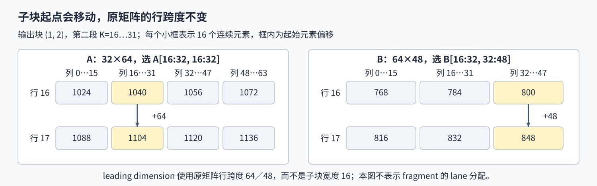

# 07. Tensor Core MMA Programming | Tensor Core 矩阵乘加编程

**难度：** 进阶 | **环境：** [NVIDIA GPU 必需](#runtime-environment) | **标签：** `Tensor Core`、`WMMA`、`MMA` | **目标人群：** 理解矩阵乘法与 Warp 协作

> 🚀 **云端运行环境**
>
> 本章节的实战代码可以点击以下链接在免费 GPU 算力平台上直接运行：
>
> [](https://colab.research.google.com/github/datawhalechina/llm-algo-leetcode/blob/main/04_CUDA_and_System_Optimization/07_Tensor_Core_MMA_Programming.ipynb)
> [](https://modelscope.cn/my/mynotebook) *(国内推荐：魔搭社区免费实例)*


## 本节导读

让每个线程独立累加一个输出，与让整个 Warp 协作完成一个矩阵子块，是两种不同的计算组织方式。后一种方式怎样决定谁处理哪个输出块，又怎样把多段 K 维乘积保留在同一份结果里？

沿着输入子块、分布在 Warp 中的矩阵片段和输出累加器，可以理解 WMMA 的协作边界。FP16 输入、FP32 累加和正确的矩阵步长需要同时满足；能编译或得到正确形状，都不足以说明输出数值正确。
<a id="runtime-environment"></a>

## 运行环境

- **CPU计划：** 在本页已有导入下计算输出网格和K维分段次数。
- **GPU练习：** 使用[算子优化环境](../topic_discussion/operator_optimization/quickstart.md#triton-environment)，运行[矩阵片段练习与测试](#mechanism-practice)；需要支持WMMA的NVIDIA GPU和CUDA PyTorch。
- **工具链条件：** 本机CUDA Toolkit（`nvcc`）和兼容C++编译器。

无GPU时仅跳过GPU数值部分；工具链缺失、编译或运行失败保留错误。代码使用固定16×16×16子块，输入维度需满足本页对齐要求；性能与实际指令分析由独立测量核对。

## 前置阅读

先理解输入子块复用和 Warp 协作范围，再把标量乘加改为矩阵片段操作。

- [Part 04 · 06 共享内存 GEMM](./06_CUDA_Shared_Memory_Optimization.md)
- [Part 04 · 03 Warp 内归约](./03_Warp_Level_Primitives.md)
## Step 1：一个 Warp 怎样负责一个矩阵子块

设 $A\in\mathbb{R}^{M\times K}$、$B\in\mathbb{R}^{K\times N}$，目标为 $C=AB$。Tensor Core是GPU中执行特定矩阵运算的硬件单元，支持的形状与数值格式取决于目标架构。矩阵乘加（MMA）把乘积累加到已有矩阵；WMMA 是 CUDA 的 Warp 级矩阵操作接口，不是另一类硬件单元。以 16×16×16 子块为例，一个 Warp 每轮读取一块 16×16 的 A 和 B，将乘积加入一个 16×16 的输出累加器。

矩阵为 $M=32,N=48,K=64$ 时，输出分成两行、三列共六个子块。每个子块沿 K 方向完成四轮乘加，FP16 输入先参与矩阵计算，结果保存在 FP32 累加器中。输出块之间独立，K 分段之间则持续累积。


## Step 2：矩阵片段为何必须由完整 Warp 共同操作

矩阵片段（fragment）表示分布在 Warp 各线程中的矩阵数据。内部元素怎样分配给各 lane 由接口实现决定，不能把它当成每个线程拥有一份完整矩阵，也不能假设某个 lane 固定持有某个坐标。装载、矩阵乘加和写回都由完整 Warp 以一致参数共同执行。

行主序矩阵中，leading dimension 是相邻两行起点相隔的元素数。A 的行跨度为 K，B 与 C 的行跨度为 N；它们不是当前子块的固定宽度。加载第二段 K 时，A 的列起点加 16，B 的行起点也加 16。对本页 FP16 输入，还需满足接口的行跨度与起始地址对齐要求；连续视图也可能因为存储偏移而失去所需对齐。



## Step 3：为什么只能在 K 循环之前清零累加器

一个输出块必须把所有 K 分段的乘积相加。累加器先清零，第一轮得到第一段贡献，后面每轮在原值上继续累加，完成后才写回：

$$
C_{\mathrm{tile}}\leftarrow A_{\mathrm{tile}}B_{\mathrm{tile}}+C_{\mathrm{tile}}.
$$

若每轮重新清零，最终只剩最后一段 K 的乘积；若多个 Warp 错用同一输出起点，还会遗漏其他输出块。对 32×48 的输出，第三列子块从列 32 开始，其写回步长仍为 48，而不是子块宽度 16。 当各维度均为 16 的正整数倍时，可以用一个完整 Warp 处理一个完整输出块，并让所有协作调用走相同路径。非整除形状不能直接照搬：把其中几个线程屏蔽掉，会破坏 Warp 级协作；需要另外设计补齐与边缘路径。

<a id="mechanism-practice"></a>

## Step 4：实现输出分块、矩阵加载与跨段累加

补全 CPU 网格计划与完整 CUDA 模板中的四处机制片段。输入是同设备、连续、32 字节对齐的 FP16 矩阵，M／N／K 为 16 的正整数倍，输出为 FP32。输入检查、扩展编译缓存、当前设备与当前流启动已给出；变量默认 `None`，实际调用时在对应 TODO 停止，不扫描源码注释。

| TODO / 函数 | 待实现的机制 | 必须满足的约束 | 测试证据 |
| --- | --- | --- | --- |
| TODO 1 / `mma_tile_plan` → `plan` | 输出网格与 K 分段次数 | x 对应输出列，y 对应输出行 | 非方形网格、多轮 K 与非法维度 |
| TODO 2 / `build_cuda_source` → `origin_statements` | 输出子块归属 | 每个块独占一个 16×16 区域 | 多行、多列及非均匀输入 |
| TODO 3 / `load_statements` | 装载 A、B 矩阵片段 | 正确 K 偏移与真实行跨度 | 非方形矩阵、不同 K 长度 |
| TODO 4 / `mma_statement` | 将本轮乘积加入累加器 | 保留前面 K 分段的贡献 | 多段常量与随机输入 |
| TODO 5 / `store_statement` | 写出完整 FP32 子块 | 行主序、真实输出行跨度 | 输出数值、形状、类型与设备 |

```python
from functools import lru_cache
from string import Template
import shutil
import torch
from torch.utils.cpp_extension import CUDA_HOME, load_inline
```


```python
def mma_tile_plan(m, n, k, tile=16):
    """计算固定 WMMA 子块的输出网格与 K 迭代数。"""
    if any(isinstance(value, bool) or not isinstance(value, int) or value <= 0 for value in (m, n, k, tile)):
        raise ValueError("矩阵维度和子块宽度必须为正整数")
    if tile != 16 or any(value % tile for value in (m, n, k)):
        raise ValueError("固定 16×16×16 实现要求各维度为 16 的倍数")
    # TODO 1：计算网格与归约轮数。
    # 提示：plan 的 grid_x 对应 n，grid_y 对应 m，k_tiles 对应 k。
    plan = None
    if plan is None:
        raise NotImplementedError("请完成 TODO 1：plan")
    return plan


def build_cuda_source():
    """将具名机制片段填入完整 WMMA 内核与启动器。"""
    # TODO 2：确定当前输出子块的行、列编号。
    # 提示：origin_statements 定义 tile_m、tile_n，分别对应 blockIdx.y、blockIdx.x。
    origin_statements = None
    if origin_statements is None:
        raise NotImplementedError("请完成 TODO 2：origin_statements")
    # TODO 3：加载本轮 A、B 片段。
    # 提示：load_statements 使用 tile_m、tile_n、tile_k、k、n；行跨度不能写成固定子块宽度。
    load_statements = None
    if load_statements is None:
        raise NotImplementedError("请完成 TODO 3：load_statements")
    # TODO 4：累积本轮乘积。
    # 提示：mma_statement 使用 a_frag、b_frag 和已有 c_frag，不清零累加器。
    mma_statement = None
    if mma_statement is None:
        raise NotImplementedError("请完成 TODO 4：mma_statement")
    # TODO 5：写出当前输出片段。
    # 提示：store_statement 使用输出起点、真实行跨度 n 和行主序布局。
    store_statement = None
    if store_statement is None:
        raise NotImplementedError("请完成 TODO 5：store_statement")
    template = r'''
#include <torch/extension.h>
#include <ATen/cuda/CUDAContext.h>
#include <c10/cuda/CUDAException.h>
#include <cuda_fp16.h>
#include <c10/cuda/CUDAGuard.h>
#include <cstdint>
#include <mma.h>

using namespace nvcuda;

__global__ void wmma_gemm_kernel(const __half* a, const __half* b, float* c,
                                int m, int n, int k) {
    $origin_statements

    wmma::fragment<wmma::matrix_a, 16, 16, 16, __half, wmma::row_major> a_frag;
    wmma::fragment<wmma::matrix_b, 16, 16, 16, __half, wmma::row_major> b_frag;
    wmma::fragment<wmma::accumulator, 16, 16, 16, float> c_frag;
    wmma::fill_fragment(c_frag, 0.0f);

    for (int tile_k = 0; tile_k < k; tile_k += 16) {
        $load_statements
        $mma_statement
    }

    $store_statement
}

torch::Tensor wmma_gemm_cuda(torch::Tensor a, torch::Tensor b) {
    TORCH_CHECK(a.is_cuda() && b.is_cuda(), "inputs must be CUDA tensors");
    TORCH_CHECK(a.device() == b.device(), "inputs must be on the same CUDA device");
    TORCH_CHECK(a.scalar_type() == at::kHalf && b.scalar_type() == at::kHalf,
                "inputs must use float16");
    TORCH_CHECK(a.dim() == 2 && b.dim() == 2, "inputs must be rank-2 matrices");
    TORCH_CHECK(a.size(1) == b.size(0), "incompatible matrix dimensions");
    TORCH_CHECK(a.is_contiguous() && b.is_contiguous(), "inputs must be contiguous");
    c10::cuda::CUDAGuard guard(a.device());
    TORCH_CHECK(reinterpret_cast<std::uintptr_t>(a.data_ptr()) % 32 == 0 &&
                reinterpret_cast<std::uintptr_t>(b.data_ptr()) % 32 == 0, "WMMA pointers must be 32-byte aligned");

    const int m = static_cast<int>(a.size(0));
    const int k = static_cast<int>(a.size(1));
    const int n = static_cast<int>(b.size(1));
    TORCH_CHECK(m > 0 && n > 0 && k > 0, "matrix dimensions must be positive");
    TORCH_CHECK(m % 16 == 0 && n % 16 == 0 && k % 16 == 0,
                "M, N, and K must be multiples of 16");

    auto c = torch::empty({m, n}, a.options().dtype(torch::kFloat32));
    const dim3 grid(n / 16, m / 16);
    wmma_gemm_kernel<<<grid, 32, 0, at::cuda::getCurrentCUDAStream().stream()>>>(
        reinterpret_cast<const __half*>(a.data_ptr<at::Half>()),
        reinterpret_cast<const __half*>(b.data_ptr<at::Half>()),
        c.data_ptr<float>(), m, n, k);
    C10_CUDA_KERNEL_LAUNCH_CHECK();
    return c;
}
'''
    return Template(template).substitute(
        origin_statements=origin_statements, load_statements=load_statements,
        mma_statement=mma_statement, store_statement=store_statement,
    )


@lru_cache(maxsize=2)
def build_wmma_extension(source, major, minor):
    """为目标架构编译完整源码，编译或工具链错误不转为跳过。"""
    if major < 7:
        raise RuntimeError("WMMA 核对需要支持该接口的设备")
    if CUDA_HOME is None or shutil.which("nvcc") is None:
        raise RuntimeError("未找到 CUDA Toolkit/nvcc")
    if shutil.which("c++") is None and shutil.which("g++") is None:
        raise RuntimeError("未找到 C++ 主机编译器")
    return load_inline(
        name="tutorial_wmma_gemm_v3",
        cpp_sources=r'''
#include <torch/extension.h>
torch::Tensor wmma_gemm_cuda(torch::Tensor a, torch::Tensor b);
torch::Tensor wmma_gemm(torch::Tensor a, torch::Tensor b) {
    return wmma_gemm_cuda(a, b);
}
''',
        cuda_sources=source, functions=["wmma_gemm"], with_cuda=True,
        extra_cflags=["-O3"], extra_cuda_cflags=[f"-arch=sm_{major}{minor}", "-O3"],
    )


def wmma_gemm(a, b):
    """计算对齐且连续的 FP16 矩阵乘法，返回 FP32 输出。"""
    if not (a.is_cuda and b.is_cuda) or a.device != b.device:
        raise ValueError("输入必须位于同一 CUDA 设备")
    if a.ndim != 2 or b.ndim != 2 or a.shape[1] != b.shape[0]:
        raise ValueError("输入须为可相乘的二维矩阵")
    if a.dtype != torch.float16 or b.dtype != torch.float16 or not (a.is_contiguous() and b.is_contiguous()):
        raise ValueError("输入须为连续 FP16 矩阵")
    if a.data_ptr() % 32 or b.data_ptr() % 32:
        raise ValueError("WMMA 输入地址须按 32 字节对齐")
    mma_tile_plan(a.shape[0], b.shape[1], a.shape[1])
    with torch.cuda.device(a.device):
        extension = build_wmma_extension(build_cuda_source(), *torch.cuda.get_device_capability(a.device))
        return extension.wmma_gemm(a, b)
```

## 测试

```python
def test_mma_tile_plan():
    """核对非方形网格、K 分段和固定子块约束。"""
    for dims, target in (
        ((32, 48, 64), {"grid_x": 3, "grid_y": 2, "k_tiles": 4}),
        ((16, 16, 16), {"grid_x": 1, "grid_y": 1, "k_tiles": 1}),
        ((48, 16, 32), {"grid_x": 1, "grid_y": 3, "k_tiles": 2}),
    ):
        assert mma_tile_plan(*dims) == target
    invalid = ((17, 16, 16), (16, 17, 16), (16, 16, 17),
               (0, 16, 16), (-16, 16, 16), (16.0, 16, 16),
               (True, 16, 16), (16, 16, 16, 8))
    for args in invalid:
        try:
            mma_tile_plan(*args)
        except ValueError:
            pass
        else:
            raise AssertionError(f"非法分块计划应被拒绝：{args}")


def test_wmma_gemm_correctness():
    """核对多输出块、多 K 分段、非均匀值、输入约束与当前流。"""
    test_mma_tile_plan()
    if not torch.cuda.is_available():
        print("SKIPPED: 已核对 CPU 分块计划，未执行 WMMA GPU 测试。")
        return {"status": "skipped", "reason": "cuda_unavailable"}
    torch.manual_seed(42)
    cases = []
    for m, n, k in ((16, 16, 16), (32, 48, 64), (48, 32, 16), (16, 64, 48)):
        cases.append((torch.randn(m, k, device="cuda", dtype=torch.float16),
                      torch.randn(k, n, device="cuda", dtype=torch.float16)))
    cases.extend((
        (torch.zeros(32, 32, device="cuda", dtype=torch.float16),
         torch.ones(32, 48, device="cuda", dtype=torch.float16)),
        (torch.eye(32, device="cuda", dtype=torch.float16),
         torch.randn(32, 48, device="cuda", dtype=torch.float16)),
        (torch.ones(32, 64, device="cuda", dtype=torch.float16),
         torch.ones(64, 48, device="cuda", dtype=torch.float16)),
        (torch.arange(32 * 64, device="cuda", dtype=torch.float16).reshape(32, 64) / 1024,
         torch.arange(64 * 48, device="cuda", dtype=torch.float16).reshape(64, 48) / 2048),
    ))
    for a, b in cases:
        actual = wmma_gemm(a, b)
        expected = (a.cpu().double() @ b.cpu().double()).float()
        torch.testing.assert_close(actual.cpu(), expected, atol=2e-3, rtol=2e-3)
        assert actual.shape == (a.shape[0], b.shape[1])
        assert actual.dtype == torch.float32 and actual.device == a.device

    valid = torch.ones(16, 16, device="cuda", dtype=torch.float16)
    offset = torch.ones(257, device="cuda", dtype=torch.float16)[1:].reshape(16, 16)
    invalid = ((valid.cpu(), valid), (valid.float(), valid),
               (valid.t(), valid), (valid[:0], valid),
               (valid[:, :15].contiguous(), valid[:15]),
               (offset, valid), (valid.flatten(), valid))
    for a, b in invalid:
        try:
            wmma_gemm(a, b)
        except ValueError:
            pass
        else:
            raise AssertionError("非法 WMMA 输入应在编译与启动前被拒绝")

    stream = torch.cuda.Stream()
    with torch.cuda.stream(stream):
        a = torch.full((32, 64), 0.5, device="cuda", dtype=torch.float16)
        b = torch.full((64, 48), 2, device="cuda", dtype=torch.float16)
        consumed = wmma_gemm(a, b) + 1
    stream.synchronize()
    torch.testing.assert_close(consumed, torch.full_like(consumed, 65), atol=0, rtol=0)
    print({"status": "passed", "gpu_cases": len(cases), "invalid_cases": len(invalid), "current_stream": "passed"})
    return {"status": "passed"}


test_wmma_gemm_correctness()
```

---

🛑 **STOP HERE** 🛑

先完成题目区，再查看参考实现。
## 参考代码与解析

### 代码

```python
def mma_tile_plan(m, n, k, tile=16):
    """计算固定 WMMA 子块的输出网格与 K 迭代数。"""
    if any(isinstance(value, bool) or not isinstance(value, int) or value <= 0 for value in (m, n, k, tile)):
        raise ValueError("矩阵维度和子块宽度必须为正整数")
    if tile != 16 or any(value % tile for value in (m, n, k)):
        raise ValueError("固定 16×16×16 实现要求各维度为 16 的倍数")
    # TODO 1：计算网格与归约轮数。
    # 提示：plan 的 grid_x 对应 n，grid_y 对应 m，k_tiles 对应 k。
    plan = {"grid_x": n // tile, "grid_y": m // tile, "k_tiles": k // tile}
    if plan is None:
        raise NotImplementedError("请完成 TODO 1：plan")
    return plan


def build_cuda_source():
    """将具名机制片段填入完整 WMMA 内核与启动器。"""
    # TODO 2：确定当前输出子块的行、列编号。
    # 提示：origin_statements 定义 tile_m、tile_n，分别对应 blockIdx.y、blockIdx.x。
    origin_statements = "const int tile_m = blockIdx.y; const int tile_n = blockIdx.x;"
    if origin_statements is None:
        raise NotImplementedError("请完成 TODO 2：origin_statements")
    # TODO 3：加载本轮 A、B 片段。
    # 提示：load_statements 使用 tile_m、tile_n、tile_k、k、n；行跨度不能写成固定子块宽度。
    load_statements = "wmma::load_matrix_sync(a_frag, a + tile_m * 16 * k + tile_k, k);\nwmma::load_matrix_sync(b_frag, b + tile_k * n + tile_n * 16, n);"
    if load_statements is None:
        raise NotImplementedError("请完成 TODO 3：load_statements")
    # TODO 4：累积本轮乘积。
    # 提示：mma_statement 使用 a_frag、b_frag 和已有 c_frag，不清零累加器。
    mma_statement = "wmma::mma_sync(c_frag, a_frag, b_frag, c_frag);"
    if mma_statement is None:
        raise NotImplementedError("请完成 TODO 4：mma_statement")
    # TODO 5：写出当前输出片段。
    # 提示：store_statement 使用输出起点、真实行跨度 n 和行主序布局。
    store_statement = "wmma::store_matrix_sync(c + tile_m * 16 * n + tile_n * 16, c_frag, n, wmma::mem_row_major);"
    if store_statement is None:
        raise NotImplementedError("请完成 TODO 5：store_statement")
    template = r'''
#include <torch/extension.h>
#include <ATen/cuda/CUDAContext.h>
#include <c10/cuda/CUDAException.h>
#include <cuda_fp16.h>
#include <c10/cuda/CUDAGuard.h>
#include <cstdint>
#include <mma.h>

using namespace nvcuda;

__global__ void wmma_gemm_kernel(const __half* a, const __half* b, float* c,
                                int m, int n, int k) {
    $origin_statements

    wmma::fragment<wmma::matrix_a, 16, 16, 16, __half, wmma::row_major> a_frag;
    wmma::fragment<wmma::matrix_b, 16, 16, 16, __half, wmma::row_major> b_frag;
    wmma::fragment<wmma::accumulator, 16, 16, 16, float> c_frag;
    wmma::fill_fragment(c_frag, 0.0f);

    for (int tile_k = 0; tile_k < k; tile_k += 16) {
        $load_statements
        $mma_statement
    }

    $store_statement
}

torch::Tensor wmma_gemm_cuda(torch::Tensor a, torch::Tensor b) {
    TORCH_CHECK(a.is_cuda() && b.is_cuda(), "inputs must be CUDA tensors");
    TORCH_CHECK(a.device() == b.device(), "inputs must be on the same CUDA device");
    TORCH_CHECK(a.scalar_type() == at::kHalf && b.scalar_type() == at::kHalf,
                "inputs must use float16");
    TORCH_CHECK(a.dim() == 2 && b.dim() == 2, "inputs must be rank-2 matrices");
    TORCH_CHECK(a.size(1) == b.size(0), "incompatible matrix dimensions");
    TORCH_CHECK(a.is_contiguous() && b.is_contiguous(), "inputs must be contiguous");
    c10::cuda::CUDAGuard guard(a.device());
    TORCH_CHECK(reinterpret_cast<std::uintptr_t>(a.data_ptr()) % 32 == 0 &&
                reinterpret_cast<std::uintptr_t>(b.data_ptr()) % 32 == 0, "WMMA pointers must be 32-byte aligned");

    const int m = static_cast<int>(a.size(0));
    const int k = static_cast<int>(a.size(1));
    const int n = static_cast<int>(b.size(1));
    TORCH_CHECK(m > 0 && n > 0 && k > 0, "matrix dimensions must be positive");
    TORCH_CHECK(m % 16 == 0 && n % 16 == 0 && k % 16 == 0,
                "M, N, and K must be multiples of 16");

    auto c = torch::empty({m, n}, a.options().dtype(torch::kFloat32));
    const dim3 grid(n / 16, m / 16);
    wmma_gemm_kernel<<<grid, 32, 0, at::cuda::getCurrentCUDAStream().stream()>>>(
        reinterpret_cast<const __half*>(a.data_ptr<at::Half>()),
        reinterpret_cast<const __half*>(b.data_ptr<at::Half>()),
        c.data_ptr<float>(), m, n, k);
    C10_CUDA_KERNEL_LAUNCH_CHECK();
    return c;
}
'''
    return Template(template).substitute(
        origin_statements=origin_statements, load_statements=load_statements,
        mma_statement=mma_statement, store_statement=store_statement,
    )


@lru_cache(maxsize=2)
def build_wmma_extension(source, major, minor):
    """为目标架构编译完整源码，编译或工具链错误不转为跳过。"""
    if major < 7:
        raise RuntimeError("WMMA 核对需要支持该接口的设备")
    if CUDA_HOME is None or shutil.which("nvcc") is None:
        raise RuntimeError("未找到 CUDA Toolkit/nvcc")
    if shutil.which("c++") is None and shutil.which("g++") is None:
        raise RuntimeError("未找到 C++ 主机编译器")
    return load_inline(
        name="tutorial_wmma_gemm_v3",
        cpp_sources=r'''
#include <torch/extension.h>
torch::Tensor wmma_gemm_cuda(torch::Tensor a, torch::Tensor b);
torch::Tensor wmma_gemm(torch::Tensor a, torch::Tensor b) {
    return wmma_gemm_cuda(a, b);
}
''',
        cuda_sources=source, functions=["wmma_gemm"], with_cuda=True,
        extra_cflags=["-O3"], extra_cuda_cflags=[f"-arch=sm_{major}{minor}", "-O3"],
    )


def wmma_gemm(a, b):
    """计算对齐且连续的 FP16 矩阵乘法，返回 FP32 输出。"""
    if not (a.is_cuda and b.is_cuda) or a.device != b.device:
        raise ValueError("输入必须位于同一 CUDA 设备")
    if a.ndim != 2 or b.ndim != 2 or a.shape[1] != b.shape[0]:
        raise ValueError("输入须为可相乘的二维矩阵")
    if a.dtype != torch.float16 or b.dtype != torch.float16 or not (a.is_contiguous() and b.is_contiguous()):
        raise ValueError("输入须为连续 FP16 矩阵")
    if a.data_ptr() % 32 or b.data_ptr() % 32:
        raise ValueError("WMMA 输入地址须按 32 字节对齐")
    mma_tile_plan(a.shape[0], b.shape[1], a.shape[1])
    with torch.cuda.device(a.device):
        extension = build_wmma_extension(build_cuda_source(), *torch.cuda.get_device_capability(a.device))
        return extension.wmma_gemm(a, b)
```

### 解析

#### TODO 1：列网格、行网格和K轮数分别计算

- 输出列数N决定`grid_x`，行数M决定`grid_y`，归约长度K决定每块的累加轮数；三者均按固定16元素子块换算。
- CPU用例要求32×48输出对应3列、2行，K=64对应4轮，可分别发现行列颠倒和将K轮数写死为1的问题。

#### TODO 2：每个输出子块只有一个Warp负责

- `tile_m`、`tile_n`分别取行、列块编号，乘16得到输出起点。每块中的一个Warp负责自己的16×16区域，不能让全部块重复写起始区域。
- 多行、多列的非均匀输入逐元素对照，能发现块编号写零或子块重叠；只有一个输出块的用例无法充分检查这种归属。

#### TODO 3：地址偏移与行跨度是两个量

- A按行块与K段定位，B按K段与列块定位；加载后的行跨度仍分别是完整矩阵的K与N，而不是子块边长16。
- 32×48输出、K=64的非方形用例同时改变偏移与行跨度，能暴露错用固定16或混淆K、N的装载。

#### TODO 4：把本轮乘积累加到已有结果

- 矩阵乘加读取并更新已有`c_frag`，初始化放在K循环之前，避免下一轮丢失前面乘积。
- K=64的全一矩阵要求累计四轮、每项结果为64；只算一轮或每轮清零都会少计贡献。数值核对不等于已经采集矩阵指令或性能证据。

#### TODO 5：按输出真实步长写回

- 输出起点由行、列块共同确定，按跨度N以FP32行主序写回。子块内布局与完整矩阵跨度需要同时正确。
- 非方形输出的全部元素及属性比较检查错位或遗漏；非默认流用例另核对当前流上的准备、调用与消费依赖，不能由此推断多流加速。

## 相关阅读

比较另一种分块实现，或继续研究输入怎样提前到达计算位置。

- [Part 03 · 05 Triton GEMM](../03_Triton_Kernels/05_Triton_GEMM_Tutorial.md)：对照 Program 级分块表达与 Warp 级矩阵片段。
- [Part 04 · 09 异步拷贝流水线](./09_CUDA_Async_Copy_Pipeline.md)：共享缓冲区的准备、等待和复用。
