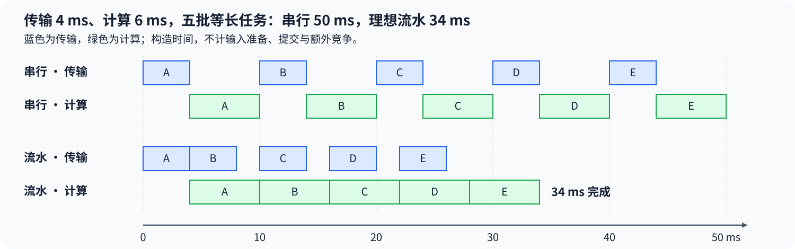
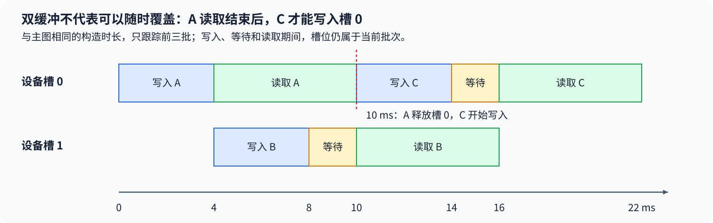

# 08. Async Data Prefetch and Double Buffering | 异步数据预取与双缓冲

**难度：** 进阶 | **环境：** [CPU 主线](#runtime-environment) | **标签：** `异步传输`、`双缓冲`、`流水线` | **目标人群：** 理解异步执行、希望分析数据等待

> 🚀 **云端运行环境**
>
> 本章节的实战代码可以点击以下链接在免费 GPU 算力平台上直接运行：
>
> [](https://colab.research.google.com/github/datawhalechina/llm-algo-leetcode/blob/main/04_CUDA_and_System_Optimization/08_Async_Data_Prefetch_and_Double_Buffering.ipynb)
> [](https://modelscope.cn/my/mynotebook) *(国内推荐：魔搭社区免费实例)*


## 本节导读

一批数据先花 4 ms 传入设备，再花 6 ms 计算；如果下一批必须等这一批全部结束才开始，五批需要 50 ms。把下一批搬运提前，是否就能把总时间降到 30 ms？首批还没有输入、末批还没有算完，这两段不能直接省略。

沿着填充、连续处理和排空三个阶段，可以推导理想流水时间，再检查缓冲区何时能被覆盖。相同模型也能帮助理解其他生产者—消费者过程，但传输位置、同步机制与真实耗时需要分别核对。
<a id="runtime-environment"></a>

## 运行环境

基础练习仅使用 Python 标准库，在 CPU 上计算给定阶段耗时的理想结果，不执行 CUDA。真实主机—设备传输与计算依赖的实现见最后的相关阅读。
## 前置阅读

先区分主机提交与设备执行，再分析两个阶段如何在时间线上交错。

- [Part 01 · 17 Stream 与异步执行](../01_Hardware_Math_and_Systems/17_CUDA_Stream_and_Asynchrony.md)
## Step 1：串行执行为什么要逐批支付两段时间

把每批拆成主机到设备传输和设备计算，耗时分别为 $T_c$、$T_g$，批次数为正整数 $N$。串行执行时，上一批计算结束后才开始下一批传输，总时间为：

$$
T_{\mathrm{serial}}=N(T_c+T_g).
$$

令 $T_c=4\text{ ms}$、$T_g=6\text{ ms}$、$N=5$，每批耗时 10 ms，五批共 50 ms。这里假设每批耗时相同，未计入主机数据准备、提交和额外同步；下图只用构造值比较这两段任务的安排，不表示 GPU 实测。


## Step 2：为什么首批与末批不能隐藏

传输与计算各自按批次顺序执行，但两种资源可以并行：第 $i+1$ 批传输时，设备可能正在计算第 $i$ 批。第一批仍需先传输再计算，之后每增加一批，完成时间由较慢阶段推进，模型还要求批次独立、数据持续就绪、两种资源可并发且没有新增竞争，因此理想总时间为：

$$
T_{\mathrm{pipe}}=T_c+T_g+(N-1)\max(T_c,T_g).
$$

仍用上例，第一批在 10 ms 完成，后四批各推进 6 ms，总共 34 ms，而不是简单取五次计算的 30 ms。若传输改为 6 ms、计算为 4 ms，传输成为较慢阶段，但总时间仍为 34 ms。只有一批时，两段时间都无法隐藏，流水与串行相同。 双缓冲提供当前批与下一批的不同存储位置；第三块缓冲区可能吸收波动，但不能让固定耗时模型中较慢的阶段本身变快。

## Step 3：两块缓冲区怎样安全复用

A 写入槽 0，B 写入槽 1，C 再使用槽 0。C 的写入必须等 A 的消费结束，而 B 的写入可以与 A 的消费并行。只等待“本批传输完成”还不够：若生产者提前覆盖上一批正在读取的槽位，消费者可能读到混合数据。

主机到设备的异步传输还需要合适的设备能力、源内存条件和执行依赖。CPU 提交后能够继续工作，并不表示设备侧已经重叠；一个槽位、串行依赖、输入准备不足或带宽争用都可能让理想收益消失。缓冲策略因此先检查能否并发以及是否至少有两个可用槽位，再通过真实时间线与总耗时判断是否获益。



<a id="mechanism-practice"></a>

## Step 4：估算流水线时长并判断缓冲策略

补全两个函数中的三个局部变量。输入检查和返回结构已经给出；时间以毫秒计，两个阶段均为有限正数，批次数与槽位数为正整数。并发条件由调用方显式提供，不能从缓冲区数量反推出硬件支持重叠。这里的结果是理想估算，不是 CUDA 测量。

| TODO / 函数 | 待实现的机制 | 必须满足的约束 | 测试证据 |
| --- | --- | --- | --- |
| TODO 1 / `estimate_pipeline_ms` → `serial` | 累计全部批次的两段时间 | 每批传输和计算均计入 | 单批、五批、传输或计算较慢 |
| TODO 2 / `estimate_pipeline_ms` → `pipeline` | 计算填充、连续处理与排空 | 首批两段加剩余批次的较慢阶段 | 单批相等、两段对称、理想结果不大于串行 |
| TODO 3 / `choose_buffering` → `supports_pipeline` | 判断给定条件下是否具备双缓冲能力 | 并发条件成立且槽位至少为两个 | 不可并发、单槽、双槽与更多槽位 |

```python
import math
```


```python
def estimate_pipeline_ms(transfer_ms, compute_ms, batches):
    """以毫秒估算等长批次的串行与理想双阶段流水总时长。"""
    times = (transfer_ms, compute_ms)
    if any(isinstance(value, bool) or not isinstance(value, (int, float)) or not math.isfinite(value) or value <= 0 for value in times):
        raise ValueError("两个阶段耗时必须为有限正数")
    if isinstance(batches, bool) or not isinstance(batches, int) or batches < 1:
        raise ValueError("批次数必须为正整数")
    # TODO 1：计算串行时间。
    # 提示：serial 中每批都支付 transfer_ms 与 compute_ms。
    serial = None
    if serial is None:
        raise NotImplementedError("请完成 TODO 1：serial")
    # TODO 2：计算理想流水时间。
    # 提示：pipeline 保留首批两段，再累计 batches - 1 个较慢阶段。
    pipeline = None
    if pipeline is None:
        raise NotImplementedError("请完成 TODO 2：pipeline")
    if not math.isfinite(serial) or not math.isfinite(pipeline):
        raise ValueError("估算总时间溢出")
    return {"serial_ms": serial, "pipeline_ms": pipeline}


def choose_buffering(can_overlap, buffer_count):
    """按显式并发条件与可用槽位数返回单缓冲或双缓冲策略。"""
    if not isinstance(can_overlap, bool):
        raise ValueError("并发条件必须为布尔值")
    if isinstance(buffer_count, bool) or not isinstance(buffer_count, int) or buffer_count < 1:
        raise ValueError("槽位数必须为正整数")
    # TODO 3：联合并发条件与槽位容量。
    # 提示：supports_pipeline 不能仅由 can_overlap 或 buffer_count 单独决定。
    supports_pipeline = None
    if supports_pipeline is None:
        raise NotImplementedError("请完成 TODO 3：supports_pipeline")
    return "double" if supports_pipeline else "single"
```

## 测试

```python
def test_pipeline_estimates():
    """核对首尾阶段、较慢阶段、对称性、增长步长和非法参数。"""
    cases = ((4, 6, 5, 50, 34), (6, 4, 5, 50, 34),
             (4, 6, 1, 10, 10), (4, 4, 5, 40, 24),
             (0.5, 1.5, 3, 6, 5))
    for transfer, compute, batches, serial, pipeline in cases:
        actual = estimate_pipeline_ms(transfer, compute, batches)
        assert actual == {"serial_ms": serial, "pipeline_ms": pipeline}
        assert actual["pipeline_ms"] <= actual["serial_ms"]
    for transfer, compute in ((1, 7), (7, 1), (3, 3)):
        for batches in range(1, 7):
            row = estimate_pipeline_ms(transfer, compute, batches)
            swapped = estimate_pipeline_ms(compute, transfer, batches)
            assert row == swapped
            following = estimate_pipeline_ms(transfer, compute, batches + 1)
            assert following["pipeline_ms"] - row["pipeline_ms"] == max(transfer, compute)
    invalid = ((0, 6, 5), (-1, 6, 5), (float("nan"), 6, 5),
               (4, float("inf"), 5), (True, 6, 5), ("4", 6, 5),
               (4, 6, 0), (4, 6, 1.5), (4, 6, True),
               (1e308, 1e308, 2))
    for args in invalid:
        try:
            estimate_pipeline_ms(*args)
        except ValueError:
            pass
        else:
            raise AssertionError(f"非法时间或批次数应被拒绝：{args}")


def test_buffering_choice():
    """核对两个条件的联合判断，并拒绝隐式真值或非法槽位。"""
    for can_overlap in (False, True):
        for count in (1, 2, 3, 8):
            expected = "double" if can_overlap and count >= 2 else "single"
            assert choose_buffering(can_overlap, count) == expected
    for args in ((True, 0), (True, -1), (True, 1.5), (True, True),
                 ("yes", 2), (1, 2)):
        try:
            choose_buffering(*args)
        except ValueError:
            pass
        else:
            raise AssertionError(f"非法并发条件或槽位应被拒绝：{args}")


test_pipeline_estimates()
test_buffering_choice()
print("PASS: CPU 流水估算、首尾阶段、不变量与缓冲条件核对通过。")
```

---

🛑 **STOP HERE** 🛑

先完成题目区，再查看参考实现。
## 参考代码与解析

### 代码

```python
def estimate_pipeline_ms(transfer_ms, compute_ms, batches):
    """以毫秒估算等长批次的串行与理想双阶段流水总时长。"""
    times = (transfer_ms, compute_ms)
    if any(isinstance(value, bool) or not isinstance(value, (int, float)) or not math.isfinite(value) or value <= 0 for value in times):
        raise ValueError("两个阶段耗时必须为有限正数")
    if isinstance(batches, bool) or not isinstance(batches, int) or batches < 1:
        raise ValueError("批次数必须为正整数")
    # TODO 1：计算串行时间。
    # 提示：serial 中每批都支付 transfer_ms 与 compute_ms。
    serial = batches * (transfer_ms + compute_ms)
    if serial is None:
        raise NotImplementedError("请完成 TODO 1：serial")
    # TODO 2：计算理想流水时间。
    # 提示：pipeline 保留首批两段，再累计 batches - 1 个较慢阶段。
    pipeline = transfer_ms + compute_ms + (batches - 1) * max(transfer_ms, compute_ms)
    if pipeline is None:
        raise NotImplementedError("请完成 TODO 2：pipeline")
    if not math.isfinite(serial) or not math.isfinite(pipeline):
        raise ValueError("估算总时间溢出")
    return {"serial_ms": serial, "pipeline_ms": pipeline}


def choose_buffering(can_overlap, buffer_count):
    """按显式并发条件与可用槽位数返回单缓冲或双缓冲策略。"""
    if not isinstance(can_overlap, bool):
        raise ValueError("并发条件必须为布尔值")
    if isinstance(buffer_count, bool) or not isinstance(buffer_count, int) or buffer_count < 1:
        raise ValueError("槽位数必须为正整数")
    # TODO 3：联合并发条件与槽位容量。
    # 提示：supports_pipeline 不能仅由 can_overlap 或 buffer_count 单独决定。
    supports_pipeline = can_overlap and buffer_count >= 2
    if supports_pipeline is None:
        raise NotImplementedError("请完成 TODO 3：supports_pipeline")
    return "double" if supports_pipeline else "single"
```

### 解析

#### TODO 1：每个批次都支付完整串行成本

- 串行路径中同批两段相加，不同批再依次累计，因此总时长是批次数乘每批的传输与计算之和。
- 传输4 ms、计算6 ms、五批应为50 ms；单批与交换阶段时长的用例检查没有漏掉任一阶段，也没有只累计较慢阶段。

#### TODO 2：保留首批成本，再按较慢阶段推进

- 首批必须经历两段，后续批次在理想并发条件下按较慢阶段的节拍完成；这保留了流水的填充和排空成本。
- 单批结果应与串行相同；传输较慢、计算较慢及每增一批的步长检查，能发现固定选某段或遗漏首尾成本的错误。

#### TODO 3：槽位数量不能替代并发能力

- 并发条件成立且至少有两个槽位，才选择双缓冲；单槽或不能并发时保留单缓冲。增加槽位本身不改变这个双阶段模型的节拍。
- 测试交叉组合并发声明与1、2、3、8个槽位，检查两个条件都参与判断；这里选择的是理想模型策略，不是设备重叠验证。

## 相关阅读

将估算与具体执行对照时，先确认搬运范围与同步对象。

- [Part 04 · 10 Stream 与传输](./10_PyTorch_CUDA_Streams_and_Transfer.md)：主机输入、设备槽位、完成事件和真实依赖。
- [Part 04 · 09 设备内异步拷贝](./09_CUDA_Async_Copy_Pipeline.md)：全局内存到共享内存的线程级阶段；不直接套用主机传输时间。
