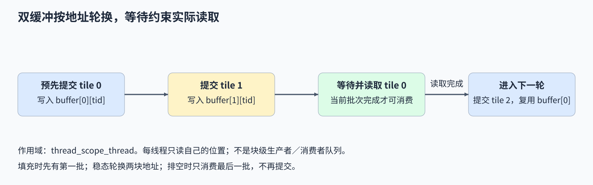
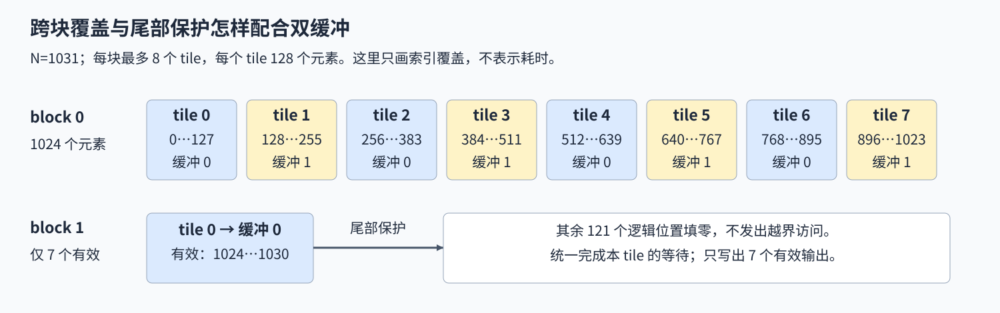

# 09. CUDA Async Copy Pipeline | CUDA 异步拷贝流水线
**难度：** Hard | **环境：** [NVIDIA GPU 必需](#runtime-environment) | **标签：** `CUDA C++`、`cuda::pipeline`、`异步拷贝` | **目标人群：** 理解共享内存与异步执行

> 🚀 **云端运行环境**
>
> 本章节的实战代码可以点击以下链接在免费 GPU 算力平台上直接运行：
>
> [](https://colab.research.google.com/github/datawhalechina/llm-algo-leetcode/blob/main/04_CUDA_and_System_Optimization/09_CUDA_Async_Copy_Pipeline.ipynb)
> [](https://modelscope.cn/my/mynotebook) *(国内推荐：魔搭社区免费实例)*


## 本节导读
同一个线程连续处理多块数据时，必须先等当前块可读，再计算输出；它能否在等待之前先发出下一块拷贝？两块共享内存缓冲区为当前数据和下一批数据提供不同位置，但提交拷贝、等待完成和再次覆盖仍有严格次序。

沿线程独占的缓冲位置追踪数据，可以区分地址轮换与阶段完成的作用。数值结果检查读取了哪一批数据；是否真正隐藏等待，还要另外观察执行和耗时。

<a id="runtime-environment"></a>
## 运行环境

- **GPU练习：** 使用[算子优化环境](../topic_discussion/operator_optimization/quickstart.md#triton-environment)，运行[异步拷贝练习与测试](#mechanism-practice)；需要NVIDIA GPU和CUDA PyTorch。
- **工具链条件：** 本机CUDA Toolkit（`nvcc`）和兼容C++主机编译器。本页设备端`cuda::pipeline`／`cuda::memcpy_async`接口需要CUDA 11+；硬件加速效果还取决于GPU架构和对齐条件。

## 前置阅读
先理解共享内存 tile 的装载、消费与复用，再把同步拷贝改成带阶段状态的异步拷贝。

- [06. CUDA 共享内存分块 GEMM](./06_CUDA_Shared_Memory_Optimization.md)
## Step 1：提交拷贝后，什么时候才能读取

全局内存到共享内存（global→shared）的异步拷贝先提交、后完成；消费者须等数据就绪再读取。`cuda::memcpy_async`与pipeline配合记录提交批次和完成进度。在线程级分工中，每个线程只搬运并读取属于自己的位置，各自维护这份进度，等待覆盖的是本线程提交的数据。

线程级pipeline与块级生产者—消费者队列的协作范围不同。两块共享地址只提供交替存储的位置，不自动构成会管理两槽容量的块级队列；若改成多个线程消费彼此搬运的数据，还需重新建立跨线程完成与可见性关系。



## Step 2：两块缓冲区怎样轮换

每个 block 最多处理 8 个 tile，每个 tile 有 128 个元素。先提交 tile 0，再在每轮消费前提交下一 tile：当前数据放在 `tile % 2`，下一批放在另一个缓冲区。计算结束后，线程才进入会再次使用旧地址的下一轮，所以后续拷贝不会覆盖自己尚未读完的数据。

每个线程独占缓冲位置，因此地址轮换与“先读完、再进入下一轮”的执行顺序共同防止覆盖。`consumer_release()`保留消费阶段的API次序；两槽容量约束仍由当前轮换设计保证，而不是由这个线程级调用自动建立。

| 阶段 | 缓冲区 0 | 缓冲区 1 | 当前线程的动作 |
| --- | --- | --- | --- |
| 填充 | 提交 tile 0 | 空闲 | 尚不能直接读取 |
| 第一轮 | 等待并消费 tile 0 | 提交 tile 1 | 先发出下一批，再等当前批次 |
| 中间轮 | 提交 tile 2 | 等待并消费 tile 1 | 轮换缓冲地址 |
| 排空 | 最后一批所在位置 | 不再提交下一批 | 等待并完成最后输出 |
## Step 3：尾块、工作量和重叠收益怎样区分

输入长度为 1031 时，第一个 block 处理前 1024 个元素，第二个 block 只剩 7 个有效元素。尾部无效位置填零，各线程仍按相同轮次提交和等待，最终只写出合法坐标。各 block 独立处理自己的输入范围。

两个 FP32 缓冲区占 $2\times128\times4=1024$ 字节，即 1 KiB；每个元素只乘一个常数，计算很短，准备与等待的代价可能抵消重叠收益。调用异步 API 不代表已经测得拷贝与计算重叠，也不代表使用了 TMA。跨 tile、跨 block 和尾块的数值结果说明数据路径是否正确；生成指令、耗时和重叠程度则需要分别核对。



<a id="mechanism-practice"></a>

## Step 4：实现提交、等待与消费

补全初始 tile、下一 tile 的提交，以及当前 tile 的等待和消费。保留给定的线程级分工，用缓冲轮换保证读写次序。 在`build_cuda_source()`的变量提示处补全CUDA片段，保留给定模板和启动器；空缺为`None`时，实际测试在对应TODO停止，补全后再编译并核对输出。


| TODO / 函数 | 待实现的机制 | 必须满足的约束 | 测试证据 |
| --- | --- | --- | --- |
| TODO 1 / `build_cuda_source` → `pipeline_kernel` | 提交初始 tile | 有效元素异步搬运，无效位置填零；提交批次 | 首轮输出与 PyTorch 比较 |
| TODO 2 / `build_cuda_source` → `pipeline_kernel` | 提交下一 tile | 只在下一 tile 存在时使用另一缓冲区 | 多 tile 和第二个 block 的结果 |
| TODO 3 / `build_cuda_source` → `pipeline_kernel` | 等待、消费并结束阶段 | 完成通知先于读取，只写有效输出 | 跨缓冲、跨 block、尾块与多种缩放系数对照 |

```python
import torch
from functools import lru_cache
from string import Template
from torch.utils.cpp_extension import load_inline

import math
```


```python
def build_cuda_source():
    """组装 CUDA 源码，空缺在实际测试调用时报告。"""
    # ==========================================
    # TODO 1：提交初始 tile
    # 作用：使用 base、n、tid、pipe 和 tile_buffer；无效位置填零，提交批次。
    # first_submit = r"""???"""
    # ==========================================
    first_submit = None
    if first_submit is None:
        raise NotImplementedError("TODO 1：请填写 first_submit")
    # ==========================================
    # TODO 2：提前提交下一 tile
    # 作用：先判断下一 tile 是否存在，再写另一缓冲区；保持提交次序。
    # next_submit = r"""???"""
    # ==========================================
    next_submit = None
    if next_submit is None:
        raise NotImplementedError("TODO 2：请填写 next_submit")
    # ==========================================
    # TODO 3：等待并消费当前 tile
    # 作用：等待完成后读 tile % 2，只写合法输出，随后结束消费阶段。
    # consume_statements = r"""???"""
    # ==========================================
    consume_statements = None
    if consume_statements is None:
        raise NotImplementedError("TODO 3：请填写 consume_statements")
    template = r'''
#include <torch/extension.h>
#include <cuda/pipeline>
#include <cuda_runtime.h>
#include <ATen/cuda/CUDAContext.h>
#include <c10/cuda/CUDAException.h>
#include <c10/cuda/CUDAGuard.h>

constexpr int BLOCK = 128;
__global__ void pipeline_kernel(const float* input, float* output, int n, float scale) {
    __shared__ float tile_buffer[2][BLOCK];
    int tid = threadIdx.x;
    int base = blockIdx.x * BLOCK * 8 + tid;
    int remaining = n - blockIdx.x * BLOCK * 8;
    int tile_count = (remaining + BLOCK - 1) / BLOCK;
    if (tile_count > 8) tile_count = 8;
    cuda::pipeline<cuda::thread_scope_thread> pipe = cuda::make_pipeline();
    $first_submit

    for (int tile = 0; tile < tile_count; ++tile) {
        $next_submit
        $consume_statements
    }
}

torch::Tensor pipeline_cuda(torch::Tensor input, double scale) {
    c10::cuda::CUDAGuard guard(input.device());
    auto output = torch::empty_like(input);
    int blocks = (input.numel() + BLOCK * 8 - 1) / (BLOCK * 8);
    pipeline_kernel<<<blocks, BLOCK, 0, at::cuda::getCurrentCUDAStream()>>>(input.data_ptr<float>(), output.data_ptr<float>(), input.numel(), static_cast<float>(scale));
    C10_CUDA_KERNEL_LAUNCH_CHECK();
    return output;
}
'''
    return Template(template).substitute(
        first_submit=first_submit,
        next_submit=next_submit,
        consume_statements=consume_statements,
    )


@lru_cache(maxsize=1)
def compile_cuda_source(source):
    """按完整源码缓存扩展，不检查源码中的 TODO 注释。"""
    return load_inline(
        name='tutorial_async_copy_v2',
        cpp_sources='torch::Tensor pipeline_cuda(torch::Tensor input, double scale);',
        cuda_sources=source,
        functions=['pipeline_cuda'],
        with_cuda=True,
        extra_cflags=['-O3'],
        extra_cuda_cflags=['-O3'],
    )


def pipeline_cuda(x, scale):
    """用线程级 pipeline 搬入一维 FP32 数据并缩放。"""
    if not x.is_cuda or x.ndim != 1 or x.dtype != torch.float32 or not x.is_contiguous() or x.numel() == 0:
        raise ValueError("本节要求连续、非空的一维 float32 CUDA 输入")
    if isinstance(scale, bool) or not isinstance(scale, (int, float)) or not math.isfinite(scale) or abs(scale) > torch.finfo(torch.float32).max:
        raise ValueError("缩放系数必须是可表示为有限 FP32 的实数")
    extension = compile_cuda_source(build_cuda_source())
    return extension.pipeline_cuda(x, float(scale))
```

## 正确性测试


```python
def test_async_copy_pipeline():
    """核对缓冲轮换、多块、尾块、缩放系数、输入约束与当前流。"""
    if not torch.cuda.is_available():
        print("SKIPPED: 异步拷贝核对需要 NVIDIA GPU。")
        return {"status": "skipped", "reason": "cuda_unavailable"}
    torch.manual_seed(42)
    sizes = (1, 127, 128, 129, 1024, 1031, 2048, 2051)
    numeric_cases = 0
    for size in sizes:
        for scale in (0, -0.5, 1.75):
            # 不同位置的值不同，重复读取第一块不能冒充正确轮换。
            x = torch.randn(size, device="cuda", dtype=torch.float32)
            actual = pipeline_cuda(x, scale)
            torch.testing.assert_close(actual, x * scale, atol=0, rtol=0)
            assert actual.shape == x.shape and actual.dtype == x.dtype and actual.device == x.device
            numeric_cases += 1
    valid = torch.ones(16, device="cuda")
    invalid_inputs = (valid.cpu(), valid.double(), valid[::2], valid.reshape(4, 4), valid[:0])
    for x in invalid_inputs:
        try:
            pipeline_cuda(x, 1)
        except ValueError:
            pass
        else:
            raise AssertionError("非法流水输入应被拒绝")
    invalid_scales = (True, "1", float("nan"), float("inf"), 1e40)
    for scale in invalid_scales:
        try:
            pipeline_cuda(valid, scale)
        except ValueError:
            pass
        else:
            raise AssertionError("非法缩放系数应被拒绝")
    stream = torch.cuda.Stream()
    with torch.cuda.stream(stream):
        x = torch.arange(1031, device="cuda", dtype=torch.float32)
        consumed = pipeline_cuda(x, -0.5) + 1
    stream.synchronize()
    torch.testing.assert_close(consumed, x * -0.5 + 1, atol=0, rtol=0)
    print({"status": "passed", "numeric_cases": numeric_cases,
           "invalid_cases": len(invalid_inputs) + len(invalid_scales), "current_stream": "passed"})
    return {"status": "passed"}


test_async_copy_pipeline()
```

---
> 先完成题目区，再运行测试并查看参考实现。

## 参考代码与解析

### 代码


```python
def build_cuda_source():
    """组装 CUDA 源码，空缺在实际测试调用时报告。"""
    # ==========================================
    # TODO 1：提交初始 tile
    # 作用：使用 base、n、tid、pipe 和 tile_buffer；无效位置填零，提交批次。
    # first_submit = r"""???"""
    # ==========================================
    first_submit = r"""
int first = base;
    pipe.producer_acquire();
    if (first < n) cuda::memcpy_async(&tile_buffer[0][tid], input + first, sizeof(float), pipe);
    else tile_buffer[0][tid] = 0.0f;
    pipe.producer_commit();
"""
    if first_submit is None:
        raise NotImplementedError("TODO 1：请填写 first_submit")
    # ==========================================
    # TODO 2：提前提交下一 tile
    # 作用：先判断下一 tile 是否存在，再写另一缓冲区；保持提交次序。
    # next_submit = r"""???"""
    # ==========================================
    next_submit = r"""
int next_tile = tile + 1;
        int next_index = base + next_tile * BLOCK;
        if (next_tile < tile_count) {
            pipe.producer_acquire();
            if (next_index < n) cuda::memcpy_async(&tile_buffer[next_tile % 2][tid], input + next_index, sizeof(float), pipe);
            else tile_buffer[next_tile % 2][tid] = 0.0f;
            pipe.producer_commit();
        }
"""
    if next_submit is None:
        raise NotImplementedError("TODO 2：请填写 next_submit")
    # ==========================================
    # TODO 3：等待并消费当前 tile
    # 作用：等待完成后读 tile % 2，只写合法输出，随后结束消费阶段。
    # consume_statements = r"""???"""
    # ==========================================
    consume_statements = r"""
pipe.consumer_wait();
        int current = base + tile * BLOCK;
        if (current < n) output[current] = tile_buffer[tile % 2][tid] * scale;
        pipe.consumer_release();
"""
    if consume_statements is None:
        raise NotImplementedError("TODO 3：请填写 consume_statements")
    template = r'''
#include <torch/extension.h>
#include <cuda/pipeline>
#include <cuda_runtime.h>
#include <ATen/cuda/CUDAContext.h>
#include <c10/cuda/CUDAException.h>
#include <c10/cuda/CUDAGuard.h>

constexpr int BLOCK = 128;
__global__ void pipeline_kernel(const float* input, float* output, int n, float scale) {
    __shared__ float tile_buffer[2][BLOCK];
    int tid = threadIdx.x;
    int base = blockIdx.x * BLOCK * 8 + tid;
    int remaining = n - blockIdx.x * BLOCK * 8;
    int tile_count = (remaining + BLOCK - 1) / BLOCK;
    if (tile_count > 8) tile_count = 8;
    cuda::pipeline<cuda::thread_scope_thread> pipe = cuda::make_pipeline();
    $first_submit

    for (int tile = 0; tile < tile_count; ++tile) {
        $next_submit
        $consume_statements
    }
}

torch::Tensor pipeline_cuda(torch::Tensor input, double scale) {
    c10::cuda::CUDAGuard guard(input.device());
    auto output = torch::empty_like(input);
    int blocks = (input.numel() + BLOCK * 8 - 1) / (BLOCK * 8);
    pipeline_kernel<<<blocks, BLOCK, 0, at::cuda::getCurrentCUDAStream()>>>(input.data_ptr<float>(), output.data_ptr<float>(), input.numel(), static_cast<float>(scale));
    C10_CUDA_KERNEL_LAUNCH_CHECK();
    return output;
}
'''
    return Template(template).substitute(
        first_submit=first_submit,
        next_submit=next_submit,
        consume_statements=consume_statements,
    )


@lru_cache(maxsize=1)
def compile_cuda_source(source):
    """按完整源码缓存扩展，不检查源码中的 TODO 注释。"""
    return load_inline(
        name='tutorial_async_copy_v2',
        cpp_sources='torch::Tensor pipeline_cuda(torch::Tensor input, double scale);',
        cuda_sources=source,
        functions=['pipeline_cuda'],
        with_cuda=True,
        extra_cflags=['-O3'],
        extra_cuda_cflags=['-O3'],
    )


def pipeline_cuda(x, scale):
    """用线程级 pipeline 搬入一维 FP32 数据并缩放。"""
    if not x.is_cuda or x.ndim != 1 or x.dtype != torch.float32 or not x.is_contiguous() or x.numel() == 0:
        raise ValueError("本节要求连续、非空的一维 float32 CUDA 输入")
    if isinstance(scale, bool) or not isinstance(scale, (int, float)) or not math.isfinite(scale) or abs(scale) > torch.finfo(torch.float32).max:
        raise ValueError("缩放系数必须是可表示为有限 FP32 的实数")
    extension = compile_cuda_source(build_cuda_source())
    return extension.pipeline_cuda(x, float(scale))
```

### 解析

#### TODO 1：先提交第一批数据

- 消费循环开始前先准备缓冲区0，提交本线程的初始拷贝；无效位置填零且不发出越界拷贝，仍保持阶段提交次序。
- 1／127／128元素检查极短尾块、不足一块与完整tile。输出逐元素核对有助于发现首批未准备，但访问安全仍需结合提交前的边界条件审查。

#### TODO 2：提前发出下一批

- 下一tile存在时才提交，并用`next_tile % 2`选择另一缓冲区；之后再复用旧地址时，本线程已结束对旧数据的消费。
- 129元素进入第二个tile，1031元素再增加第二个block的尾部；不同位置的随机值可暴露重复读取首tile或缓冲轮换错位。

#### TODO 3：等到可读后再使用数据

- `consumer_wait()`先等本线程提交的数据可读，再从当前槽位取值、缩放并写合法位置，最后结束消费阶段；它不是其他线程消费者的共同屏障。
- 零、负数与非整数系数核对计算，非默认流另核对准备与消费依赖。数值测试不测重叠比例，改成块内共同装载时还需重新建立跨线程可见性。

## 相关阅读

继续查看 pipeline 的作用域和阶段语义，或比较 kernel 内部与主机—设备之间的流水线。

- [CUDA Programming Guide：Pipelines](https://docs.nvidia.com/cuda/cuda-programming-guide/04-special-topics/pipelines.html)：线程级与块级 pipeline 的差别。
- [08. 异步数据预取与双缓冲](./08_Async_Data_Prefetch_and_Double_Buffering.md)：填充、稳态和排空的时间模型。
