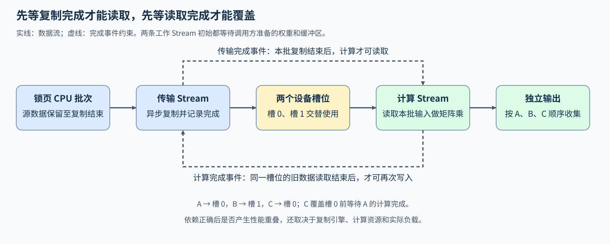
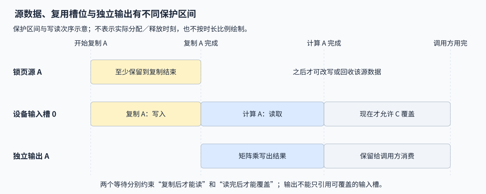

# 10. PyTorch CUDA Streams and Transfer | CUDA Stream 与锁页内存传输

**难度：** 进阶 | **环境：** [NVIDIA GPU 必需](#runtime-environment) | **标签：** `CUDA Stream`、`Pinned Memory`、`异步传输` | **目标人群：** 理解张量运算与异步执行

> 🚀 **云端运行环境**
>
> 本章节的实战代码可以点击以下链接在免费 GPU 算力平台上直接运行：
>
> [](https://colab.research.google.com/github/datawhalechina/llm-algo-leetcode/blob/main/04_CUDA_and_System_Optimization/10_PyTorch_CUDA_Streams_and_Transfer.ipynb)
> [](https://modelscope.cn/my/mynotebook) *(国内推荐：魔搭社区免费实例)*


## 本节导读

CPU 批次依次传入 GPU 时，下一批传输可能与当前批计算同时进行，也可能错误覆盖仍在使用的数据。以 A、B、C 三批矩阵为例，跟踪两块设备缓冲区的写入、读取与轮换，用两类完成事件实现正确依赖，再与串行参考结果逐批核对。

<a id="runtime-environment"></a>

## 运行环境

需要 NVIDIA GPU 与 CUDA 版 PyTorch；使用 [PERF-CUDA-MECHANISM](../topic_discussion/performance_analysis/quickstart.md#perf-cuda-mechanism-quickstart)，或已有且通过检查的 [llm_algo_cnb_gpu](../topic_discussion/operator_optimization/quickstart.md#triton-environment)。练习调用 PyTorch Runtime，无需本机 `nvcc`；测试检查多批次输出和输入约束，性能重叠需另用时间线或配对测量确认。

## 前置阅读

先看 Stream 的执行顺序与依赖，再检查主机数据复制何时能与计算并行。

- [Part 01：17 CUDA Stream 与异步执行](../01_Hardware_Math_and_Systems/17_CUDA_Stream_and_Asynchrony.md)

## Step 1：锁页批次怎样经过设备缓冲区

执行流（Stream）组织设备操作的提交次序，事件（Event）标记进度，让另一条流可以等待数据就绪。设A、B、C是CPU上的同形状矩阵，各自传入GPU后与同一权重相乘。两块设备槽位交替接收数据，A写槽0、B写槽1、C再用槽0；复制完成后计算才能读取，前次计算读完后槽位才能重写。事件负责保证这两类先后关系，能否并发还取决于设备能力和资源竞争。

锁页内存（Pinned Memory）为异步主机到设备传输提供稳定的源内存条件，会占用不可换出的主机内存。普通可分页内存可能先暂存到锁页缓冲区再搬运；异步提交后的源数据还要保留到复制完成，才能安全修改或释放。满足这些条件后，不同槽位的传输与计算才有机会交错执行。



## Step 2：传输完成与读取完成分别约束什么

传输 Stream 顺序复制 A、B、C，计算 Stream 顺序执行矩阵乘。同一条 Stream 的提交有先后关系，两条 Stream 则需要事件连接：A 的复制结束后记录传输完成，计算 Stream 等待这个事件，才能读取槽 0；A 的矩阵乘结束后再记录计算完成，传输 Stream 等待它，才可以用 C 覆盖槽 0。只保留第一类等待，可能让旧批次读到被覆盖的数据；只保留第二类等待，又可能让计算读取尚未复制完的批次。

事件按槽位维护。B 使用槽 1 时，不需要为了写入槽 1 而等待 A 释放槽 0；C 回到槽 0 时，等待的则是 A 对应的读取结束。初始权重和两块缓冲区还由调用方准备，传输、计算两条工作 Stream 都应先等待调用方已有任务，之后再用批次事件推进。

## Step 3：双缓冲怎样避免提前覆盖

用 `index % 2` 选择槽位时，第 0、1 批分别首次使用两个槽位，第 2 批开始复用。C写入槽0前，先等待A的计算完成事件，确保槽位中的旧输入已被读完。每批矩阵乘产生独立输出，收集这些输出后，即使输入槽位被下一批覆盖，前面各批的结果也能保持有效。

锁页源数据、设备输入槽位和输出各有生命周期：源数据保留到传输结束，输入槽位保留到计算读取完成，输出保留到调用方使用完毕。两条 Stream 的分配与使用也要让内存分配器了解，函数返回前再等待计算 Stream 完成，使返回结果可直接用于对照。设备是否支持并发搬运、传输与计算是否争用资源，决定上述交错执行能否缩短耗时。



## Step 4：补全双缓冲的三处数据依赖

输入为同形状、同类型的锁页 CPU 批次，以及同类型的二维设备权重和位于同一设备的两条不同 Stream；输出保持原批次顺序。缓冲区分配、事件创建、槽位循环、输出收集和返回同步已给出，补全下面三处等待或复制动作。

正确性测试用单批、双批及多批数据覆盖槽位首次使用和多次复用，并检查空输入、权重／批次／Stream 约束与调用方准备依赖；不测吞吐或重叠比例。

| TODO / 函数 | 待实现的机制 | 必须满足的约束 | 测试证据 |
| --- | --- | --- | --- |
| TODO 1 · `overlap_transfer_and_compute` | 重写槽位前等待上次读取完成 | 仅复用时等待当前槽位的计算完成事件 | 不同批次数覆盖槽 0、1 的轮换与再次覆盖 |
| TODO 2 · `overlap_transfer_and_compute` | 将当前锁页批次异步复制到槽位 | 使用传输 Stream，复制后再记录传输完成 | 每批数值、输出顺序与串行参考一致 |
| TODO 3 · `overlap_transfer_and_compute` | 计算前等待本槽位传输完成 | 等待当前槽位的事件，不依赖整设备同步 | 不同形状的输出属性与数值，非默认调用方准备 |

```python
import torch

```


```python
def overlap_transfer_and_compute(cpu_batches, weight, transfer_stream, compute_stream):
    """用两个设备槽位传输锁页批次，并按原顺序返回矩阵乘结果。

    Args:
        cpu_batches: 同形状、同类型的锁页 CPU 张量列表。
        weight: CUDA 上的二维权重，内维与批次矩阵匹配。
        transfer_stream: 提交异步复制的 CUDA Stream。
        compute_stream: 提交矩阵乘的另一条 CUDA Stream。

    Returns:
        已完成计算的输出列表；输入列表为空时返回空列表。
    """
    if not cpu_batches:
        return []
    if not isinstance(weight, torch.Tensor) or not weight.is_cuda or weight.ndim != 2 or min(weight.shape) <= 0 or not weight.is_floating_point():
        raise ValueError("权重须为非空二维浮点 CUDA 张量")
    if not isinstance(transfer_stream, torch.cuda.Stream) or not isinstance(compute_stream, torch.cuda.Stream):
        raise ValueError("传输与计算须使用 CUDA Stream")
    if transfer_stream.device != weight.device or compute_stream.device != weight.device:
        raise ValueError("两条 Stream 与权重须位于同一设备")
    if transfer_stream.cuda_stream == compute_stream.cuda_stream:
        raise ValueError("传输与计算必须使用不同 CUDA Stream")
    if any(not isinstance(batch, torch.Tensor) or batch.device.type != "cpu" or not batch.is_pinned() for batch in cpu_batches):
        raise ValueError("所有批次须为锁页 CPU 张量")
    if any(batch.ndim != 2 or min(batch.shape) <= 0 or batch.shape[1] != weight.shape[0] or batch.dtype != weight.dtype for batch in cpu_batches):
        raise ValueError("批次须为非空二维矩阵，内维与权重匹配且类型一致")
    if any(batch.shape != cpu_batches[0].shape for batch in cpu_batches):
        raise ValueError("所有批次形状须相同")

    device = weight.device
    buffers = [torch.empty_like(cpu_batches[0], device=device) for _ in range(2)]
    for buffer in buffers:
        buffer.record_stream(transfer_stream)
        buffer.record_stream(compute_stream)

    # 两条工作流先等待调用方准备好的权重和设备缓冲区。
    caller_stream = torch.cuda.current_stream(device)
    transfer_stream.wait_stream(caller_stream)
    compute_stream.wait_stream(caller_stream)

    transfer_done = [torch.cuda.Event() for _ in buffers]
    compute_done = [torch.cuda.Event() for _ in buffers]
    outputs = []

    for index, cpu_batch in enumerate(cpu_batches):
        slot = index % 2
        if index >= 2:
            # ==========================================
            # TODO 1：保护被复用槽位的旧数据
            # 作用：等待该槽位上一次矩阵乘读取完成，才能开始下一次复制。
            # 注意：index >= 2 才发生复用；事件应与当前 slot 对应。
            # 提示：reuse_event 使用当前 slot 的计算完成事件。
            # ==========================================
            reuse_event = None
            if reuse_event is None:
                raise NotImplementedError("请完成 TODO 1：reuse_event")
            transfer_stream.wait_event(reuse_event)
        with torch.cuda.stream(transfer_stream):
            # ==========================================
            # TODO 2：提交当前批次的异步复制
            # 作用：在传输 Stream 中把 cpu_batch 写入 buffers[slot]。
            # 注意：源张量已锁页；完成事件在复制之后记录。
            # 提示：copy_source 使用本轮 CPU 输入，不是首批或其他槽位。
            # ==========================================
            copy_source = None
            if copy_source is None:
                raise NotImplementedError("请完成 TODO 2：copy_source")
            buffers[slot].copy_(copy_source, non_blocking=True)
            transfer_done[slot].record(transfer_stream)

        # ==========================================
        # TODO 3：等待本批次数据就绪
        # 作用：让计算 Stream 等待当前槽位的复制结束，再执行矩阵乘。
        # 提示：ready_event 使用当前 slot 的传输完成事件。
        # ==========================================
        ready_event = None
        if ready_event is None:
            raise NotImplementedError("请完成 TODO 3：ready_event")
        compute_stream.wait_event(ready_event)
        with torch.cuda.stream(compute_stream):
            outputs.append(buffers[slot] @ weight)
            compute_done[slot].record(compute_stream)

    compute_stream.synchronize()
    return outputs
```

## 正确性测试


```python
def test_streamed_transfer_matches_reference():
    """核对多批轮换、顺序、输入契约和非默认调用方的准备依赖。"""
    if not torch.cuda.is_available():
        print("SKIPPED: Stream 依赖核对需要 NVIDIA GPU。")
        return {"status": "skipped", "reason": "cuda_unavailable"}
    torch.manual_seed(17)
    device = torch.device("cuda", torch.cuda.current_device())
    transfer = torch.cuda.Stream(device=device)
    compute = torch.cuda.Stream(device=device)
    checked_batches = 0
    for count, rows, inner, cols in ((1, 1, 3, 2), (2, 7, 5, 3), (5, 64, 32, 16), (7, 17, 9, 4)):
        batches = [torch.randn(rows, inner, pin_memory=True) for _ in range(count)]
        before = [batch.clone() for batch in batches]
        weight = torch.randn(inner, cols, device=device)
        actual = overlap_transfer_and_compute(batches, weight, transfer, compute)
        expected = [batch.to(device) @ weight for batch in batches]
        assert len(actual) == count
        assert len({output.data_ptr() for output in actual}) == count
        for index, (got, want) in enumerate(zip(actual, expected)):
            assert got.shape == want.shape and got.dtype == want.dtype and got.device == want.device
            torch.testing.assert_close(got, want, atol=1e-5, rtol=1e-5, msg=f"batch={index}")
            torch.testing.assert_close(batches[index], before[index], atol=0, rtol=0)
        checked_batches += count
    assert overlap_transfer_and_compute([], weight, transfer, compute) == []

    valid = [torch.ones(4, 9, pin_memory=True)]
    w = torch.ones(9, 3, device=device)
    invalid = (
        (valid, w.cpu(), transfer, compute),
        (valid, w.flatten(), transfer, compute),
        (valid, w.double(), transfer, compute),
        (valid, w, transfer, transfer),
        (valid, w, None, compute),
        ([torch.ones(4, 9)], w, transfer, compute),
        ([torch.ones(4, 8, pin_memory=True)], w, transfer, compute),
        ([torch.ones(0, 9, pin_memory=True)], w, transfer, compute),
        ([torch.ones(4, 9, dtype=torch.float64, pin_memory=True)], w, transfer, compute),
        (valid + [torch.ones(5, 9, pin_memory=True)], w, transfer, compute),
    )
    for args in invalid:
        try:
            overlap_transfer_and_compute(*args)
        except ValueError:
            pass
        else:
            raise AssertionError("非法批次、权重或 Stream 应在提交前被拒绝")

    # 调用方在非默认流中准备权重，两条工作流必须等待这一准备。
    caller = torch.cuda.Stream(device=device)
    batches = [torch.full((17, 9), float(i + 1), pin_memory=True) for i in range(5)]
    with torch.cuda.stream(caller):
        w = torch.empty(9, 3, device=device)
        w.fill_(2)
        actual = overlap_transfer_and_compute(batches, w, transfer, compute)
    for index, output in enumerate(actual):
        torch.testing.assert_close(output, torch.full_like(output, 18 * (index + 1)), atol=0, rtol=0)
    print({"status": "passed", "random_batches": checked_batches, "invalid_cases": len(invalid), "caller_stream": "passed"})
    return {"status": "passed"}


test_streamed_transfer_matches_reference()
```

---

🛑 **STOP HERE** 🛑

先完成题目区，再查看参考实现。

## 参考代码与解析

### 代码


```python
def overlap_transfer_and_compute(cpu_batches, weight, transfer_stream, compute_stream):
    """用两个设备槽位传输锁页批次，并按原顺序返回矩阵乘结果。

    Args:
        cpu_batches: 同形状、同类型的锁页 CPU 张量列表。
        weight: CUDA 上的二维权重，内维与批次矩阵匹配。
        transfer_stream: 提交异步复制的 CUDA Stream。
        compute_stream: 提交矩阵乘的另一条 CUDA Stream。

    Returns:
        已完成计算的输出列表；输入列表为空时返回空列表。
    """
    if not cpu_batches:
        return []
    if not isinstance(weight, torch.Tensor) or not weight.is_cuda or weight.ndim != 2 or min(weight.shape) <= 0 or not weight.is_floating_point():
        raise ValueError("权重须为非空二维浮点 CUDA 张量")
    if not isinstance(transfer_stream, torch.cuda.Stream) or not isinstance(compute_stream, torch.cuda.Stream):
        raise ValueError("传输与计算须使用 CUDA Stream")
    if transfer_stream.device != weight.device or compute_stream.device != weight.device:
        raise ValueError("两条 Stream 与权重须位于同一设备")
    if transfer_stream.cuda_stream == compute_stream.cuda_stream:
        raise ValueError("传输与计算必须使用不同 CUDA Stream")
    if any(not isinstance(batch, torch.Tensor) or batch.device.type != "cpu" or not batch.is_pinned() for batch in cpu_batches):
        raise ValueError("所有批次须为锁页 CPU 张量")
    if any(batch.ndim != 2 or min(batch.shape) <= 0 or batch.shape[1] != weight.shape[0] or batch.dtype != weight.dtype for batch in cpu_batches):
        raise ValueError("批次须为非空二维矩阵，内维与权重匹配且类型一致")
    if any(batch.shape != cpu_batches[0].shape for batch in cpu_batches):
        raise ValueError("所有批次形状须相同")

    device = weight.device
    buffers = [torch.empty_like(cpu_batches[0], device=device) for _ in range(2)]
    for buffer in buffers:
        buffer.record_stream(transfer_stream)
        buffer.record_stream(compute_stream)

    # 两条工作流先等待调用方准备好的权重和设备缓冲区。
    caller_stream = torch.cuda.current_stream(device)
    transfer_stream.wait_stream(caller_stream)
    compute_stream.wait_stream(caller_stream)

    transfer_done = [torch.cuda.Event() for _ in buffers]
    compute_done = [torch.cuda.Event() for _ in buffers]
    outputs = []

    for index, cpu_batch in enumerate(cpu_batches):
        slot = index % 2
        if index >= 2:
            # ==========================================
            # TODO 1：保护被复用槽位的旧数据
            # 作用：等待该槽位上一次矩阵乘读取完成，才能开始下一次复制。
            # 注意：index >= 2 才发生复用；事件应与当前 slot 对应。
            # 提示：reuse_event 使用当前 slot 的计算完成事件。
            # ==========================================
            reuse_event = compute_done[slot]
            if reuse_event is None:
                raise NotImplementedError("请完成 TODO 1：reuse_event")
            transfer_stream.wait_event(reuse_event)
        with torch.cuda.stream(transfer_stream):
            # ==========================================
            # TODO 2：提交当前批次的异步复制
            # 作用：在传输 Stream 中把 cpu_batch 写入 buffers[slot]。
            # 注意：源张量已锁页；完成事件在复制之后记录。
            # 提示：copy_source 使用本轮 CPU 输入，不是首批或其他槽位。
            # ==========================================
            copy_source = cpu_batch
            if copy_source is None:
                raise NotImplementedError("请完成 TODO 2：copy_source")
            buffers[slot].copy_(copy_source, non_blocking=True)
            transfer_done[slot].record(transfer_stream)

        # ==========================================
        # TODO 3：等待本批次数据就绪
        # 作用：让计算 Stream 等待当前槽位的复制结束，再执行矩阵乘。
        # 提示：ready_event 使用当前 slot 的传输完成事件。
        # ==========================================
        ready_event = transfer_done[slot]
        if ready_event is None:
            raise NotImplementedError("请完成 TODO 3：ready_event")
        compute_stream.wait_event(ready_event)
        with torch.cuda.stream(compute_stream):
            outputs.append(buffers[slot] @ weight)
            compute_done[slot].record(compute_stream)

    compute_stream.synchronize()
    return outputs
```

### 解析

#### TODO 1：重写前等待读取完成

- 复用槽位时，传输Stream等待该槽位上一次计算完成事件。A仍读取槽0时，C不能覆盖它；首次使用则没有这份旧读取依赖。
- 1／2批覆盖首次使用，5／7批覆盖多轮复用；按原顺序逐项比较各批输出，检查旧数据没有被后续批次替换。

#### TODO 2：异步复制当前锁页批次

- `copy_source`取本轮CPU输入，在传输Stream写入当前槽位；骨架在复制之后记录同槽位事件，使它代表这一批数据就绪。
- 各批数值与串行参考对照，输入不变检查确认复制没有改写来源；前置检查另行拒绝未锁页、类型或形状不匹配的输入，保证复制动作接收符合约定的数据。

#### TODO 3：计算前等待传输完成

- 计算Stream等待当前槽位的传输事件，再读取缓冲区；函数末尾等待计算完成后返回独立输出，避免把尚未就绪的数据交给调用方。
- 多形状、逐批数值与输出存储检查核对返回结果；非默认调用方用例另检查权重准备依赖。这些用例核对依赖与输出；重叠比例则需要另外观察实际执行时间线。

## 相关阅读

先核对框架的跨流语义，再用时间模型分析流水线的填充与排空。

- [异步预取与双缓冲](./08_Async_Data_Prefetch_and_Double_Buffering.md)：用时间模型分析填充、稳态和排空。
- [PyTorch 2.11：CUDA Stream语义](https://docs.pytorch.org/docs/2.11/notes/cuda.html#cuda-streams)：核对跨流等待与分配器存储寿命的区别。
