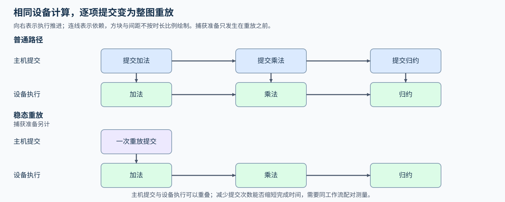
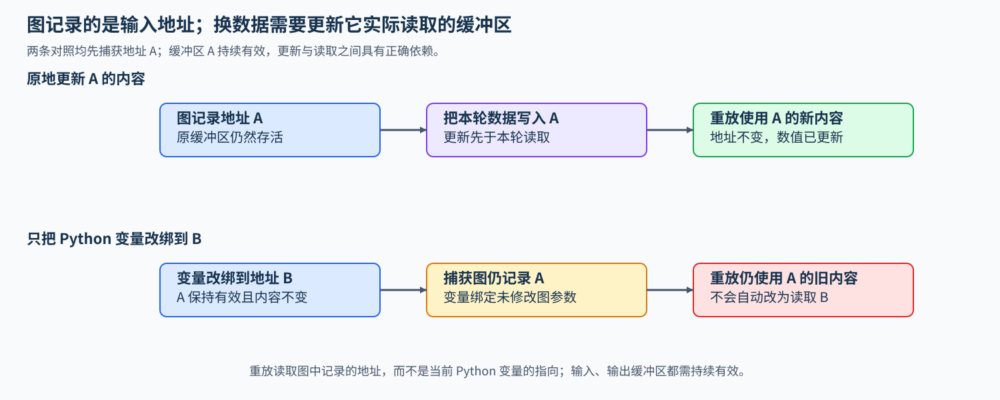

# 11. CUDA Graph and JIT Compile | CUDA Graph 与 JIT 编译

**难度：** 进阶 | **环境：** [CPU 主线，GPU 可选](#runtime-environment) | **标签：** `CUDA Graph`、`JIT`、`提交开销` | **目标人群：** 掌握异步提交与 Stream 依赖

> 🚀 **云端运行环境**
>
> 本章节的实战代码可以点击以下链接在免费 GPU 算力平台上直接运行：
>
> [](https://colab.research.google.com/github/datawhalechina/llm-algo-leetcode/blob/main/04_CUDA_and_System_Optimization/11_CUDA_Graph_and_JIT_Compile.ipynb)
> [](https://modelscope.cn/my/mynotebook) *(国内推荐：魔搭社区免费实例)*


## 本节导读

一轮计算包含许多短操作时，即使设备计算很快，CPU 仍需反复提交同一组任务。CUDA Graph 将已捕获的操作序列重复执行，减少逐次提交；编译融合则可能改变操作数量与中间读写。先用时间模型筛查候选，再在固定缓冲区中更新输入、核对重放结果，最后比较准备成本与稳态耗时。

<a id="runtime-environment"></a>

## 运行环境

- **CPU 练习：** 使用 [BASE-CPU](../guide.md#base-cpu)，完成候选筛查和边界测试。
- **GPU 核对与测量：** 复用已有 CUDA PyTorch 环境，例如 [PERF-CUDA-MECHANISM](../topic_discussion/performance_analysis/quickstart.md#perf-cuda-mechanism-quickstart)；已有 `llm_algo_cnb_gpu` 也可按[算子环境检查](../topic_discussion/operator_optimization/quickstart.md#triton-environment)进入。使用 PyTorch Runtime，无需编译 CUDA C++ 扩展。独立 GPU 单元由 `--mode benchmark` 执行，普通题目／答案测试只运行 CPU。

## 前置阅读

先看 [10. PyTorch CUDA Streams and Transfer](./10_PyTorch_CUDA_Streams_and_Transfer.md) 中任务提交和 Stream 依赖，再判断重复执行同一工作流时能否使用 Graph。
## Step 1：逐次提交与重放怎样执行同一组操作

设固定工作流依次执行加法、乘法和归约。普通执行每轮由主机逐项提交，设备按依赖执行；主机可以在设备忙碌时继续提交，因此两边时间可能重叠。操作很短、主机尚未提交后继任务时，设备也可能出现等待。

CUDA Graph 先捕获这组操作及其依赖，再重复提交整个图。下图只比较稳态的提交方式，方块宽度不代表测量时长。设备仍完成同一组计算；节省多少工作流完成时间，取决于逐次提交原本有多少暴露在关键路径上。


## Step 2：区分代码编译、图捕获与重复执行

代码编译改变操作如何实现，图捕获记录一组操作及其依赖，重放则重复提交这组已捕获的任务。它们可以组合，某些编译后端也会使用 Graph；比较普通提交与显式 Graph 时，先保持工作流和操作实现相同，才容易解释提交方式的影响。

准备成本需要与执行次数一起看。用一组构造值说明：普通路径每轮 1 ms，Graph 稳态每轮 0.8 ms，额外准备 20 ms，重复 100 次时两者同为 100 ms；超过 100 次才开始抵消准备成本。这解释了短任务与长驻服务为何可能选择不同路径，下面按机制列出各自要计入的准备工作。

| 机制 | 改变什么 | 单独计入的准备成本 |
| --- | --- | --- |
| Triton JIT | 将内核源码与配置编译成设备代码 | 首次编译与相应缓存 |
| PyTorch 编译优化 | 可能融合算子、改变中间读写或选择执行实现 | 编译、专门化与重新编译 |
| CUDA Graph 重放 | 按捕获的依赖重复执行，减少逐项提交 | 预热、捕获与图实例化 |

## Step 3：保持地址与依赖，更新缓冲区中的内容

捕获记录操作使用的地址和执行依赖。固定处理 4096 个元素时，可在原输入缓冲区中写入新数值，再重放并读取原输出；若只是把 Python 变量指向另一块内存，图仍读取旧地址。输入、输出与临时缓冲区在重放期间都需保持有效，更新输入必须先于本轮读取。批次换成另一种形状时，可能需要匹配另一张图、补齐到已有分桶或回退普通路径；补齐增加无效计算，多张图占用资源，重新捕获也有准备成本。

比较时还要保留相同计时边界。CPU 提交与 GPU 工作可能重叠，不能直接把两者相加当成端到端时间；CPU 练习因此采用无重叠的串行估算，只产生待测候选。GPU 测量在同一工作流的同步边界之间使用主机墙钟计时，将捕获准备与稳态分开；CUDA Event 可辅助观察设备区间，但单凭设备时间不能确认主机提交成本降低。



## Step 4：实现提交占比与重放候选筛查

给定串行估算中的主机提交时间、设备工作时间，以及是否重复执行和缓冲区是否稳定，补全三个局部判断。默认阈值 20% 只用于本题筛查，不预测加速倍数。

| TODO / 函数 | 待实现的机制 | 必须满足的约束 | 测试证据 |
| --- | --- | --- | --- |
| TODO 1 · `assess_graph_candidate` | 验证时间与阈值 | 时间有限非负、总和有限且为正；阈值在闭区间 [0,1] | 零值、负数、非有限值、溢出和非法阈值 |
| TODO 2 · `assess_graph_candidate` | 计算串行模型的提交占比 | 保持计算精度，仅在返回时保留六位小数 | 0%、100% 与阈值恰好相等 |
| TODO 3 · `assess_graph_candidate` | 联合重复性、稳定性与占比给出建议 | 三项条件同时满足才建议实测；阈值比较使用未舍入值 | 不重复、不稳定、低占比和舍入边界 |


```python
import json
import math
import statistics

from pathlib import Path
from tools.project_runtime import resolve_project_root, save_json_record_once

```


```python
def assess_graph_candidate(cpu_submit_ms, gpu_work_ms, repeated, stable_io, minimum_submission_share=0.2):
    """用串行时间估算筛选值得实测 Graph 的工作流，不预测性能收益。"""
    # ==========================================
    # TODO 1：验证时间与阈值
    # 作用：排除非法时间、非正总和与越界阈值，保证占比有定义。
    # 注意：分别检查有限性；两个有限时间的和也可能溢出。
    # valid_inputs = ???  # 时间、总和与阈值是否满足约束
    # ==========================================
    valid_inputs = None
    if valid_inputs is None:
        raise NotImplementedError("请完成 TODO 1：valid_inputs")
    if not valid_inputs:
        raise ValueError("时间须有限非负、总和为正，阈值须在 [0,1]")
    if not isinstance(repeated, bool) or not isinstance(stable_io, bool):
        raise ValueError("repeated 和 stable_io 必须为布尔值")

    # ==========================================
    # TODO 2：计算串行估算中的提交占比
    # 作用：由 cpu_submit_ms 和 gpu_work_ms 得到未舍入的 share。
    # share = ???  # 主机提交占串行总时间的比例
    # ==========================================
    share = None
    if share is None:
        raise NotImplementedError("请完成 TODO 2：share")

    # ==========================================
    # TODO 3：联合重放候选条件
    # 作用：综合 repeated、stable_io 与 share 决定是否值得实测。
    # 注意：阈值包含等号；使用未舍入的占比作判断。
    # recommend_graph = ???  # 三项门槛是否同时满足
    # ==========================================
    recommend_graph = None
    if recommend_graph is None:
        raise NotImplementedError("请完成 TODO 3：recommend_graph")
    return {
        "submission_share": round(share, 6),
        "recommendation": "benchmark_graph" if recommend_graph else "keep_standard_path",
    }
```

## 测试

```python
def test_graph_candidate_assessment():
    """三项门槛同时满足才推荐，重复性与稳定性各自都不可缺少。"""
    assert assess_graph_candidate(2, 3, True, True) == {
        "submission_share": 0.4, "recommendation": "benchmark_graph",
    }
    for args in [(1, 9, True, True), (4, 1, False, True), (4, 1, True, False)]:
        assert assess_graph_candidate(*args)["recommendation"] == "keep_standard_path"


def test_graph_threshold_boundaries():
    """阈值包含等号，决策使用原始占比而非六位小数的展示值。"""
    assert assess_graph_candidate(2, 8, True, True)["recommendation"] == "benchmark_graph"
    assert assess_graph_candidate(0, 1, True, True)["submission_share"] == 0.0
    assert assess_graph_candidate(1, 0, True, True, 1)["recommendation"] == "benchmark_graph"
    assert assess_graph_candidate(0, 1, True, True, 0)["recommendation"] == "benchmark_graph"
    row = assess_graph_candidate(0.19999996, 0.80000004, True, True)
    assert row["submission_share"] == 0.2
    assert row["recommendation"] == "keep_standard_path"


def test_graph_invalid_inputs():
    """拒绝非有限值、负数、溢出的总和、非法阈值及非布尔门槛。"""
    cases = [
        (0, 0, True, True, 0.2), (-1, 2, True, True, 0.2),
        (float("nan"), 1, True, True, 0.2), (1, float("inf"), True, True, 0.2),
        (1e308, 1e308, True, True, 0.2), (1, 2, True, True, -0.1),
        (1, 2, True, True, 1.1), (1, 2, True, True, float("nan")),
        (1, 2, True, True, float("inf")), (1, 2, True, False, "0.2"),
        (None, 2, True, True, 0.2), (True, 2, True, True, 0.2),
        (1, 2, True, True, True), (1, 2, 1, True, 0.2),
        (1, 2, True, "yes", 0.2),
    ]
    for args in cases:
        try:
            assess_graph_candidate(*args)
        except ValueError:
            continue
        raise AssertionError(f"未拒绝非法输入：{args}")


test_graph_candidate_assessment()
test_graph_threshold_boundaries()
test_graph_invalid_inputs()
print("PASS: CPU 串行估算、候选门槛及边界测试通过。")
```

---

🛑 **STOP HERE** 🛑

先完成题目区，再查看参考实现。
## 参考代码与解析

### 代码

```python
def assess_graph_candidate(cpu_submit_ms, gpu_work_ms, repeated, stable_io, minimum_submission_share=0.2):
    """用串行时间估算筛选值得实测 Graph 的工作流，不预测性能收益。"""
    # ==========================================
    # TODO 1：验证时间与阈值
    # 作用：排除非法时间、非正总和与越界阈值，保证占比有定义。
    # 注意：分别检查有限性；两个有限时间的和也可能溢出。
    # valid_inputs = ???  # 时间、总和与阈值是否满足约束
    # ==========================================
    valid_inputs = (
        all(
            isinstance(value, (int, float)) and not isinstance(value, bool)
            and math.isfinite(value) and value >= 0
            for value in (cpu_submit_ms, gpu_work_ms)
        )
        and math.isfinite(cpu_submit_ms + gpu_work_ms)
        and cpu_submit_ms + gpu_work_ms > 0
        and isinstance(minimum_submission_share, (int, float))
        and not isinstance(minimum_submission_share, bool)
        and math.isfinite(minimum_submission_share)
        and 0 <= minimum_submission_share <= 1
    )
    if valid_inputs is None:
        raise NotImplementedError("请完成 TODO 1：valid_inputs")
    if not valid_inputs:
        raise ValueError("时间须有限非负、总和为正，阈值须在 [0,1]")
    if not isinstance(repeated, bool) or not isinstance(stable_io, bool):
        raise ValueError("repeated 和 stable_io 必须为布尔值")

    # ==========================================
    # TODO 2：计算串行估算中的提交占比
    # 作用：由 cpu_submit_ms 和 gpu_work_ms 得到未舍入的 share。
    # share = ???  # 主机提交占串行总时间的比例
    # ==========================================
    share = cpu_submit_ms / (cpu_submit_ms + gpu_work_ms)
    if share is None:
        raise NotImplementedError("请完成 TODO 2：share")

    # ==========================================
    # TODO 3：联合重放候选条件
    # 作用：综合 repeated、stable_io 与 share 决定是否值得实测。
    # 注意：阈值包含等号；使用未舍入的占比作判断。
    # recommend_graph = ???  # 三项门槛是否同时满足
    # ==========================================
    recommend_graph = repeated and stable_io and share >= minimum_submission_share
    if recommend_graph is None:
        raise NotImplementedError("请完成 TODO 3：recommend_graph")
    return {
        "submission_share": round(share, 6),
        "recommendation": "benchmark_graph" if recommend_graph else "keep_standard_path",
    }
```

### 解析

#### TODO 1：验证串行时间与阈值

- 两个时间可以分别为零，但总和必须有限且为正；阈值位于闭区间[0,1]，重复性与稳定性须为明确布尔值，才能形成有效筛查条件。
- 非法输入测试既检查零总和，也检查两个有限大数相加溢出；非布尔门槛用例防止整数或字符串被隐式当作有效声明。

#### TODO 2：计算未舍入的提交占比

- 提交时间除以串行总时间得到原始占比；零提交和零设备时间分别对应0与1。只在返回展示值时舍入，不用展示精度改变后续判断。
- 0.19999996显示为0.2，仍应低于默认门槛；该边界用例能发现先舍入、再比较导致的错误推荐。

#### TODO 3：联合条件形成实测建议

- 重复执行、缓冲稳定和原始占比达到阈值三项同时成立，才进入Graph配对测量候选；等于阈值也满足条件。
- 测试分别关闭重复性或稳定性，再检查低占比与恰好到界的输入，确认每个条件都参与判断。结果只是实测建议，不是加速倍数预测。


## Step 5：比较普通提交与 Graph 重放的完成时间（可选）

串行占比只能筛出值得尝试的工作流。这里先让固定缓冲接收不同输入，检查Graph重放是否得到新结果，再比较相同短操作链的普通提交与整图重放，将一次性捕获成本和重复执行节省分开计算。

### 5.1 环境与固定工作负载

使用[算子优化Quickstart](../topic_discussion/operator_optimization/quickstart.md#triton-environment)准备环境与仓库运行时，设备与工具链要求沿用本页运行环境；已有记录见[实验资产表](../topic_discussion/operator_optimization/experiment_assets.md)。读取只核对JSON，整页仍需要导入本节所用框架。

固定FP32短操作链，对每个形状分别捕获；先更换三组输入值并清空输出核对重放，再比较普通提交与Graph。记录捕获及首次重放成本。

| 配置或协议 | 默认值与含义 | 修改规则 |
| --- | --- | --- |
| 模式、标签与结果 | read；default；根目录已有记录 | 测量时改为measure，使用唯一标签和新文件名 |
| 工作负载 | 4096／65536个FP32元素，16步操作链 | 改长度或链长需重新捕获并另存结果 |
| 重复策略 | 预热、窗口次数与六轮正逆序或AB/BA配对 | 次数在下方集中配置；轮数取正的偶数 |
| 比较要求 | 数值检查先通过，再解释执行、资源与耗时 | 门槛沿用已给实现，变慢样本同样保留 |


```python
RUN_MODE = "read"  # 默认read读取已有记录；改为measure才执行设备实验。
RUN_LABEL = "default"  # 默认default；测量前换为唯一字母数字标签，可含下划线或连字符。
RESULT_PATH = "benchmarks/results/18_cuda_graph_replay_rtx5070ti_20261110.json"  # 默认已有记录；测量时换新文件名，拒绝覆盖。
N_ELEMENTS = (4096, 65536)  # 默认两档元素数；每档独立捕获，改变后另存记录。
CHAIN_STEPS = 16  # 默认16步加法和乘法，改变后工作流随之变化。
WARMUP = 3  # 默认侧Stream预热3次，不进入稳态窗口。
ITERATIONS = 50  # 默认每窗口重复50次相同工作流。
REPEATS = 6  # 默认6轮；使用正的偶数，平衡普通优先与Graph优先。

```

### 5.2 执行并保存结果

固定地址下依次更换三组输入值，清空输出再重放，以检出错误复用旧结果。正确性通过后，在两个固定形状分别比较普通提交与 Graph，顺序逐轮交换。捕获、实例化与首次重放合记为准备时间；预热、分配、输入更新和独立参考计算不进入稳态窗口。同步只放在计时窗口两端，窗口内重复相同工作流。

measure模式检查新标签与输出路径后执行，完成才以独占方式保存；read模式跳过设备执行。数值、编译或计时异常保留为失败，已有结果不会覆盖。


```python
def run_graph_replay_benchmark():
    """先核对更新输入后的重放，再配对测量相同固定工作流的完成时间。"""
    import json
    import statistics
    import time
    import torch

    if not torch.cuda.is_available():
        print("SKIPPED: Graph 捕获、重放和性能测量需要 CUDA GPU。")
        return {"status": "skipped", "reason": "cuda_unavailable"}
    for value in (*N_ELEMENTS, CHAIN_STEPS, WARMUP, ITERATIONS, REPEATS):
        if not isinstance(value, int) or value <= 0:
            raise ValueError("元素数、链长度、预热及测量轮数必须为正整数")

    device = torch.device("cuda")
    rows = []

    def workload(source, output, temporary):
        """对静态缓冲执行同一条无分配的算术链。"""
        current = source
        for _ in range(CHAIN_STEPS):
            torch.add(current, 0.125, out=temporary)
            torch.mul(temporary, 0.99, out=output)
            current = output

    def reference(source):
        """独立生成参考值，不使用捕获的输出缓冲。"""
        value = source.clone()
        for _ in range(CHAIN_STEPS):
            value = (value + 0.125) * 0.99
        return value

    def completion_ms(callback):
        """同步边界之间的墙钟耗时，除以相同的执行次数。"""
        torch.cuda.synchronize(device)
        start = time.perf_counter()
        for _ in range(ITERATIONS):
            callback()
        torch.cuda.synchronize(device)
        return (time.perf_counter() - start) * 1000 / ITERATIONS

    with torch.no_grad():
        for size in N_ELEMENTS:
            x = torch.zeros(size, device=device, dtype=torch.float32)
            y = torch.empty_like(x)
            temporary = torch.empty_like(x)
            addresses = (x.data_ptr(), y.data_ptr(), temporary.data_ptr())
            current_stream = torch.cuda.current_stream(device)
            warmup_stream = torch.cuda.Stream(device=device)
            warmup_stream.wait_stream(current_stream)
            with torch.cuda.stream(warmup_stream):
                for _ in range(WARMUP):
                    workload(x, y, temporary)
            current_stream.wait_stream(warmup_stream)
            torch.cuda.synchronize(device)

            graph = torch.cuda.CUDAGraph()
            start = time.perf_counter()
            with torch.cuda.graph(graph):
                workload(x, y, temporary)
            graph.replay()
            torch.cuda.synchronize(device)
            capture_and_first_replay_ms = (time.perf_counter() - start) * 1000

            max_error = 0.0
            for value in (-0.5, 0.0, 0.75):
                x.fill_(value)
                expected = reference(x)
                y.fill_(float("nan"))  # 没有真正重放时不能误读上一次输出。
                graph.replay()
                torch.cuda.synchronize(device)
                assert addresses == (x.data_ptr(), y.data_ptr(), temporary.data_ptr())
                assert y.shape == x.shape and y.dtype == x.dtype and y.device == x.device
                torch.testing.assert_close(y, expected, atol=1e-6, rtol=1e-5)
                max_error = max(max_error, (y - expected).abs().max().item())

            x.fill_(0.25)
            expected = reference(x)
            for _ in range(WARMUP):
                workload(x, y, temporary)
                graph.replay()
            pairs = []
            for repeat in range(REPEATS):
                order = ("eager", "graph") if repeat % 2 == 0 else ("graph", "eager")
                measured = {}
                for name in order:
                    callback = (lambda: workload(x, y, temporary)) if name == "eager" else graph.replay
                    measured[name] = completion_ms(callback)
                    torch.testing.assert_close(y, expected, atol=1e-6, rtol=1e-5)
                pairs.append({
                    "repeat": repeat + 1, "order": list(order),
                    "eager_completion_ms": measured["eager"],
                    "graph_completion_ms": measured["graph"],
                    "speedup": measured["eager"] / measured["graph"],
                })

            eager_ms = statistics.median(p["eager_completion_ms"] for p in pairs)
            graph_ms = statistics.median(p["graph_completion_ms"] for p in pairs)
            saving_ms = eager_ms - graph_ms
            rows.append({
                "elements": size, "dtype": str(x.dtype),
                "correctness": "passed", "max_abs_error": max_error,
                "capture_and_first_replay_ms": capture_and_first_replay_ms,
                "eager_median_ms": eager_ms, "graph_median_ms": graph_ms,
                "median_paired_speedup": statistics.median(p["speedup"] for p in pairs),
                "estimated_setup_amortization_calls": (
                    math.ceil(capture_and_first_replay_ms / saving_ms) if saving_ms > 0 else None
                ),
                "decision": "steady_state_candidate" if saving_ms > 0 else "no_steady_state_gain",
                "pairs": pairs,
            })
            del graph  # 下一形状重新捕获，缓冲生命周期覆盖全部重放。

    report = {
        "status": "measured", "evidence_scope": "local_fixed_workflow",
        "device": torch.cuda.get_device_name(device),
        "torch": torch.__version__, "torch_cuda": torch.version.cuda,
        "chain_steps": CHAIN_STEPS, "warmup": WARMUP,
        "iterations": ITERATIONS, "repeats": REPEATS,
        "timing": "host_wall_clock_with_device_sync_at_window_boundaries",
        "input_update_in_timed_window": False, "rows": rows,
    }
    print(json.dumps(report, ensure_ascii=False, indent=2))
    return report


```


```python
relative_result = Path(RESULT_PATH)
if relative_result.is_absolute() or ".." in relative_result.parts:
    raise ValueError("结果路径须为仓库内相对路径")
project_root = resolve_project_root()
if not (project_root / "03_Triton_Kernels").is_dir():
    raise RuntimeError("未定位到仓库，请按Quickstart注册仓库运行时")
result_path = (project_root / relative_result).resolve()
if not result_path.is_relative_to((project_root / "benchmarks/results").resolve()):
    raise ValueError("结果必须位于根目录benchmarks/results")
if RUN_MODE not in {"read", "measure"}:
    raise ValueError("RUN_MODE仅支持read或measure")
if RUN_MODE == "measure":
    if (RUN_LABEL == "default" or not RUN_LABEL
            or any(ch not in "abcdefghijklmnopqrstuvwxyzABCDEFGHIJKLMNOPQRSTUVWXYZ0123456789_-" for ch in RUN_LABEL)):
        raise ValueError("测量前请填写唯一的字母数字标签")
    if result_path.exists():
        raise FileExistsError(f"已有结果不得覆盖，请更换RESULT_PATH：{result_path}")
    if type(REPEATS) is not int or REPEATS <= 0 or REPEATS % 2:
        raise ValueError("REPEATS须为正的偶数")
    if any(type(v) is not int or v <= 0 for v in (*N_ELEMENTS, CHAIN_STEPS, WARMUP, ITERATIONS)):
        raise ValueError("元素数、链长、预热和窗口次数须为正整数")
    measured = run_graph_replay_benchmark()
    if measured["status"] != "measured":
        raise RuntimeError("设备实验未完成，不保存成功记录")
    payload = {
        "schema_version": "tutorial-local-benchmark-record/v1",
        "provenance": {"kind": "notebook_execution", "run_label": RUN_LABEL,
                       "notebook": "04_CUDA_and_System_Optimization/11_CUDA_Graph_and_JIT_Compile.ipynb"},
        "report": measured,
    }
    save_json_record_once(result_path, payload)
    print(f"已保存：{result_path}")
else:
    print(f"读取已有记录，不执行设备实验：{result_path}")

```

### 5.3 读取与核对结果

运行导入和5.1配置后，可直接运行下面的读取单元，无需执行5.2。它按记录本身的协议核对样本、配对次序和汇总值，随后显示该记录的比较结果。


```python
relative_result = Path(RESULT_PATH)
if relative_result.is_absolute() or ".." in relative_result.parts:
    raise ValueError("结果路径须为仓库内相对路径")
project_root = resolve_project_root()
if not (project_root / "03_Triton_Kernels").is_dir():
    raise RuntimeError("未定位到仓库，请按Quickstart注册仓库运行时")
result_path = (project_root / relative_result).resolve()
if not result_path.is_relative_to((project_root / "benchmarks/results").resolve()):
    raise ValueError("结果必须位于根目录benchmarks/results")
record = json.loads(result_path.read_text(encoding="utf-8"))
report = record.get("report", record)
assert report["status"] == "measured" and report["rows"]
assert type(report["repeats"]) is int and report["repeats"] > 0 and report["repeats"] % 2 == 0
assert report["timing"] == "host_wall_clock_with_device_sync_at_window_boundaries"
assert report["input_update_in_timed_window"] is False
assert report["chain_steps"] > 0 and report["iterations"] > 0
seen_sizes = set()
for row in report["rows"]:
    assert row["elements"] > 0 and row["elements"] not in seen_sizes
    seen_sizes.add(row["elements"])
    assert row["correctness"] == "passed" and math.isfinite(row["max_abs_error"])
    assert row["max_abs_error"] >= 0 and row["capture_and_first_replay_ms"] >= 0
    pairs = row["pairs"]
    assert len(pairs) == report["repeats"]
    for index, pair in enumerate(pairs, 1):
        assert pair["repeat"] == index
        assert pair["order"] == (["eager", "graph"] if index % 2 else ["graph", "eager"])
        a, b = pair["eager_completion_ms"], pair["graph_completion_ms"]
        assert math.isfinite(a) and a > 0 and math.isfinite(b) and b > 0
        assert math.isclose(pair["speedup"], a / b, rel_tol=1e-12)
    eager = statistics.median(p["eager_completion_ms"] for p in pairs)
    graph = statistics.median(p["graph_completion_ms"] for p in pairs)
    assert math.isclose(row["eager_median_ms"], eager, rel_tol=1e-12)
    assert math.isclose(row["graph_median_ms"], graph, rel_tol=1e-12)
    assert math.isclose(row["median_paired_speedup"], statistics.median(p["speedup"] for p in pairs), rel_tol=1e-12)
    estimate = math.ceil(row["capture_and_first_replay_ms"] / (eager - graph)) if eager > graph else None
    assert row["estimated_setup_amortization_calls"] == estimate
summary = [{"elements": r["elements"], "eager_ms": r["eager_median_ms"],
            "graph_ms": r["graph_median_ms"], "paired_ratio": r["median_paired_speedup"],
            "setup_calls": r["estimated_setup_amortization_calls"]} for r in report["rows"]]

print(json.dumps({"status": "record_checked", "source": RESULT_PATH,
                  "device": report["device"], "repeats": report["repeats"], "rows": summary},
                 ensure_ascii=False, indent=2))

```

### 5.4 解释结果与适用条件

先看每种形状的 `correctness` 与输入更新误差，再读逐轮 `pairs`：延迟加速比使用普通路径耗时除以 Graph 耗时，超过 1 才表示该轮完成时间下降。六轮配对仅用于观察本机局部趋势，不构成稳定性或服务 SLO 证明；无稳态收益也是有效结论。

`estimated_setup_amortization_calls` 用本次捕获及首次重放时间除以稳态每轮节省，仅作已记录准备成本的摊销估算；预热、分配与应用初始化另计，稳态不更快时记为空。实际服务还需加入输入更新、批次形状变化、分桶及排队成本。

在 RTX 5070 Ti Laptop GPU、PyTorch 2.11.0+cu128 上，FP32 短操作链的两种形状均通过更新输入后的重放核对，最大绝对误差为 0。每种形状预热 3 次，每个计时窗口重复 50 次工作流，再交换普通／Graph 的先后顺序测量 6 轮；完整配置与逐轮数据见[登记记录](../../benchmarks/results/18_cuda_graph_replay_rtx5070ti_20261110.json)，来源为2026-11-10提供的终端输出。

加速比先在每轮求普通耗时／Graph 耗时，再取中位数，因此不要求等于两列耗时中位数的比值。结果支持这条固定工作流的稳态候选；输入更新未进入计时窗口，约 9 次的摊销也只覆盖已记录的捕获及首次重放成本。完整模型、动态批次或服务请求还需各自复测，不能直接采用表中倍数。

| 元素数 | 普通路径中位耗时（ms） | Graph 中位耗时（ms） | 配对加速比中位数 | 捕获及首次重放（ms） | 估算摊销调用数 |
| --- | --- | --- | --- | --- | --- |
| 4096 | 0.107727 | 0.026714 | 4.03× | 0.707 | 9 |
| 65536 | 0.108104 | 0.030793 | 3.51× | 0.650 | 9 |
## 相关阅读

继续比较编译改变的计算路径与 Graph 改变的提交方式，并核对静态缓冲的约束。

- [执行融合与分派](../02_PyTorch_Algorithms/INF-EXECUTION-DISPATCH_Inference_Fusion_and_Backend_Dispatch.md)：比较编译准备、稳态与回退。
- [PyTorch 2.11：CUDA Graph](https://docs.pytorch.org/docs/2.11/notes/cuda.html#cuda-graphs)：捕获约束、静态缓冲与新输入重放。
