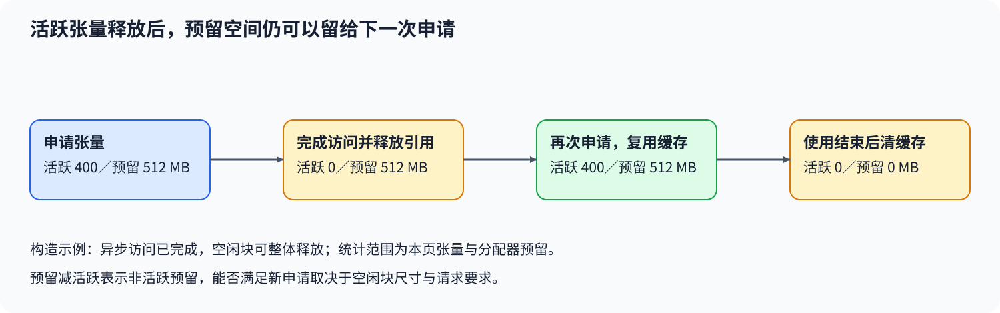
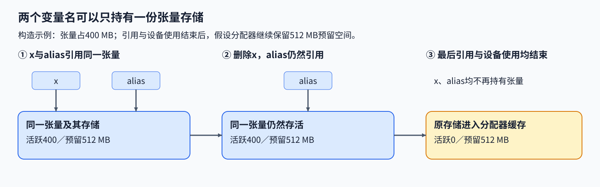

# 12. Memory Pool and VRAM Management | 内存池与显存管理

**难度：** 进阶 | **环境：** [CPU 主线，GPU 可选](#runtime-environment) | **标签：** `CUDA 分配器`、`显存占用`、`内存池` | **目标人群：** 理解张量生命周期、需要分析显存占用

> 🚀 **云端运行环境**
>
> 本章节的实战代码可以点击以下链接在免费 GPU 算力平台上直接运行：
>
> [](https://colab.research.google.com/github/datawhalechina/llm-algo-leetcode/blob/main/04_CUDA_and_System_Optimization/12_Memory_Pool_and_VRAM_Management.ipynb)
> [](https://modelscope.cn/my/mynotebook) *(国内推荐：魔搭社区免费实例)*


## 本节导读

张量已经释放，设备监控里的显存却没有明显下降，是内存泄漏，还是分配器留下了可复用空间？反过来，活跃张量看起来不大，为什么一次新分配仍可能失败？

活跃张量、分配器预留和设备总占用统计的是三个范围。本节先分清这些数字，再根据是否分配失败及剩余容量选择排查方向，用后续采样判断工作集和缓存怎样变化。

<a id="runtime-environment"></a>

## 运行环境

- **基础练习：** 使用[基础CPU环境](../guide.md#base-cpu)，运行[题目与测试](#mechanism-practice)，只依赖Python标准库。
- **GPU行为核对（可选）：** 使用[性能机制环境](../topic_discussion/performance_analysis/quickstart.md#perf-cuda-mechanism-quickstart)或[兼容的算子环境](../topic_discussion/operator_optimization/quickstart.md#triton-environment)，进入[生命周期核对](#gpu-allocator-check)。需要CUDA PyTorch与NVIDIA GPU，无需本机nvcc。

## 前置阅读

先理解一次训练中哪些状态同时存活，再区分张量工作集与分配器缓存。

- [Part 02 · 43 训练显存账本](../02_PyTorch_Algorithms/43_Unified_Training_Memory_Ledger.md)
## Step 1：活跃张量、预留空间与设备占用分别是什么

分配器管理显存的申请、保留与复用。活跃张量占用（allocated）描述PyTorch张量当前持有的显存；缓存分配器预留量（reserved）还包括暂时未被活跃张量使用的空间。设备监控则可能包含CUDA上下文、其他库或其他进程。三者统计范围不同，不能直接拿其中两个数字相减就认定内存泄漏。

例如张量占用 400 MB、分配器预留 512 MB，释放该张量并等待异步使用结束后，活跃占用可以回到零，而预留仍为 512 MB。下一次申请有机会复用这些缓存，不必立即向设备重新申请。下图采用构造值，并假设空闲缓存整块可释放；设备其他占用不在图中。


## Step 2：清理缓存为何不能释放仍在使用的张量

变量名、张量对象与底层存储不是同一个概念。把x赋给alias，只让两个名字引用同一张量，不会复制一份显存；删除x后，alias仍能访问它。视图是另一种共享存储的关系：它可以有不同形状或步长，而不是独立副本。只有相关引用都不再需要这份存储、设备访问也已完成，存储才可安全复用。清理缓存不会越过这些条件去释放活跃数据。

同一时刻仍存活的数据合起来形成工作集，缓存不会缩小权重、激活、梯度或优化器状态本身。工作集超过容量时，需要改变寿命、表示或驻留位置；预留减活跃也不保证是任意请求均可使用的连续空间，还受块尺寸、后端与外部分配影响。跨流访问则同时需要执行依赖和存储寿命保护：主机删除名字不等于设备已经读完。下图沿用主图构造值，只展开两个名字对同一张量的引用。



## Step 3：一次样本能支持哪些排查方向

先统一单位和采样口径，再根据失败信号及活跃占用选择排查方向。本页把容量的90%设为可调整的筛查阈值，判断使用未舍入的比例；达到阈值时，优先查看同时存活的张量和峰值区间。

分配失败时，有空闲预留就检查请求尺寸、空闲块分布与外部分配；预留和活跃量相等时，则继续检查设备其他占用及未跟踪分配。尚未失败时，可以观察缓存是否被后续请求复用，并连续采样活跃量。单个样本用于确定下一步观测，增长、碎片或工作集稳定性需要更多时点和请求信息。

| 样本条件 | 构造例子：活跃／预留／容量（MB） | 优先检查 |
| --- | --- | --- |
| 活跃占用达到筛查阈值 | 900／950／1000，阈值90% | 同时存活的张量及峰值区间 |
| 分配失败且有空闲预留 | 400／800／1000 | 请求块尺寸、空闲块分布与设备其他占用 |
| 分配失败但无空闲预留 | 400／400／1000 | 外部或未跟踪分配、请求尺寸 |
| 未失败但保留缓存 | 400／800／1000 | 后续申请是否按预期复用缓存 |
| 未失败且无其他信号 | 400／400／1000 | 继续采样活跃量与请求变化 |

<a id="mechanism-practice"></a>

## Step 4：从观测样本选择优先排查方向

补全 `classify_memory_sample` 的三个局部量。输入以相同 MB 单位表示活跃量、预留量与设备总容量，满足 $0\le A\le R\le C$ 且 $C>0$；输入检查和返回分支已给出。默认阈值为 0.9，可显式调整；输出是排查建议，不是故障诊断。

| TODO / 函数 | 待实现的机制 | 必须满足的约束 | 测试证据 |
| --- | --- | --- | --- |
| TODO 1：判断活跃工作集<br>`classify_memory_sample` | 判断活跃工作集是否达到阈值 | 用容量与未舍入阈值比较，包含等号 | 阈值两侧、恰好相等、自定义阈值 |
| TODO 2：区分非活跃预留<br>`classify_memory_sample` | 计算分配器内的非活跃预留 | 预留量减活跃量，不用设备空闲量代替 | 相等、存在差值、统一缩放单位 |
| TODO 3：选择失败排查方向<br>`classify_memory_sample` | 在分配失败时区分排查方向 | 即使差值为零也不能返回正常 | 有缓存和无缓存的失败、工作集优先级 |


```python
import math
```


```python
def classify_memory_sample(allocated_mb, reserved_mb, capacity_mb, allocation_failed=False, near_capacity_ratio=0.9):
    """按同口径样本选择排查方向，不以一次样本确诊故障。

    失败方向标识：check_fragmentation_or_external_allocations 检查块布局与外部分配；
    check_external_or_untracked_allocations 检查外部或未跟踪分配。
    """
    values = (allocated_mb, reserved_mb, capacity_mb, near_capacity_ratio)
    try:
        invalid_values = any(isinstance(value, bool) or not isinstance(value, (int, float))
                             or not math.isfinite(value) for value in values)
    except OverflowError:
        invalid_values = True
    if invalid_values:
        raise ValueError("观测值与阈值须为可表示的有限实数")
    if not 0 <= allocated_mb <= reserved_mb <= capacity_mb or capacity_mb <= 0:
        raise ValueError("需要 0 <= allocated <= reserved <= capacity，且容量为正")
    if not isinstance(allocation_failed, bool) or not 0 < near_capacity_ratio <= 1:
        raise ValueError("失败标志须为布尔值，阈值位于 (0, 1]")
    # TODO 1：判断活跃量是否达到容量筛查阈值。
    # 提示：near_capacity 使用 allocated_mb、capacity_mb 和 near_capacity_ratio。
    near_capacity = None
    if near_capacity is None:
        raise NotImplementedError("请完成 TODO 1：near_capacity")
    # TODO 2：计算非活跃预留量。
    # 提示：cached_gap_mb 属于当前分配器口径，不能用 capacity_mb - allocated_mb 代替。
    cached_gap_mb = None
    if cached_gap_mb is None:
        raise NotImplementedError("请完成 TODO 2：cached_gap_mb")
    if near_capacity:
        return "working_set_near_capacity"
    if allocation_failed:
        # TODO 3：分别处理有空闲预留和没有空闲预留的失败。
        # failure_hint = ???
        # 可用量：cached_gap_mb；选择块布局／外部分配或外部／未跟踪分配的排查方向。
        # 返回标识见函数说明；不要把分配失败归为正常缓存保留。
        failure_hint = None
        if failure_hint is None:
            raise NotImplementedError("请完成 TODO 3：failure_hint")
        return failure_hint
    return "cached_blocks_retained" if cached_gap_mb > 0 else "no_specific_signal"

```

## 测试

```python
def test_memory_sample_classification():
    """核对阈值边界、失败优先级、缓存口径、单位缩放及非法样本。"""
    cases = (
        ((950, 980, 1000), "working_set_near_capacity"),
        ((900, 900, 1000), "working_set_near_capacity"),
        ((899.999, 899.999, 1000), "no_specific_signal"),
        ((400, 800, 1000), "cached_blocks_retained"),
        ((400, 800, 1000, True), "check_fragmentation_or_external_allocations"),
        ((400, 400, 1000, True), "check_external_or_untracked_allocations"),
        ((400, 400, 1000), "no_specific_signal"),
        ((0, 0, 1000), "no_specific_signal"),
        ((950, 980, 1000, True), "working_set_near_capacity"),
        ((900, 900, 1000, False, 0.95), "no_specific_signal"),
    )
    for args, expected in cases:
        assert classify_memory_sample(*args) == expected, args
    for scale in (0.5, 2, 1024):
        assert classify_memory_sample(400 * scale, 800 * scale, 1000 * scale) == "cached_blocks_retained"
        assert classify_memory_sample(400 * scale, 400 * scale, 1000 * scale, True) == "check_external_or_untracked_allocations"
    invalid = ((-1, 10, 100), (11, 10, 100), (1, 101, 100), (0, 0, 0),
               (float("nan"), 10, 100), (1, float("inf"), 100),
               (True, 10, 100), ("1", 10, 100), (1, 10, 100, "yes"),
               (1, 10, 100, False, 0), (1, 10, 100, False, 1.1),
               (1, 10, 100, False, float("nan")),
               (10**400, 10**400, 10**400), (1, 10, 100, False, 10**400))
    for args in invalid:
        try:
            classify_memory_sample(*args)
        except ValueError:
            pass
        else:
            raise AssertionError(f"非法样本应被拒绝：{args}")


test_memory_sample_classification()
print("PASS: CPU 显存样本筛查、失败分支、阈值与单位不变量通过。")

```

---

🛑 **STOP HERE** 🛑

先完成题目区，再查看参考实现。
## 参考代码与解析

### 代码

```python
def classify_memory_sample(allocated_mb, reserved_mb, capacity_mb, allocation_failed=False, near_capacity_ratio=0.9):
    """按同口径样本选择排查方向，不以一次样本确诊故障。

    失败方向标识：check_fragmentation_or_external_allocations 检查块布局与外部分配；
    check_external_or_untracked_allocations 检查外部或未跟踪分配。
    """
    values = (allocated_mb, reserved_mb, capacity_mb, near_capacity_ratio)
    try:
        invalid_values = any(isinstance(value, bool) or not isinstance(value, (int, float))
                             or not math.isfinite(value) for value in values)
    except OverflowError:
        invalid_values = True
    if invalid_values:
        raise ValueError("观测值与阈值须为可表示的有限实数")
    if not 0 <= allocated_mb <= reserved_mb <= capacity_mb or capacity_mb <= 0:
        raise ValueError("需要 0 <= allocated <= reserved <= capacity，且容量为正")
    if not isinstance(allocation_failed, bool) or not 0 < near_capacity_ratio <= 1:
        raise ValueError("失败标志须为布尔值，阈值位于 (0, 1]")
    # TODO 1：判断活跃量是否达到容量筛查阈值。
    # 提示：near_capacity 使用 allocated_mb、capacity_mb 和 near_capacity_ratio。
    near_capacity = allocated_mb >= near_capacity_ratio * capacity_mb
    if near_capacity is None:
        raise NotImplementedError("请完成 TODO 1：near_capacity")
    # TODO 2：计算非活跃预留量。
    # 提示：cached_gap_mb 属于当前分配器口径，不能用 capacity_mb - allocated_mb 代替。
    cached_gap_mb = reserved_mb - allocated_mb
    if cached_gap_mb is None:
        raise NotImplementedError("请完成 TODO 2：cached_gap_mb")
    if near_capacity:
        return "working_set_near_capacity"
    if allocation_failed:
        # TODO 3：分别处理有空闲预留和没有空闲预留的失败。
        # failure_hint = ???
        # 可用量：cached_gap_mb；选择块布局／外部分配或外部／未跟踪分配的排查方向。
        # 返回标识见函数说明；不要把分配失败归为正常缓存保留。
        failure_hint = "check_fragmentation_or_external_allocations" if cached_gap_mb > 0 else "check_external_or_untracked_allocations"
        if failure_hint is None:
            raise NotImplementedError("请完成 TODO 3：failure_hint")
        return failure_hint
    return "cached_blocks_retained" if cached_gap_mb > 0 else "no_specific_signal"

```

### 解析

#### TODO 1：使用活跃量与显式阈值比较

- 活跃量达到容量乘阈值时，按本题规则优先检查工作集；包含等号，并使用调用方给定的阈值。
- 900／1000与略低于它的样本应走不同分支；阈值改为95%后，900／1000不再触发该建议。比例是筛查规则，不是实测OOM边界。

#### TODO 2：差值只属于分配器内部口径

- 预留量减活跃量得到分配器内的非活跃预留；容量减活跃量还包含未被当前分配器管理的空间，不能替代这个差值。
- 400活跃、800预留、1000容量的样本应识别保留缓存；相等样本与统一单位缩放再检查差值和判读不依赖固定字节阈值。缓存存在不保证任意请求都能成功。

#### TODO 3：分配失败不能因差值为零被忽略

- 分配失败且有非活跃预留时，转向块布局与外部分配检查；差值为零时仍需调查外部或未跟踪分配及请求尺寸，不能返回正常。
- 两类失败用例分别检查上述分支；高活跃量且分配失败的输入仍优先检查工作集，核对既定顺序。这些结果安排排查方向，不是碎片或泄漏诊断。


<a id="gpu-allocator-check"></a>

## GPU行为核对（可选）

CPU规则能根据一次样本选择排查方向，但不能观察真实引用和缓存怎样变化。下面使用同一小张量，依次申请、保留别名、删除首个名字、在仍存活时清理缓存、删除最后引用并重新申请，记录每一步的张量占用和分配器预留。

核对在独立Python子进程中执行，避免Notebook输出历史保留张量。所有观测保存为字节数，展示时换算MiB；它检查生命周期关系，不测分配性能、不故意触发OOM，也不要求不同分配器得到相同预留曲线。[指标口径见PyTorch说明](https://docs.pytorch.org/docs/2.11/notes/cuda.html#memory-management)。

### 配置

默认read读取已登记记录，不导入GPU依赖；plan只显示方案，measure才执行并独占保存新记录。测量前保存Notebook，使用唯一标签和包含该标签的新路径。单轮最多申请一个本页张量；显存余量不足时停止，不扩大申请或修改分配器配置。


```python
RUN_MODE = "read"  # 默认读取已登记记录；plan仅看方案，measure在独立进程观察GPU。
RUN_LABEL = "rtx5070ti_allocator_lifecycle_20261111_v1"  # 默认已有记录；measure前换唯一标签。
RESULT_PATH = f"benchmarks/results/allocator_lifecycle_{RUN_LABEL}.json"  # 根目录相对路径；不覆盖旧记录。
PAYLOAD_MIB = 64  # 每轮张量64 MiB，合法范围1–128；不用于逼近设备容量。
REPEATS = 3  # 独立生命周期重复3轮，合法范围3–10；完整保留全部阶段。

```

### 观察与保存

每轮预热后读取基线，再记录七个阶段。仍有别名时，清理空闲缓存不应让活跃张量消失；删除最后引用后，本页张量占用应回到基线。重新申请的内容另行核对，reserved与峰值仅按实际后端记录，不以同址或预留完全不变作为通过条件。


```python
def observe_allocator_lifecycle(payload_mib, repeats):
    """在独立进程中观察本页张量的引用与分配器状态，只返回CPU标量。"""
    import gc
    import platform
    import subprocess
    import torch

    if type(payload_mib) is not int or not 1 <= payload_mib <= 128:
        raise ValueError("payload_mib须为1至128的整数")
    if type(repeats) is not int or not 3 <= repeats <= 10:
        raise ValueError("repeats须为3至10的整数")
    if not torch.cuda.is_available():
        return {"status": "skipped", "reason": "CUDA不可用"}
    device = torch.device("cuda:0")
    payload_bytes = payload_mib * 1024**2
    tensor = held = warmup = None
    rounds = []
    backend = torch.cuda.memory.get_allocator_backend()
    try:
        warmup = torch.empty(1, dtype=torch.uint8, device=device)
        warmup.fill_(1)
        assert warmup.item() == 1
        warmup = None
        gc.collect()
        torch.cuda.synchronize(device)
        torch.cuda.empty_cache()
        free_bytes, total_bytes = torch.cuda.mem_get_info(device)
        if free_bytes < 4 * payload_bytes + 64 * 1024**2:
            return {"status": "skipped", "reason": "显存余量不足安全预算",
                    "free_bytes": free_bytes, "payload_bytes": payload_bytes}
        for repeat in range(1, repeats + 1):
            samples = []
            checks = {}

            def sample(stage):
                torch.cuda.synchronize(device)
                samples.append({
                    "stage": stage,
                    "allocated_bytes": int(torch.cuda.memory_allocated(device)),
                    "reserved_bytes": int(torch.cuda.memory_reserved(device)),
                    "peak_allocated_bytes": int(torch.cuda.max_memory_allocated(device)),
                    "peak_reserved_bytes": int(torch.cuda.max_memory_reserved(device)),
                })

            torch.cuda.reset_peak_memory_stats(device)
            sample("baseline")
            baseline = samples[-1]["allocated_bytes"]
            tensor = torch.empty(payload_bytes, dtype=torch.uint8, device=device)
            tensor.fill_(37)
            sample("allocated")
            held = tensor
            tensor = None
            gc.collect()
            sample("alias_retained")
            torch.cuda.empty_cache()
            checks["live_data_preserved"] = held[0].item() == 37 and held[-1].item() == 37
            sample("cache_cleared_while_live")
            held = None
            gc.collect()
            sample("last_reference_released")
            tensor = torch.empty(payload_bytes, dtype=torch.uint8, device=device)
            tensor.fill_(73)
            checks["reallocated_data_correct"] = tensor[0].item() == 73 and tensor[-1].item() == 73
            sample("reallocated")
            tensor = None
            gc.collect()
            torch.cuda.synchronize(device)
            torch.cuda.empty_cache()
            sample("finished")
            by_stage = {row["stage"]: row for row in samples}
            checks["payload_accounted"] = all(
                by_stage[stage]["allocated_bytes"] == baseline + payload_bytes
                for stage in ("allocated", "alias_retained", "cache_cleared_while_live", "reallocated"))
            checks["last_reference_released"] = by_stage["last_reference_released"]["allocated_bytes"] == baseline
            checks["finished_at_baseline"] = by_stage["finished"]["allocated_bytes"] == baseline
            if not all(checks.values()):
                raise AssertionError({"repeat": repeat, "checks": checks, "samples": samples})
            rounds.append({"repeat": repeat, "checks": checks, "samples": samples})
        try:
            driver = subprocess.check_output(
                ["nvidia-smi", "--query-gpu=driver_version", "--format=csv,noheader"],
                text=True, timeout=10).strip().splitlines()[0]
        except (OSError, subprocess.SubprocessError, IndexError):
            driver = None
        return {
            "status": "measured", "evidence_scope": "local_allocator_lifecycle",
            "config": {"payload_mib": payload_mib, "payload_bytes": payload_bytes, "repeats": repeats},
            "runtime": {"torch": str(torch.__version__), "torch_cuda": torch.version.cuda,
                        "allocator_backend": backend, "device": torch.cuda.get_device_name(device),
                        "device_index": 0, "driver_version": driver, "platform": platform.platform(),
                        "device_total_bytes": int(total_bytes)},
            "rounds": rounds,
        }
    finally:
        tensor = held = warmup = None
        gc.collect()
        torch.cuda.synchronize(device)
        torch.cuda.empty_cache()

```


```python
def allocator_result_path(relative_path):
    """将结果限制在仓库根benchmarks/results内，不创建目录。"""
    from pathlib import Path
    from tools.project_runtime import resolve_project_root

    root = resolve_project_root()
    supplied = Path(relative_path)
    result = (root / supplied).resolve()
    if supplied.is_absolute() or not result.is_relative_to((root / "benchmarks/results").resolve()):
        raise ValueError("结果须使用根benchmarks/results内的仓库相对路径")
    if result.suffix != ".json":
        raise ValueError("结果文件须为.json")
    return root, result


def validate_allocator_record(record):
    """独立重算生命周期关系；不要求固定reserved曲线或相同指针。"""
    expected_stages = ["baseline", "allocated", "alias_retained",
                       "cache_cleared_while_live", "last_reference_released",
                       "reallocated", "finished"]
    if record.get("schema_version") != "cuda-allocator-lifecycle/v1" or record.get("status") != "measured":
        raise ValueError("需要已测的生命周期记录")
    if (record.get("evidence_scope") != "local_allocator_lifecycle"
            or record.get("isolation") != "fresh_python_subprocess"):
        raise ValueError("记录的证据范围或进程隔离不匹配")
    config = record["config"]
    size, count, payload = config["payload_mib"], config["repeats"], config["payload_bytes"]
    if type(size) is not int or not 1 <= size <= 128 or payload != size * 1024**2:
        raise ValueError("数据量或单位不匹配")
    if type(count) is not int or not 3 <= count <= 10 or len(record["rounds"]) != count:
        raise ValueError("轮次不完整")
    if not isinstance(record.get("run_label"), str) or not record["run_label"]:
        raise ValueError("缺少运行标签")
    if (not isinstance(record.get("source_sha256"), str) or len(record["source_sha256"]) != 64
            or any(character not in "0123456789abcdef" for character in record["source_sha256"])):
        raise ValueError("缺少源实现身份")
    if not record["runtime"].get("allocator_backend"):
        raise ValueError("缺少分配器后端")
    for repeat, row in enumerate(record["rounds"], 1):
        if row["repeat"] != repeat or [sample["stage"] for sample in row["samples"]] != expected_stages:
            raise ValueError("阶段或轮次次序错误")
        for sample in row["samples"]:
            for field in ("allocated_bytes", "reserved_bytes", "peak_allocated_bytes", "peak_reserved_bytes"):
                if type(sample[field]) is not int or sample[field] < 0:
                    raise ValueError("内存字段须为非负整数字节数")
        if record["runtime"]["allocator_backend"] == "native":
            for sample in row["samples"]:
                if (sample["reserved_bytes"] < sample["allocated_bytes"]
                        or sample["peak_allocated_bytes"] < sample["allocated_bytes"]
                        or sample["peak_reserved_bytes"] < sample["reserved_bytes"]):
                    raise ValueError("native后端的占用／预留／峰值关系不一致")
        samples = {sample["stage"]: sample for sample in row["samples"]}
        base = samples["baseline"]["allocated_bytes"]
        if any(samples[stage]["allocated_bytes"] != base + payload
               for stage in ("allocated", "alias_retained", "cache_cleared_while_live", "reallocated")):
            raise ValueError("存活引用阶段的张量占用不匹配")
        if any(samples[stage]["allocated_bytes"] != base
               for stage in ("last_reference_released", "finished")):
            raise ValueError("最后引用或收尾仍有本页张量残留")
        required_checks = {"live_data_preserved", "reallocated_data_correct", "payload_accounted",
                           "last_reference_released", "finished_at_baseline"}
        if set(row["checks"]) != required_checks or any(value is not True for value in row["checks"].values()):
            raise ValueError("数据或生命周期检查未通过")
    return record


def run_allocator_observation(mode, label, relative_path, payload_mib, repeats):
    """读取计划、在子进程实测或读取记录；GPU依赖不进入CPU题目。"""
    import hashlib
    import json
    import re
    import subprocess
    import sys
    from datetime import datetime, timezone
    from tools.project_runtime import save_json_record_once

    if mode not in {"plan", "measure", "read"}:
        raise ValueError("mode须为plan、measure或read")
    if type(payload_mib) is not int or not 1 <= payload_mib <= 128:
        raise ValueError("payload_mib须为1至128的整数")
    if type(repeats) is not int or not 3 <= repeats <= 10:
        raise ValueError("repeats须为3至10的整数")
    root, result_path = allocator_result_path(relative_path)
    if mode == "plan":
        return {"status": "plan", "payload_mib": payload_mib, "repeats": repeats,
                "result_path": str(result_path), "gpu_executed": False}
    if mode == "read":
        return validate_allocator_record(json.loads(result_path.read_text(encoding="utf-8")))
    if (not isinstance(label, str) or label == "replace_with_unique_label"
            or re.fullmatch(r"[A-Za-z0-9][A-Za-z0-9_-]{0,95}", label) is None):
        raise ValueError("测量前设置唯一、合法的运行标签")
    if label not in result_path.stem:
        raise ValueError("结果文件名须包含本次标签")
    if result_path.exists():
        raise FileExistsError("结果已存在，测量前换标签和路径")
    notebook_path = root / "04_CUDA_and_System_Optimization/12_Memory_Pool_and_VRAM_Management.ipynb"
    notebook = json.loads(notebook_path.read_text(encoding="utf-8"))
    cells = [cell for cell in notebook["cells"] if cell.get("id") == "allocator-lifecycle-functions"]
    if len(cells) != 1:
        raise ValueError("未找到唯一的GPU观察定义，请先保存Notebook")
    worker_source = "".join(cells[0]["source"])
    # 只加载保存的观察函数定义，不执行页面配置、CPU题目或递归启动器。
    command = worker_source + "\nimport json\nprint(json.dumps(observe_allocator_lifecycle(" + str(payload_mib) + ", " + str(repeats) + ")))\n"
    completed = subprocess.run([sys.executable, "-c", command], cwd=root,
                               capture_output=True, text=True, timeout=120, check=False)
    if completed.returncode:
        raise RuntimeError("GPU观察子进程失败：\n" + completed.stderr + completed.stdout)
    record = json.loads(completed.stdout)
    if record["status"] == "skipped":
        return record
    record.update({"schema_version": "cuda-allocator-lifecycle/v1", "run_label": label,
                   "recorded_at_utc": datetime.now(timezone.utc).isoformat(),
                   "source_sha256": hashlib.sha256(worker_source.encode()).hexdigest(),
                   "isolation": "fresh_python_subprocess"})
    validate_allocator_record(record)
    save_json_record_once(result_path, record)
    return record


def display_allocator_record(record):
    """只显示阶段标量，所有轮次均保留；不把未运行计为设备通过。"""
    if record["status"] == "plan":
        print(record)
        return
    print({"status": record["status"], "scope": record.get("evidence_scope"),
           "reason": record.get("reason"), "config": record.get("config")})
    if record["status"] == "skipped":
        print("SKIPPED: 本次未形成GPU生命周期证据")
    elif record["status"] == "measured":
        print(record["runtime"])
        print("轮次 | 阶段 | allocated MiB | reserved MiB | peak allocated MiB")
        for row in record["rounds"]:
            for sample in row["samples"]:
                print(row["repeat"], sample["stage"],
                      round(sample["allocated_bytes"] / 1024**2, 3),
                      round(sample["reserved_bytes"] / 1024**2, 3),
                      round(sample["peak_allocated_bytes"] / 1024**2, 3), sep=" | ")

```


```python
print({"run_mode": RUN_MODE})
allocator_record = run_allocator_observation(
    RUN_MODE, RUN_LABEL, RESULT_PATH, PAYLOAD_MIB, REPEATS)
display_allocator_record(allocator_record)

```

### 读取与解释

已有记录时设置read与相应路径，运行配置、函数定义及读取入口即可，不启动GPU。先核对每轮阶段、数据量、后端和生命周期检查，再比较allocated与reserved；峰值记录本页窗口，不是设备上所有进程的总占用。

若别名保留后allocated下降，应先检查是否真的保留了同一张量；若最后引用删除后仍有占用，应检查未释放引用和同步条件。reserved保留只能说明分配器仍管理这些空间，不足以确诊碎片、泄漏或证明下一次申请一定更快。


本机三轮均通过数据与生命周期检查。完整[记录](../../benchmarks/results/allocator_lifecycle_rtx5070ti_allocator_lifecycle_20261111_v1.json)使用RTX 5070 Ti Laptop GPU、PyTorch 2.11.0+cu128及native分配器，每轮申请64 MiB；下表各阶段数值在三轮一致。它支持本次引用与缓存变化的解释，不代表所有后端都会保留相同预留量，也没有测量重复申请的速度。

| 阶段 | 张量占用（MiB） | 分配器预留（MiB） | 本次可观察关系 |
| --- | --- | --- | --- |
| 基线 | 0 | 0 | 初始化与预热后的同进程基线 |
| 申请并填充 | 64 | 64 | 本页张量进入活跃占用 |
| 删除首个名字，别名仍在 | 64 | 64 | 删除一个名字不等于释放最后引用 |
| 存活时清理空闲缓存 | 64 | 64 | 活跃张量及内容保持有效 |
| 删除最后引用 | 0 | 64 | 活跃占用归零，缓存仍由分配器保留 |
| 再次申请同大小张量 | 64 | 64 | 新内容核对通过，预留未增加 |
| 释放并清理收尾 | 0 | 0 | 本页张量及可释放空闲缓存已回收 |

## 相关阅读

将显存样本与分配器定义、跨流使用寿命结合起来阅读。

- [Part 04 · 10 Stream 与传输](./10_PyTorch_CUDA_Streams_and_Transfer.md)：跨流使用如何约束缓冲区复用。
- [PyTorch 2.11：显存管理](https://docs.pytorch.org/docs/2.11/notes/cuda.html#memory-management)：核对活跃量、预留量及empty_cache可释放的范围。
