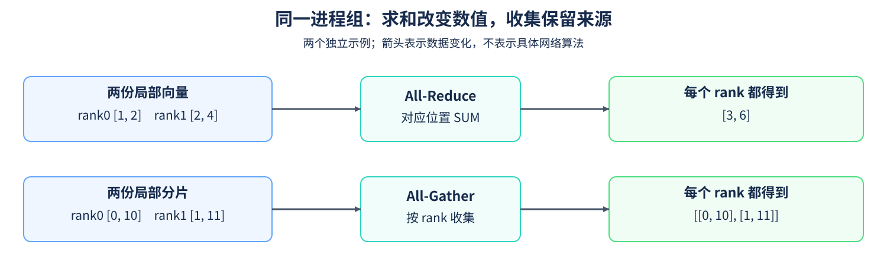

# 13. Distributed Communication Primitives | 用本地进程核对集合通信语义

**难度：** 进阶 | **环境：** [CPU 多进程](#runtime-environment) | **标签：** `torch.distributed`、`All-Reduce`、`All-Gather` | **目标人群：** 掌握张量运算

> 🚀 **云端运行环境**
>
> 本章节的实战代码可以点击以下链接在免费 GPU 算力平台上直接运行：
>
> [](https://colab.research.google.com/github/datawhalechina/llm-algo-leetcode/blob/main/04_CUDA_and_System_Optimization/13_Distributed_Communication_Primitives.ipynb)
> [](https://modelscope.cn/my/mynotebook) *(国内推荐：魔搭社区免费实例)*


## 本节导读

两个进程各持有一份向量，哪些操作让它们得到同一份和，哪些操作让它们保留各自的数据、再组合成完整列表？All-Reduce 与 All-Gather 都让多个进程拿到结果，但数值含义与数据组织不同。

本节让两个或三个本地进程实际交换CPU张量。Gloo提供集合通信实现，PyTorch把它作为可选择的通信后端；CPU说明张量放在哪里，Gloo说明由哪套实现完成通信。沿rank、进程组与调用顺序跟踪每份输入，可以检查参与者增加后结果怎样变化。

<a id="runtime-environment"></a>

## 运行环境

- **多进程核对：** 环境准备见[通信CPU入口](../topic_discussion/communication_parallelism/quickstart.md#par-cpu-quickstart)，运行[题目与测试](#mechanism-practice)。需要支持Gloo后端的PyTorch，测试分别启动2个和3个本地CPU进程；已有满足条件的PyTorch环境可复用。

具体集合操作的后端支持见[PyTorch 2.11说明](https://docs.pytorch.org/docs/2.11/distributed.html#which-backend-to-use)。

命令行采用spawn：子进程启动新的Python解释器，需要能导入工作函数。Jupyter中的工作函数保存在当前内存，本页采用Linux上的fork继承父进程状态，因此应在未初始化CUDA、没有后台线程任务的新Kernel中运行。已使用CUDA、存在后台任务或平台不支持fork时，改用仓库根目录下的脚本测试入口；启动方式差异见[Python多进程说明](https://docs.python.org/3/library/multiprocessing.html#contexts-and-start-methods)。

```bash
python tools/test_notebook_answers.py \
  04_CUDA_and_System_Optimization/13_Distributed_Communication_Primitives.ipynb \
  --mode both --strict-question-failure
```

这里核对各进程的数值、数据归属与顺序；网络带宽和多GPU性能需要另设对应负载。

## 前置阅读

先认识集合通信的参与者和目标，再观察操作前后的数据。

- [Part01·20 NCCL 与 AllReduce](../01_Hardware_Math_and_Systems/20_NCCL_and_AllReduce_Basics.md)：集合语义与后端的区别。

## Step 1：求和与收集分别保留哪些信息

rank是通信参与进程在组内的编号；这里每个进程持有自己的CPU张量。All-Reduce（全归约）让各 rank 对应位置的数值按指定操作合并，每个 rank 都得到归约后的张量。例如 rank0 输入 [1,2]、rank1 输入 [2,4]，按 SUM 归约后，两者都得到 [3,6]；不能把这项逐元素求和误解为沿本地向量求一个标量。

All-Gather（全收集）不做数值归约。rank0 提供 [0,10]、rank1 提供 [1,11]，每个 rank 都得到按 rank 排列的两份张量，来源和顺序都保留。本节使用等长输入和等长接收缓冲，不讨论不均匀分片。



## Step 2：rank 和进程组怎样约定参与者

进程组界定一次集合通信的参与范围，world size是组内进程数。本地两个CPU进程可以组成规模为2的组，扩展到第三个进程后，输入、期望结果与接收位置都需要纳入新参与者。跨机器运行还需准备各主机之间的连接。

各 rank 必须进入兼容的操作序列。例如所有进程先求和、再收集，双方的缓冲类型和大小也满足对应接口要求；若一方先归约、另一方先收集，就不再是同一次操作，可能报错或等待。集合语义规定结果，但不规定后端一定使用 Ring、Tree 或某种网络链路。

## Step 3：原地归约怎样改变后续使用的数据

本节使用的 All-Reduce 会原地修改传入张量。因此，归约前的本地向量若还要作为后续输入，应先保留独立副本；否则后续收集的可能是各 rank 相同的归约结果，而不是各自原始数据。All-Gather 则把局部输入放入按 rank 编号排列的接收缓冲列表。

参与者增加时，SUM 的期望值要纳入新 rank，收集列表也要增加对应位置。例如第三个 rank 输入 [3,6]，三方归约应为 [6,12]，不能继续期待两进程的 [3,6]。正常、负数、零值与不同长度输入都应保持这条语义；结果一致也不说明实际用了哪一种集合算法。

<a id="mechanism-practice"></a>

## Step 4：实现求和归约与按 rank 收集

进程组初始化、超时、临时 rendezvous 文件和子进程启动均由骨架提供。补全 `collective_values` 的三个位置；返回归约结果与收集列表，保持调用方两份输入不变。

本地测试分别启动2个和3个 Gloo 进程，每个进程核对6组输入；启动器允许这两种规模，不在题目运行时安装包。所有 rank 使用相同操作次序，测试不通过故意错序或漏调用来制造挂起。

| TODO / 函数 | 待实现的机制 | 必须满足的约束 | 测试证据 |
| --- | --- | --- | --- |
| TODO 1 / `collective_values` | 选择 `reduction_op` | 对应位置执行 SUM，不是 MAX 或均值 | 两种进程数、正负数与零值 |
| TODO 2 / `collective_values` | 构造 `gathered` | 每个 rank 一个独立、同类型同形状接收张量 | 列表长度、逐 rank 数值与缓冲独立性 |
| TODO 3 / `collective_values` | 选择 `gather_operation` | 收集各方原始局部张量，保持 rank 顺序 | 整数标记、不同输入长度与来源顺序 |


```python
import datetime
import tempfile
from pathlib import Path

import torch
import torch.distributed as dist
import torch.multiprocessing as mp

```


```python
def collective_values(local_values, local_shard, world_size):
    """返回逐元素 SUM 与按 rank 排列的局部张量，不修改调用方输入。"""
    reduced = local_values.clone()
    # TODO 1：reduction_op；选择逐元素求和的 ReduceOp。
    reduction_op = None
    if reduction_op is None:
        raise NotImplementedError("请完成 TODO 1：reduction_op")
    dist.all_reduce(reduced, op=reduction_op)
    # TODO 2：gathered；为每个 rank 创建与 local_shard 匹配的独立接收缓冲。
    gathered = None
    if gathered is None:
        raise NotImplementedError("请完成 TODO 2：gathered")
    # TODO 3：gather_operation；选择让每个 rank 收到完整列表的集合操作。
    gather_operation = None
    if gather_operation is None:
        raise NotImplementedError("请完成 TODO 3：gather_operation")
    gather_operation(gathered, local_shard)
    return reduced, gathered


def _local_case(rank, case_index):
    """构造可独立算出期望值的不同长度、类型与符号输入。"""
    lengths = (1, 3, 7, 5, 11, 4)
    dtypes = (torch.float32, torch.float32, torch.float64,
              torch.int64, torch.float32, torch.float64)
    values = (torch.arange(lengths[case_index], dtype=dtypes[case_index])
              - case_index) * (rank + 1)
    if case_index == 5:
        values.zero_()
    shard = torch.arange(lengths[case_index], dtype=torch.int64) + 100 * rank + 10 * case_index
    return values, shard


def distributed_worker(rank, world_size, init_method):
    """在每个子进程检查本 rank 的结果及输入是否保持不变。"""
    torch.set_num_threads(1)
    dist.init_process_group(
        backend="gloo", init_method=init_method, rank=rank,
        world_size=world_size, timeout=datetime.timedelta(seconds=30),
    )
    try:
        for case_index in range(6):
            local_values, local_shard = _local_case(rank, case_index)
            before_values, before_shard = local_values.clone(), local_shard.clone()
            reduced, gathered = collective_values(local_values, local_shard, world_size)
            expected_sum = sum((_local_case(other, case_index)[0]
                                for other in range(world_size)), torch.zeros_like(local_values))
            torch.testing.assert_close(reduced, expected_sum)
            torch.testing.assert_close(local_values, before_values)
            torch.testing.assert_close(local_shard, before_shard)
            assert len(gathered) == world_size
            assert len({part.data_ptr() for part in gathered}) == world_size
            for other, part in enumerate(gathered):
                torch.testing.assert_close(part, _local_case(other, case_index)[1])
    finally:
        dist.destroy_process_group()


def run_two_process_check(world_size=2):
    """以临时文件启动两个或三个本地 Gloo 进程，等待全部断言完成。"""
    if isinstance(world_size, bool) or not isinstance(world_size, int) or world_size not in (2, 3):
        raise ValueError("this local check supports world_size 2 or 3")
    if not dist.is_available() or not dist.is_gloo_available():
        raise RuntimeError("本节需要支持 Gloo 的 PyTorch，请按通信 Quickstart 准备环境")
    # 脚本中 worker 可由模块导入；Notebook 定义在内存中，使用 CPU fork。
    start_method = "spawn" if globals().get("__file__") else "fork"
    if start_method not in mp.get_all_start_methods():
        raise RuntimeError("当前 Notebook 平台不支持 fork；请用命令行脚本运行本节")
    with tempfile.TemporaryDirectory(prefix="part04_gloo_") as directory:
        init_method = (Path(directory) / "store").resolve().as_uri()
        mp.start_processes(distributed_worker, args=(world_size, init_method),
                           nprocs=world_size, join=True, start_method=start_method)
    return {"world_size": world_size, "cases_per_rank": 6}

```

## 测试


```python
def test_two_process_collectives():
    """检查启动规模边界，再验证所有 rank 上的集合结果。"""
    for invalid in (0, 1, 4, 2.0, True, "2"):
        try:
            run_two_process_check(invalid)
        except ValueError:
            pass
        else:
            raise AssertionError(f"expected ValueError: {invalid!r}")
    results = [run_two_process_check(size) for size in (2, 3)]
    assert results == [{"world_size": 2, "cases_per_rank": 6},
                       {"world_size": 3, "cases_per_rank": 6}]
    print({"status": "passed", "backend": "gloo", "groups": results,
           "rank_case_checks": 30, "invalid_cases": 6})


if __name__ == "__main__":
    test_two_process_collectives()

```

## 参考代码与解析

### 代码


```python
def collective_values(local_values, local_shard, world_size):
    """返回逐元素 SUM 与按 rank 排列的局部张量，不修改调用方输入。"""
    reduced = local_values.clone()
    # TODO 1：reduction_op；选择逐元素求和的 ReduceOp。
    reduction_op = dist.ReduceOp.SUM
    if reduction_op is None:
        raise NotImplementedError("请完成 TODO 1：reduction_op")
    dist.all_reduce(reduced, op=reduction_op)
    # TODO 2：gathered；为每个 rank 创建与 local_shard 匹配的独立接收缓冲。
    gathered = [torch.empty_like(local_shard) for _ in range(world_size)]
    if gathered is None:
        raise NotImplementedError("请完成 TODO 2：gathered")
    # TODO 3：gather_operation；选择让每个 rank 收到完整列表的集合操作。
    gather_operation = dist.all_gather
    if gather_operation is None:
        raise NotImplementedError("请完成 TODO 3：gather_operation")
    gather_operation(gathered, local_shard)
    return reduced, gathered


def _local_case(rank, case_index):
    """构造可独立算出期望值的不同长度、类型与符号输入。"""
    lengths = (1, 3, 7, 5, 11, 4)
    dtypes = (torch.float32, torch.float32, torch.float64,
              torch.int64, torch.float32, torch.float64)
    values = (torch.arange(lengths[case_index], dtype=dtypes[case_index])
              - case_index) * (rank + 1)
    if case_index == 5:
        values.zero_()
    shard = torch.arange(lengths[case_index], dtype=torch.int64) + 100 * rank + 10 * case_index
    return values, shard


def distributed_worker(rank, world_size, init_method):
    """在每个子进程检查本 rank 的结果及输入是否保持不变。"""
    torch.set_num_threads(1)
    dist.init_process_group(
        backend="gloo", init_method=init_method, rank=rank,
        world_size=world_size, timeout=datetime.timedelta(seconds=30),
    )
    try:
        for case_index in range(6):
            local_values, local_shard = _local_case(rank, case_index)
            before_values, before_shard = local_values.clone(), local_shard.clone()
            reduced, gathered = collective_values(local_values, local_shard, world_size)
            expected_sum = sum((_local_case(other, case_index)[0]
                                for other in range(world_size)), torch.zeros_like(local_values))
            torch.testing.assert_close(reduced, expected_sum)
            torch.testing.assert_close(local_values, before_values)
            torch.testing.assert_close(local_shard, before_shard)
            assert len(gathered) == world_size
            assert len({part.data_ptr() for part in gathered}) == world_size
            for other, part in enumerate(gathered):
                torch.testing.assert_close(part, _local_case(other, case_index)[1])
    finally:
        dist.destroy_process_group()


def run_two_process_check(world_size=2):
    """以临时文件启动两个或三个本地 Gloo 进程，等待全部断言完成。"""
    if isinstance(world_size, bool) or not isinstance(world_size, int) or world_size not in (2, 3):
        raise ValueError("this local check supports world_size 2 or 3")
    if not dist.is_available() or not dist.is_gloo_available():
        raise RuntimeError("本节需要支持 Gloo 的 PyTorch，请按通信 Quickstart 准备环境")
    # 脚本中 worker 可由模块导入；Notebook 定义在内存中，使用 CPU fork。
    start_method = "spawn" if globals().get("__file__") else "fork"
    if start_method not in mp.get_all_start_methods():
        raise RuntimeError("当前 Notebook 平台不支持 fork；请用命令行脚本运行本节")
    with tempfile.TemporaryDirectory(prefix="part04_gloo_") as directory:
        init_method = (Path(directory) / "store").resolve().as_uri()
        mp.start_processes(distributed_worker, args=(world_size, init_method),
                           nprocs=world_size, join=True, start_method=start_method)
    return {"world_size": world_size, "cases_per_rank": 6}

```

### 解析

#### TODO 1：选择逐元素SUM

- `dist.ReduceOp.SUM`将各rank对应位置相加；骨架先复制输入再归约，使原地集合操作不改写调用方张量。
- 2／3进程中各rank都与独立参考和比较，负数与零值用例能区分求和和取最大值；只检查各rank结果相同不足以说明归约正确。

#### TODO 2：按参与者准备独立接收缓冲

- 为每个来源创建与局部张量同形状、同类型的独立缓冲，避免多个列表项指向同一块存储。
- worker同时检查列表长度、不同存储地址和逐来源数值；重复引用同一张量即使长度正确，也不能通过这些检查。

#### TODO 3：收集并保留rank次序

- `dist.all_gather`让每个参与者收到各rank的原始局部输入，列表位置对应来源rank，不是已归约的副本。
- 整数来源标记与不同长度逐项核对来源顺序，调用前后比较检查输入不变。当前Gloo执行验证集合语义，不确定特定网络算法或GPU通信性能。

## 相关阅读

结果语义成立后，再追踪一种算法的分片流转与字节量。

- [14 Ring-AllReduce](./14_Ring_AllReduce_Deep_Dive.md)：归约散射、全收集及每 rank 的通信量。
- [PyTorch 2.11：分布式通信](https://docs.pytorch.org/docs/2.11/distributed.html)：进程组与集合操作契约。
