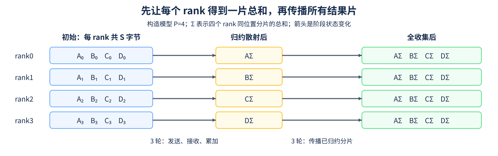
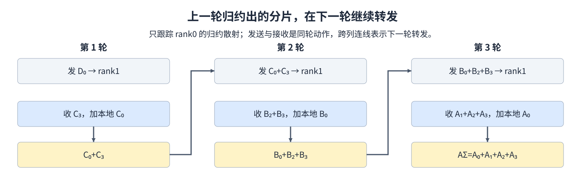

# 14. Ring AllReduce Deep Dive | 环形全归约的通信量与步骤

**难度：** 进阶 | **环境：** [CPU 主线](#runtime-environment) | **标签：** `Ring-AllReduce`、`Reduce-Scatter`、`All-Gather` | **目标人群：** 理解集合通信

> 🚀 **云端运行环境**
>
> 本章节的实战代码可以点击以下链接在免费 GPU 算力平台上直接运行：
>
> [](https://colab.research.google.com/github/datawhalechina/llm-algo-leetcode/blob/main/04_CUDA_and_System_Optimization/14_Ring_AllReduce_Deep_Dive.ipynb)
> [](https://modelscope.cn/my/mynotebook) *(国内推荐：魔搭社区免费实例)*


## 本节导读

All-Reduce 要让每个 rank 获得完整的归约结果，为什么环形算法不需要每次发送整份输入？把输入切成等长分片后，可以先边传边累加，再只传播已经完成的结果分片。

本节跟踪四个rank中一个rank的发送与接收，再核算单rank和全系统的发送字节。学完后可以分别回答“发了多少数据”“经过多少轮”，并解释估算完成时间还需要哪些链路与调度信息。

<a id="runtime-environment"></a>

## 运行环境

- **基础练习：** Python 3；在CPU上推导环形算法的通信轮次和字节数。
- **集合语义核对：** 见[13 集合通信](./13_Distributed_Communication_Primitives.md)，由多个本地进程通过Gloo后端交换CPU张量；Gloo的作用及进程启动方式在该页说明。

## 前置阅读

先看 [13. Distributed Communication Primitives](./13_Distributed_Communication_Primitives.md) 中 All-Reduce 与 rank 的数据语义，再跟踪同一操作如何拆成 Reduce-Scatter 和 All-Gather。
## Step 1：分片先归约，再传播完整结果

rank 是进程在通信组中的编号。设组内有 $P$ 个 rank，每个 rank 都持有大小为 $S$ 字节的完整输入，按相同位置切成 $P$ 片，每片 $S/P$ 字节。这里S按单rank统计，输入可均匀划分；全系统则共有P份这样的输入。

Reduce-Scatter（归约散射）经过 $P-1$ 轮相邻通信，把同位置的分片逐步相加。阶段结束时，每个 rank 只保留一片完整归约结果，各 rank 持有不同分片。All-Gather（全收集）再经过 $P-1$ 轮，把这些结果片传播给其他 rank。前一段完成同位置数据的求和，后一段分发这些和，两段合起来实现All-Reduce。例如 P=4、S=400 字节，每片100字节。下面采用一种结果归属编号：归约散射后 rank0 持有 A 的总和，rank1 持有 B 的总和，依次类推；其他编号约定也可以实现同一语义。



## Step 2：每轮发送一片，怎样得到总字节数

每个阶段发送 $P-1$ 次，每次 $S/P$ 字节，所以单 rank 的阶段发送量与两阶段合计分别为：

$$
V_{RS}=V_{AG}=\frac{P-1}{P}S,\qquad V_{rank}=2\frac{P-1}{P}S
$$

P=4、S=400 字节时，每个阶段发送300字节，两阶段共600字节；全系统发送量为 $P V_{rank}=2400$ 字节。在这个均匀环模型里，各rank接收量与发送量相同；统计“发送加接收”时再乘二。因此记录流量时，要同时标明单rank／全系统以及发送／收发。固定S、增加P时，单rank发送量趋近2S，轮次 $2(P-1)$ 则继续增长；更多启动与同步，加上链路带宽、拓扑和通信库的算法选择，共同影响完成时间。

## Step 3：四个 rank 中，rank0 怎样逐轮归约

设相邻方向为 rank0→rank1→rank2→rank3→rank0，$A_i$ 表示 rank i 输入中的 A 片。选择第一轮让 rank i 发送编号为 $(i+3)\bmod4$ 的分片，可以让 rank0 最终持有 A 的总和。每一轮发送上一轮已累加的片，接收下一片并加上本地同位置数据。

归约散射结束后，rank0 已有 $A_\Sigma$；全收集时依次收到 $D_\Sigma$、$C_\Sigma$、$B_\Sigma$，不再把它们重复归约。下图只跟踪 rank0 的归约散射，其他 rank 做相应轮换；实际通信库不一定采用这个 Ring 算法或这一编号约定。



## Step 4：计算单 rank 的环形发送量

输入检查已经给出：字节数必须是非负整数，rank 数至少为2，输入大小能均分。补全分片字节、阶段发送量和两阶段总量；只用整数运算，保留大整数精度。该练习不启动通信。

| TODO / 函数 | 待实现的机制 | 必须满足的约束 | 测试证据 |
| --- | --- | --- | --- |
| TODO 1 / `ring_allreduce_send_bytes` | 计算 `shard_bytes` | 是单片字节，不是全部输入 | 多种 rank 数、零输入与大整数 |
| TODO 2 / `ring_allreduce_send_bytes` | 计算 `per_phase` | 每阶段发送 P−1 片 | 阶段结果及世界规模变化 |
| TODO 3 / `ring_allreduce_send_bytes` | 计算 `total` | 两个阶段各计一次 | 两阶段相等与整数倍缩放 |


```python
# 本节仅做 CPU 整数字节核算，无需通信后端。

```


```python
def ring_allreduce_send_bytes(payload_bytes, world_size):
    """计算均匀分片 Ring 中单 rank 的阶段与总发送字节。"""
    if isinstance(payload_bytes, bool) or not isinstance(payload_bytes, int) or payload_bytes < 0:
        raise ValueError("payload_bytes must be a non-negative integer")
    if isinstance(world_size, bool) or not isinstance(world_size, int) or world_size < 2:
        raise ValueError("world_size must be an integer of at least two")
    if payload_bytes % world_size:
        raise ValueError("payload_bytes must be divisible by world_size")
    # TODO 1：shard_bytes；输入总字节 payload_bytes，分片数 world_size。
    shard_bytes = None
    if shard_bytes is None:
        raise NotImplementedError("请完成 TODO 1：shard_bytes")
    # TODO 2：per_phase；每阶段有 world_size - 1 轮，每轮发送一片。
    per_phase = None
    if per_phase is None:
        raise NotImplementedError("请完成 TODO 2：per_phase")
    # TODO 3：total；归约散射和全收集的合计发送量。
    total = None
    if total is None:
        raise NotImplementedError("请完成 TODO 3：total")
    return {"reduce_scatter": per_phase, "all_gather": per_phase, "total": total}

```

## 测试

```python
def test_ring_allreduce_send_bytes():
    """核对阶段口径、缩放不变量和非法均分输入。"""
    assert ring_allreduce_send_bytes(400, 4) == {"reduce_scatter": 300, "all_gather": 300, "total": 600}
    assert ring_allreduce_send_bytes(400, 2) == {"reduce_scatter": 200, "all_gather": 200, "total": 400}
    for ranks in (2, 3, 4, 7, 16):
        for chunk in (0, 1, 17, 2**60 + 1):
            row = ring_allreduce_send_bytes(ranks * chunk, ranks)
            assert row["reduce_scatter"] == (ranks - 1) * chunk
            assert row["all_gather"] == row["reduce_scatter"]
            assert row["total"] == 2 * (ranks - 1) * chunk
            scaled = ring_allreduce_send_bytes(3 * ranks * chunk, ranks)
            assert scaled["total"] == 3 * row["total"]
    invalid = [(-4, 2), (3, 2), (4.0, 2), (True, 2), ("4", 2),
               (4, 1), (4, 0), (4, -2), (4, 2.0), (4, True), (4, "2")]
    for args in invalid:
        try:
            ring_allreduce_send_bytes(*args)
        except ValueError:
            pass
        else:
            raise AssertionError(f"expected ValueError: {args}")
    print({"status": "passed", "balanced_cases": 20, "invalid_cases": len(invalid)})


test_ring_allreduce_send_bytes()

```

---

🛑 **STOP HERE** 🛑

先完成题目区，再查看参考实现。
## 参考代码与解析

### 代码

```python
def ring_allreduce_send_bytes(payload_bytes, world_size):
    """计算均匀分片 Ring 中单 rank 的阶段与总发送字节。"""
    if isinstance(payload_bytes, bool) or not isinstance(payload_bytes, int) or payload_bytes < 0:
        raise ValueError("payload_bytes must be a non-negative integer")
    if isinstance(world_size, bool) or not isinstance(world_size, int) or world_size < 2:
        raise ValueError("world_size must be an integer of at least two")
    if payload_bytes % world_size:
        raise ValueError("payload_bytes must be divisible by world_size")
    # TODO 1：shard_bytes；输入总字节 payload_bytes，分片数 world_size。
    shard_bytes = payload_bytes // world_size
    if shard_bytes is None:
        raise NotImplementedError("请完成 TODO 1：shard_bytes")
    # TODO 2：per_phase；每阶段有 world_size - 1 轮，每轮发送一片。
    per_phase = shard_bytes * (world_size - 1)
    if per_phase is None:
        raise NotImplementedError("请完成 TODO 2：per_phase")
    # TODO 3：total；归约散射和全收集的合计发送量。
    total = 2 * per_phase
    if total is None:
        raise NotImplementedError("请完成 TODO 3：total")
    return {"reduce_scatter": per_phase, "all_gather": per_phase, "total": total}

```

### 解析

#### TODO 1：先确定单片大小

- 均分模型中用总字节数整除rank数得到一片；骨架已检查可整除，后续保持整数运算。
- 零输入与超过浮点精确范围的大整数用例核对结果，防止借助浮点除法后丢失字节精度。

#### TODO 2：累加一个阶段的发送量

- 一个阶段共P−1轮，单rank每轮发送一片，因此将分片大小乘轮数；统计对象不是全系统收发量。
- 同为400字节时，2个rank每阶段发送200字节，4个rank为300字节；世界规模变化用例可暴露直接返回整份输入的错误。

#### TODO 3：合并两个阶段

- 归约散射与全收集各计一次阶段发送量，两者相加得到单rank总发送量。
- 测试逐项比较两阶段及总量，并检查输入放大三倍时总量同比放大；这些断言核对均匀分片的字节模型；实际通信延迟由目标后端另行测量。

## 相关阅读

从字节量继续分析何时能隐藏通信等待，或核对实际后端采用的算法。

- [15 通信与计算重叠](./15_Communication_Computation_Overlap_Advanced_Scheduling.md)：梯度就绪、重叠区间与暴露等待。
- [Part01·20 NCCL 与 AllReduce](../01_Hardware_Math_and_Systems/20_NCCL_and_AllReduce_Basics.md)：集合语义、后端和执行条件。
