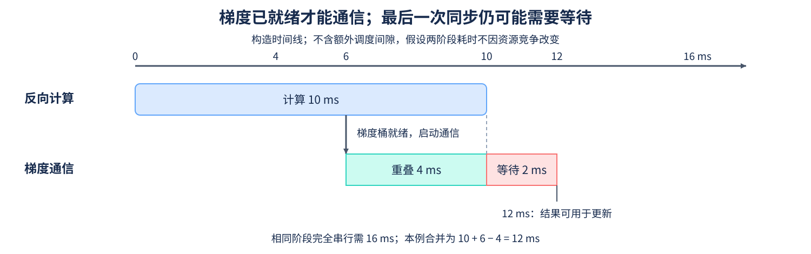
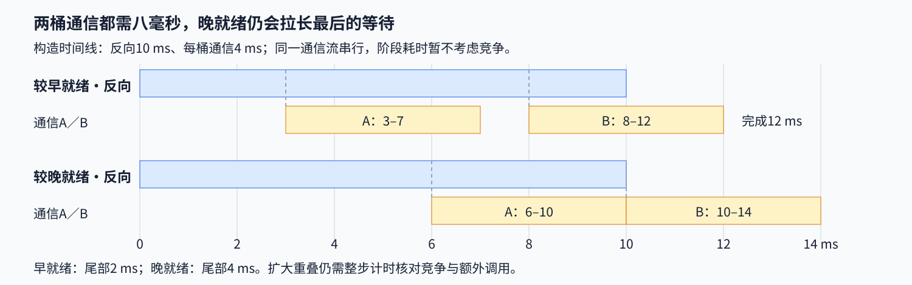

# 15. Communication Computation Overlap Advanced Scheduling | 通信与计算重叠

**难度：** 进阶 | **环境：** [CPU 主线](#runtime-environment) | **标签：** `梯度分桶`、`All-Reduce`、`关键路径` | **目标人群：** 理解反向传播与集合通信

> 🚀 **云端运行环境**
>
> 本章节的实战代码可以点击以下链接在免费 GPU 算力平台上直接运行：
>
> [](https://colab.research.google.com/github/datawhalechina/llm-algo-leetcode/blob/main/04_CUDA_and_System_Optimization/15_Communication_Computation_Overlap_Advanced_Scheduling.ipynb)
> [](https://modelscope.cn/my/mynotebook) *(国内推荐：魔搭社区免费实例)*


## 本节导读

反向传播还没结束，较早算好的梯度能否先开始同步？梯度分桶让通信有机会提前启动，但最后一批梯度和最后一次通信仍可能让优化器等待。

本节沿“梯度就绪 → 启动通信 → 等待同步结果”分析一个简化时间线，计算哪些通信时间被覆盖、哪些仍延长完成时间。CPU 计算检验时间关系；真实收益还要回到多卡执行，检查竞争、同步与总步时。

<a id="runtime-environment"></a>

## 运行环境

- **基础练习：** Python 3；在CPU上计算时间线和关键路径。
- **多GPU扩展：** 按[通信与并行Quickstart](../topic_discussion/communication_parallelism/quickstart.md)准备至少两张GPU及NCCL（NVIDIA集合通信库）后端，另行采集设备通信时间。CPU张量的Gloo通信入口见[13 集合通信](./13_Distributed_Communication_Primitives.md)。

## 前置阅读

先看 [13. Distributed Communication Primitives](./13_Distributed_Communication_Primitives.md) 中集合通信改变的数据，再看 [14 Ring-AllReduce](./14_Ring_AllReduce_Deep_Dive.md) 中分阶段传输量；本页关注通信在时间线上何时开始。
## Step 1：梯度桶何时可以开始通信

反向传播从输出侧向输入侧逐层计算梯度。运行时将多个梯度聚合为桶；某桶的梯度齐备后，才具备启动 All-Reduce 的数据条件，其他层此时可以继续反向计算。优化器在读取该桶梯度前，还要等待对应通信完成；“梯度就绪”“通信提交”“结果可用”是三个不同的时点。

例如反向计算在0–10毫秒执行，一个桶在6毫秒时就绪，通信需要6毫秒。若它可以立即开始且阶段耗时不因竞争改变，通信在6–12毫秒执行，重叠4毫秒，最后仍需等待2毫秒。这里用构造时间线演示就绪时点与尾部等待。



## Step 2：重叠时间为什么只能减去一次

设反向计算时间为 $T_b$、通信忙碌时间为 $T_c$、两者共同执行的区间总长为 $T_o$。在无额外空闲间隙的双阶段模型中，两段时间直接相加会将交叠区间计算两次，因此扣除一次即可得到合并完成时间；通信时间扣除交叠区间后，则得到暴露通信。区间长度应满足 $0\le T_o\le\min(T_b,T_c)$。

$$
T_{backward+comm}=T_b+T_c-T_o,\qquad T_{exposed}=T_c-T_o
$$

10毫秒计算、6毫秒通信、4毫秒重叠得到12毫秒完成时间和2毫秒暴露通信；若6毫秒通信完全被计算覆盖，完成时间为10毫秒。交换阶段长短后，4毫秒计算最多覆盖10毫秒通信中的4毫秒，仍留下6毫秒等待。多个桶还需要跟踪各自的就绪时点：两个桶各通信4 ms、反向为10 ms时，按下图单条通信流依次执行，在3、8 ms就绪会于12 ms完成，改成6、10 ms就绪则于14 ms完成。出现调度空隙或复杂依赖时，沿完整时间线计算关键路径。



## Step 3：怎样选择梯度桶并观察整步时间

小桶较早就绪，但调用和调度次数更多；大桶减少调用，却要等待更多梯度凑齐。各进程还需按兼容顺序发起集合通信，所以某个rank提前就绪后，也可能等待其他参与者。

通信和计算会共同使用设备执行资源及访存带宽，并发后的阶段耗时可能随竞争改变。分析时沿每桶梯度就绪、通信起止、最后等待和整步完成时间逐项追踪：交叠区间增大而整步变慢时，应检查额外调用和阶段耗时是否抵消了被隐藏的等待。

| 观察到的现象 | 要继续检查的原因 |
| --- | --- |
| 第一批通信启动很晚 | 梯度就绪、桶大小和提交开销 |
| 某些rank总是等待 | 负载差异及集合通信调用顺序 |
| 时间线有交叠，整步仍更慢 | 资源竞争、更多调用或阶段耗时变化 |
| 反向已结束，通信还在执行 | 剩余通信量及无法覆盖的尾部 |

## Step 4：计算合并完成时间与暴露通信

骨架提供时间类型、有限性与区间检查。补全 `critical_path_ms` 和 `exposed_communication_ms`，保持单位均为毫秒；测试覆盖无重叠、部分重叠、两种阶段瓶颈、零时间和非法输入。

| TODO / 函数 | 待实现的机制 | 必须满足的约束 | 测试证据 |
| --- | --- | --- | --- |
| TODO 1 / `communication_critical_path_ms` | 计算 `critical_path_ms` | 交叠区间只计一次 | 无／部分／完全重叠及阶段交换 |
| TODO 2 / `communication_critical_path_ms` | 计算 `exposed_communication_ms` | 从通信中扣除已覆盖部分 | 通信较长、零时间、缩放与差值不变量 |


```python
from math import isclose, isfinite
from numbers import Real

```


```python
def communication_critical_path_ms(backward_ms, communication_ms, overlap_ms):
    """计算无额外空闲间隙的双阶段完成时间及暴露通信，单位毫秒。"""
    values = (backward_ms, communication_ms, overlap_ms)
    try:
        valid = all(not isinstance(value, bool) and isinstance(value, Real)
                    and isfinite(value) and value >= 0 for value in values)
    except OverflowError:
        valid = False
    if not valid:
        raise ValueError("times must be finite non-negative real numbers")
    if overlap_ms > min(backward_ms, communication_ms):
        raise ValueError("overlap cannot exceed either stage duration")
    # TODO 1：critical_path_ms；合并两段时间，共同执行区间只算一次。
    critical_path_ms = None
    if critical_path_ms is None:
        raise NotImplementedError("请完成 TODO 1：critical_path_ms")
    # TODO 2：exposed_communication_ms；通信中没有被计算覆盖的部分。
    exposed_communication_ms = None
    if exposed_communication_ms is None:
        raise NotImplementedError("请完成 TODO 2：exposed_communication_ms")
    return {"critical_path_ms": critical_path_ms,
            "exposed_communication_ms": exposed_communication_ms}

```

## 测试

```python
def test_communication_critical_path():
    """核对阶段瓶颈、重叠边界、单位缩放和非法时间。"""
    cases = [(10, 6, 0, 16, 6), (10, 6, 4, 12, 2), (10, 6, 6, 10, 0),
             (4, 10, 4, 10, 6), (0, 0, 0, 0, 0), (0, 5, 0, 5, 5),
             (5, 0, 0, 5, 0), (6, 6, 6, 6, 0), (0.3, 0.2, 0.1, 0.4, 0.1)]
    for backward, communication, overlap, critical, exposed in cases:
        row = communication_critical_path_ms(backward, communication, overlap)
        assert isclose(row["critical_path_ms"], critical, abs_tol=1e-12)
        assert isclose(row["exposed_communication_ms"], exposed, abs_tol=1e-12)
        assert isclose(row["critical_path_ms"], backward + row["exposed_communication_ms"])
        assert row["critical_path_ms"] >= max(backward, communication)
        reverse = communication_critical_path_ms(communication, backward, overlap)
        assert isclose(reverse["critical_path_ms"], row["critical_path_ms"])
        scaled = communication_critical_path_ms(7 * backward, 7 * communication, 7 * overlap)
        assert isclose(scaled["critical_path_ms"], 7 * critical, abs_tol=1e-12)
    invalid = [(-1, 2, 0), (1, -2, 0), (1, 2, -1), (1, 2, 1.01),
               (2, 1, 1.01), (float("nan"), 2, 0), (1, float("inf"), 0),
               (1, 2, float("inf")), (True, 2, 0), (1, 2, False),
               ("1", 2, 0), (1, None, 0), (1j, 2, 0)]
    for args in invalid:
        try:
            communication_critical_path_ms(*args)
        except ValueError:
            pass
        else:
            raise AssertionError(f"expected ValueError: {args}")
    print({"status": "passed", "timeline_cases": len(cases), "invalid_cases": len(invalid)})


test_communication_critical_path()

```

---

🛑 **STOP HERE** 🛑

先完成题目区，再查看参考实现。
## 参考代码与解析

### 代码

```python
def communication_critical_path_ms(backward_ms, communication_ms, overlap_ms):
    """计算无额外空闲间隙的双阶段完成时间及暴露通信，单位毫秒。"""
    values = (backward_ms, communication_ms, overlap_ms)
    try:
        valid = all(not isinstance(value, bool) and isinstance(value, Real)
                    and isfinite(value) and value >= 0 for value in values)
    except OverflowError:
        valid = False
    if not valid:
        raise ValueError("times must be finite non-negative real numbers")
    if overlap_ms > min(backward_ms, communication_ms):
        raise ValueError("overlap cannot exceed either stage duration")
    # TODO 1：critical_path_ms；合并两段时间，共同执行区间只算一次。
    critical_path_ms = backward_ms + communication_ms - overlap_ms
    if critical_path_ms is None:
        raise NotImplementedError("请完成 TODO 1：critical_path_ms")
    # TODO 2：exposed_communication_ms；通信中没有被计算覆盖的部分。
    exposed_communication_ms = communication_ms - overlap_ms
    if exposed_communication_ms is None:
        raise NotImplementedError("请完成 TODO 2：exposed_communication_ms")
    return {"critical_path_ms": critical_path_ms,
            "exposed_communication_ms": exposed_communication_ms}

```

### 解析

#### TODO 1：合并两个阶段的执行区间

- 反向时间加通信时间，再扣一次共同执行区间，得到无额外间隙模型的合并完成时间；重叠部分不能重复计入。
- 无重叠用例要求两段相加，完全覆盖较短阶段时要求取较长段；交换两段与统一缩放检查结果不依赖阶段顺序或固定单位。

#### TODO 2：保留没有被计算覆盖的通信

- 从通信时长扣除已覆盖部分，留下暴露通信；通信较长时，即使完全覆盖较短的计算阶段，仍会延长完成时间。
- 计算4 ms、通信10 ms、重叠4 ms时仍有6 ms暴露通信；差值不变量再检查“计算＋暴露通信＝合并时间”。这组断言核对给定区间的时间关系；真实争用和调度间隙需要结合执行时间线分析。

## 相关阅读

对照跨流依赖和DDP梯度桶，理解真实框架怎样连接就绪与等待。

- [10 CUDA Stream 与传输](./10_PyTorch_CUDA_Streams_and_Transfer.md)：事件依赖与提交、完成的区别。
- [PyTorch 2.11：DDP设计说明](https://docs.pytorch.org/docs/2.11/notes/ddp.html)：对照梯度桶就绪、异步归约与兼容的集合调用顺序。
