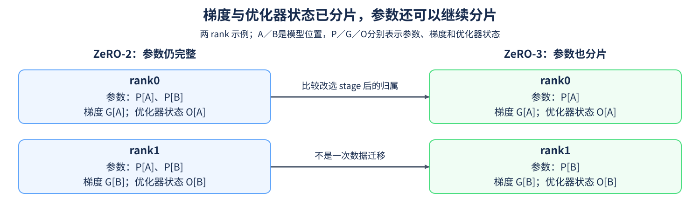
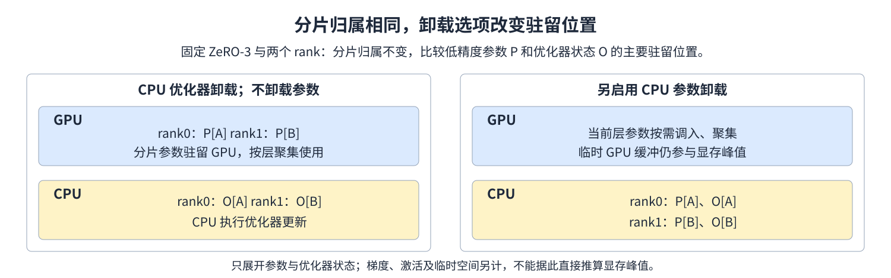

# 16. DeepSpeed Zero Config | ZeRO 分片与卸载配置

**难度：** 进阶 | **环境：** [CPU 主线](#runtime-environment) | **标签：** `DeepSpeed`、`ZeRO`、`CPU Offload` | **目标人群：** 理解训练状态与集合通信

> 🚀 **云端运行环境**
>
> 本章节的实战代码可以点击以下链接在免费 GPU 算力平台上直接运行：
>
> [](https://colab.research.google.com/github/datawhalechina/llm-algo-leetcode/blob/main/04_CUDA_and_System_Optimization/16_DeepSpeed_Zero_Config.ipynb)
> [](https://modelscope.cn/my/mynotebook) *(国内推荐：魔搭社区免费实例)*


## 本节导读

优化器状态已经分片，为什么每个 rank 仍可能保存完整参数？同样写着 CPU offload，卸载优化器与卸载模型参数又改变了什么？

ZeRO的stage决定哪些状态分片，卸载选项决定相关状态驻留在哪里。先沿这两个维度比较参数、梯度和优化器状态的归属，再检查哪些CPU卸载组合满足要求。

<a id="runtime-environment"></a>
## 运行环境

- **基础练习：** 使用[基础CPU环境](../guide.md#base-cpu)，运行[题目与测试](#mechanism-practice)。Python标准库生成并检查本页定义的配置子集，不要求GPU或DeepSpeed。
- **框架核对：** 使用已有、独立且包含DeepSpeed的环境，进入[配置解析核对](#framework-check)。环境选择和命令见[Quickstart](../topic_discussion/operator_optimization/quickstart.md#zero-config-check)；这里只调用配置解析，不要求两张GPU，也不初始化训练进程组。缺依赖明确跳过，已安装但导入或解析失败则报错。

## 前置阅读

先认识训练状态，再区分集合操作如何改变数据归属。

- [Part02·27 ZeRO 状态分片](../02_PyTorch_Algorithms/27_ZeRO_Optimizer_Sim.md)：参数、梯度与优化器状态的分片范围。
- [13 集合通信](./13_Distributed_Communication_Primitives.md)：rank、归约与收集的结果。

## Step 1：stage 改变哪些状态的归属

在普通数据并行中，每个 rank 保存完整参数、梯度和优化器状态；优化器状态包括更新所需的统计量等，并不等于模型参数本身。ZeRO-1 将优化器状态分片，ZeRO-2 再分片归约后的梯度，ZeRO-3 进一步分片参数。stage 0 表示不启用这套 ZeRO 分片。

以两个 rank 为例，把状态按对应的模型位置分成 A、B 两片。ZeRO-2 中，rank0 负责 A 的梯度与优化器状态，rank1 负责 B，但两者仍有完整参数。改为 ZeRO-3 后，参数也按这两个位置分片，计算某层时再按实现要求聚集需要的参数。分片不等于每时每刻只占完整模型的一半；聚集缓冲、激活与临时工作区仍会影响峰值。



## Step 2：分片与 CPU 卸载是两种选择

分片描述“哪个 rank 负责哪一部分”，卸载描述“相关状态驻留在哪类设备”。CPU优化器卸载路径把优化器状态及更新计算放到CPU；模型参数的驻留位置由独立的参数卸载选项控制。

例如 ZeRO-2 配置 CPU 优化器卸载后，GPU 仍需保存完整的低精度模型参数，并完成前向和反向计算；CPU 更新、主机内存、数据搬运和通信都会参与实际成本。参数卸载还需要 ZeRO-3 对应的分片与按需调入安排。字段含义及适用 stage 依据 [DeepSpeed ZeRO 配置文档](https://deepspeed.readthedocs.io/en/stable/zero3.html)。 `overlap_comm`请求将梯度归约与反向计算重叠，`pin_memory`选择锁页主机内存。前者改变时间安排，后者改变主机传输条件；实际效果通过通信时间线、有效传输表现与整步耗时核对。



## Step 3：哪些卸载组合需要拒绝

本节的配置子集只选择不卸载或卸载到 CPU：优化器卸载对应 stage 1–3，参数卸载只对应 stage 3。NVMe是访问非易失存储的协议；扩展到NVMe卸载时，还需明确存储路径、缓冲和对应运行环境。

例如stage 2可以配置CPU优化器卸载，参数卸载则要求stage 3；非法组合应明确报错。stage 3无论是否启用参数卸载都保留参数分片，两种选择分别控制归属和驻留位置。

| 选择 | 本节检查的关系 | 尚需真实运行检查 |
| --- | --- | --- |
| stage 0，不卸载 | 不启用 ZeRO 分片 | 完整训练配置和优化器 |
| stage 1／2，CPU 优化器卸载 | 分片对象包含优化器状态 | CPU 更新、内存与搬运代价 |
| stage 3，CPU 参数卸载 | 分片对象包含参数 | 按需调入、聚集与驻留峰值 |
| overlap_comm／pin_memory 开关 | 布尔输入及字段位置正确 | 通信时间线与有效传输表现 |

<a id="mechanism-practice"></a>

## Step 4：生成并检查分片与 CPU 卸载配置

输入检查和字典组装由骨架提供。补全 stage 对应的分片集合、优化器卸载字段和参数卸载字段；未启用的卸载不输出对应字段。默认调用保留 ZeRO-2 加 CPU 优化器卸载，其他组合由显式参数选择。

测试检查 stage 0–3 的状态关系、开关组合、非法请求、独立返回字典与 JSON 往返。它验证本节定义的配置子集，不调用 DeepSpeed 的 schema 或训练引擎。

| TODO / 函数 | 待实现的机制 | 必须满足的约束 | 测试证据 |
| --- | --- | --- | --- |
| TODO 1 / `zero_partitioned_states` | 计算 `partitioned_states` | stage 逐步增加优化器、梯度、参数 | 四个 stage 的精确集合与非法 stage |
| TODO 2 / `build_zero_config` | 生成 `optimizer_fields` | 开启时设置 CPU 与 pin_memory，否则为空 | stage 1–3、开关传递与返回值独立 |
| TODO 3 / `build_zero_config` | 生成 `parameter_fields` | 只在请求参数卸载时生成 | stage 3 组合；stage 0–2 的请求被拒绝 |


```python
import json

```


```python
def zero_partitioned_states(stage):
    """返回 stage 对应的分片对象；这是本节语义模型，不调用 DeepSpeed。"""
    if isinstance(stage, bool) or not isinstance(stage, int) or stage not in (0, 1, 2, 3):
        raise ValueError("stage must be an integer from 0 to 3")
    # TODO 1：partitioned_states；用 stage 选择 optimizer、gradients、parameters 的集合。
    partitioned_states = None
    if partitioned_states is None:
        raise NotImplementedError("请完成 TODO 1：partitioned_states")
    return partitioned_states


def build_zero_config(stage=2, optimizer_offload=True, parameter_offload=False,
                      overlap_comm=True, pin_memory=True):
    """生成不卸载／CPU卸载的 zero_optimization 片段，检查分片组合。"""
    states = zero_partitioned_states(stage)
    flags = (optimizer_offload, parameter_offload, overlap_comm, pin_memory)
    if any(type(flag) is not bool for flag in flags):
        raise ValueError("offload, overlap and pin_memory flags must be bool")
    if optimizer_offload and "optimizer" not in states:
        raise ValueError("optimizer offload requires ZeRO stage 1, 2 or 3")
    if parameter_offload and "parameters" not in states:
        raise ValueError("parameter offload requires ZeRO stage 3")
    # TODO 2：optimizer_fields；启用时包含 offload_optimizer，否则返回空字典。
    optimizer_fields = None
    if optimizer_fields is None:
        raise NotImplementedError("请完成 TODO 2：optimizer_fields")
    # TODO 3：parameter_fields；启用时包含 offload_param，否则返回空字典。
    parameter_fields = None
    if parameter_fields is None:
        raise NotImplementedError("请完成 TODO 3：parameter_fields")
    return {"stage": stage, "overlap_comm": overlap_comm,
            "contiguous_gradients": True, **optimizer_fields, **parameter_fields}

```

## 测试


```python
def test_zero_config():
    """核对四种分片关系、36种合法配置、非法组合及字典独立性。"""
    expected_states = [set(), {"optimizer"}, {"optimizer", "gradients"},
                       {"optimizer", "gradients", "parameters"}]
    for stage, expected in enumerate(expected_states):
        assert zero_partitioned_states(stage) == expected
    valid_cases = 0
    for stage in range(4):
        for optimizer in (False, True):
            for parameters in (False, True):
                if (optimizer and stage == 0) or (parameters and stage != 3):
                    continue
                for overlap in (False, True):
                    for pinned in (False, True):
                        config = build_zero_config(stage, optimizer, parameters, overlap, pinned)
                        expected = {"stage": stage, "overlap_comm": overlap,
                                    "contiguous_gradients": True}
                        if optimizer:
                            expected["offload_optimizer"] = {"device": "cpu", "pin_memory": pinned}
                        if parameters:
                            expected["offload_param"] = {"device": "cpu", "pin_memory": pinned}
                        assert config == expected
                        assert json.loads(json.dumps({"zero_optimization": config})) == {
                            "zero_optimization": expected}
                        valid_cases += 1
    invalid = [{"stage": value} for value in (-1, 4, True, 2.0, "2", None)]
    invalid += [{"stage": 0, "optimizer_offload": True}]
    invalid += [{"stage": stage, "optimizer_offload": False, "parameter_offload": True}
                for stage in (0, 1, 2)]
    invalid += [{key: value} for key in ("optimizer_offload", "parameter_offload",
                                       "overlap_comm", "pin_memory")
                for value in (0, 1, "true", None)]
    for kwargs in invalid:
        try:
            build_zero_config(**kwargs)
        except ValueError:
            pass
        else:
            raise AssertionError(f"expected ValueError: {kwargs}")
    first, second = build_zero_config(), build_zero_config()
    first["offload_optimizer"]["pin_memory"] = False
    assert second["offload_optimizer"]["pin_memory"] is True
    assert build_zero_config()["stage"] == 2
    assert valid_cases == 36
    print({"status": "passed", "state_cases": 4, "valid_configs": valid_cases,
           "invalid_cases": len(invalid), "framework_execution": "not_run"})


test_zero_config()

```

## 参考代码与解析

### 代码


```python
def zero_partitioned_states(stage):
    """返回 stage 对应的分片对象；这是本节语义模型，不调用 DeepSpeed。"""
    if isinstance(stage, bool) or not isinstance(stage, int) or stage not in (0, 1, 2, 3):
        raise ValueError("stage must be an integer from 0 to 3")
    # TODO 1：partitioned_states；用 stage 选择 optimizer、gradients、parameters 的集合。
    partitioned_states = (frozenset(), frozenset({"optimizer"}),
                          frozenset({"optimizer", "gradients"}),
                          frozenset({"optimizer", "gradients", "parameters"}))[stage]
    if partitioned_states is None:
        raise NotImplementedError("请完成 TODO 1：partitioned_states")
    return partitioned_states


def build_zero_config(stage=2, optimizer_offload=True, parameter_offload=False,
                      overlap_comm=True, pin_memory=True):
    """生成不卸载／CPU卸载的 zero_optimization 片段，检查分片组合。"""
    states = zero_partitioned_states(stage)
    flags = (optimizer_offload, parameter_offload, overlap_comm, pin_memory)
    if any(type(flag) is not bool for flag in flags):
        raise ValueError("offload, overlap and pin_memory flags must be bool")
    if optimizer_offload and "optimizer" not in states:
        raise ValueError("optimizer offload requires ZeRO stage 1, 2 or 3")
    if parameter_offload and "parameters" not in states:
        raise ValueError("parameter offload requires ZeRO stage 3")
    # TODO 2：optimizer_fields；启用时包含 offload_optimizer，否则返回空字典。
    optimizer_fields = ({"offload_optimizer": {"device": "cpu", "pin_memory": pin_memory}}
                        if optimizer_offload else {})
    if optimizer_fields is None:
        raise NotImplementedError("请完成 TODO 2：optimizer_fields")
    # TODO 3：parameter_fields；启用时包含 offload_param，否则返回空字典。
    parameter_fields = ({"offload_param": {"device": "cpu", "pin_memory": pin_memory}}
                        if parameter_offload else {})
    if parameter_fields is None:
        raise NotImplementedError("请完成 TODO 3：parameter_fields")
    return {"stage": stage, "overlap_comm": overlap_comm,
            "contiguous_gradients": True, **optimizer_fields, **parameter_fields}

```

### 解析

#### TODO 1：按stage累加分片对象

- stage 0不分片，1、2、3依次增加优化器状态、梯度、参数；不可变集合表示每个stage负责分片的对象，并供后续合法性检查使用。
- 四种精确集合断言区分stage 2与3，防止所有stage都被当作参数已分片；非法卸载请求检查错误的集合是否会放行不支持的组合。

#### TODO 2：仅在请求时生成优化器卸载字段

- 启用时返回独立的`offload_optimizer`字段，设备为cpu，并传递`pin_memory`；关闭时为空，避免默认值意外启用卸载。
- 多stage与锁页开关的组合检查字段是否随输入改变；修改一次返回值后再比较另一次结果，检查配置没有共享可变字典。

#### TODO 3：把参数卸载与优化器卸载分开

- 参数卸载使用`offload_param`，且要求分片集合包含参数；它与优化器卸载是独立选择，不共用开关。
- stage 3的四种卸载组合与stage 0–2的非法请求检查字段独立性和适用范围。JSON往返只检查序列化，不代表DeepSpeed已解析配置或执行训练。


<a id="framework-check"></a>

## 框架一致性核对（可选）

标准库字典能序列化，不代表框架已经读取了这些字段。本节将36组合法配置交给DeepSpeed的`get_zero_config`，比较stage、两类卸载、锁页和通信重叠开关；只核对显式字段，不锁定框架的其他默认值。入口和字段依据见[DeepSpeed ZeRO配置文档](https://deepspeed.readthedocs.io/en/stable/zero3.html#zero-configurations)。

先运行已完成的实现或参考代码，再运行本单元；命令行测试器自动选择参考实现。格式错误应由schema拒绝，stage与卸载的交叉限制则分别记录本页策略和框架行为：框架即使接受字段，也不等于已检查优化器、分片或真实训练。当前环境缺少DeepSpeed，解析状态为未执行；不产生GPU或训练结果记录。

| 核对项 | 本节对照 | 框架入口 | 验收与证据 |
| --- | --- | --- | --- |
| 合法配置 | stage 0–3、两类CPU卸载、overlap_comm与pin_memory组合 | `get_zero_config` | 36组显式字段一致，调用方输入不变 |
| 格式错误 | 越界stage、不支持的设备、未知字段 | DeepSpeed配置schema | 三类请求抛出ValidationError，其他异常保留为失败 |
| 跨stage条件 | stage 0优化器卸载、stage 2参数卸载 | 本页策略与框架解析分别执行 | 本页拒绝；框架接受／拒绝单独展示，不推断训练可行 |


```python
def _check_zero_parser(parse_zero):
    """逐配置比较解析字段，并区分schema拒绝与本页的stage策略。"""
    import copy
    from pydantic import ValidationError

    def selected_fields(parsed):
        """只比较本页显式控制的字段，不约束框架其他默认值。"""
        result = {"stage": int(parsed.stage),
                  "overlap_comm": parsed.overlap_comm,
                  "contiguous_gradients": parsed.contiguous_gradients}
        for key in ("offload_optimizer", "offload_param"):
            nested = getattr(parsed, key)
            if nested is not None:
                result[key] = {"device": getattr(nested.device, "value", nested.device),
                               "pin_memory": nested.pin_memory}
        return result

    parsed_rows = []
    for stage in range(4):
        for optimizer in (False, True):
            for parameters in (False, True):
                if (optimizer and stage == 0) or (parameters and stage != 3):
                    continue
                for overlap in (False, True):
                    for pinned in (False, True):
                        config = build_zero_config(stage, optimizer, parameters, overlap, pinned)
                        wrapped = {"zero_optimization": config}
                        before = copy.deepcopy(wrapped)
                        parsed = parse_zero(wrapped)
                        actual = selected_fields(parsed)
                        if actual != config:
                            raise AssertionError(f"解析后显式字段改变：{config!r} -> {actual!r}")
                        if wrapped != before:
                            raise AssertionError("解析改写了调用方配置")
                        parsed_rows.append({"requested": config, "parsed": actual})
    if len(parsed_rows) != 36:
        raise AssertionError("合法配置覆盖不完整")

    malformed = [
        ("stage_out_of_range", {"stage": 4}),
        ("unsupported_offload_device",
         {"stage": 3, "offload_param": {"device": "cuda"}}),
        ("unknown_field", {"stage": 2, "tutorial_unknown_field": True}),
    ]
    rejected = []
    for name, config in malformed:
        try:
            parse_zero({"zero_optimization": config})
        except ValidationError:
            rejected.append(name)
        else:
            raise AssertionError(f"schema未拒绝约定的格式错误：{name}")

    # 不强求schema验证stage与卸载的所有运行条件，分别记录其真实行为。
    cross_stage = [
        ({"stage": 0, "optimizer_offload": True},
         {"stage": 0, "offload_optimizer": {"device": "cpu", "pin_memory": True}}),
        ({"stage": 2, "parameter_offload": True},
         {"stage": 2, "offload_param": {"device": "cpu", "pin_memory": True}}),
    ]
    observations = []
    for local_request, config in cross_stage:
        try:
            build_zero_config(**local_request)
        except ValueError:
            pass
        else:
            raise AssertionError("本页策略未拒绝不支持的stage组合")
        try:
            parsed = parse_zero({"zero_optimization": config})
        except ValidationError:
            outcome, fields = "rejected_by_schema", None
        else:
            outcome, fields = "accepted_by_schema_only", selected_fields(parsed)
        observations.append({"requested": config, "local_policy": "rejected",
                             "framework_outcome": outcome, "parsed": fields})
    return {
        "checks": {"explicit_fields_preserved": True, "caller_input_unchanged": True,
                   "legal_subset_covered": True, "malformed_configs_rejected": True,
                   "cross_stage_local_policy_enforced": True},
        "valid_config_count": len(parsed_rows), "parsed_rows": parsed_rows,
        "schema_rejections": rejected, "cross_stage_observations": observations,
    }


def check_zero_framework_conformance():
    """核对本页配置与DeepSpeed ZeRO解析字段，不启动训练或进程组。"""
    import importlib.metadata
    import importlib.util
    import platform

    if importlib.util.find_spec("deepspeed") is None:
        try:
            importlib.metadata.version("deepspeed")
        except importlib.metadata.PackageNotFoundError:
            return {"status": "skipped", "reason": "deepspeed_not_installed",
                    "evidence_scope": "zero_config_parsing", "training_execution": "not_run"}
        raise ImportError("发现DeepSpeed元数据但缺少模块，请检查目标环境")
    # 已安装但导入／解析失败时直接报错，不降级成缺依赖跳过。
    from deepspeed.runtime.zero.config import get_zero_config

    details = _check_zero_parser(get_zero_config)
    return {"status": "passed", "check_kind": "framework_conformance",
            "evidence_scope": "zero_config_parsing",
            "versions": {name: importlib.metadata.version(name)
                         for name in ("deepspeed", "pydantic", "torch")},
            "python": platform.python_version(), "training_execution": "not_run",
            "process_group_created_by_check": False, **details}


framework_check = check_zero_framework_conformance()
if framework_check["status"] == "skipped":
    print("SKIPPED: 当前环境未安装DeepSpeed；CPU题目不受影响，框架解析尚未执行。")
else:
    print({"status": framework_check["status"], "scope": framework_check["evidence_scope"],
           "versions": framework_check["versions"], "checks": framework_check["checks"],
           "valid_config_count": framework_check["valid_config_count"],
           "schema_rejections": framework_check["schema_rejections"],
           "cross_stage_observations": framework_check["cross_stage_observations"],
           "training_execution": framework_check["training_execution"]})

```

## 相关阅读

配置说明驻留选择后，再估算搬运成本，并核对目标框架的实际字段。

- [17 CPU／NVMe 卸载](./17_Heterogeneous_Training_CPU_Offload_NVMe_Offload.md)：数据路径、带宽与可隐藏时间。
- [DeepSpeed ZeRO 配置](https://deepspeed.readthedocs.io/en/stable/zero3.html)：stage、优化器与参数卸载的适用条件。
