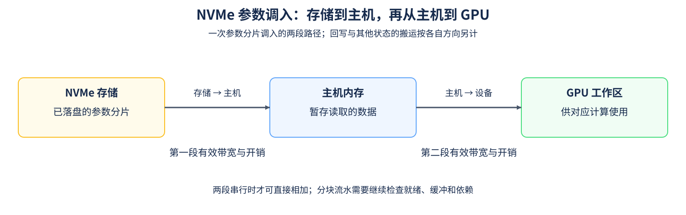
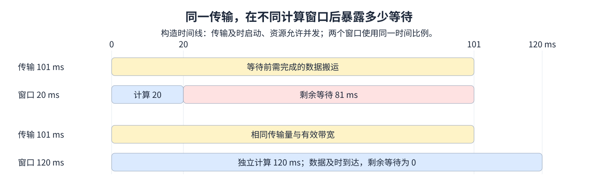

# 17. Heterogeneous Training CPU Offload NVMe Offload | 异构训练：CPU 与 NVMe 卸载

**难度：** 进阶 | **环境：** [CPU 主线，GPU 可选](#runtime-environment) | **标签：** `CPU Offload`、`NVMe Offload`、`状态搬运` | **目标人群：** 理解训练状态与内存层级

> 🚀 **云端运行环境**
>
> 本章节的实战代码可以点击以下链接在免费 GPU 算力平台上直接运行：
>
> [](https://colab.research.google.com/github/datawhalechina/llm-algo-leetcode/blob/main/04_CUDA_and_System_Optimization/17_Heterogeneous_Training_CPU_Offload_NVMe_Offload.ipynb)
> [](https://modelscope.cn/my/mynotebook) *(国内推荐：魔搭社区免费实例)*


## 本节导读

把状态移出 GPU 后，模型可能装得下了，但计算需要的数据仍要及时到达。哪些状态留在 CPU 更新，哪些参数需要调入 GPU，哪些激活要等反向时取回？每种对象都有自己的搬运方向和使用时点。

NVMe是存储访问协议，本文的NVMe卸载指将状态放到采用该协议的持久存储上，再按计算需要调入主机或GPU。本节从搬运对象与方向出发，用数据量、有效带宽和可用计算窗口估算等待。

<a id="runtime-environment"></a>

## 运行环境

- **基础练习：** 使用[基础CPU环境](../guide.md#base-cpu)，运行[题目与测试](#mechanism-practice)。Python标准库按给定带宽、固定开销与计算窗口估算，不访问存储或设备。
- **GPU对照：** 使用[性能机制环境](../topic_discussion/performance_analysis/quickstart.md#perf-cuda-mechanism-quickstart)或兼容的既有CUDA PyTorch环境，进入[Step 5](#gpu-offload-experiment)。只需CUDA PyTorch与NVIDIA GPU，不要求nvcc或DeepSpeed；默认read读取登记JSON，plan只显示计划，measure显式测量。

## 前置阅读

先看 [16. DeepSpeed ZeRO Config](./16_DeepSpeed_Zero_Config.md) 了解状态分片及卸载配置，再用本页判断配置对应的状态搬运是否可能进入关键路径。
## Step 1：先确定谁需要哪些数据

各类状态按自己的消费者决定搬运方式：参数在对应层计算前就绪；CPU优化器卸载把状态留在主机完成更新，并按实现交换梯度或更新后的参数；激活则在前向保存、反向使用前取回。

以 NVMe 上的一份参数分片为例，调入可能经过“存储 → 主机暂存 → GPU”两段；回写和其他状态流量另计。下表区分各类对象，图展开这一次从存储经主机到GPU的参数调入。

| 对象 | 需要追踪的数据路径 | 还需计算的代价 |
| --- | --- | --- |
| 优化器状态 | CPU 驻留与更新；按实现交换梯度或更新后的参数 | CPU 计算、主机内存与实际交换量 |
| 参数分片 | 从 CPU 或经主机暂存从 NVMe 调入 GPU | 调入、回写、预取及工作区 |
| 激活 | 前向保存到主机，反向使用前取回 | 保存与取回的两个方向、寿命和缓冲 |



## Step 2：单段传输怎样换算成毫秒

设单向传输量为 $S$、该路径的有效带宽为 $B$、每次请求固定开销为 $T_s$。按十进制 MB、GB/s 和毫秒计，$1\,\text{GB/s}=1\,\text{MB/ms}$；例如1000 MB、10 GB/s、固定开销1 ms，对应100 ms数据传输加1 ms准备，共101 ms。MB、GB使用十进制；数据若以MiB、GiB给出，应先换算。固定开销按一次已发起请求计，因此零字节请求仍计准备，未发起请求则为零。

$$
T_{payload,ms}=\frac{S_{MB}}{B_{GB/s}},\qquad
T_{transfer,ms}=T_{s,ms}+T_{payload,ms}
$$

一份参数经NVMe→主机→GPU串行调入时，第二段需等待第一段完整结束。继续采用构造值：第一段2 GB/s、第二段10 GB/s，各有1 ms固定开销，同为1000 MB时分别需501 ms、101 ms，最早602 ms到达GPU。若第二段到600 ms才可用，就要等到701 ms；有效带宽相同，数据就绪仍会推迟。这里按整份数据串行调入；采用分块流水时，应进一步跟踪每块的就绪和缓冲复用。有效带宽与路径可用时刻也要按当前访问粒度和并发状态取值。

## Step 3：数据就绪时刻怎样决定消费者等待

消费者在独立计算窗口 $W$ 结束时需要数据。每段只能在数据到达且自身路径可用后开始；令 $F_{i-1}$ 为前一段结束时刻，$A_i$ 为当前路径最早可用时刻，$D_i$ 为本段传输耗时，则 $F_0=0$，最后一段结束时刻 $F_n$ 决定消费者还需等待多久。所有时刻从本次计算开始计，整个计算窗口只使用一次。

$$
F_i=\max(F_{i-1},A_i)+D_i,\qquad
T_{exposed,ms}=\max(0,F_n-W)
$$

单段在0 ms可启动、耗时101 ms时，20 ms计算窗口留下81 ms等待，120 ms窗口则留下零；串行两段在0 ms可用、合计602 ms时，消费者等待582 ms：20 ms是从本次计算开始计的一段窗口，只从最终就绪时刻扣除一次。下图展开单段的两个窗口；多段沿上述就绪关系递推。真实运行还需记录主机更新、资源争用、显存与主机容量及总步时，才能判断等待减少是否转化为任务完成时间下降。



<a id="mechanism-practice"></a>

## Step 4：组合串行路径并计算消费者等待

已给出单段估算、路径字段与相邻设备检查，补全 `estimate_offload_path` 中的三个时序量。输入按同一份数据的搬运方向排列，各段传输量相同；每段声明源、目标、数据量、有效带宽、准备开销和最早可用时刻；未声明的可用时刻为0。输出保留逐段起止时刻、纯传输合计、最终就绪时刻与消费者等待，不模拟分块流水或自动预测带宽。

测试先核对单段基础，再比较单段与双段路径、路径延迟可用、等待恰好为零及多段累计。数据量和带宽同时缩放不应改变结果；反向搬运使用显式反向路径，不从调入记录推测回写。

| TODO / 函数 | 待实现的机制 | 必须满足的约束 | 测试证据 |
| --- | --- | --- | --- |
| TODO 1：确定当前段起点<br>`estimate_offload_path` | 生成`leg_start_ms` | 数据到达与路径可用两个条件均满足 | 前一段尚未结束、后一段延迟可用、第一段延迟 |
| TODO 2：沿路径传递就绪时刻<br>`estimate_offload_path` | 生成`leg_end_ms` | 每段从自己的起点累计耗时；最后结束才算数据就绪 | 双段602 ms、三段累计、逐段首尾时刻 |
| TODO 3：计算消费者剩余等待<br>`estimate_offload_path` | 生成`exposed_ms` | 从最终就绪时刻扣除同一个计算窗口，等待非负 | 窗口两侧与相等边界、延迟路径、避免逐段重复扣减 |


```python
from math import isclose, isfinite
from numbers import Real

```


```python
def offload_transfer_estimate(size_mb, effective_bandwidth_gbps, setup_ms, compute_window_ms):
    """估算一次单向传输及理想剩余等待，使用十进制 MB、GB/s、ms。"""
    values = (size_mb, effective_bandwidth_gbps, setup_ms, compute_window_ms)
    try:
        valid = all(not isinstance(value, bool) and isinstance(value, Real)
                    and isfinite(value) and value >= 0 for value in values)
    except OverflowError:
        valid = False
    if not valid or effective_bandwidth_gbps <= 0:
        raise ValueError("size and times must be finite non-negative reals; bandwidth must be positive")
    payload_ms = size_mb / effective_bandwidth_gbps
    transfer_ms = setup_ms + payload_ms
    exposed_ms = max(0, transfer_ms - compute_window_ms)
    if not isfinite(transfer_ms) or not isfinite(exposed_ms):
        raise ValueError("estimated time exceeds finite numeric range")
    return {"transfer_ms": transfer_ms, "exposed_ms": exposed_ms}


def estimate_offload_path(segments, compute_window_ms):
    """推导同一份数据沿串行路径的就绪时刻和消费者等待，全部时间单位为ms。

    segments按数据流排序，每项包含source、target、size_mb、
    effective_bandwidth_gbps、setup_ms及可选available_ms。
    available_ms是该段最早可开始搬运的绝对时刻，起点均为本次计算开始的0。
    同一份数据不改变表示，各段传输量相同；完整搬完才进入下一段。
    不模拟分块流水或资源争用，不从调入自动推断回写。
    """
    try:
        valid_window = (not isinstance(compute_window_ms, bool)
                        and isinstance(compute_window_ms, Real)
                        and isfinite(compute_window_ms) and compute_window_ms >= 0)
    except OverflowError:
        valid_window = False
    if not valid_window or not isinstance(segments, (list, tuple)) or not segments:
        raise ValueError("需要非空有序路径及有限非负计算窗口")
    normalized = []
    previous_target = None
    previous_size_mb = None
    for segment in segments:
        if not isinstance(segment, dict):
            raise ValueError("每段须使用具名字段")
        required = {"source", "target", "size_mb", "effective_bandwidth_gbps", "setup_ms"}
        if not required <= segment.keys() or set(segment) - required - {"available_ms"}:
            raise ValueError("路径字段缺失或未知")
        source, target = segment["source"], segment["target"]
        if (not isinstance(source, str) or not isinstance(target, str)
                or source not in {"nvme", "cpu", "gpu"}
                or target not in {"nvme", "cpu", "gpu"} or source == target):
            raise ValueError("需要不同的合法源与目标")
        if previous_target is not None and previous_target != source:
            raise ValueError("相邻路径必须首尾相接")
        available_ms = segment.get("available_ms", 0)
        try:
            valid_available = (not isinstance(available_ms, bool)
                               and isinstance(available_ms, Real)
                               and isfinite(available_ms) and available_ms >= 0)
        except OverflowError:
            valid_available = False
        if not valid_available:
            raise ValueError("路径可用时刻须为有限非负数")
        leg_duration_ms = offload_transfer_estimate(
            segment["size_mb"], segment["effective_bandwidth_gbps"],
            segment["setup_ms"], 0)["transfer_ms"]
        if previous_size_mb is not None and segment["size_mb"] != previous_size_mb:
            raise ValueError("同一份数据的各段传输量须相同")
        normalized.append((source, target, available_ms, leg_duration_ms))
        previous_size_mb = segment["size_mb"]
        previous_target = target

    cursor_ms = 0
    transfer_ms = 0
    timeline = []
    for source, target, available_ms, leg_duration_ms in normalized:
        # TODO 1：同时满足数据已到达和当前路径已可用。
        # leg_start_ms = ???  # 使用cursor_ms与available_ms；两者从同一时间原点计。
        leg_start_ms = None
        if leg_start_ms is None:
            raise NotImplementedError("请完成 TODO 1：leg_start_ms")
        # TODO 2：完成这一段，才能把同一份数据交给下一段。
        # leg_end_ms = ???  # 使用leg_start_ms与leg_duration_ms，不让两段完整搬运并行。
        leg_end_ms = None
        if leg_end_ms is None:
            raise NotImplementedError("请完成 TODO 2：leg_end_ms")
        if not isfinite(leg_end_ms):
            raise ValueError("路径就绪时刻超出有限范围")
        timeline.append({"source": source, "target": target,
                         "start_ms": leg_start_ms, "end_ms": leg_end_ms})
        cursor_ms = leg_end_ms
        transfer_ms += leg_duration_ms

    # TODO 3：消费者在compute_window_ms结束时需要最终数据。
    # exposed_ms = ???  # 使用最终cursor_ms和compute_window_ms；整个窗口只扣一次。
    exposed_ms = None
    if exposed_ms is None:
        raise NotImplementedError("请完成 TODO 3：exposed_ms")
    return {"transfer_ms": transfer_ms, "ready_ms": cursor_ms,
            "exposed_ms": exposed_ms, "timeline": timeline}

```

## 测试

```python
def test_offload_transfer_estimate():
    """检查单位、隐藏窗口、零请求数据、缩放及非法输入。"""
    cases = [(1000, 10, 1, 20, 101, 81), (1000, 10, 1, 120, 101, 0),
             (1000, 10, 1, 101, 101, 0), (1000, 10, 1, 0, 101, 101),
             (0, 10, 1, 0, 1, 1), (0, 10, 0, 0, 0, 0),
             (1, 1, 0, 0, 1, 1), (2.5, 0.5, 0.25, 1.25, 5.25, 4)]
    for size, bandwidth, setup, window, transfer, exposed in cases:
        row = offload_transfer_estimate(size, bandwidth, setup, window)
        assert isclose(row["transfer_ms"], transfer, abs_tol=1e-12)
        assert isclose(row["exposed_ms"], exposed, abs_tol=1e-12)
        assert 0 <= row["exposed_ms"] <= row["transfer_ms"]
        scaled = offload_transfer_estimate(size * 4, bandwidth * 4, setup, window)
        assert isclose(scaled["transfer_ms"], transfer, abs_tol=1e-12)
        later = offload_transfer_estimate(size, bandwidth, setup, window + 1)
        assert later["exposed_ms"] <= row["exposed_ms"]
    storage = offload_transfer_estimate(1000, 2, 1, 0)
    device = offload_transfer_estimate(1000, 10, 1, 0)
    assert storage["transfer_ms"] + device["transfer_ms"] == 602
    invalid = [(-1, 10, 1, 0), (1, 0, 1, 0), (1, -2, 1, 0),
               (1, 2, -1, 0), (1, 2, 1, -1), (float("nan"), 2, 1, 0),
               (1, float("inf"), 1, 0), (1, 2, float("nan"), 0),
               (1, 2, 1, float("inf")), (True, 2, 1, 0), (1, 2, False, 0),
               ("1", 2, 1, 0), (1, None, 1, 0), (1j, 2, 1, 0),
               (1e308, 1e-308, 1, 0)]
    for args in invalid:
        try:
            offload_transfer_estimate(*args)
        except ValueError:
            pass
        else:
            raise AssertionError(f"expected ValueError: {args}")
    print({"status": "passed", "transfer_cases": len(cases),
           "serial_two_hop_total_ms": 602, "invalid_cases": len(invalid),
           "hardware_measurement": "not_run"})


def test_offload_path_timeline():
    """核对串行数据依赖、路径可用时刻和只扣一次的消费者窗口。"""
    def leg(source, target, bandwidth, size=1000, setup=1, available=0):
        return {"source": source, "target": target, "size_mb": size,
                "effective_bandwidth_gbps": bandwidth,
                "setup_ms": setup, "available_ms": available}

    cases = [
        ([leg("cpu", "gpu", 10)], 20, 101, 101, 81, [(0, 101)]),
        ([leg("nvme", "cpu", 2), leg("cpu", "gpu", 10)],
         20, 602, 602, 582, [(0, 501), (501, 602)]),
        ([leg("nvme", "cpu", 2), leg("cpu", "gpu", 10, available=600)],
         20, 602, 701, 681, [(0, 501), (600, 701)]),
        ([leg("nvme", "cpu", 2, available=30), leg("cpu", "gpu", 10)],
         20, 602, 632, 612, [(30, 531), (531, 632)]),
        ([leg("cpu", "gpu", 10)], 101, 101, 101, 0, [(0, 101)]),
        ([leg("cpu", "gpu", 10)], 120, 101, 101, 0, [(0, 101)]),
        ([leg("gpu", "cpu", 10), leg("cpu", "nvme", 2)],
         0, 602, 602, 602, [(0, 101), (101, 602)]),
        ([leg("nvme", "cpu", 2, size=10, setup=0),
          leg("cpu", "gpu", 5, size=10, setup=0),
          leg("gpu", "cpu", 10, size=10, setup=0)],
         3, 8, 8, 5, [(0, 5), (5, 7), (7, 8)]),
        ([leg("cpu", "gpu", 10, size=0)], 0, 1, 1, 1, [(0, 1)]),
        ([leg("cpu", "gpu", 10, size=0, setup=0)], 0, 0, 0, 0, [(0, 0)]),
    ]
    for segments, window, transfer, ready, exposed, expected_times in cases:
        original = [dict(segment) for segment in segments]
        result = estimate_offload_path(segments, window)
        for key, expected in [("transfer_ms", transfer), ("ready_ms", ready),
                              ("exposed_ms", exposed)]:
            assert isclose(result[key], expected, abs_tol=1e-12), (key, result)
        assert [(row["start_ms"], row["end_ms"]) for row in result["timeline"]] == expected_times
        assert [(row["source"], row["target"]) for row in result["timeline"]] == [
            (segment["source"], segment["target"]) for segment in segments]
        assert segments == original
        scaled = [{**segment, "size_mb": segment["size_mb"] * 4,
                   "effective_bandwidth_gbps": segment["effective_bandwidth_gbps"] * 4}
                  for segment in segments]
        assert estimate_offload_path(scaled, window) == result
        assert estimate_offload_path(segments, window + 1)["exposed_ms"] <= exposed

    base = leg("cpu", "gpu", 10)
    invalid = [
        ([], 20), ("cpu->gpu", 20), ([None], 20), ([{}], 20),
        ([{**base, "source": "other"}], 20),
        ([{**base, "target": "cpu"}], 20),
        ([leg("nvme", "cpu", 2), leg("nvme", "gpu", 10)], 20),
        ([{**base, "available_ms": -1}], 20),
        ([{**base, "available_ms": True}], 20),
        ([{**base, "available_ms": float("inf")}], 20),
        ([{**base, "available_ms": 10**400}], 20),
        ([{**base, "effective_bandwidth_gbps": 0}], 20),
        ([{**base, "extra": 1}], 20),
        ([leg("nvme", "cpu", 2), leg("cpu", "gpu", 10, size=500)], 20),
        ([base], -1), ([base], True), ([base], float("nan")),
        ([base], 10**400),
        ([leg("cpu", "gpu", 1, size=1e308, setup=0, available=1e308)], 20),
    ]
    for segments, window in invalid:
        try:
            estimate_offload_path(segments, window)
        except ValueError:
            pass
        else:
            raise AssertionError("非法路径、时刻或窗口应被拒绝")
    print({"status": "passed", "path_cases": len(cases),
           "invalid_path_cases": len(invalid), "hardware_measurement": "not_run"})


test_offload_transfer_estimate()
test_offload_path_timeline()

```

---

🛑 **STOP HERE** 🛑

先完成题目区，再查看参考实现。
## 参考代码与解析

### 代码

```python
def offload_transfer_estimate(size_mb, effective_bandwidth_gbps, setup_ms, compute_window_ms):
    """估算一次单向传输及理想剩余等待，使用十进制 MB、GB/s、ms。"""
    values = (size_mb, effective_bandwidth_gbps, setup_ms, compute_window_ms)
    try:
        valid = all(not isinstance(value, bool) and isinstance(value, Real)
                    and isfinite(value) and value >= 0 for value in values)
    except OverflowError:
        valid = False
    if not valid or effective_bandwidth_gbps <= 0:
        raise ValueError("size and times must be finite non-negative reals; bandwidth must be positive")
    payload_ms = size_mb / effective_bandwidth_gbps
    transfer_ms = setup_ms + payload_ms
    exposed_ms = max(0, transfer_ms - compute_window_ms)
    if not isfinite(transfer_ms) or not isfinite(exposed_ms):
        raise ValueError("estimated time exceeds finite numeric range")
    return {"transfer_ms": transfer_ms, "exposed_ms": exposed_ms}


def estimate_offload_path(segments, compute_window_ms):
    """推导同一份数据沿串行路径的就绪时刻和消费者等待，全部时间单位为ms。

    segments按数据流排序，每项包含source、target、size_mb、
    effective_bandwidth_gbps、setup_ms及可选available_ms。
    available_ms是该段最早可开始搬运的绝对时刻，起点均为本次计算开始的0。
    同一份数据不改变表示，各段传输量相同；完整搬完才进入下一段。
    不模拟分块流水或资源争用，不从调入自动推断回写。
    """
    try:
        valid_window = (not isinstance(compute_window_ms, bool)
                        and isinstance(compute_window_ms, Real)
                        and isfinite(compute_window_ms) and compute_window_ms >= 0)
    except OverflowError:
        valid_window = False
    if not valid_window or not isinstance(segments, (list, tuple)) or not segments:
        raise ValueError("需要非空有序路径及有限非负计算窗口")
    normalized = []
    previous_target = None
    previous_size_mb = None
    for segment in segments:
        if not isinstance(segment, dict):
            raise ValueError("每段须使用具名字段")
        required = {"source", "target", "size_mb", "effective_bandwidth_gbps", "setup_ms"}
        if not required <= segment.keys() or set(segment) - required - {"available_ms"}:
            raise ValueError("路径字段缺失或未知")
        source, target = segment["source"], segment["target"]
        if (not isinstance(source, str) or not isinstance(target, str)
                or source not in {"nvme", "cpu", "gpu"}
                or target not in {"nvme", "cpu", "gpu"} or source == target):
            raise ValueError("需要不同的合法源与目标")
        if previous_target is not None and previous_target != source:
            raise ValueError("相邻路径必须首尾相接")
        available_ms = segment.get("available_ms", 0)
        try:
            valid_available = (not isinstance(available_ms, bool)
                               and isinstance(available_ms, Real)
                               and isfinite(available_ms) and available_ms >= 0)
        except OverflowError:
            valid_available = False
        if not valid_available:
            raise ValueError("路径可用时刻须为有限非负数")
        leg_duration_ms = offload_transfer_estimate(
            segment["size_mb"], segment["effective_bandwidth_gbps"],
            segment["setup_ms"], 0)["transfer_ms"]
        if previous_size_mb is not None and segment["size_mb"] != previous_size_mb:
            raise ValueError("同一份数据的各段传输量须相同")
        normalized.append((source, target, available_ms, leg_duration_ms))
        previous_size_mb = segment["size_mb"]
        previous_target = target

    cursor_ms = 0
    transfer_ms = 0
    timeline = []
    for source, target, available_ms, leg_duration_ms in normalized:
        # TODO 1：同时满足数据已到达和当前路径已可用。
        # leg_start_ms = ???  # 使用cursor_ms与available_ms；两者从同一时间原点计。
        leg_start_ms = max(cursor_ms, available_ms)
        if leg_start_ms is None:
            raise NotImplementedError("请完成 TODO 1：leg_start_ms")
        # TODO 2：完成这一段，才能把同一份数据交给下一段。
        # leg_end_ms = ???  # 使用leg_start_ms与leg_duration_ms，不让两段完整搬运并行。
        leg_end_ms = leg_start_ms + leg_duration_ms
        if leg_end_ms is None:
            raise NotImplementedError("请完成 TODO 2：leg_end_ms")
        if not isfinite(leg_end_ms):
            raise ValueError("路径就绪时刻超出有限范围")
        timeline.append({"source": source, "target": target,
                         "start_ms": leg_start_ms, "end_ms": leg_end_ms})
        cursor_ms = leg_end_ms
        transfer_ms += leg_duration_ms

    # TODO 3：消费者在compute_window_ms结束时需要最终数据。
    # exposed_ms = ???  # 使用最终cursor_ms和compute_window_ms；整个窗口只扣一次。
    exposed_ms = max(0, cursor_ms - compute_window_ms)
    if exposed_ms is None:
        raise NotImplementedError("请完成 TODO 3：exposed_ms")
    return {"transfer_ms": transfer_ms, "ready_ms": cursor_ms,
            "exposed_ms": exposed_ms, "timeline": timeline}

```

### 解析

#### TODO 1：开始搬运需要两个条件同时满足

- 当前段开始时，既要有上一段送达的数据，也要有可用路径，因此起点取数据就绪与路径可用时刻中较晚者；两者使用同一时间原点。
- 双段默认路径的第二段在501 ms开始；将该段可用时刻推迟到600 ms后，起点应随之变化。第一段延迟用例还检查起点没有被写死为零。

#### TODO 2：每段从自己的起点累加耗时

- 当前起点加本段耗时得到结束时刻，再交给下一段；同一份完整数据的两次搬运不能直接取最长段或同时起步。
- 501 ms与101 ms串行相接为602 ms；三段累计及逐段起止断言能发现漏算或错误并行。这些时间由给定数据量、有效带宽和可用时刻推导而来。

#### TODO 3：计算窗口只抵消一次最终等待

- 消费者在同一个计算窗口结束时需要最终数据，因此只从最终就绪时刻扣一次窗口，再将剩余等待截在零。
- 602 ms配20 ms窗口应剩582 ms，逐段各扣一次会错成562 ms；相等和更长窗口用例检查零等待边界，路径延迟后则仍需计入新增等待。


<a id="gpu-offload-experiment"></a>

## Step 5：减少驻留需要支付多少往返代价（可选）

### 5.1 环境与固定工作负载

使用本页CUDA PyTorch环境与已注册的仓库运行时，不加载模型或下载数据。每次从0.25初始化FP32状态，每步原地加0.125；一条路径将状态留在GPU，另一条在相同更新后写回预分配锁页CPU缓冲、释放设备引用，再调回GPU供下一步使用。两条路径各自预热，并逐轮交换先后顺序。

比较4、32 MiB两档：记录中间已分配量、窗口峰值、主机缓冲与双向字节，并用主机墙钟测每步完整完成时间。循环按阶段同步，无独立计算窗口，不测重叠或NVMe；初始化、锁页分配与正确性比较在窗口外，调回分配、传输、同步和状态采样在窗口内。


```python
RUN_MODE = "read"  # read读取已有记录；plan只显示计划；measure执行并保存。
RUN_LABEL = "rtx5070ti_offload_path_20261111_v1"  # 复现测量时换唯一标签，不覆盖登记结果。
RESULT_PATH = f"benchmarks/results/offload_path_{RUN_LABEL}.json"  # 根目录结果，不写入Part04子目录。
PAYLOAD_MIB = (4, 32)  # 每档一个FP32状态，最多3档，每档1–64 MiB。
ITERATIONS = 10  # 每轮每条路径的更新／使用次数，上限30。
WARMUP = 2  # 每档每条路径单独预热的步数，上限5。
REPEATS = 6  # 偶数轮AB/BA配对，范围4–10，全部样本保留。

```

### 5.2 执行并保存结果

先保存Notebook，再显式选择measure。执行器在新的Python子进程加载本页保存的实验函数，避免当前Kernel的张量引用混入驻留统计；环境不足时明确跳过且不保存，运行异常直接失败。已有结果在启动GPU前拒绝覆盖。

每条路径从相同输入重新开始，先预热再测量；写回完成后才释放，调回完成后才进入下一次更新。中间状态逐步记录，峰值在全量正确性比较前读取；每次循环结束都核对所有元素的累计值。


```python
def measure_offload_paths(payload_mib, iterations, warmup, repeats):
    """在独立进程比较相同FP32更新的驻留路径与同步CPU往返路径。"""
    import gc
    import platform
    import sys
    import time
    import torch

    if (not isinstance(payload_mib, (list, tuple)) or not payload_mib
            or len(payload_mib) > 3 or len(set(payload_mib)) != len(payload_mib)
            or any(type(size) is not int or not 1 <= size <= 64 for size in payload_mib)):
        raise ValueError("payload_mib需要1至3个不同的1–64 MiB整数")
    for value, low, high in ((iterations, 1, 30), (warmup, 1, 5), (repeats, 4, 10)):
        if type(value) is not int or not low <= value <= high:
            raise ValueError("迭代、预热或配对轮数超出有界范围")
    if repeats % 2:
        raise ValueError("配对轮数须为偶数")
    if not torch.cuda.is_available():
        return {"status": "skipped", "reason": "cuda_unavailable"}
    device = torch.device("cuda:0")
    torch.cuda.set_device(device)
    # 预热上下文；不把初始化算进候选路径。
    probe = torch.ones(1, device=device)
    probe.add_(0.125)
    torch.cuda.synchronize(device)
    del probe
    gc.collect()
    torch.cuda.empty_cache()
    free_bytes, total_bytes = torch.cuda.mem_get_info(device)
    if free_bytes < (4 * max(payload_mib) + 64) * 1024**2:
        return {"status": "skipped", "reason": "insufficient_free_device_memory"}
    runtime = {"python": sys.version, "platform": platform.platform(),
               "torch": torch.__version__, "torch_cuda": torch.version.cuda,
               "device": torch.cuda.get_device_name(device),
               "capability": list(torch.cuda.get_device_capability(device)),
               "allocator_backend": torch.cuda.get_allocator_backend(),
               "device_total_bytes": total_bytes}

    def run_path(name, size_mib, steps):
        """固定输入与原地更新；在同一完成边界测完整串行循环。"""
        x = host = None
        try:
            torch.cuda.synchronize(device)
            torch.cuda.empty_cache()
            baseline = torch.cuda.memory_allocated(device)
            setup_start = time.perf_counter()
            elements = size_mib * 1024**2 // 4
            x = torch.full((elements,), 0.25, dtype=torch.float32, device=device)
            if name == "cpu_roundtrip":
                # 锁页缓冲预分配，不在每次往返中重复锁页。
                host = torch.empty(elements, dtype=torch.float32, pin_memory=True)
            torch.cuda.synchronize(device)
            setup_ms = (time.perf_counter() - setup_start) * 1000
            torch.cuda.reset_peak_memory_stats(device)
            samples = []
            started = time.perf_counter()
            for step in range(steps):
                x.add_(0.125)
                torch.cuda.synchronize(device)
                active = torch.cuda.memory_allocated(device) - baseline
                if name == "cpu_roundtrip":
                    host.copy_(x, non_blocking=False)
                    # 阻塞回写完成后删除最后设备引用；不在计时内empty_cache。
                    x = None
                released = torch.cuda.memory_allocated(device) - baseline
                reserved = torch.cuda.memory_reserved(device)
                if name == "cpu_roundtrip":
                    x = torch.empty(elements, dtype=torch.float32, device=device)
                    x.copy_(host, non_blocking=False)
                torch.cuda.synchronize(device)
                ready = torch.cuda.memory_allocated(device) - baseline
                samples.append({"step": step + 1, "active_allocated_bytes": active,
                                "between_uses_allocated_bytes": released,
                                "between_uses_reserved_bytes": reserved,
                                "ready_allocated_bytes": ready})
            completion_ms = (time.perf_counter() - started) * 1000 / steps
            peak = torch.cuda.max_memory_allocated(device) - baseline
            peak_reserved = torch.cuda.max_memory_reserved(device)
            # 全量数值核对在计时与峰值采样之后，避免临时比较张量污染峰值。
            expected = 0.25 + steps * 0.125
            correct = bool(torch.all(x == expected).item())
            if not correct:
                raise AssertionError("往返数据或更新次数不一致")
            return {"name": name, "completion_ms_per_step": completion_ms,
                    "setup_ms": setup_ms, "correctness": "passed",
                    "baseline_allocated_bytes": baseline,
                    "peak_allocated_delta_bytes": peak,
                    "peak_reserved_bytes": peak_reserved,
                    "host_buffer_bytes": size_mib * 1024**2 if host is not None else 0,
                    "d2h_bytes_per_step": size_mib * 1024**2 if host is not None else 0,
                    "h2d_bytes_per_step": size_mib * 1024**2 if host is not None else 0,
                    "expected_final_value": expected, "samples": samples}
        finally:
            x = host = None
            gc.collect()
            torch.cuda.synchronize(device)
            torch.cuda.empty_cache()

    rows = []
    for size_mib in payload_mib:
        for name in ("gpu_resident", "cpu_roundtrip"):
            run_path(name, size_mib, warmup)
        pairs = []
        for repeat in range(1, repeats + 1):
            order = (["gpu_resident", "cpu_roundtrip"] if repeat % 2
                     else ["cpu_roundtrip", "gpu_resident"])
            paths = [run_path(name, size_mib, iterations) for name in order]
            by_name = {path["name"]: path for path in paths}
            ratio = (by_name["cpu_roundtrip"]["completion_ms_per_step"]
                     / by_name["gpu_resident"]["completion_ms_per_step"])
            pairs.append({"repeat": repeat, "order": order, "paths": paths,
                          "roundtrip_over_resident": ratio})
        rows.append({"payload_mib": size_mib, "payload_bytes": size_mib * 1024**2,
                     "pairs": pairs})
    return {"status": "measured", "evidence_scope": "local_serial_residency_transfer",
            "runtime": runtime,
            "protocol": {"dtype": "float32", "initial_value": 0.25, "increment": 0.125,
                         "timing": "host_wall_clock_synchronized_each_stage",
                         "host_buffer": "pinned_preallocated_outside_timing",
                         "input_initialization_in_timing": False,
                         "reload_allocation_in_timing": True,
                         "memory_sampling_in_timing": True,
                         "overlap": False, "nvme": False},
            "config": {"payload_mib": list(payload_mib), "iterations": iterations,
                       "warmup": warmup, "repeats": repeats}, "rows": rows}

```


```python
def run_offload_experiment(mode, label, relative_path, payload_mib, iterations, warmup, repeats):
    """计划不调用GPU；实测在新子进程执行，成功后独占保存。"""
    import hashlib
    import json
    import re
    import subprocess
    import sys
    from datetime import datetime, timezone
    from tools.project_runtime import resolve_project_root, save_json_record_once

    if mode not in {"plan", "measure", "read"}:
        raise ValueError("模式须为plan、measure或read")
    if (not isinstance(payload_mib, (list, tuple)) or not 1 <= len(payload_mib) <= 3
            or any(type(size) is not int or not 1 <= size <= 64 for size in payload_mib)
            or len(set(payload_mib)) != len(payload_mib)):
        raise ValueError("需要1至3个不同的1–64 MiB整数")
    for value, low, high in ((iterations, 1, 30), (warmup, 1, 5), (repeats, 4, 10)):
        if type(value) is not int or not low <= value <= high:
            raise ValueError("迭代配置超界")
    if repeats % 2:
        raise ValueError("配对轮数须为偶数")
    root = resolve_project_root()
    notebook = json.loads((root / "04_CUDA_and_System_Optimization/17_Heterogeneous_Training_CPU_Offload_NVMe_Offload.ipynb").read_text(encoding="utf-8"))

    def saved_source(cell_id):
        """按固定单元身份加载本页已保存定义，不执行题目或递归启动器。"""
        cells = [cell for cell in notebook["cells"] if cell.get("id") == cell_id]
        if len(cells) != 1:
            raise ValueError("缺少唯一实验定义，请先保存Notebook")
        return "".join(cells[0]["source"])

    helpers = {}
    exec(saved_source("offload-read-functions"), helpers)
    _, target = helpers["offload_record_path"](relative_path)
    if mode == "plan":
        return {"status": "plan", "gpu_executed": False, "result_path": str(target),
                "payload_mib": list(payload_mib), "iterations": iterations,
                "warmup": warmup, "repeats": repeats}
    if mode == "read":
        return helpers["read_offload_record"](relative_path, label)
    if (not isinstance(label, str) or label == "replace_with_unique_label"
            or re.fullmatch(r"[A-Za-z0-9][A-Za-z0-9_-]{0,95}", label) is None
            or label not in target.stem):
        raise ValueError("实测需唯一合法标签，且文件名包含该标签")
    if target.exists():
        raise FileExistsError("结果已存在，测量前请更换标签与路径")
    source = saved_source("offload-gpu-functions")
    arguments = repr((list(payload_mib), iterations, warmup, repeats))
    command = source + "\nimport json\nprint(json.dumps(measure_offload_paths(*" + arguments + ")))\n"
    completed = subprocess.run([sys.executable, "-c", command], cwd=root,
                               capture_output=True, text=True, check=False, timeout=180)
    if completed.returncode:
        raise RuntimeError("GPU子进程失败：\n" + completed.stderr + completed.stdout)
    record = json.loads(completed.stdout)
    if record["status"] == "skipped":
        return record
    record.update({"schema_version": "cuda-offload-path/v1", "run_label": label,
                   "recorded_at_utc": datetime.now(timezone.utc).isoformat(),
                   "source_sha256": hashlib.sha256(source.encode()).hexdigest(),
                   "isolation": "fresh_python_subprocess"})
    helpers["validate_offload_record"](record)
    save_json_record_once(target, record)
    return {"status": "saved", "result_path": str(target), "run_label": label}


if RUN_MODE != "read":
    execution_status = run_offload_experiment(
        RUN_MODE, RUN_LABEL, RESULT_PATH, PAYLOAD_MIB, ITERATIONS, WARMUP, REPEATS)
    print(execution_status)
    if execution_status["status"] == "skipped":
        print("SKIPPED: 本次没有形成GPU搬运证据")
else:
    print("read：未执行GPU；继续运行5.3读取。")

```

### 5.3 读取与核对结果

配置已有标签、路径并选择read后，只需运行本小节，无需执行5.2。读取函数按记录本身的配置核对所有档位、配对顺序、状态与双向字节，再从原始时间重算比值；先展示环境和协议，再列出全部轮次及各路径中位数。


```python
def offload_record_path(relative_path):
    """仅解析仓库根benchmarks/results中的JSON，不创建目录。"""
    from pathlib import Path
    from tools.project_runtime import resolve_project_root

    root = resolve_project_root()
    supplied = Path(relative_path)
    target = (root / supplied).resolve()
    if (supplied.is_absolute() or target.suffix != ".json"
            or not target.is_relative_to((root / "benchmarks/results").resolve())):
        raise ValueError("结果须为根benchmarks/results内的相对JSON路径")
    return root, target


def validate_offload_record(record):
    """按原始轮次重算传输量、驻留量和时间比，不预设必须加速。"""
    import math

    def require(condition, message):
        """记录缺损或语义不一致时明确拒绝。"""
        if not condition:
            raise ValueError(message)

    require(record.get("schema_version") == "cuda-offload-path/v1"
            and record.get("status") == "measured", "需要已测的卸载路径记录")
    require(record.get("evidence_scope") == "local_serial_residency_transfer"
            and record.get("isolation") == "fresh_python_subprocess", "证据范围或进程隔离不符")
    require(isinstance(record.get("run_label"), str) and bool(record["run_label"]), "缺少标签")
    sha = record.get("source_sha256", "")
    require(isinstance(sha, str) and len(sha) == 64
            and all(char in "0123456789abcdef" for char in sha), "源实现身份无效")
    config = record["config"]
    sizes, count = config["payload_mib"], config["repeats"]
    require(isinstance(sizes, list) and 1 <= len(sizes) <= 3
            and all(type(size) is int and 1 <= size <= 64 for size in sizes)
            and len(set(sizes)) == len(sizes), "数据量超界或重复")
    require(type(count) is int and 4 <= count <= 10 and count % 2 == 0, "配对轮数无效")
    for key, maximum in (("iterations", 30), ("warmup", 5)):
        require(type(config[key]) is int and 1 <= config[key] <= maximum, "迭代配置无效")
    protocol = {"dtype": "float32", "initial_value": 0.25, "increment": 0.125,
                "timing": "host_wall_clock_synchronized_each_stage",
                "host_buffer": "pinned_preallocated_outside_timing",
                "input_initialization_in_timing": False,
                "reload_allocation_in_timing": True, "memory_sampling_in_timing": True,
                "overlap": False, "nvme": False}
    require(record["protocol"] == protocol, "计时或数据协议不匹配")
    for key in ("torch", "torch_cuda", "device", "allocator_backend", "python"):
        require(isinstance(record["runtime"].get(key), str) and bool(record["runtime"][key]),
                "缺少环境字段")
    require([row["payload_mib"] for row in record["rows"]] == sizes, "工作负载档位不完整")
    for row in record["rows"]:
        payload = row["payload_mib"] * 1024**2
        require(row["payload_bytes"] == payload and len(row["pairs"]) == count, "字节数或轮次不完整")
        for index, pair in enumerate(row["pairs"], 1):
            order = (["gpu_resident", "cpu_roundtrip"] if index % 2
                     else ["cpu_roundtrip", "gpu_resident"])
            require(pair["repeat"] == index and pair["order"] == order
                    and [path["name"] for path in pair["paths"]] == order, "配对次序不匹配")
            by_name = {}
            for path in pair["paths"]:
                name = path["name"]
                by_name[name] = path
                for key in ("completion_ms_per_step", "setup_ms"):
                    value = path[key]
                    require(type(value) in (int, float) and math.isfinite(value)
                            and (value > 0 if key == "completion_ms_per_step" else value >= 0),
                            "时间须为有限有效数")
                require(path["correctness"] == "passed"
                        and path["expected_final_value"] == 0.25 + config["iterations"] * 0.125,
                        "数据或更新次数未通过")
                for key in ("baseline_allocated_bytes", "peak_allocated_delta_bytes",
                            "peak_reserved_bytes", "host_buffer_bytes",
                            "d2h_bytes_per_step", "h2d_bytes_per_step"):
                    require(type(path[key]) is int and path[key] >= 0, "内存或流量须为整数字节")
                require(path["peak_allocated_delta_bytes"] >= payload, "峰值遗漏活跃张量")
                moved = payload if name == "cpu_roundtrip" else 0
                require(all(path[key] == moved for key in
                            ("host_buffer_bytes", "d2h_bytes_per_step", "h2d_bytes_per_step")),
                        "主机缓冲或双向搬运字节不一致")
                require(len(path["samples"]) == config["iterations"], "状态样本不完整")
                for step, sample in enumerate(path["samples"], 1):
                    require(sample["step"] == step, "状态样本次序错误")
                    for key in ("active_allocated_bytes", "between_uses_allocated_bytes",
                                "between_uses_reserved_bytes", "ready_allocated_bytes"):
                        require(type(sample[key]) is int and sample[key] >= 0, "状态须为整数字节")
                    require(sample["active_allocated_bytes"] == payload
                            and sample["ready_allocated_bytes"] == payload
                            and sample["between_uses_allocated_bytes"] == (0 if moved else payload),
                            "引用释放或调回驻留关系不符")
            ratio = (by_name["cpu_roundtrip"]["completion_ms_per_step"]
                     / by_name["gpu_resident"]["completion_ms_per_step"])
            require(type(pair["roundtrip_over_resident"]) in (int, float)
                    and math.isclose(pair["roundtrip_over_resident"], ratio, rel_tol=1e-12),
                    "配对时间比不一致")
    return record


def read_offload_record(relative_path, label):
    """从配置路径独立读取，无需运行5.2或导入GPU框架。"""
    import json

    _, path = offload_record_path(relative_path)
    record = validate_offload_record(json.loads(path.read_text(encoding="utf-8")))
    if record["run_label"] != label:
        raise ValueError("配置标签与记录标签不一致")
    return record


def display_offload_record(record):
    """先显示协议，再展示全部配对与按路径重算的中位数。"""
    from statistics import median

    if record["status"] != "measured":
        print(record)
        if record["status"] == "skipped":
            print("SKIPPED: 本次没有形成GPU搬运证据")
        return
    validate_offload_record(record)
    print({"run_label": record["run_label"], "status": record["status"],
           "scope": record["evidence_scope"], "runtime": record["runtime"],
           "protocol": record["protocol"], "config": record["config"]})
    print("MiB | 轮次 | 先后顺序 | 驻留ms/步 | 往返ms/步 | 往返/驻留")
    for row in record["rows"]:
        for pair in row["pairs"]:
            paths = {path["name"]: path for path in pair["paths"]}
            print(row["payload_mib"], pair["repeat"], "→".join(pair["order"]),
                  round(paths["gpu_resident"]["completion_ms_per_step"], 6),
                  round(paths["cpu_roundtrip"]["completion_ms_per_step"], 6),
                  round(pair["roundtrip_over_resident"], 3), sep=" | ")
    print("MiB | 路径 | 中位ms/步 | 中间allocated MiB | 峰值增量MiB | 主机缓冲MiB | 双向MiB/步")
    for row in record["rows"]:
        for name in ("gpu_resident", "cpu_roundtrip"):
            paths = [next(path for path in pair["paths"] if path["name"] == name)
                     for pair in row["pairs"]]
            print(row["payload_mib"], name,
                  round(median(path["completion_ms_per_step"] for path in paths), 6),
                  median(sample["between_uses_allocated_bytes"] for path in paths
                         for sample in path["samples"]) / 1024**2,
                  median(path["peak_allocated_delta_bytes"] for path in paths) / 1024**2,
                  paths[0]["host_buffer_bytes"] / 1024**2,
                  (paths[0]["d2h_bytes_per_step"] + paths[0]["h2d_bytes_per_step"]) / 1024**2,
                  sep=" | ")

```


```python
if RUN_MODE == "read":
    display_offload_record(read_offload_record(RESULT_PATH, RUN_LABEL))
else:
    print("尚未读取；测量保存后改为read，并重新运行5.1配置与5.3。")

```

### 5.4 解释结果与适用条件

先核对两条路径的正确性和双向流量，再比较中间allocated与峰值：写回后释放设备张量减少两次使用之间的驻留，但调回仍需容纳同样大小的状态。reserved记录分配器管理的空间，释放张量不要求它立即下降，口径见[PyTorch内存管理](https://docs.pytorch.org/docs/2.11/notes/cuda.html#memory-management)。

时间比为每轮“往返／驻留”，大于1表示往返较慢；先逐轮求比，再取中位数，不能用两列中位耗时直接替代。这里按阶段同步，主机缓冲预分配在计时外，调回分配、传输、同步和状态采样在计时内；[PyTorch传输说明](https://docs.pytorch.org/tutorials/intermediate/pinmem_nonblock.html)中的同步条件也是解释边界，不能仅由non_blocking推断重叠。

2026-11-11在RTX 5070 Ti Laptop、PyTorch 2.11.0+cu128、native分配器上，两档全部配对通过全量累计值与状态检查。每条路径每轮10步，各预热2步，6轮AB/BA；[完整记录](../../benchmarks/results/offload_path_rtx5070ti_offload_path_20261111_v1.json)保留全部轮次和逐步样本。4 MiB的配对时间比中位数为3.387，32 MiB为20.676；小循环受同步、采样及主机波动影响，不将这两个比值外推为纯链路性能。

本次往返减少的是中间驻留，不是窗口峰值，代价包括主机缓冲和每步双向传输。没有独立计算可隐藏搬运，因此本例不能评价CPU更新、NVMe、重叠或完整训练容量收益；这些问题需要相应负载另行验证。

| 状态大小／路径 | 完整时间中位数（ms/步） | 中间allocated（MiB） | 窗口峰值增量（MiB） | 主机缓冲（MiB） | 双向传输（MiB/步） |
| --- | --- | --- | --- | --- | --- |
| 4 MiB／GPU驻留 | 0.257571 | 4 | 4 | 0 | 0 |
| 4 MiB／CPU往返 | 0.871606 | 0 | 4 | 4 | 8 |
| 32 MiB／GPU驻留 | 0.251985 | 32 | 32 | 0 | 0 |
| 32 MiB／CPU往返 | 5.101446 | 0 | 32 | 32 | 64 |

## 相关阅读

要判断窗口是否真正可用，继续核对数据依赖与缓冲寿命，再比较总完成时间。

- [10 Stream 与主机传输](./10_PyTorch_CUDA_Streams_and_Transfer.md)：传输就绪、消费与复用事件。
- [15 通信与计算重叠](./15_Communication_Computation_Overlap_Advanced_Scheduling.md)：交叠、暴露等待与阶段争用。
