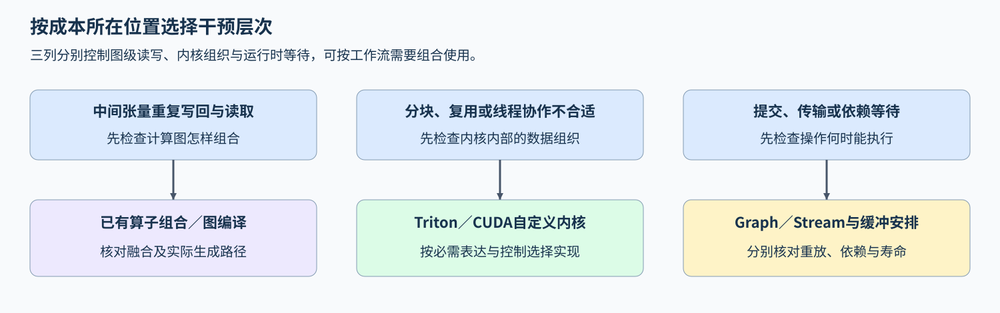

# 18. CUDA vs Triton vs PyTorch | 按工作负载选择算子实现路径

**难度：** 进阶 | **环境：** 阅读与情景判断 | **标签：** `PyTorch`、`Triton`、`CUDA C++`、`技术选型` | **目标人群：** 接触过 GPU 算子实现

> 🚀 **云端运行环境**
>
> 本章节的实战代码可以点击以下链接在免费 GPU 算力平台上直接运行：
>
> 
>  *(国内推荐：魔搭社区免费实例)*

## 本节导读

一个内核快了一倍，放回模型后却只省下几毫秒；另一个候选稳态更快，短任务的总耗时却增加了。要决定是否改写，需要把局部节省、转换开销和一次性准备放回完整任务比较。

本节从关键路径、控制需求和运行次数选择下一步：先定位成本，再判断图编译、自定义内核或运行时调整能改变什么，最后计算采用条件。情景中的数字均为构造输入，用于推导成本关系。

## 前置阅读

先回顾不同编程模型的控制范围，以及编译图对执行路径的影响。

- [Part 01：08 CUDA 与 Triton 编程模型](../01_Hardware_Math_and_Systems/08_Programming_Models_CUDA_Triton.md)
- [Part 01：09 AI 编译器与计算图优化](../01_Hardware_Math_and_Systems/09_AI_Compilers_and_Graph_Optimization.md)
## Step 1：最多能省下多少时间

先定位目标操作在完整调用中占用的关键路径时间，再判断省去它能改变多少结果。若一次串行工作流100 ms，其中目标算子仅5 ms，即使把它的成本完全消除，也只能降到95 ms，速度比上限约为 $100/95\approx1.053$。因此，优先剖析其余95 ms，有助于找到更值得减少的计算或等待。

再看已有算子、库与编译是否已经覆盖所需计算。PyTorch是调用和组合计算的接口，底层可以执行库内核，也可以执行编译器生成的Triton或CUDA实现；这些路径能够组合使用。选型时应比较它们实际执行了什么，以及新增控制能省下哪部分成本。

## Step 2：需要改变的是图、内核还是提交方式

同一串张量操作可以通过图编译省去中间读写，也可以由自定义内核改变分块、归约或数据映射。Triton的Program是一份内核执行实例，Tile是它处理的数据子块；Program内的工作再由编译器映射到硬件线程，Tile大小与线程数分别描述数据范围和执行资源。若计算本身已合适，而主机需要反复提交很多短操作，CUDA Graph可记录并重放工作流，减少逐次提交开销；图级融合、内核算法和运行时（Runtime）提交分别控制不同的成本。

控制需求也可能位于调用接口。例如已有CUDA库的计算正确，但封装把工作提交到错误的Stream（设备任务队列），应让封装传入调用方要求的Stream，并连接必要依赖。需要改变内核内部的数据组织时，再根据当前版本和设备可用的接口选择Triton或CUDA C++原型；每条路径都要把新增的准备、适配和维护成本计入比较。

| 路径 | 可改变的部分 | 适合先验证的情况 | 额外成本 |
| --- | --- | --- | --- |
| PyTorch 组合／已有库／图编译 | 图结构、形状安排、融合与已有库调用 | 标准计算已有实现，或问题在图级中间值 | 编译准备、形状复用与执行路径核对 |
| 自定义 Triton 内核 | Program／Tile 映射、融合与局部数据访问 | 关键路径中的数据组织或算法确有改进空间 | 数值、布局、形状覆盖和配置调优 |
| CUDA C++ 扩展 | 显式线程协作、同步、资源与可用硬件接口 | 必需控制在已检查的上层路径中无法获得 | 本机工具链、竞态排查、接口和跨设备维护 |
| 运行时调整 | 提交、依赖与缓冲寿命 | 时间线主要暴露传输或提交等待 | 准备成本、地址与数据寿命约束 |

## Step 3：局部节省怎样被额外工作抵消

假设串行工作流原来100 ms，其中目标内核40 ms；候选把它降到20 ms，却新增8 ms布局转换，那么完整调用为 $100-40+20+8=88$ ms。内核耗时减半，完整调用每次节省12 ms。这个计算要求两条路径采用相同输入、精度、转换与同步范围；存在重叠时，则按实际关键路径计算节省。

若候选还需1200 ms一次性准备，按每次节省12 ms估算，100次调用刚好抵消这项成本，超过100次后才产生净节省。形状变化会触发重复准备时，按每份产物实际复用的次数分别计算。采用前再核对接口、数值误差、梯度需求、支持形状和失败回退：满足要求且完整任务有收益时采用；转换或准备成本较高时，优先调整布局与复用方式；设备适配仍待核对时，先保留已验证路径。

## Step 4：为三个场景选择下一步

对每个场景给出首选动作、计算或依赖依据，以及采用前还需核对的条件。A、B的时间均按串行完整调用统计，B的准备成本是相对原路径新增的一次性成本；C先判断执行依赖是否正确，性能收益留待修复后测量。

| 场景与给定条件 | 要回答的问题 |
| --- | --- |
| A：完整调用100 ms，目标算子5 ms；现有PyTorch可表达计算，其余95 ms尚未剖析 | 完全消除目标的速度比上限是多少？能否据此优先改写这5 ms？ |
| B：完整调用100 ms，目标40 ms；Triton原型20 ms，新增转换8 ms，新增准备1200 ms；固定形状分别调用50、500次 | 两档总任务耗时是多少？盈亏平衡调用次数是多少？采用前还需核对什么？ |
| C：已有CUDA C++库按要求传入的Stream执行；当前封装却固定传入默认Stream，非默认Stream中的输入尚未就绪就可能被读取。计算算法不变，尚无修复后的耗时 | 应先修封装、重写Triton内核，还是更换算法？怎样核对依赖正确？能否由修复推断加速？ |

## 参考判断

### 场景A：先定位其余关键路径

完全消除目标后的时间下限为95 ms，速度比上限为 $100/95\approx1.053$。实际改写通常会保留部分执行成本，因此先剖析其余95 ms，再把目标算子的可节省时间与收益目标、实现投入比较。这个理想上限可用于筛选投入方向。

### 场景B：按完整任务计算准备成本

候选稳态完整调用为 $100-40+20+8=88$ ms，每次省12 ms。50次时，原路径5000 ms，候选 $1200+50\times88=5600$ ms，慢600 ms；500次时，原路径50000 ms，候选45200 ms，省4800 ms。100次恰好抵消新增准备成本，超过100次才有本例条件下的净节省。

采用前仍需检查数值误差、实际形状分布、转换与同步范围和重复准备次数。若形状变化触发重新准备，应按各份产物的实际复用次数分组，分别计入准备成本，再汇总完整任务耗时。

### 场景C：保留已有内核，先修调用依赖

首选让封装使用调用方当前Stream，使输入准备、库调用和后续消费遵循所需的先后关系。若调用跨Stream，则通过事件或等待显式连接生产者与消费者的依赖；已有库内核继续负责原来的计算。

验证时，在非默认Stream准备输入、调用库并消费输出，与可信参考核对多组输入，同时检查实际使用的Stream及依赖关系。依赖核对通过后，再以相同输入和完成边界测量修复前后的耗时，分别回答“结果是否正确”和“完整调用是否更快”。

## 相关阅读

将具体实现选择放回运行成本与目标负载核对。

- [11 CUDA Graph 与提交成本](./11_CUDA_Graph_and_JIT_Compile.md)：固定工作流的准备、重放及稳态对照。
- [19 TCO 与硬件选择](./19_TCO_and_Hardware_Selection.md)：在相同负载与服务要求下比较容量、产出和完整成本。
