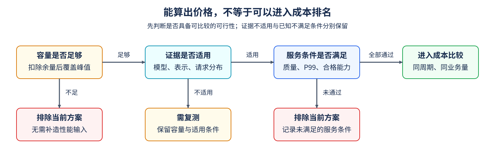

# 19. TCO and Hardware Selection | 按负载、容量与成本选择硬件

**难度：** 进阶 | **环境：** [CPU 主线](#runtime-environment) | **标签：** `TCO`、`容量规划`、`SLO`、`硬件选型` | **目标人群：** 理解性能与资源约束

> 🚀 **云端运行环境**
>
> 本章节的实战代码可以点击以下链接在免费 GPU 算力平台上直接运行：
>
> [](https://colab.research.google.com/github/datawhalechina/llm-algo-leetcode/blob/main/04_CUDA_and_System_Optimization/19_TCO_and_Hardware_Selection.ipynb)
> [](https://modelscope.cn/my/mynotebook) *(国内推荐：魔搭社区免费实例)*


## 本节导读

报价最低的设备可能装不下工作集，完成请求最快的设备也可能长期闲置。给定三个候选方案，先检查容量、质量和服务要求，再用同一批业务比较成本；当繁忙时长或请求需求变化时，重新判断选择。本节给出同一观察期内的容量、服务条件与成本，用构造数据比较可行方案，不采用真实设备报价或性能测量。

<a id="runtime-environment"></a>
## 运行环境

使用[基础CPU环境](../guide.md#base-cpu)，只依赖Python标准库。输入中的容量、P99与合格处理能力由题目给定；代码不运行模型、读取账单或查询设备。

## 前置阅读

先统一成本与业务产出的口径，再判断哪些方案可以进入比较。

- [Part01·33 TCO与成本模型](../01_Hardware_Math_and_Systems/33_TCO_and_Cost_Model.md)：采购、能耗、运维及迁移怎样组成同一观察期的成本。
- [18 实现方式选型](./18_CUDA_vs_Triton_vs_PyTorch.md)：需要判断是否改写实现时，区分局部收益与完整调用成本。

## Step 1：容量与服务条件怎样筛掉候选

先固定模型表示、请求类型与长度分布，再给出服务等级目标（SLO），即希望服务达到的指标阈值；测得的指标要与目标比较，而不是把目标当作已有结果。本例工作集峰值为22 GiB，另留4 GiB给未计入峰值的运行余量；质量检查须通过，P99首次响应时间不超过150 ms，繁忙时实际需求为10请求/秒，每秒请求数简称QPS。P99是首次响应时间的99分位数，用于描述较慢一侧的请求延迟；比较前要固定请求集合、采样窗口与分位数统计方法。容量与峰值须采用同一统计范围，4 GiB只是本例余量。

表中的12／20请求每秒是已验证范围内满足质量与延迟要求的持续服务能力，不是实际业务量。P99上界也属于该有效范围；需求超过能力时，不能继续把旧P99当作该负载下的结果。证据还需匹配模型、表示和请求分布，任一项改变就先标记需复测，不能由旧吞吐推断新条件。为便于比较，本例假设有效范围内的全部实际需求都能合格完成；真实系统须另测合格请求数。

| 候选 | 设备容量／扣除余量后 | 质量 | 有效范围内P99上界 | SLO合格能力 | 当前筛选 |
| --- | --- | --- | --- | --- | --- |
| A | 24／20 GiB | 未测 | 未测 | 未测 | 容量不足，先排除 |
| B | 32／28 GiB | 通过 | 120 ms | 12请求/秒 | 满足当前要求 |
| C | 48／44 GiB | 通过 | 100 ms | 20请求/秒 | 满足当前要求 |



## Step 2：同一批业务怎样换算单位成本

总拥有成本（Total Cost of Ownership，TCO）包括同一观察期内的硬件使用、主机、能耗、运维与适配等支出。这里沿用已统一口径的简化线性成本，不再逐项计算采购与折旧；固定费用F已包含闲置基线，v为每个繁忙小时新增的成本。H是单方案在30天观察期内的繁忙墙钟小时，范围为0–720，不是多设备累计GPU小时。

$$
C(H)=F+vH,\qquad N=qH\times3600,\qquad
C_{\text{每百万合格请求}}=\frac{C(H)}{N}\times10^6.
$$

q是实际合格完成的业务请求率，不是设备最大处理能力。本例B的成本为600＋2H，C为300＋5H，使用同一“成本单位”；当H=100、q=10时，两者成本均为800，产出均为360万合格请求，单位成本约为222.22。若用12和20替代同一业务需求，就会把尚未发生的请求计入分母。H或业务量为零时，单位成本没有定义，应保留空值而不是填零；容量或服务筛选未通过时，也不进入此项成本排名。

## Step 3：成本曲线交点怎样改变选择

令两候选成本相等，有600＋2H＝300＋5H，得到H=100小时。忙40小时时C较便宜，忙200小时时B较便宜；100小时时两者并列，成本本身不能替你选出唯一方案。一般交点为 $H^*=(F_C-F_B)/(v_B-v_C)$：斜率相同但固定成本不同的两线平行，成本均相同则整段重合；算出交点后，还要检查它是否落在观察期内。

成本比较始终限定在可行集合中。将需求提高到15请求/秒时，B已有能力12不能覆盖新需求，C的20仍覆盖；这个判断依赖前面声明的证据适用范围，不声称B在15请求/秒时仍有120 ms的P99。如果请求长度、模型或表示改变，两者应先复测。全部候选未通过时保留无可行候选及排除原因；没有业务产出时保留成本但不作单位成本采用判断。

| 繁忙时长 | B：600＋2H | C：300＋5H | 两者均可行时 |
| --- | --- | --- | --- |
| 40小时 | 680 | 500 | C成本较低 |
| 100小时 | 800 | 800 | 并列 |
| 200小时 | 1000 | 1300 | B成本较低 |

## Step 4：实现筛选、同业务量成本与情景比较

补全三个函数中的局部机制。输入检查、交点计算和报告组装已经提供；候选中的`evidence_applies`表示记录是否适用于当前模型、表示与请求分布，不是程序自动验证出的事实。`max_slo_qps`是给定服务条件下的合格能力，成本分母使用实际需求；只有筛选通过后，情景比较才调用成本计算。

测试先逐项制造容量、质量、延迟和能力失败，再检查需复测、成本反转、并列、零业务量与无交点。金额按给定单位计算；并列用相对容差1e-12、绝对容差1e-9处理浮点计算差异，不代表业务上可忽略的报价差。

| TODO / 函数 | 待实现的机制 | 必须满足的约束 | 测试证据 |
| --- | --- | --- | --- |
| TODO 1 / `screen_candidate` | 生成逐项通过条件`checks` | 容量、证据、质量、P99、能力分别判断，包含等号边界 | 单项／多项失败，容量不足时不要求补造性能输入 |
| TODO 2 / `comparable_cost` | 生成总成本、合格请求数与单位成本 | 同观察期、实际业务量、小时换秒；零产出保留None | 100小时成本相同，能力变化不改变业务分母 |
| TODO 3 / `compare_scenarios` | 生成`decision` | 仅在可行集合选择，保留全部并列与无解／零产出 | 40／100／200小时、15请求/秒与证据失效 |


```python
import copy
import math

```


```python
def _number(value, name, *, positive=False):
    """检查有限非负数，拒绝布尔值与隐式字符串转换。"""
    if type(value) not in (int, float) or not math.isfinite(value) or value < 0 or (positive and value == 0):
        raise ValueError(f"{name}须为有限{'正' if positive else '非负'}数")
    return value


def _validate_candidate(candidate):
    """检查一个构造方案的资源、成本和证据输入，不替代真实压测。"""
    if not isinstance(candidate, dict) or not isinstance(candidate.get("name"), str) or not candidate["name"]:
        raise ValueError("候选须有非空名称")
    for key in ("capacity_gib", "fixed_cost", "busy_cost_per_hour"):
        _number(candidate[key], key)
    if type(candidate["evidence_applies"]) is not bool:
        raise ValueError("evidence_applies须为布尔值")
    if candidate["quality_passed"] is not None and type(candidate["quality_passed"]) is not bool:
        raise ValueError("quality_passed须为布尔值或None")
    for key in ("p99_ms", "max_slo_qps"):
        if candidate[key] is not None:
            _number(candidate[key], key)
    if candidate["evidence_applies"] and any(
            candidate[key] is None for key in ("quality_passed", "p99_ms", "max_slo_qps")):
        raise ValueError("证据适用时须提供完整质量、延迟与合格容量输入")


def _validate_requirements(requirements):
    """统一容量、服务要求与单方案观察期单位。"""
    for key in ("peak_gib", "reserve_gib"):
        _number(requirements[key], key)
    for key in ("max_p99_ms", "demand_qps", "period_hours"):
        _number(requirements[key], key, positive=True)


def screen_candidate(candidate, requirements):
    """先判断容量和证据适用性，再筛质量、延迟与合格服务能力。"""
    _validate_candidate(candidate)
    _validate_requirements(requirements)
    # TODO 1：逐项计算通过条件；缺少性能输入时相应条件为False。
    # checks = ???  # 使用capacity_gib、peak_gib、reserve_gib、evidence_applies及三项服务指标。
    checks = None
    if checks is None:
        raise NotImplementedError("TODO 1：填写 checks")
    if not checks["capacity"]:
        return {"status": "ineligible", "reasons": ["capacity"]}
    if not checks["evidence"]:
        return {"status": "needs_retest", "reasons": ["evidence"]}
    failures = [key for key in ("quality", "latency", "throughput") if not checks[key]]
    return {"status": "ineligible" if failures else "eligible", "reasons": failures}


def comparable_cost(candidate, demand_qps, busy_hours, period_hours=720):
    """计算同观察期成本与实际业务产出；零产出的单位成本返回None。"""
    _validate_candidate(candidate)
    _number(demand_qps, "demand_qps")
    _number(busy_hours, "busy_hours")
    _number(period_hours, "period_hours", positive=True)
    if busy_hours > period_hours:
        raise ValueError("繁忙小时不能超过单方案观察期")
    # TODO 2：统一观察期与实际业务量，不把max_slo_qps作为请求数。
    # total_cost、qualified_requests、cost_per_million = ???  # F、v、H、实际需求与3600秒/小时。
    total_cost = None
    qualified_requests = None
    cost_per_million = None
    if total_cost is None or qualified_requests is None:
        raise NotImplementedError("TODO 2：填写成本与合格业务量")
    if qualified_requests > 0 and cost_per_million is None:
        raise NotImplementedError("TODO 2：填写 cost_per_million")
    for name, value in (("total_cost", total_cost), ("qualified_requests", qualified_requests)):
        _number(value, name)
    if cost_per_million is not None:
        _number(cost_per_million, "cost_per_million")
    return {"total_cost": total_cost, "qualified_requests": qualified_requests,
            "cost_per_million": cost_per_million}


def cost_crossover(left, right, period_hours):
    """给定线性成本求交点；平行、重合及区间外均保留为独立状态。"""
    _validate_candidate(left)
    _validate_candidate(right)
    _number(period_hours, "period_hours", positive=True)
    slope_difference = left["busy_cost_per_hour"] - right["busy_cost_per_hour"]
    if slope_difference == 0:
        return {"status": "identical" if left["fixed_cost"] == right["fixed_cost"] else "parallel",
                "busy_hours": None}
    hours = (right["fixed_cost"] - left["fixed_cost"]) / slope_difference
    if not math.isfinite(hours):
        raise ValueError("交点计算超出有限数值范围")
    return {"status": "inside" if 0 <= hours <= period_hours else "outside", "busy_hours": hours}


def compare_scenarios(candidates, requirements, busy_hours):
    """仅对可行候选比较成本，保留无解、零产出与并列结果。"""
    _validate_requirements(requirements)
    _number(busy_hours, "busy_hours")
    if busy_hours > requirements["period_hours"]:
        raise ValueError("繁忙小时不能超过观察期")
    if not isinstance(candidates, (list, tuple)):
        raise ValueError("候选须为列表或元组")
    for candidate in candidates:
        _validate_candidate(candidate)
    if len({candidate["name"] for candidate in candidates}) != len(candidates):
        raise ValueError("候选名称不能重复")
    screening = {c["name"]: screen_candidate(c, requirements) for c in candidates}
    eligible = [c for c in candidates if screening[c["name"]]["status"] == "eligible"]
    costs = {c["name"]: comparable_cost(c, requirements["demand_qps"], busy_hours,
                                      requirements["period_hours"]) for c in eligible}
    # TODO 3：处理无可行候选、零产出与成本比较，保留全部并列最优名称。
    # decision = ???  # 使用eligible、costs、busy_hours；并列按给定数值容差判断。
    decision = None
    if decision is None:
        raise NotImplementedError("TODO 3：填写 decision")
    crossings = [{"left": left["name"], "right": right["name"],
                  **cost_crossover(left, right, requirements["period_hours"])}
                 for index, left in enumerate(eligible) for right in eligible[index + 1:]]
    return {**decision, "screening": screening, "costs": costs, "crossings": crossings}

```

## 正确性测试


```python
def make_tco_case():
    """每次构造独立字典，示例数值不是设备报价或实测。"""
    requirements = {"peak_gib": 22, "reserve_gib": 4, "max_p99_ms": 150,
                    "demand_qps": 10, "period_hours": 720}
    candidates = [
        {"name": "A", "capacity_gib": 24, "quality_passed": None, "p99_ms": None,
         "max_slo_qps": None, "evidence_applies": False, "fixed_cost": 100, "busy_cost_per_hour": 1},
        {"name": "B", "capacity_gib": 32, "quality_passed": True, "p99_ms": 120,
         "max_slo_qps": 12, "evidence_applies": True, "fixed_cost": 600, "busy_cost_per_hour": 2},
        {"name": "C", "capacity_gib": 48, "quality_passed": True, "p99_ms": 100,
         "max_slo_qps": 20, "evidence_applies": True, "fixed_cost": 300, "busy_cost_per_hour": 5},
    ]
    return candidates, requirements


def expect_value_error(call):
    """非法输入必须在计算前拒绝，不能捕获普通断言冒充通过。"""
    try:
        call()
    except ValueError:
        return
    raise AssertionError("未拒绝非法输入")


def test_tco_selection():
    """核对筛选、同业务量成本、反转与证据失效，并检查输入不变。"""
    candidates, requirements = make_tco_case()
    snapshot = copy.deepcopy((candidates, requirements))
    a, b, c = candidates
    assert screen_candidate(a, requirements) == {"status": "ineligible", "reasons": ["capacity"]}
    assert screen_candidate(b, requirements) == {"status": "eligible", "reasons": []}
    boundary = dict(b, capacity_gib=26, p99_ms=150, max_slo_qps=10)
    assert screen_candidate(boundary, requirements)["status"] == "eligible"
    for field, value, reason in (("capacity_gib", 25.9, "capacity"),
                                 ("quality_passed", False, "quality"),
                                 ("p99_ms", 150.1, "latency"), ("max_slo_qps", 9.9, "throughput")):
        assert reason in screen_candidate(dict(boundary, **{field: value}), requirements)["reasons"]
    multiple = dict(b, quality_passed=False, p99_ms=200, max_slo_qps=1)
    assert screen_candidate(multiple, requirements)["reasons"] == ["quality", "latency", "throughput"]
    assert screen_candidate(dict(b, evidence_applies=False), requirements) == {
        "status": "needs_retest", "reasons": ["evidence"]}

    b_cost = comparable_cost(b, 10, 100)
    c_cost = comparable_cost(c, 10, 100)
    assert b_cost["total_cost"] == c_cost["total_cost"] == 800
    assert b_cost["qualified_requests"] == c_cost["qualified_requests"] == 3_600_000
    assert math.isclose(b_cost["cost_per_million"], 222.22222222222223)
    assert comparable_cost(dict(b, max_slo_qps=1000), 10, 100) == b_cost
    assert comparable_cost(b, 10, 0)["cost_per_million"] is None
    assert comparable_cost(b, 0, 100)["cost_per_million"] is None
    assert comparable_cost(b, 10, 720)["qualified_requests"] == 25_920_000

    for hours, selected, status in ((40, ["C"], "selected"), (100, ["B", "C"], "tie"),
                                     (200, ["B"], "selected")):
        report = compare_scenarios(candidates, requirements, hours)
        assert report["selected"] == selected and report["status"] == status, (hours, report)
        assert set(report["costs"]) == {"B", "C"}
        assert report["crossings"] == [{"left": "B", "right": "C", "status": "inside", "busy_hours": 100}]
    assert compare_scenarios(candidates, dict(requirements, demand_qps=15), 100)["selected"] == ["C"]
    report = compare_scenarios([a, dict(b, evidence_applies=False)], requirements, 100)
    assert report["status"] == "no_feasible" and report["selected"] == []
    assert report["screening"]["B"]["status"] == "needs_retest"
    assert compare_scenarios([], requirements, 40)["status"] == "no_feasible"
    assert compare_scenarios(candidates, requirements, 0)["status"] == "no_output"
    assert compare_scenarios([dict(b, fixed_cost=0), dict(c, fixed_cost=0, busy_cost_per_hour=0)],
                             requirements, 40)["selected"] == ["C"]
    assert cost_crossover(b, dict(c, busy_cost_per_hour=2), 720)["status"] == "parallel"
    assert cost_crossover(b, dict(b, name="B2"), 720)["status"] == "identical"
    assert cost_crossover(b, dict(c, fixed_cost=5000), 720)["status"] == "outside"
    assert cost_crossover(b, dict(c, fixed_cost=600), 720) == {"status": "inside", "busy_hours": 0}
    scaled = [dict(item, fixed_cost=item["fixed_cost"] * 10,
                   busy_cost_per_hour=item["busy_cost_per_hour"] * 10) for item in candidates]
    assert compare_scenarios(scaled, requirements, 200)["selected"] == ["B"]
    assert (candidates, requirements) == snapshot

    invalid_cases = [
        lambda: screen_candidate(dict(b, capacity_gib=float("nan")), requirements),
        lambda: screen_candidate(dict(b, quality_passed=1), requirements),
        lambda: screen_candidate(dict(b, p99_ms=None), requirements),
        lambda: screen_candidate(dict(b, evidence_applies=1), requirements),
        lambda: screen_candidate(b, dict(requirements, demand_qps=0)),
        lambda: comparable_cost(b, 10, -1),
        lambda: comparable_cost(b, 10, 721),
        lambda: comparable_cost(b, True, 100),
        lambda: comparable_cost(dict(b, fixed_cost=float("inf")), 10, 100),
        lambda: comparable_cost(b, 10, 100, 0),
        lambda: comparable_cost(b, 1e308, 720),
        lambda: compare_scenarios([b, b], requirements, 40),
        lambda: compare_scenarios(candidates, requirements, float("nan")),
    ]
    for call in invalid_cases:
        expect_value_error(call)
    print({"status": "passed", "scope": "constructed_cpu_decision",
           "screening": "capacity/quality/latency/throughput/evidence",
           "sensitivity_hours": [40, 100, 200], "invalid_cases": len(invalid_cases),
           "hardware_benchmark": "not_run"})


test_tco_selection()

```

---

先完成题目并核对测试，再向下查看参考实现。

## 参考代码与解析

### 代码


```python
def _number(value, name, *, positive=False):
    """检查有限非负数，拒绝布尔值与隐式字符串转换。"""
    if type(value) not in (int, float) or not math.isfinite(value) or value < 0 or (positive and value == 0):
        raise ValueError(f"{name}须为有限{'正' if positive else '非负'}数")
    return value


def _validate_candidate(candidate):
    """检查一个构造方案的资源、成本和证据输入，不替代真实压测。"""
    if not isinstance(candidate, dict) or not isinstance(candidate.get("name"), str) or not candidate["name"]:
        raise ValueError("候选须有非空名称")
    for key in ("capacity_gib", "fixed_cost", "busy_cost_per_hour"):
        _number(candidate[key], key)
    if type(candidate["evidence_applies"]) is not bool:
        raise ValueError("evidence_applies须为布尔值")
    if candidate["quality_passed"] is not None and type(candidate["quality_passed"]) is not bool:
        raise ValueError("quality_passed须为布尔值或None")
    for key in ("p99_ms", "max_slo_qps"):
        if candidate[key] is not None:
            _number(candidate[key], key)
    if candidate["evidence_applies"] and any(
            candidate[key] is None for key in ("quality_passed", "p99_ms", "max_slo_qps")):
        raise ValueError("证据适用时须提供完整质量、延迟与合格容量输入")


def _validate_requirements(requirements):
    """统一容量、服务要求与单方案观察期单位。"""
    for key in ("peak_gib", "reserve_gib"):
        _number(requirements[key], key)
    for key in ("max_p99_ms", "demand_qps", "period_hours"):
        _number(requirements[key], key, positive=True)


def screen_candidate(candidate, requirements):
    """先判断容量和证据适用性，再筛质量、延迟与合格服务能力。"""
    _validate_candidate(candidate)
    _validate_requirements(requirements)
    # TODO 1：逐项计算通过条件；缺少性能输入时相应条件为False。
    # checks = ???  # 使用capacity_gib、peak_gib、reserve_gib、evidence_applies及三项服务指标。
    checks = {
        "capacity": candidate["capacity_gib"] - requirements["reserve_gib"] >= requirements["peak_gib"],
        "evidence": candidate["evidence_applies"],
        "quality": candidate["quality_passed"] is True,
        "latency": candidate["p99_ms"] is not None and candidate["p99_ms"] <= requirements["max_p99_ms"],
        "throughput": candidate["max_slo_qps"] is not None and candidate["max_slo_qps"] >= requirements["demand_qps"],
    }
    if checks is None:
        raise NotImplementedError("TODO 1：填写 checks")
    if not checks["capacity"]:
        return {"status": "ineligible", "reasons": ["capacity"]}
    if not checks["evidence"]:
        return {"status": "needs_retest", "reasons": ["evidence"]}
    failures = [key for key in ("quality", "latency", "throughput") if not checks[key]]
    return {"status": "ineligible" if failures else "eligible", "reasons": failures}


def comparable_cost(candidate, demand_qps, busy_hours, period_hours=720):
    """计算同观察期成本与实际业务产出；零产出的单位成本返回None。"""
    _validate_candidate(candidate)
    _number(demand_qps, "demand_qps")
    _number(busy_hours, "busy_hours")
    _number(period_hours, "period_hours", positive=True)
    if busy_hours > period_hours:
        raise ValueError("繁忙小时不能超过单方案观察期")
    # TODO 2：统一观察期与实际业务量，不把max_slo_qps作为请求数。
    # total_cost、qualified_requests、cost_per_million = ???  # F、v、H、实际需求与3600秒/小时。
    total_cost = candidate["fixed_cost"] + candidate["busy_cost_per_hour"] * busy_hours
    qualified_requests = demand_qps * busy_hours * 3600
    cost_per_million = total_cost / qualified_requests * 1e6 if qualified_requests > 0 else None
    if total_cost is None or qualified_requests is None:
        raise NotImplementedError("TODO 2：填写成本与合格业务量")
    if qualified_requests > 0 and cost_per_million is None:
        raise NotImplementedError("TODO 2：填写 cost_per_million")
    for name, value in (("total_cost", total_cost), ("qualified_requests", qualified_requests)):
        _number(value, name)
    if cost_per_million is not None:
        _number(cost_per_million, "cost_per_million")
    return {"total_cost": total_cost, "qualified_requests": qualified_requests,
            "cost_per_million": cost_per_million}


def cost_crossover(left, right, period_hours):
    """给定线性成本求交点；平行、重合及区间外均保留为独立状态。"""
    _validate_candidate(left)
    _validate_candidate(right)
    _number(period_hours, "period_hours", positive=True)
    slope_difference = left["busy_cost_per_hour"] - right["busy_cost_per_hour"]
    if slope_difference == 0:
        return {"status": "identical" if left["fixed_cost"] == right["fixed_cost"] else "parallel",
                "busy_hours": None}
    hours = (right["fixed_cost"] - left["fixed_cost"]) / slope_difference
    if not math.isfinite(hours):
        raise ValueError("交点计算超出有限数值范围")
    return {"status": "inside" if 0 <= hours <= period_hours else "outside", "busy_hours": hours}


def compare_scenarios(candidates, requirements, busy_hours):
    """仅对可行候选比较成本，保留无解、零产出与并列结果。"""
    _validate_requirements(requirements)
    _number(busy_hours, "busy_hours")
    if busy_hours > requirements["period_hours"]:
        raise ValueError("繁忙小时不能超过观察期")
    if not isinstance(candidates, (list, tuple)):
        raise ValueError("候选须为列表或元组")
    for candidate in candidates:
        _validate_candidate(candidate)
    if len({candidate["name"] for candidate in candidates}) != len(candidates):
        raise ValueError("候选名称不能重复")
    screening = {c["name"]: screen_candidate(c, requirements) for c in candidates}
    eligible = [c for c in candidates if screening[c["name"]]["status"] == "eligible"]
    costs = {c["name"]: comparable_cost(c, requirements["demand_qps"], busy_hours,
                                      requirements["period_hours"]) for c in eligible}
    # TODO 3：处理无可行候选、零产出与成本比较，保留全部并列最优名称。
    # decision = ???  # 使用eligible、costs、busy_hours；并列按给定数值容差判断。
    if not eligible:
        decision = {"status": "no_feasible", "selected": []}
    elif busy_hours == 0:
        decision = {"status": "no_output", "selected": []}
    else:
        minimum = min(row["cost_per_million"] for row in costs.values())
        selected = [name for name, row in costs.items()
                    if math.isclose(row["cost_per_million"], minimum, rel_tol=1e-12, abs_tol=1e-9)]
        decision = {"status": "tie" if len(selected) > 1 else "selected", "selected": selected}
    if decision is None:
        raise NotImplementedError("TODO 3：填写 decision")
    crossings = [{"left": left["name"], "right": right["name"],
                  **cost_crossover(left, right, requirements["period_hours"])}
                 for index, left in enumerate(eligible) for right in eligible[index + 1:]]
    return {**decision, "screening": screening, "costs": costs, "crossings": crossings}

```

### 解析

#### TODO 1：将可运行、可复测和可采用分开

- 容量扣除余量后须覆盖工作集；容量通过后再判断证据适用性，最后检查质量、P99与合格能力，保留服务条件的全部失败原因。
- 边界样本在26 GiB容量、150 ms P99和10请求/秒时应通过；逐项失败与证据失效用例区分“不可采用”和“需复测”，而不是一律进入成本排名。

#### TODO 2：按实际发生的合格请求归一化

- 固定成本加繁忙小时的新增成本得到总额，请求数使用实际需求乘繁忙小时再乘3600。能力上限只用于筛选，不是实际业务分母；零产出时单位成本为`None`。
- 100小时、10请求/秒时，两方案均为800成本、360万请求；将能力上限改为1000仍应得到同一成本结果，能发现用能力代替业务量的错误。

#### TODO 3：只在可行集合中比较，并保留未决分支

- 无可行方案时保留无解，有方案但繁忙小时为零时保留零产出；其余情景比较单位成本，并返回容差内全部并列名称，不按输入顺序任选一个。
- 40／100／200小时分别选C、并列、选B；需求增为15时只有C可行，证据失效时旧方案被排除。这些构造情景检查筛选与成本比较的衔接，不构成真实设备选型结论。


## 相关阅读

将构造条件替换成真实方案时，分别核对设备支持范围与服务指标的定义。

- [Part01·34 异构加速器与运行时约束](../01_Hardware_Math_and_Systems/34_Heterogeneous_Accelerators_and_Runtime_Constraints.md)：设备能力、软件路径与迁移条件。
- [Google SRE：服务等级目标](https://sre.google/sre-book/service-level-objectives/)：区分实际指标与目标阈值，阅读延迟分位数为何不能被平均值代替。
