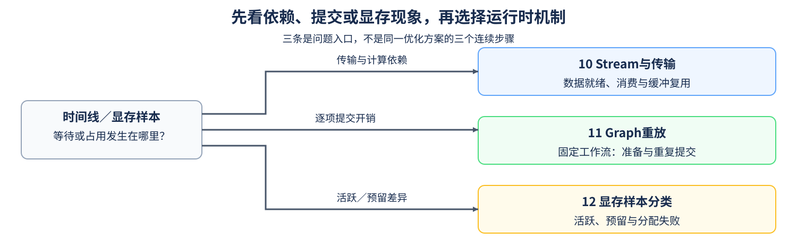

# Group 4.3: CUDA Runtime and Memory | 4.3: CUDA Runtime 与显存管理

内核本身没有变化，数据未就绪、主机逐项提交或缓冲尚未释放，也可能让一次调用变慢或占用更多显存。本组按观测选择入口：跨流数据依赖看10，固定短工作流的提交成本看11，活跃量与预留量的差异看12；三页不构成同一个优化方案的连续步骤。

## Group Asset Overview | 组内资产总览

| 页面 | 核心问题 | 实现与证据产物 | 何时进入 |
|:---|:---|:---|:---|
| [10 Stream与传输](./10_PyTorch_CUDA_Streams_and_Transfer.md) | 跨流传输、消费与缓冲复用怎样等待正确？ | 多批次输出、输入契约与调用方准备依赖核对 | 时间线或结果暴露传输／计算依赖问题 |
| [11 Graph重放与准备成本](./11_CUDA_Graph_and_JIT_Compile.md) | 固定工作流的重放和准备成本是否值得？ | CPU候选筛查；独立GPU输入更新与普通／Graph配对 | 重复短操作存在逐项提交开销 |
| [12 显存样本与缓存](./12_Memory_Pool_and_VRAM_Management.md) | 活跃、预留与分配失败各提示什么？ | CPU样本筛查；可选GPU引用、释放与空闲缓存生命周期核对 | 需要判断占用或失败的排查方向 |

## Learning Path | 学习路径

### Recommended Order | 推荐顺序

- **数据依赖：** 从[10](./10_PyTorch_CUDA_Streams_and_Transfer.md)核对传输就绪、消费与再次覆盖。输出一致只验证当前测试，重叠程度和性能另行测量。
- **重复提交：** 进入[11](./11_CUDA_Graph_and_JIT_Compile.md)，先做CPU条件筛查，再用独立GPU入口核对固定地址下的新输入和准备／稳态成本；普通题目／答案测试只运行CPU部分。
- **显存状态：** 可独立进入[12](./12_Memory_Pool_and_VRAM_Management.md)，先做CPU样本筛查，再按需观察独立GPU进程中的引用与缓存变化；一次样本或局部生命周期不用于确认碎片成因。
- Stream概念有助于理解Graph依赖，但Graph重放不等于代码编译或算子融合；也不需要先写一个自定义CUDA C++内核才能使用。

### Prerequisites | 按需前置

- [Part01·17 Stream与异步执行](../01_Hardware_Math_and_Systems/17_CUDA_Stream_and_Asynchrony.md)：主机提交、设备执行与跨流等待。
- [Part02·43 训练显存账本](../02_PyTorch_Algorithms/43_Unified_Training_Memory_Ledger.md)：进入12时区分驻留对象和统计范围。

### Next Steps | 后续衔接

- 在[算子优化Task5](../topic_discussion/operator_optimization/intro.md)中按实际等待选择本组机制，调整后回到Task6的组件与负载复测。
- 出现跨设备归约或训练状态卸载时，再进入[4.4](./4_4.md)。本组单卡结果不替代多GPU通信；实现与成本选择可按[4.5](./4_5.md)继续判断。

## Environment Notes | 环境说明

| 运行目标 | 环境入口 | 条件 |
|:---|:---|:---|
| 11的筛查、12的分类 | [基础CPU环境](../guide.md#base-cpu) | 不采集GPU时间或显存 |
| 10的依赖、11的重放与测量、12的生命周期核对 | [性能机制环境](../topic_discussion/performance_analysis/quickstart.md#perf-cuda-mechanism-quickstart)或[兼容的算子环境](../topic_discussion/operator_optimization/quickstart.md#triton-environment) | NVIDIA GPU和CUDA PyTorch；本组不编译CUDA C++扩展 |
