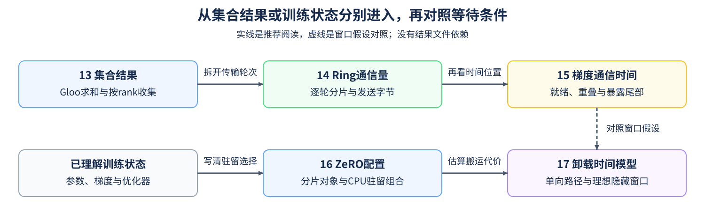

# Group 4.4: Distributed Training Systems | 4.4: 分布式训练系统

分布式训练既要让各进程得到正确数据，也要决定训练状态分片到哪里、计算前是否需要搬回。本组分两条路径：13–15从集合结果进入分片通信量与暴露等待，16–17从ZeRO分片进入CPU配置与卸载路径；两条路径共享时间和依赖问题，但不要求先做完单卡Runtime实验。

## Group Asset Overview | 组内资产总览

| 页面 | 核心问题 | 实现与证据产物 | 何时进入 |
|:---|:---|:---|:---|
| [13 集合通信](./13_Distributed_Communication_Primitives.md) | 求和与收集怎样改变每个rank的数据？ | 本地2／3进程，经Gloo后端通信CPU张量；核对逐rank数值与接收顺序 | 先理解集合结果与进程组 |
| [14 Ring AllReduce](./14_Ring_AllReduce_Deep_Dive.md) | 一种环形算法怎样逐轮传片，每rank发送多少？ | 四rank流转示例；CPU均分字节模型与缩放检查 | 需要推导算法轮次和通信量 |
| [15 通信与计算重叠](./15_Communication_Computation_Overlap_Advanced_Scheduling.md) | 梯度何时就绪，哪些通信仍延长完成时间？ | CPU双阶段时间线、重叠边界与暴露等待 | 需要分析梯度同步的时间位置 |
| [16 ZeRO配置](./16_DeepSpeed_Zero_Config.md) | 分片对象怎样限制CPU卸载组合？ | CPU配置组合；可选DeepSpeed解析核对显式字段，框架结果待验证 | 需要区分本页策略、框架解析和真实训练 |
| [17 CPU／NVMe卸载](./17_Heterogeneous_Training_CPU_Offload_NVMe_Offload.md) | 哪些数据沿哪条路径搬运，理想剩余等待多少？ | CPU串行路径与消费者等待；可选单GPU驻留／CPU往返对照，记录完整时间、中间驻留与峰值 | 需要估算并实测卸载新增的搬运代价 |

## Learning Path | 学习路径

### Recommended Order | 推荐顺序

- **通信路径：** [13](./13_Distributed_Communication_Primitives.md) → [14](./14_Ring_AllReduce_Deep_Dive.md) → [15](./15_Communication_Computation_Overlap_Advanced_Scheduling.md)，先运行集合操作，再推导一种环形算法的通信量，最后分析通信开始和结束的时间。13使用的后端与14的示例算法分别核对；目标负载的通信耗时经测量后，才作为15的时间输入。
- **状态路径：** 已理解参数、梯度和优化器状态时，可直接读[16](./16_DeepSpeed_Zero_Config.md)，再进入[17](./17_Heterogeneous_Training_CPU_Offload_NVMe_Offload.md)。先推导路径，再按需运行17的单GPU对照，区分中间驻留、窗口峰值与往返时间；CPU更新和完整训练另测。
- 研究17的隐藏窗口时，可对照15的关键路径假设。通信与搬运的阶段可能争用资源，不把两套独立估算直接相加或视为已发生的重叠。

### Prerequisites | 按需前置

- [Part01·20 NCCL与AllReduce](../01_Hardware_Math_and_Systems/20_NCCL_and_AllReduce_Basics.md)：集合操作、后端与参与者。
- [Part02·27 ZeRO状态分片](../02_PyTorch_Algorithms/27_ZeRO_Optimizer_Sim.md)：从状态路径进入时补参数、梯度和优化器归属。

### Next Steps | 后续衔接

- 需要并行策略和多GPU验证时，进入[通信与并行路线](../topic_discussion/communication_parallelism/intro.md)。
- 只有问题已落到具体内核或设备执行路径时，才按[算子优化路线](../topic_discussion/operator_optimization/intro.md)继续；容量、部署与成本取舍可进入[4.5](./4_5.md)。

## Environment Notes | 环境说明

CPU和GPU说明张量所在的设备，Gloo与NCCL说明通信后端：13让本地进程通过Gloo交换CPU张量，NCCL则用于另行开展的NVIDIA GPU通信实验。14–17的标准库练习是算法、时间或配置推导，与13的实际进程通信分别记录。

| 运行目标 | 环境入口 | 条件 |
|:---|:---|:---|
| 14–17推导与配置 | [基础CPU环境](../guide.md#base-cpu) | Python标准库；16不需要DeepSpeed，17不读写NVMe |
| 13集合语义 | [通信CPU环境](../topic_discussion/communication_parallelism/quickstart.md#par-cpu-quickstart) | 支持Gloo后端的PyTorch与本地CPU进程；Notebook启动方式见13的环境说明 |
| 17驻留／CPU往返 | [性能机制环境](../topic_discussion/performance_analysis/quickstart.md#perf-cuda-mechanism-quickstart)或兼容的CUDA PyTorch环境 | 单张NVIDIA GPU，无需nvcc或DeepSpeed；默认读取，不读写NVMe |
| 16配置解析 | [独立DeepSpeed环境与核对命令](../topic_discussion/operator_optimization/quickstart.md#zero-config-check) | 标准库练习不需要；可选解析不启动训练，不要求两张GPU，缺依赖不算通过 |
| NCCL与扩展效率 | [通信与并行Quickstart](../topic_discussion/communication_parallelism/quickstart.md) | 至少两张GPU；在独立负载中记录拓扑、后端和测量结果 |
