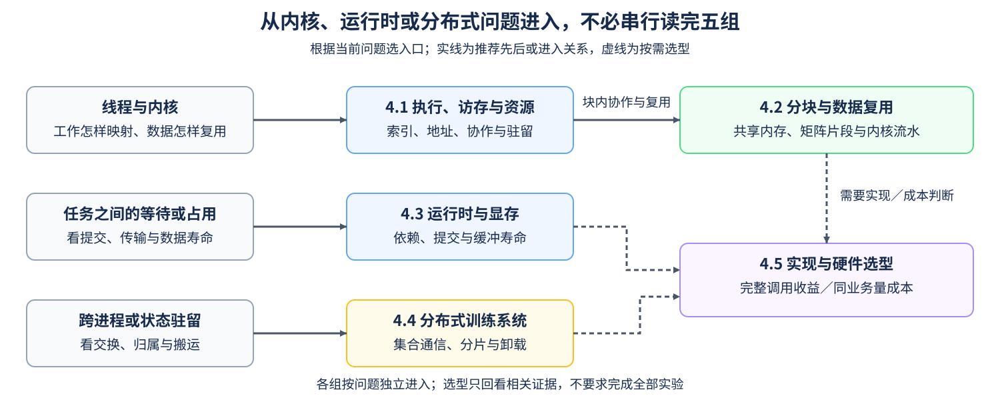

# Part 04: CUDA C++ and System Optimization | 第四部分：CUDA C++ 与系统优化

## Part Overview | Part 概览

同一个张量计算，线程怎样分工、数据怎样复用，决定了内核内部做多少工作；任务怎样提交、状态放在哪里，又决定了内核之间和设备之间要等多久。本部分从这些问题进入 CUDA C++、运行时和分布式训练，再按工作负载比较实现方式与硬件成本。

从 Triton 进入时，选择当前案例缺少的控制或解释即可：需要看线程地址，进入4.1；需要协作复用与设备内搬运，进入4.2；问题在传输、提交或显存寿命，进入4.3。4.4是通信与训练状态分支，4.5承接实现与成本判断，不要求把所有组串行完成。

## Part Asset Overview | Part 资产总览

先按问题选择学习组，具体小节和阅读条件见组页。

| 学习组 | 主要问题 | 与其他组的关系 |
|:---|:---|:---|
| [4.1 执行、访存与资源](./4_1.md) | 线程地址、Warp协作与每块资源怎样影响执行？ | 为4.2提供线程与共享内存基础；资源分析也可单独进入 |
| [4.2 分块与数据复用](./4_2.md) | 输入子块怎样复用，搬运和计算怎样交错？ | 承接所需的4.1概念；区分CPU阶段模型与设备内实现 |
| [4.3 运行时与显存](./4_3.md) | 跨流依赖、Graph重放与活跃／预留显存怎样判断？ | 按传输、提交或内存问题进入，不要求先完成矩阵内核 |
| [4.4 分布式训练系统](./4_4.md) | rank间交换什么，分片与卸载新增哪些等待？ | 可从集合语义或训练状态两条路径进入 |
| [4.5 实现与硬件选型](./4_5.md) | 完整调用和同业务量下，候选是否值得采用？ | 按当前决策回看相关组，保留不采用或继续验证的结论 |

## Learning Path | 学习路径

### Recommended Order | 推荐顺序

- **CUDA内核：** 从[4.1](./4_1.md)的索引、地址和协作进入[4.2](./4_2.md)的分块复用；不必先完成资源查询和所有CPU模型，才开始编写GEMM。
- **运行时：** 按问题直接进入[4.3](./4_3.md)。需要分清线程与Stream时回看Part01；需要分析内核资源时，再进入4.1／4.2。
- **分布式训练：** 从[4.4](./4_4.md)选择集合通信或状态分片入口。CPU字节和时间模型、Gloo结果语义与多GPU实测分别判断。
- **实现与成本：** 从[4.5](./4_5.md)明确容量、收益与成本条件，再查相关实现；构造例子用于推导，不替代候选硬件的运行记录。

沿[算子优化路线](../topic_discussion/operator_optimization/intro.md)学习时，Task2按需对照线程访存与Warp协作，Task3进入分块计算、矩阵片段与设备内拷贝，Task4用资源和驻留分析解释配置取舍，Task5处理传输、提交与内存寿命。4.4只在涉及通信或训练状态时进入，不把分布式训练当作单卡内核的必经步骤。

### Prerequisites | 按需前置

- 不熟悉Grid、Block、Warp与SM的区别时，先看[Part01·15 CUDA执行模型](../01_Hardware_Math_and_Systems/15_CUDA_Execution_Model.md)。
- 分不清Triton逻辑Tile与物理线程时，先看[Part01·18 Triton Block模型](../01_Hardware_Math_and_Systems/18_Triton_Block_Model.md)。
- 准备比较不同设备的可用路径时，先看[Part01·03 GPU架构与设备能力](../01_Hardware_Math_and_Systems/03_GPU_Architecture_and_Memory.md)，区分型号、计算能力和实际资源。

### Next Steps | 后续衔接

- 需要同计算语义的Triton实现时，回看[Part03](../03_Triton_Kernels/intro.md)；需要并行策略时，进入[通信与并行路线](../topic_discussion/communication_parallelism/intro.md)。
- 局部实现要回到目标组件和负载复测。可按任务进入[Part05独立综合项目](../05_Integrated_Projects_and_Decisions/intro.md)，项目自行准备输入并重新测量，不要求读取本部分所有页面的结果。

## Environment Notes | 环境说明

| 运行目标 | 条件与入口 | 能得到的证据 |
|:---|:---|:---|
| CPU推导与配置 | [基础CPU环境](../guide.md#base-cpu)；03／04／08／12／14–17及05／11的CPU部分 | 索引、资源、字节、时间或字段关系，不执行目标设备路径 |
| 原生CUDA C++ | [算子优化Quickstart](../topic_discussion/operator_optimization/quickstart.md#triton-environment)；01／02／05／06／07／09还需本机Toolkit、`nvcc`与兼容主机编译器 | 真实编译、数值或资源查询；性能按独立测量入口判断 |
| 单GPU运行时 | [性能机制环境](../topic_discussion/performance_analysis/quickstart.md#perf-cuda-mechanism-quickstart)或兼容的既有CUDA PyTorch环境；10／11／12／17的GPU部分 | Stream依赖、Graph重放、分配器生命周期或驻留／CPU往返对照；不要求本机CUDA C++编译 |
| 本地集合通信 | [通信CPU环境](../topic_discussion/communication_parallelism/quickstart.md#par-cpu-quickstart)；13使用2／3进程Gloo | 每个rank的集合结果，不证明Ring算法或NCCL带宽 |
| 多GPU性能 | 按[通信与并行Quickstart](../topic_discussion/communication_parallelism/quickstart.md)准备至少两张GPU及目标后端 | 需另行记录拓扑、通信与完成时间，CPU模型不能替代 |
| 阅读与CPU选型练习 | [4.5](./4_5.md)无需GPU；19只用Python标准库 | 构造条件下的筛选、成本与情景判断；真实采用需匹配负载与计费范围的证据 |
