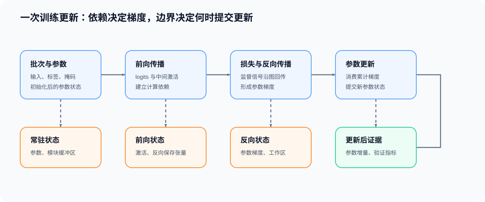

# 01. 训练闭环与计算图 | Training Loop and Computation Graph

## 学习问题

本页从一次完整更新进入反向传播：参数先参与前向传播，损失再把监督信号接入计算图，反向传播形成参数梯度，优化器最后改变参数。学习结果是一张能够标出依赖、状态和更新边界的训练图。

## 核心机制

| 阶段 | 主要输入 | 发生的变化 | 为后续保留的对象 |
|:---|:---|:---|:---|
| 初始化 | 模型结构、随机种子、dtype | 参数获得初始值 | 参数与模块状态 |
| 前向传播 | 批次、参数、缓冲区 | 产生 logits 和中间激活 | 反向传播需要的反向保存张量 |
| 损失计算 | logits、标签、掩码 | 把监督目标变成标量或逐项误差 | 损失节点及其依赖 |
| 反向传播 | 损失、上游梯度、反向保存张量 | 沿反向边形成并汇合梯度 | 参数 `.grad` |
| 参数更新 | 参数、梯度、优化器状态 | 更新参数和优化器状态 | 下一次更新使用的新状态 |
| 验证 | 固定模型、验证批次 | 计算损失和任务指标 | 汇总指标，不写入训练梯度 |

这条链的关键不是 API 顺序，而是依赖关系：损失必须连接到待训练参数；某个局部反向过程若需要前向输入或输出，相应状态就要保留到它被消费；参数更新只能发生在目标累积窗口完成以后。

### 计算图如何组织梯度

计算图中的节点表示张量或算子，边表示数值依赖。反向传播从损失出发，将上游梯度与局部导数结合，再沿反向路径传给输入与参数。

图中存在分支时，同一张量可能从多条路径接收梯度；存在残差路径或共享参数时，这些贡献需要在汇合点相加。因此，代码的书写顺序不能直接代替梯度依赖图。

| 图结构 | 反向含义 | 常见检查 |
|:---|:---|:---|
| 单链 | 梯度逐层传递 | 每层形状与局部导数是否匹配 |
| 分支 | 同一输入接收多条梯度贡献 | 汇合处是否执行求和 |
| 残差路径 | 恒等路径与变换分支共同回传 | 主路径是否保持可导 |
| 共享参数 | 参数在多处使用 | `.grad` 是否累计全部使用位置的贡献 |
| 图切断 | 某条边不再记录反向依赖 | `detach`、`no_grad` 或冻结是否符合预期 |

### 保存状态为什么进入训练成本

不是所有前向传播输出都要保留。只有局部反向过程仍需读取的输入、输出或统计量才属于保存状态。它们的大小和驻留时间共同决定激活压力；如果选择重算或融合，数学梯度可以不变，但保存点和读取路径会发生变化。

因此，分析训练问题时应依次确认：

1. 损失是否连接到目标参数；
2. 梯度经过哪些分支并在哪里汇合；
3. 每个局部反向过程需要哪些前向状态；
4. 参数梯度在何时完成累积并进入更新。

## 验证与下一步

完成本页后，应能画出“前向传播 → 损失计算 → 反向传播 → 参数更新”的训练依赖图，并为每个阶段标出参数、激活、反向保存张量和梯度。真实容量和阶段峰值将在 [04 训练状态生命周期](./04_training_state_lifecycle.md)中继续展开。

下一页进入 [02 自动求导与 Transformer 反向传播](./02_autograd_and_transformer_backward.md)，把全局计算图落实到 VJP、局部反向和 Transformer 路径。

## 相关阅读

| 资料 | 用途 |
|:---|:---|
| [Part 00 · 07 PyTorch 自动求导与反向传播](../../00_Prerequisites/07_PyTorch_Autograd_and_Backward.md) | 核对叶子张量、计算图与梯度累积。 |
| [Part 00 · 09 模块与参数](../../00_Prerequisites/09_PyTorch_nn_Module_Basics.md) | 回看参数、缓冲区和训练/验证模式。 |
| [Part 00 · 12 数据接口与训练生命周期](../../00_Prerequisites/12_PyTorch_Minimal_Training_Interface.md) | 回看批次、更新和验证的最小接口。 |
| [Automatic differentiation in machine learning: a survey](https://arxiv.org/abs/1502.05767) | 将链式法则、计算图与自动微分放在统一框架中理解。 |
| [torch.autograd](https://docs.pytorch.org/docs/stable/autograd) | 核对 PyTorch 计算图与自动求导接口。 |
