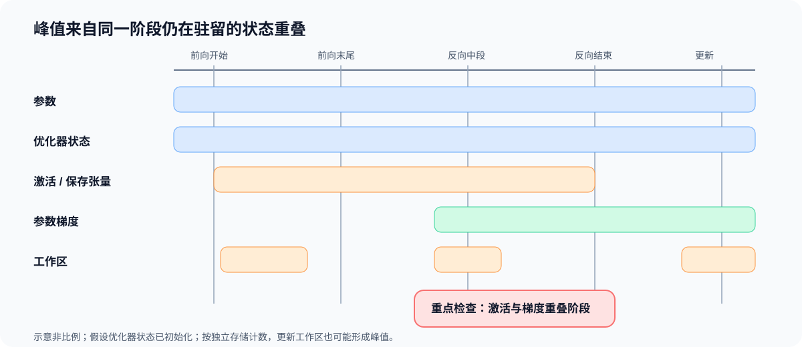

# 04. 训练状态生命周期与峰值账本 | Training-State Lifecycle and Peak Ledger

## 学习问题

参数量没变，为什么前向、反向和优化器更新可能出现不同的显存峰值？张量的大小只说明占用多少，创建和最后使用的时刻决定它与谁同时存在。沿一次更新标出这些区间，才能找到真正形成峰值的对象。

## 核心机制

下面按用途区分状态，但用途不同不保证存储独立：某个激活也可能正是自动求导保存的张量，视图或别名还可能共享底层存储。计算物理占用时，应按独立存储去重，而不是把“激活”和“反向保存张量”两栏直接相加。[PyTorch 自动求导说明](https://docs.pytorch.org/docs/stable/notes/autograd)给出了不同保存张量对象共享原存储的例子。

| 状态 | 产生时机 | 主要消费者 | 常见释放或更新时机 |
|:---|:---|:---|:---|
| 参数 | 模型初始化或检查点加载 | 前向传播、反向传播、优化器 | 通常贯穿训练 |
| 缓冲区 | 模块初始化或训练过程 | 前向传播、验证、保存 | 由模块生命周期决定 |
| 激活 | 前向传播 | 对应局部反向过程 | 被消费后释放，或通过重算减少保存 |
| 反向保存张量 | 前向传播中的自动求导节点 | 局部反向过程 | 对应节点完成反向传播后释放 |
| 参数梯度 | 反向传播 | 优化器、梯度同步 | 更新后清零、置空或进入下一累计窗口 |
| 优化器状态 | 首次更新或加载状态 | 优化器更新步 | 通常贯穿训练并持续更新 |
| 工作区 | 算子执行 | 当前内核或库调用 | 算子结束后可复用，但影响瞬时峰值 |
| 通信缓冲区 | 同步或分片通信 | 集体通信 / 点对点通信 | 通信完成后释放或复用 |

静态账本回答“每类对象有多大”，生命周期回答“它们是否同时存在”。训练峰值来自同一时刻仍然驻留的对象之和，而不是所有历史分配的简单相加。

### 一次更新中的状态变化

| 阶段 | 新产生或扩大的状态 | 仍需驻留的状态 | 主要峰值风险 |
|:---|:---|:---|:---|
| 前向传播开始 | 输入与首层激活 | 参数、优化器状态 | 常驻状态已占用基础容量 |
| 前向传播末尾 | 多层激活、反向保存张量、损失 | 参数、优化器状态 | 激活堆叠形成前向峰值 |
| 反向传播中段 | 参数梯度逐步形成 | 未消费的反向保存张量、参数、优化器状态 | 激活与梯度发生重叠 |
| 反向传播结束 | 完整参数梯度 | 参数、优化器状态 | 梯度和常驻状态同时存在 |
| 优化器更新 | 临时更新工作区 | 参数、梯度、优化器状态 | 更新临时量可能形成新峰值 |
| 清理后 | 下一窗口需要保留的状态 | 参数、优化器状态 | 梯度清零可保留分配，置空与实际回收又不同 |

### 从生命周期计算阶段峰值

设去重后的第 $i$ 份存储大小为 $b_i$，$a_i(t)$ 表示它在阶段 $t$ 是否驻留，驻留取 1，否则取 0。阶段驻留量和理论峰值分别为：

$$
M_t=\sum_i a_i(t)b_i,
\qquad
M_{peak}=\max_t M_t.
$$

例如，构造一个常驻参数与优化器状态共 6 MiB 的账本：前向末尾另有 6 MiB 保存量，总计 12 MiB；反向中段剩余保存量 3 MiB、已形成梯度 2 MiB，总计 11 MiB；更新阶段有梯度 2 MiB 和临时工作区 5 MiB，总计 13 MiB。最大值出现在更新阶段，并非必然在激活与梯度重叠时。

分配器负责申请与复用显存，已分配量（allocated）反映其活跃分配，预留量（reserved）还包含管理的空闲块；设备总占用还可能包含其他分配来源与进程。它们与理论账本统计对象不同，核对时要先对齐范围。首次优化器更新还可能新建状态，不能直接套用“状态已经常驻”的稳态账本；完整符号约定见[公式索引](./formula_reference.md)。

### 策略改变的是哪一段生命周期

| 策略 | 主要改变 | 仍需承担的成本 |
|:---|:---|:---|
| 梯度累积 | 梯度驻留时间与优化器更新频率 | 参数仍完整驻留，累计窗口延长梯度生命周期 |
| 激活检查点 | 激活的保存范围和反向重算 | 参数与优化器状态仍驻留，并增加重算时间 |
| 卸载 | 状态驻留位置和搬运时间 | 状态仍需保存，并增加传输与同步等待 |
| ZeRO | 按阶段把参数、梯度或优化器状态分片到各参与进程 | 全局状态仍存在，并增加通信与恢复要求 |
| 混合精度 | 部分状态和计算的字节宽度 | 主权重副本取决于实现，还需核对累加精度与有限值 |

## 验证与下一步

账本中先找形成峰值的独立存储，再确定它最后何时被使用。接下来在 [05 激活检查点与卸载](./05_checkpointing_and_offload.md)中比较重算与搬运；涉及多卡份额时，再进入[Part 01 · 06 显存与 ZeRO](../../01_Hardware_Math_and_Systems/06_VRAM_Calculation_and_ZeRO.md)。

## 相关阅读

| 资料 | 用途 |
|:---|:---|
| [Part 00 · 18 显存账本与运行时证据](../../00_Prerequisites/18_Memory_Profiling_and_Optimization.md) | 回看对象生命周期、allocator 与峰值账本。 |
| [Part 01 · 06 显存计算与 ZeRO](../../01_Hardware_Math_and_Systems/06_VRAM_Calculation_and_ZeRO.md) | 将单卡账本扩展到状态切分。 |
| [Part 02 · 10 Attention 反向传播与自定义 Autograd](../../02_PyTorch_Algorithms/10_Attention_Backward_and_Custom_Autograd.md) | 回看长序列 Attention 的保存状态。 |
| [Part 02 · 43 统一训练内存账本](../../02_PyTorch_Algorithms/43_Unified_Training_Memory_Ledger.md) | 练习分阶段驻留和峰值对象对照。 |
