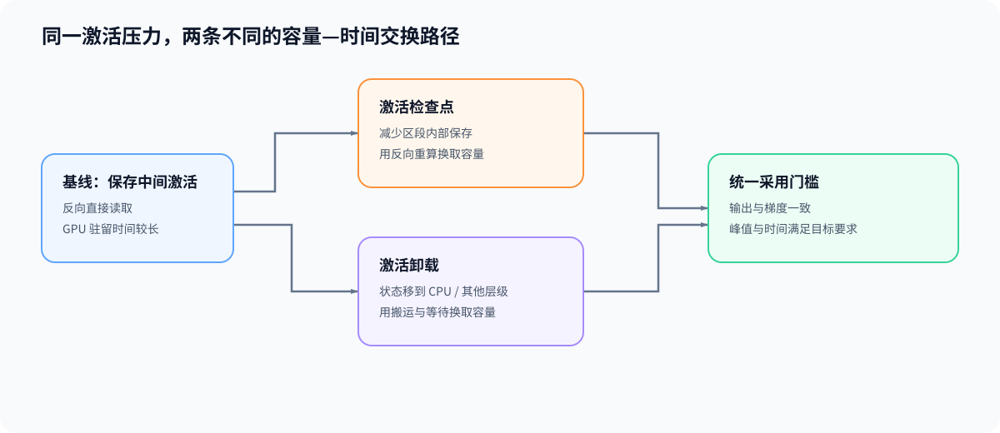

# 05. 激活检查点与卸载 | Activation Checkpointing and Offload

## 学习问题

反向传播还要使用的中间量放不下时，可以少保存、稍后重算，也可以先搬出设备、需要前再搬回。激活检查点（activation checkpointing）与激活卸载（offload）分别增加计算或传输；选择取决于哪段保存量形成峰值，以及新增时间能否接受。

## 核心机制

| 策略 | 改变的生命周期 | 主要依赖资源 | 主要代价 |
|:---|:---|:---|:---|
| 激活检查点 | 前向传播只保留边界状态，反向传播重算中间激活 | 额外计算 | 反向传播时间增加 |
| 卸载 | 状态仍需保存，但驻留位置移到 CPU 或其他存储层 | PCIe、NVLink 或内存带宽 | 搬出、搬回和等待时间 |

这里比较的是反向保存激活的两条路径，它们不直接改变参数、梯度或优化器状态的逻辑规模。参数或优化器状态也可以采用卸载，但那会改变相应状态的设备驻留与更新数据路径，需要另立账本。

### 激活检查点的正确性条件

设基线与 Checkpoint 路径保存的 activation 驻留量分别为 $M_{saved,base}$ 和 $M_{saved,ckpt}$，两者差值

$$
\Delta M_{ckpt}=M_{saved,base}-M_{saved,ckpt}
$$

表示保存量的理论差值，不一定等于整个训练峰值的下降。对应的新增时间为 $\Delta T_{ckpt}=T_{ckpt}-T_{base}$，主要来自反向重算和调度开销。重算路径必须能够重放原前向传播；比较两条路径时，需要同时检查输出、输入梯度和参数梯度。

| 条件 | 不满足时的风险 | 验证方式 |
|:---|:---|:---|
| 参数和输入一致 | 重算得到不同激活 | 固定模型状态和输入 |
| 随机状态可恢复 | Dropout 等随机层产生不同结果 | 固定或保存 RNG 状态 |
| 无不受控副作用 | 重算改变计数器、缓存或外部状态 | 保持检查点函数可重放 |
| 分段边界完整 | 依赖跨越边界但未正确传递 | 比较分段路径与基线路径的输出和梯度 |

分段更细会改变边界保存量、每次重算的范围和瞬时工作集，并不保证更省显存。把一段计算拆成很多检查点，可能留下更多边界输入；把整段包成一个检查点，又可能在重算时形成较大的瞬时占用。应按实际保留和重建的张量比较，见 [PyTorch 检查点说明](https://docs.pytorch.org/docs/stable/checkpoint)。

### 卸载的容量与传输账本

设实际搬出的状态量为 $bytes$，搬出和搬回的有效带宽分别为 $B_{out}$ 与 $B_{in}$。两向按串行估算，暂不计固定延迟和额外分配时，往返传输时间为：

$$
T_{roundtrip}\approx\frac{bytes}{B_{out}}+\frac{bytes}{B_{in}}.
$$

若状态量用字节、带宽用字节／秒，结果单位就是秒。例如两向各搬 1 GiB、有效带宽均为 10 GiB/s，串行往返约为 0.2 s。若合法依赖下有 $T_{overlap}$ 的传输被其他计算覆盖，简化的暴露时间为：

$$
T_{exposed}=\max(0,T_{roundtrip}-T_{overlap}).
$$

状态需要在对应反向读取前搬回；未及时完成时，设备必须等待。可覆盖多少时间应结合真实依赖与资源竞争观察，不能任意减去一段计算时间。Checkpoint 与 Offload 的共用符号见[公式索引](./formula_reference.md)。

### 候选策略比较

| 观察到的主导压力 | 优先候选 | 需要确认的证据 |
|:---|:---|:---|
| 前向传播末尾的激活占主导 | 激活检查点 | 峰值下降、梯度一致、重算时间可接受 |
| 可搬运状态占主导且链路带宽足够 | 卸载 | 驻留下降、搬回时刻与暴露等待 |
| 参数、梯度或优化器状态占主导 | dtype、LoRA 或 ZeRO | 状态字节数和分片口径 |
| 激活与常驻状态共同形成峰值 | 组合策略 | 每项策略的独立贡献与组合复测 |

## 验证与下一步

选择候选后，先核对输出和梯度，再把峰值下降与新增重算、搬运和等待放在同一训练负载下比较。采用门槛继续见 [06 正确性与性能证据](./06_correctness_and_performance_evidence.md)，实际实验入口由本页相关阅读与[实验资产表](./experiment_assets.md)定位。

## 相关阅读

| 资料 | 用途 |
|:---|:---|
| [Part 02 · 19 激活检查点](../../02_PyTorch_Algorithms/19_Activation_Checkpointing.md) | 检查保存—重算的正确性与峰值代价。 |
| [Part 02 · 42 激活卸载](../../02_PyTorch_Algorithms/42_Activation_Offload.md) | 检查搬出、搬回和暴露等待。 |
| [Part 02 · 76 激活检查点与卸载对照](../../02_PyTorch_Algorithms/76_Activation_Checkpoint_Offload_Benchmark.md) | 在固定训练工作负载下比较策略。 |
| [Training Deep Nets with Sublinear Memory Cost](https://arxiv.org/abs/1604.06174) | 理解激活检查点的经典空间—计算交换。 |
| [ZeRO-Offload](https://arxiv.org/abs/2101.06840) | 理解 CPU 卸载如何进入训练系统。 |
| [torch.utils.checkpoint](https://docs.pytorch.org/docs/stable/checkpoint) | 核对 PyTorch checkpoint 接口和随机状态说明。 |
