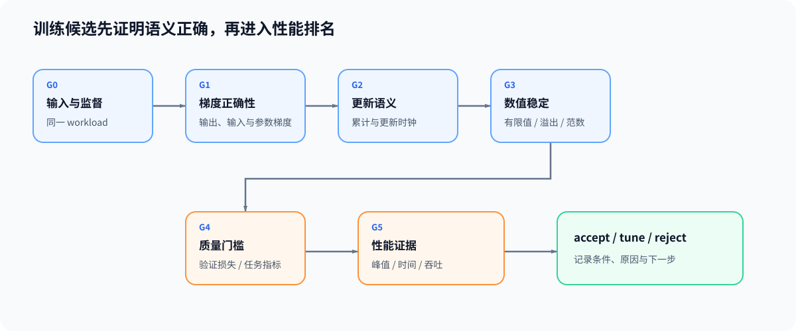

# 06. 正确性、数值稳定与性能证据 | Correctness, Numerical Stability and Performance Evidence

## 学习问题

重算后峰值下降，但单步更慢，这个候选是否值得保留？先确认它仍在训练同一个目标，再比较质量、容量与时间。这里判断的是同模型训练实现或状态策略，而非不同模型架构之间必须输出相同的比较。

## 核心机制

性能改善不能抵消训练语义错误。一个更快但梯度不一致、出现非有限值或改变监督口径的候选路径，不应进入性能排名。

| 门槛 | 要回答的问题 | 最小证据 |
|:---|:---|:---|
| G0 · 输入与监督 | 基线和候选是否使用同一工作负载、标签与有效 token 口径？ | 工作负载、随机种子、形状、dtype、监督计数 |
| G1 · 梯度正确性 | 输出、输入梯度和参数梯度是否在容差内一致？ | 参考实现、解析梯度或 `gradcheck` |
| G2 · 更新语义 | 梯度累积、优化器更新步与调度器更新步是否一致？ | 更新次数、梯度尺度、参数增量 |
| G3 · 数值稳定 | 损失和梯度是否有限，缩放或裁剪顺序是否正确？ | NaN/Inf、溢出、梯度范数、跳过更新次数 |
| G4 · 质量门槛 | 候选路径是否保持任务质量或收敛行为？ | 验证损失、任务指标或规定容差 |
| G5 · 性能证据 | 峰值、时间和吞吐是否改善？ | 峰值显存、单步时间、吞吐、重复测量 |

### 混合精度下的梯度安全

FP16、BF16 和 FP32 拥有不同的动态范围和存储代价。FP16 训练可能通过损失缩放放大反向信号，再在更新前还原梯度尺度；若检测到溢出，则应跳过当前更新并调整缩放因子。BF16 动态范围更接近 FP32，通常不依赖 `GradScaler`，但仍需检查有限值和梯度范数。

推荐核对顺序：

```text
缩放损失并执行反向传播
→ 完成梯度累积
→ 还原梯度尺度
→ 有限值 / 溢出检查
→ 梯度裁剪
→ 优化器更新
→ 学习率调度器更新
```

上面的缩放与还原只适用于启用损失缩放的路径，BF16 等不启用时跳过相应步骤。累计梯度的有限值检查与裁剪顺序可在[混合精度反向机制页](../../02_PyTorch_Algorithms/TRAIN-MIXED-PRECISION-BACKWARD_Mixed_Precision_Backward.md)核对；按成功更新计数的调度，需要确认优化器步没有被跳过。

### 从基线到策略决策

| 阶段 | 主要工作 | 输出 |
|:---|:---|:---|
| 训练基线 | 记录模型、数据、有效批次、长度、精度与重复次数，固定非候选变量 | 基线结果 JSON 与环境记录 |
| 性能分析归因 | 找出时间热点、显存峰值阶段和 I/O 等待 | 时间线追踪与瓶颈假设 |
| 候选复测 | 单项比较隔离主要变量；组合比较记录全部主动变化 | 候选结果 JSON 与失败记录 |
| 联合判断 | 先过 G0–G4，再比较 G5 | `accept / tune / reject` |

精度本身是候选时，应记录两侧类型而非强制相同；组合策略可以一起比较，但不能把全部差异归因于其中一项。为说明取舍，构造一个基线峰值 8 GiB、单步 100 ms，候选峰值 6 GiB、单步 130 ms 的例子：若预算要求不超过 7 GiB 且单步不超过 150 ms，在梯度、更新和任务质量均通过时，候选可以满足目标，虽然它并没有加速。

只有时间与峰值、缺少梯度或质量检查时，结论是待核验；已经确认梯度错误时先修实现，不能用容量收益抵消。比较条件本身不成立时，先修复比较，也不直接给候选作性能排名。记录至少包含：

| 字段组 | 关键字段 |
|:---|:---|
| 工作负载 | 模型、输入形状、批次、序列长度、dtype、随机种子、重复次数 |
| 正确性 | 输出差异、梯度差异、有限值、更新次数、质量门槛 |
| 容量 | 已分配峰值、预留峰值、状态账本与主导对象 |
| 时间 | 单步时间、前向传播 / 反向传播 / 更新分段、暴露传输时间 |
| 决策 | 证据等级、失败记录、结论、理由、下一步动作 |



## 验证与下一步

用预先约定的目标判断保留、补证或不采用，并同时保留失败原因。需要继续定位真实瓶颈时进入[性能优化](../performance_optimization/intro.md)；训练目标转为示范、偏好或奖励时，再进入[后训练优化](../post_training_optimization/intro.md)。

## 相关阅读

| 资料 | 用途 |
|:---|:---|
| [Part 00 · 19 调试与异常定位](../../00_Prerequisites/19_Debugging_and_Anomaly_Localization.md) | 定位形状、数值、梯度和设备异常。 |
| [Part 00 · 20 性能证据与实验设计](../../00_Prerequisites/20_Performance_Evidence_and_Experiment_Design.md) | 固定工作负载、基线和候选对照。 |
| [Part 02 · 73 训练性能分析](../../02_PyTorch_Algorithms/73_Training_Performance_Analysis.md) | 建立真实训练工作负载的基线。 |
| [Part 02 · 74 候选准入与交接](../../02_PyTorch_Algorithms/74_Profiling_Driven_End_to_End_Optimization.md) | 将机制候选接入时间线、归因与准入检查。 |
| [Part 02 · 76 激活检查点与卸载对照](../../02_PyTorch_Algorithms/76_Activation_Checkpoint_Offload_Benchmark.md) | 比较单项和组合策略的质量、容量与时间。 |
