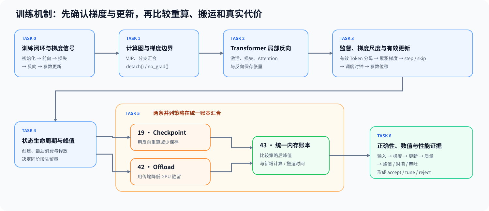
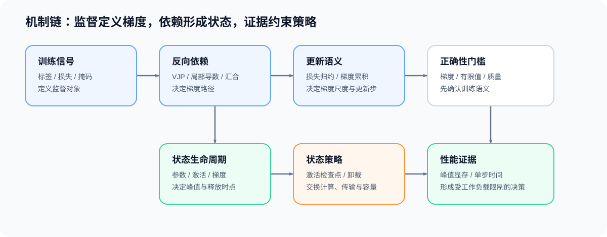

# 反向传播与训练机制（Backpropagation and Training Mechanics）

> 专题类型：基础支撑　能力出口：核对梯度与训练状态，建立性能比较前的正确性证据

一次训练更新先由前向传播建立依赖，再由损失给出监督信号，最后由反向传播生成梯度并写回参数。参数、激活值、反向保存张量、梯度和优化器状态在不同阶段产生、驻留和释放；这些关系共同决定更新是否正确、峰值显存出现在哪里，以及重算或搬运会增加多少代价。

预训练、持续预训练和后训练会改变数据来源、监督范围、参与模型和分布式规模，却共享同一组训练语义：计算图、局部反向、有效更新、数值稳定和训练状态生命周期。完成本专题后，应能画出训练依赖图，核对监督与更新条件，建立状态生命周期账本，并在比较性能前确认梯度和数值行为正确。

## 学习路线

按 Task 顺序学习时使用下表；需要连续理解一次训练更新时进入[训练机制问题链](./walkthrough.md)，遇到梯度为空、更新不一致或显存峰值异常时使用[训练机制问题索引](./casebook.md)，术语差异查询[专题术语表](./glossary.md)，跨页公式与符号查询[公式索引](./formula_reference.md)。Task0–4 建立共用训练机制，Task5 比较重算与搬运，Task6 检查候选能否进入真实性能比较。

| Task / 主题 | 本阶段要回答的问题 | 学习入口与验证出口 | 学习顺序 | 主要正文入口 |
|:---|:---|:---|:---|:---|
| Task0 · 训练闭环与梯度信号 | 参数如何经过前向传播、损失、反向传播和更新形成一次完整训练闭环？ | 核心：[Part 00 · 09 模块与参数](../../00_Prerequisites/09_PyTorch_nn_Module_Basics.md) → [Part 00 · 12 训练生命周期](../../00_Prerequisites/12_PyTorch_Minimal_Training_Interface.md) | 参数初态 → 前向依赖 → 损失 → 梯度 → 更新后状态 | [01 训练闭环与计算图](./01_training_loop_and_computation_graph.md) |
| Task1 · 计算图、VJP 与梯度边界 | 自动求导如何沿计算图传播上游梯度，计算图在何处被保留、累积或切断？ | 核心：[Part 00 · 07 自动求导](../../00_Prerequisites/07_PyTorch_Autograd_and_Backward.md) → [Part 00 · 08 梯度边界](../../00_Prerequisites/08_PyTorch_Grad_Hygiene_and_No_Grad.md) | 局部导数 → VJP → 分支汇合 → 累积 / 切断 | [02 自动求导与 Transformer 反向传播](./02_autograd_and_transformer_backward.md) |
| Task2 · Transformer 局部反向与保存状态 | 激活、损失、Attention 与残差路径分别依赖哪些前向状态？ | 核心：[Part 02 · 09 激活与损失反向](../../02_PyTorch_Algorithms/09_Activation_and_Loss_Backward.md) → [Part 02 · 10 Attention 反向传播](../../02_PyTorch_Algorithms/10_Attention_Backward_and_Custom_Autograd.md) | 局部算子 → 保存状态 → 反向消费者 → 梯度对照 | [02 自动求导与 Transformer 反向传播](./02_autograd_and_transformer_backward.md) |
| Task3 · 监督、梯度尺度与有效更新 | 损失归约、微批次、混合精度与更新时钟如何共同决定一次有效更新？ | 核心：[Part 02 · 11 梯度累积](../../02_PyTorch_Algorithms/11_Gradient_Accumulation.md) → [Part 02 · TRAIN-MIXED-PRECISION-BACKWARD 混合精度反向](../../02_PyTorch_Algorithms/TRAIN-MIXED-PRECISION-BACKWARD_Mixed_Precision_Backward.md) → [Part 02 · 12 优化器与调度](../../02_PyTorch_Algorithms/12_Optimizer_Updates_and_Learning_Rate_Scheduling.md) → [Part 02 · 55 训练更新动力学](../../02_PyTorch_Algorithms/55_Training_Update_Dynamics.md) | 监督范围 → 有效 Token 分母 → 累积梯度 → `step / skip` → 调度时钟 → 参数位移 | [03 监督与有效更新](./03_supervision_gradient_scale_effective_update.md) |
| Task4 · 训练状态生命周期与峰值账本 | 参数、梯度、优化器状态、激活和工作区在何时产生、驻留、消费与释放？ | 核心：[Part 00 · 18 显存账本](../../00_Prerequisites/18_Memory_Profiling_and_Optimization.md) | 状态字节 → 创建与最后消费时刻 → 阶段重叠 → 基线峰值 | [04 训练状态生命周期](./04_training_state_lifecycle.md) |
| Task5 · 重算、搬运与驻留策略 | 激活检查点和卸载分别改变什么状态，代价由计算还是传输承担？ | 核心：[Part 02 · 19 激活检查点](../../02_PyTorch_Algorithms/19_Activation_Checkpointing.md) 与 [Part 02 · 42 激活卸载](../../02_PyTorch_Algorithms/42_Activation_Offload.md) → [Part 02 · 43 统一训练内存账本](../../02_PyTorch_Algorithms/43_Unified_Training_Memory_Ledger.md) | 基线生命周期 → 重算 / 搬运两条并列路径 → 策略后峰值与新增时间 | [05 激活检查点与卸载](./05_checkpointing_and_offload.md) |
| Task6 · 正确性、数值稳定与性能证据 | 梯度和更新语义成立后，如何判断候选策略既正确又值得采用？ | 核心：[Part 00 · 19 异常定位](../../00_Prerequisites/19_Debugging_and_Anomaly_Localization.md) → [Part 00 · 20 实验设计](../../00_Prerequisites/20_Performance_Evidence_and_Experiment_Design.md) | 输入一致 → 梯度一致 → 更新有效 → 质量过门 → 性能复测 | [06 正确性与性能证据](./06_correctness_and_performance_evidence.md) |

## 扩展与跨专题入口

学习路线说明阅读顺序；下面的知识地图改为说明两条机制链如何汇合：训练信号沿反向依赖形成更新语义，保存状态沿生命周期进入状态策略，二者共同接受正确性与性能证据约束。

### 预训练和后训练分别改变什么

共同主干分别服务两条应用路径：预训练与持续预训练使用全序列监督和长周期训练，后训练引入 response-only mask、adapter、偏好对、rollout 与奖励信号。两条路径改变监督与系统规模，不改变计算图、有效更新和状态生命周期的基本语义。

| 应用路径 | 改变的输入与训练状态 | 机制入口 |
| --- | --- | --- |
| 预训练 / 持续预训练 | 全序列监督、长周期 checkpoint、领域评测与通用保留集 | [Part 02 · 55 更新动力学](../../02_PyTorch_Algorithms/55_Training_Update_Dynamics.md) → [Part 02 · 56 持续预训练](../../02_PyTorch_Algorithms/56_Continual_Pretraining_and_Retention.md) |
| 后训练 | response-only mask、adapter、偏好对、rollout、reward 与 value | [Part 02 · 2.4 监督微调](../../02_PyTorch_Algorithms/2_4.md) → [后训练优化](../post_training_optimization/intro.md) |

### 遇到这些问题时先读什么

| 知识缺口 | 回补入口 | 使用时机 |
| --- | --- | --- |
| Attention 的前向表示 | [Part 02 · 04 Attention](../../02_PyTorch_Algorithms/04_Attention_MHA_GQA.md) | Task2 中需要回看 Q/K/V、Softmax 与残差路径的输入输出时 |
| dtype、FP16 与 BF16 | [Part 01 · 01 数据格式与混合精度](../../01_Hardware_Math_and_Systems/01_Data_Types_and_Precision.md) | Task6 中分析梯度范围、缩放和有限值时 |
| ZeRO 与多卡状态切分 | [Part 01 · 06 显存计算与 ZeRO](../../01_Hardware_Math_and_Systems/06_VRAM_Calculation_and_ZeRO.md) | Task4 账本扩展到多卡训练时 |
| 梯度同步与通信 | [通信与并行](../communication_parallelism/intro.md) | 单卡梯度语义已经成立，需要分析 All-Reduce 或 Reduce-Scatter 时 |

### 跨专题入口

| 后续问题 | 进入专题 | 交给下一专题的记录 |
| --- | --- | --- |
| SFT、DPO、GRPO 的训练目标和项目交付 | [后训练优化](../post_training_optimization/intro.md) | 监督信号、有效更新和梯度安全 |
| 峰值显存、时间线追踪、吞吐和策略选择 | [性能优化](../performance_optimization/intro.md) | 状态生命周期、策略作用对象和正确性门槛 |
| 反向传播内核、融合与重算 | [算子优化](../operator_optimization/intro.md) | 局部梯度依赖与反向保存张量 |
| 状态切分、梯度同步和扩展效率 | [通信与并行](../communication_parallelism/intro.md) | 单卡梯度语义与训练状态账本 |

## 实验与项目出口

| 项目入口 | 使用的机制记录 | 产生的实验结果 |
|:---|:---|:---|
| [Part 02 · 73 训练基线](../../02_PyTorch_Algorithms/73_Training_Performance_Analysis.md) | 监督范围、有效更新和状态账本 | 固定工作负载下的质量、吞吐、单步时间与峰值 |
| [Part 02 · 74 候选准入与交接](../../02_PyTorch_Algorithms/74_Profiling_Driven_End_to_End_Optimization.md) | 时间线、主导状态和候选约束 | 瓶颈归因、候选选择与复测条件 |
| [Part 02 · 76 策略对照](../../02_PyTorch_Algorithms/76_Activation_Checkpoint_Offload_Benchmark.md) | Checkpoint、Offload 与统一内存账本 | 单策略和组合策略的质量—容量—时间结论 |

### 环境与验证

首次运行先按[实验 Quickstart](./quickstart.md)准备环境，再从[实验资产表](./experiment_assets.md)确认页面、结果路径和验证状态。单卡机制实验使用 `TRAIN-CUDA-MECHANISM`，在 Notebook 5.1 设置 `RUN_MODE`、`RUN_LABEL`、Profile ID 和本页工作负载参数；项目实验还需固定模型、数据划分、有效批次、数据类型、优化器更新次数和随机种子。

| 实验层级 | 适用内容 | 可确认的结论 |
| --- | --- | --- |
| CPU 机制 | Task0–5 的计算图、局部梯度、监督、账本和策略逻辑 | 数值关系、状态转移与输入契约正确 |
| 单卡 GPU | 梯度累积、混合精度、激活检查点与卸载 | 更新一致性、峰值显存与单步时间的真实代价 |
| 训练性能项目 | Part 02 · 73、74、76 | 固定工作负载下候选策略是否值得采用 |
