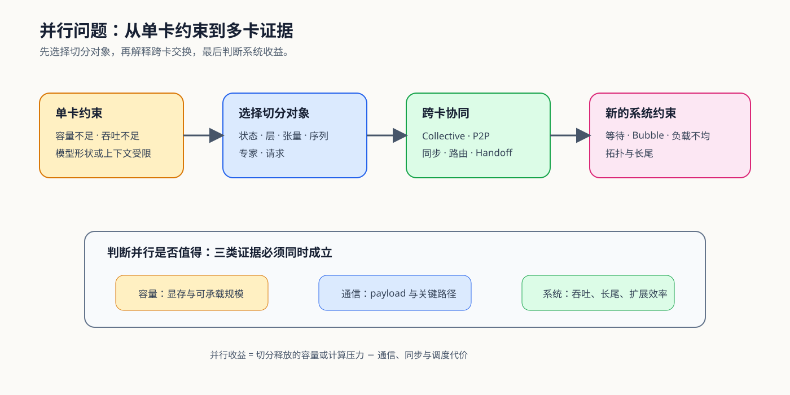

# 01. Why Parallel and Communication | 为什么需要并行与通信

## 学习问题

单卡走向多卡通常由容量、吞吐或模型结构约束触发。切分解决局部约束，也会把原本位于设备内部的数据依赖变成跨 rank 的通信、等待和调度问题。学习并行的起点不是记住框架参数，而是先判断“什么必须被切开”。

## 核心机制

### 从约束识别切分对象

同一种性能现象可能对应不同切分方式。先确认受限对象，再估计切分后的交换内容，才能避免用加卡掩盖真正瓶颈。

| 首要约束 | 优先观察的切分对象 | 通信随之出现在哪里 | 典型机制 |
|:---|:---|:---|:---|
| 训练状态装不下 | 参数、梯度、优化器状态 | 参数收集、梯度归约、状态同步 | FSDP、ZeRO |
| 模型层序列装不下 | 连续 Block / stage | stage 间激活与梯度 | 流水线并行（PP） |
| 单层矩阵或 Head 太大 | 特征维、Head、权重矩阵 | 层内 All-Reduce / Gather / Scatter | 张量并行（TP） |
| 长序列状态太大 | sequence / context | K/V 或中间状态的环式交换 | 上下文并行（CP） |
| 稀疏专家规模扩大 | expert 与 token | dispatch / combine 的 All-to-All | 专家并行（EP） |
| 服务请求规模扩大 | 请求与模型副本 | 路由、队列与缓存局部性 | 服务副本（Replica） |

### 并行收益必须扣除协同代价

并行方案的收益不能只看单卡显存下降。至少需要同时检查容量、关键路径和系统输出；其中任一项失败，都可能让“能够运行”无法转化为“值得采用”。

| 证据层 | 需要回答的问题 | 代表指标 |
|:---|:---|:---|
| 容量 | 切分后每个 rank 真正少保存了什么 | 峰值显存、可承载模型 / batch / context |
| 通信 | 交换了多少数据，发生多少次，是否落在关键路径 | 载荷、调用频率、集合通信时间、暴露通信时间 |
| 系统 | 加卡后是否得到稳定的规模或速度收益 | 吞吐、单步时间、P95/P99、扩展效率 |

### 切分对象必须落到拓扑

切分方式确定交换对象，拓扑决定交换经过哪些链路。高频、强同步的通信应优先留在低延迟、高带宽的拓扑域内；跨节点链路更适合频率较低、可批量化或能被计算覆盖的交换。

| 通信特征 | 优先放置方式 | 需要验证的事实 |
|:---|:---|:---|
| 层内高频同步，如 TP | 优先放在单机高速互联域 | rank 到 GPU 映射、链路带宽、集合通信延迟 |
| 动态大载荷交换，如 EP | 将频繁互换的专家放在较近链路 | send/receive counts、热点链路、最慢 rank |
| stage 间点对点传输，如 PP | 让相邻 stage 的传输路径可解释 | 激活字节、P2P 延迟、stage 等待 |
| 数据并行或状态分片同步 | 依据载荷与频率决定是否跨节点 | bucket、同步频率、跨机有效带宽 |

## 选择条件与验证证据

| 目的 | 入口 |
|:---|:---|
| 建立硬件和拓扑直觉 | [Part 01 · 03 GPU 架构与显存](../../01_Hardware_Math_and_Systems/03_GPU_Architecture_and_Memory.md)、[05 通信拓扑](../../01_Hardware_Math_and_Systems/05_Communication_Topologies.md) |
| 继续学习同步语义 | [02 数据并行与同步](./02_data_parallel_and_synchronization.md) |
| 机制学习完成后筛选候选 | [Part 01 · 26 并行策略决策](../../01_Hardware_Math_and_Systems/26_Parallel_Strategy_Decision_Framework.md) |
| 形成多卡结论 | [07 多卡基准与并行决策](./07_benchmark_and_parallel_decision.md) |

## 相关阅读

- [PyTorch Distributed Overview](https://pytorch.org/tutorials/beginner/dist_overview.html)
- [NCCL 官方文档](https://docs.nvidia.com/deeplearning/nccl/user-guide/docs/)
