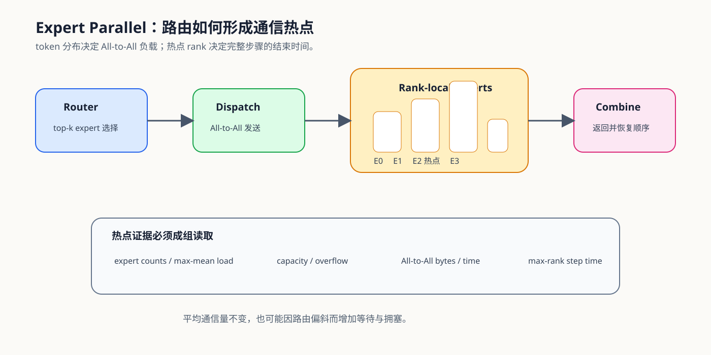

# 05. Dynamic Routing and Load | 动态路由与负载

## 学习问题

静态切分先确定张量或序列属于哪个 rank；动态路由则根据本批次状态决定工作落到哪里。EP 把 token 发给专家，Serving 路由把请求发给模型副本。两者的对象和通信不同，但都必须同时控制容量、局部性、负载偏斜和最慢执行单元。

## 核心机制

### Router 到输出的完整路径

| 阶段 | 状态变化 | 需要记录的机制证据 |
|:---|:---|:---|
| route | token 选择 top-k experts | expert counts、routing entropy |
| capacity | 每个 expert 接受有限 token | capacity factor、overflow / dropped tokens |
| dispatch | token 按目标 expert 跨 rank 重排 | send / receive counts、All-to-All bytes |
| expert compute | 各 rank 执行本地专家 | 每 rank token 数、compute time、peak memory |
| combine | 专家输出返回原 token 顺序并加权 | reverse All-to-All、combine time、正确性 |

### 负载不均决定最慢 rank

平均 token 数不能解释 EP 性能。真正限制 step time 的是热点 rank；即使总 payload 不变，不均衡也可能让部分 rank 计算和通信拥塞、其他 rank 空等。

| 现象 | 优先检查 | 可调整方向 |
|:---|:---|:---|
| overflow 升高 | capacity、top-k、router 分布 | capacity factor、路由正则、专家数 |
| All-to-All 时间抖动 | send / receive counts、拓扑 | expert placement、分层通信、路由约束 |
| expert compute 不均 | max / mean load、最慢 rank | 负载均衡、shared expert、token 重分配 |
| 吞吐增加但质量下降 | dropped tokens、router 稳定性 | 质量门槛和 overflow 策略 |

### 请求路由是另一类动态分工

Serving Replica 不执行专家 All-to-All，也不需要训练梯度同步。调度器需要同时读取副本队列、预计可用时间、Prefix Cache 归属和 Session 状态。只按队列选择可能丢失缓存复用，只按缓存归属又可能把请求持续送入热点副本。

| 路由候选 | 主要信号 | 获得的收益 | 主要风险 | 应保留的证据 |
|:---|:---|:---|:---|:---|
| 最短队列 | queue length、available time | 降低排队等待 | 忽略 Prefix Cache 与迁移成本 | 每副本队列、等待时间、P95/P99 |
| 缓存感知 | prefix owner、cache hit | 减少重复 Prefill | 热点前缀造成粘性拥塞 | 命中率、复用 token、热点副本负载 |
| Session 粘性 | session owner、会话状态 | 避免状态搬运 | 长会话长期占用同一副本 | 会话长度、迁移次数、尾延迟 |
| 受约束的局部性 | cache gain 与等待容忍度 | 在复用和均衡之间折中 | 阈值失配后两边都不占优 | makespan、TTFT、命中收益与等待代价 |

| 路由对象 | 容量信号 | 局部性信号 | 长尾来源 | 机制入口 |
|:---|:---|:---|:---|:---|
| token → expert | expert capacity、overflow | expert placement | 热门专家与最慢 rank | [46 Expert Parallel](../../02_PyTorch_Algorithms/46_MoE_Expert_Parallel.md) |
| request → replica | queue、可用时间 | prefix / session owner | 热点副本与粘性等待 | [PAR-REPLICA](../../02_PyTorch_Algorithms/PAR-REPLICA_Serving_Replica_Routing.md) |

## 选择条件与验证证据

| 目的 | 入口 |
|:---|:---|
| 理解 Router 与均衡目标 | [Part 02 · 06 MoE Router](../../02_PyTorch_Algorithms/06_MoE_Router.md)、[07 Load Balancing](../../02_PyTorch_Algorithms/07_MoE_Load_Balancing_Loss.md) |
| 验证 dispatch / combine | [Part 02 · 46 Expert Parallel](../../02_PyTorch_Algorithms/46_MoE_Expert_Parallel.md) |
| 比较请求路由与副本负载 | [PAR-REPLICA](../../02_PyTorch_Algorithms/PAR-REPLICA_Serving_Replica_Routing.md) |
| 定位通信热点 | [06 通信剖析与通信—计算重叠](./06_communication_profiling_and_overlap.md) |

## 相关阅读

- [Switch Transformer](https://arxiv.org/abs/2101.03961)
- [DeepSpeed-MoE](https://arxiv.org/abs/2201.05596)
