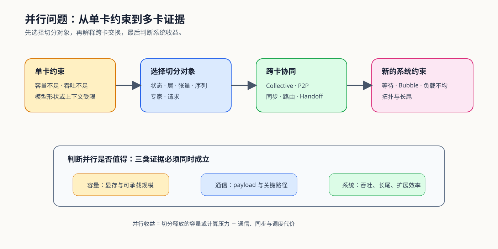
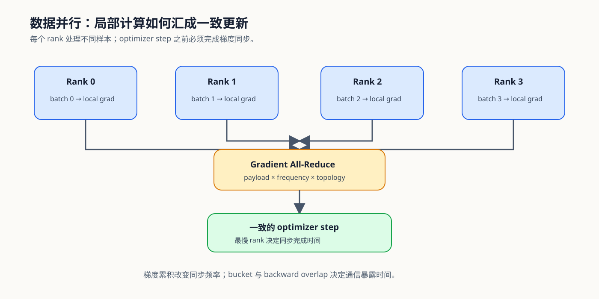
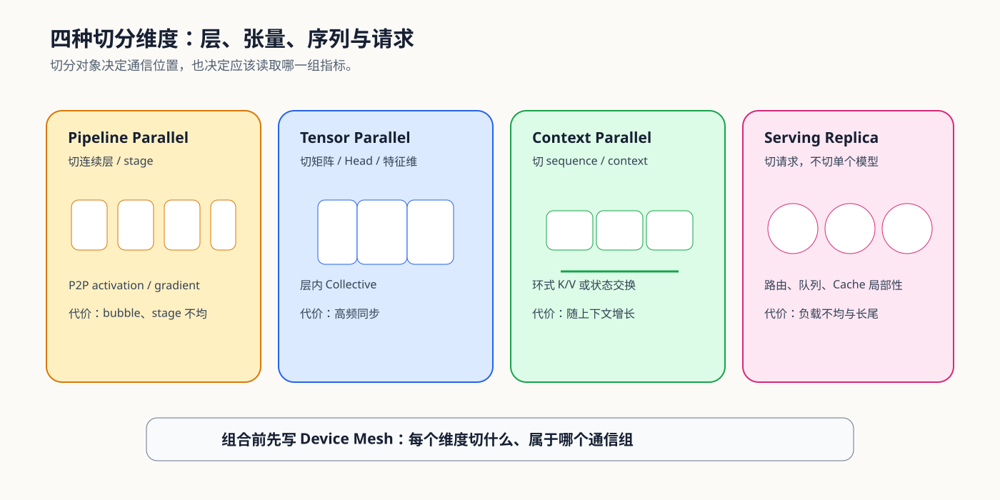
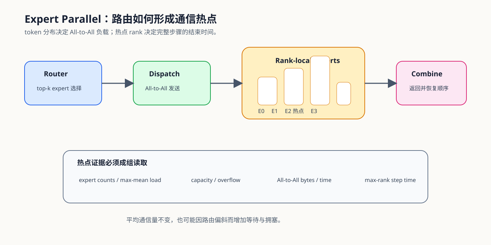
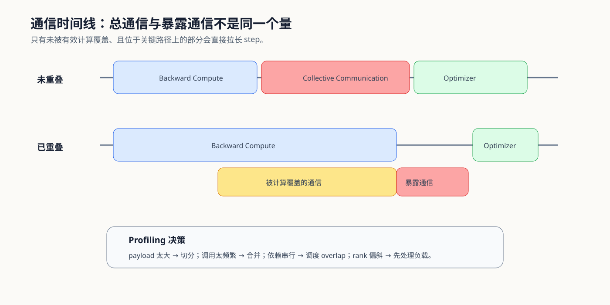

# 通信与并行问题链：从切分对象到多卡决策

多卡并行不是单纯增加设备，而是把原本位于单卡内部的状态与计算拆开，再通过通信恢复正确结果。学习时应沿着同一条因果链推进：

`单卡约束 → 切分对象与拓扑 → 集合通信与载荷 → 同步和负载 → 暴露通信 → 可靠性与决策`

下面沿训练状态、模型内部切分、专家路由和分布式推理，追踪切分对象如何产生通信，再进入热点与系统决策。总览路线和知识索引见[专题入口](./intro.md)。

## 第一段：从单卡约束选择切分对象

先判断限制来自训练状态、模型深度、单层宽度、长上下文、专家规模还是请求规模。不同对象分别对应 ZeRO / FSDP、PP、TP、CP、EP 和服务副本；切分对象没有确定时，不能仅凭框架参数选择并行方案。

对应 [01 为什么需要并行与通信](./01_why_parallel_and_communication.md)。

## 第二段：用集合通信、载荷与拓扑解释同步

切分后要确认交换语义：All-Reduce 返回完整聚合结果，Reduce-Scatter 留下分片，All-Gather 恢复完整输入，All-to-All 按目标 rank 重排数据，P2P 连接指定阶段。实际代价同时取决于载荷、调用频率、world size 和拓扑。

对应 [02 数据并行与同步](./02_data_parallel_and_synchronization.md)。数据并行提供最基础的同步基线，也为后续状态分片和模型切分建立通信语言。

## 第三段：区分训练状态分片与模型内部切分

DDP、FSDP 和 ZeRO 改变参数、梯度和优化器状态的复制方式；PP、TP 与 CP 则分别切层、张量和上下文。前者重点检查常驻状态、临时聚合和检查点生命周期，后者重点检查流水线气泡、层内同步、Head 布局与序列通信。

对应 [03 状态分片与 ZeRO](./03_state_sharding_and_zero.md)和[04 模型与上下文切分](./04_pipeline_and_tensor_parallel.md)。

## 第四段：比较两类动态路由

EP 的载荷由本批次 token 路由决定，route、capacity、dispatch、expert compute 和 combine 共同形成 All-to-All、overflow 与热点 rank。服务副本则把请求分给模型实例，队列、Prefix Cache 和 Session 局部性共同决定尾延迟。两者都要观察最慢执行单元，但不能混用专家容量和请求队列指标。

对应 [05 动态路由与负载](./05_expert_parallel_and_communication_hotspots.md)。

## 第五段：从通信总时长转向暴露通信

所有 NCCL Kernel 的总时长不能直接解释 step 或请求变慢。需要把集合通信放回时间线，检查哪些通信已被有效计算覆盖、哪些仍位于关键路径，并同时观察最慢 rank 时间、调用频率和负载不均。

对应 [06 通信剖析与通信—计算重叠](./06_communication_profiling_and_overlap.md)。

## 第六段：检查组合、恢复与多卡收益

候选先检查并行度乘积、每 rank 容量、进程组拓扑和检查点恢复条件，再进入真实多卡测量。训练状态并行、模型内部并行、MoE 专家并行和分布式推理拥有不同指标，但都要固定模型、输入、硬件、拓扑和执行条件。最终结论需要同时解释容量收益、通信代价、恢复条件和失败范围。

对应 [07 多卡基准与并行决策](./07_benchmark_and_parallel_decision.md)。遇到具体异常时，使用[通信与并行问题排查手册](./casebook.md)回到对应机制页。
