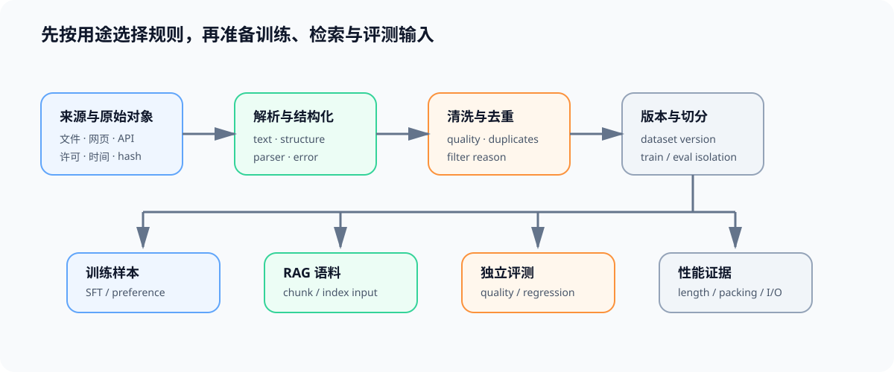

# 00 数据生命周期与消费者契约

## 学习问题

同一份原始数据可以服务训练、检索或评测，但它们对格式、版本、质量与长度的要求不同。数据工程先建立可追溯的共享处理链，再在末端把数据交给不同消费者，避免把“文件已读取”误当成“数据已可用于训练或 RAG”。

## 共享处理链怎样分流到不同消费者

| 处理阶段 | 需要产出 | 共同约束 | 下游消费者的差异 |
|:---|:---|:---|:---|
| 采集与解析 | 原始文件、来源与结构化文本 | 来源、许可、时间、解析器版本 | RAG 保留文档结构；训练保留样本语义 |
| 清洗与去重 | 可用文本与质量信号 | 规则版本、重复关系、过滤原因 | 训练关注污染与配比；检索关注 chunk 可用性 |
| 切分与版本 | train/eval 或语料版本 | 数据版本、血缘、隔离规则 | 评测集不能回流到训练或提示词 |
| 消费接口 | 可读的样本、chunk 或索引输入 | schema、长度、失败记录 | 训练、RAG、评测使用不同格式 |

## 哪些字段共同定义数据身份

| 字段组 | 至少记录 | 作用 |
|:---|:---|:---|
| 来源 | source、许可、时间、原始位置与采集方式 | 追踪可用性与合规风险 |
| 内容 | language、format、长度、解析状态与文本 hash | 统一后续规则的输入 |
| 处理 | parser、cleaning、dedup、filter 的版本和原因 | 解释样本为何被保留或删除 |
| 版本 | dataset version、split、血缘与评测隔离 | 保证训练与结果可复现 |
| 消费 | tokenizer/template、chunk 或 sample schema | 让训练、RAG 与评测正确读取 |

## 不同消费者怎样使用同一数据身份

| 消费方向 | 入口 | 数据工程提供什么 |
|:---|:---|:---|
| SFT 与偏好训练 | [后训练优化](../post_training_optimization/intro.md)、[Part 02 · 32 SFT 数据准入与长度审计](../../02_PyTorch_Algorithms/32_Data_Engineering_for_SFT.md) | 样本、切分、去污染、配比与数据版本 |
| RAG 与服务 | [推理优化](../inference_optimization/intro.md) | 解析、清洗、chunk 与索引输入 |
| 训练 I/O 与预算 | [性能优化](../performance_optimization/intro.md) | token 长度、packing、batch 契约和数据加载证据 |

## 什么证据允许数据进入下游

一份数据只有在来源、处理规则、版本、评测隔离和消费者接口都可定位时，才能进入后续解析、质量筛选或训练验证。缺少其中任一项时，应保留失败状态，而不是把“文件可读取”记为数据准入通过。
