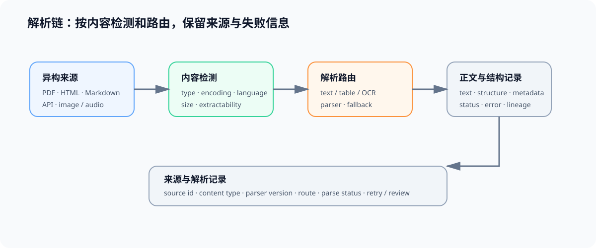

# 01 采集、解析与来源记录

## 学习问题

一份说明文档可能是带文字层的PDF，也可能是扫描图片。两者都以PDF结尾，读取方法却不同。解析要先识别文件中实际有什么，再把正文、标题和表格提取出来，并保留它们在原文中的位置。

以一份设备说明作教学示例：A1是带文字层的文件，A2是同一说明的扫描件，目标都是提取“支持服务时间”及其适用日期。配置与文件读写基础可先回补[Part 00 · 04](../../00_Prerequisites/04_Python_Config_and_Data_Entry.md)。



## 根据内容选择解析方式

先检查文件实际类型、大小及可提取内容。A1可以直接抽取文字，但还要核对段落顺序和表格单元格的对应关系；A2需要先把页面图像转成文字，即光学字符识别（OCR）。解析分流就是根据这类检测结果选择处理方式，而不是仅凭文件后缀。

假设原表格包含两行：“周一至周五｜09:00—18:00”“周六、周日｜不提供”。抽取后若只剩“09:00—18:00”，虽然得到了文本，却丢掉了适用日期。用于训练会构造出错误问答，用于检索则可能返回缺少限定的片段。

| 原文内容 | 提取结果 | 接下来怎样处理 |
|:---|:---|:---|
| 日期与时间分列的表格 | 每行保留日期、时间及所在页 | 可以继续清洗，同时保留表格结构 |
| 同一表格 | 只留下时间，行列对应丢失 | 更换表格提取方式或人工核对后再使用 |
| A2扫描件中的18:00 | OCR识别成16:00 | 标记数值疑点，回查页面图像；确认后另存修正结果 |

## 一条解析记录怎样保存

记录既要包含提取出的内容，也要指回原始文件。来源编号连接A1和A2，文件校验值区分它们的字节内容，页码和章节位置用于定位差异。原文件校验值与提取文本的校验值分别保存：文字相同的扫描件和文字版，原文件通常仍然不同。

下面展示已核对A1的一条示意记录；编号和版本仅用于教学。失败或待复核的记录同样保存来源、解析方式、已提取内容和错误原因，并单独记录后续重试或修正。

```json
{
  "source_id": "guide-A",
  "file_id": "A1",
  "content_type": "application/pdf",
  "parser_version": "demo-text-table-v1",
  "route": "text_and_table",
  "location": {"page": 2, "section": "支持服务"},
  "structure": {
    "rows": [["周一至周五", "09:00—18:00"], ["周六、周日", "不提供"]]
  },
  "text": "支持服务：周一至周五09:00—18:00；周六、周日不提供。",
  "parse_status": "reviewed",
  "error": null
}
```

## 保留结构后怎样供不同任务使用

解析后的文档先保留标题、段落、表格与原文位置，再按用途组织。预训练可以把文档内容转成词元序列，仍需知道文档从哪里开始、在哪里结束；SFT可以从某段构造问答；检索则要把相关标题和条件带进返回的片段。若解析阶段只保存一长串失去结构的文字，后面切块时就更难辨认表格行和适用范围。

来源记录也影响后续筛选。网页的发布时间、采集时间和许可信息可以帮助决定是否使用、怎样按时间划分；内容修改后保留原文件与新的解析版本，便于找回某次训练或索引构建实际读到的内容。

## 抽样检查内容是否保留

解析器报告成功后，按来源类型抽取页面与原文对照：普通段落查顺序，表格查行列，扫描件查数字、单位和否定词。再汇总各类文件的总数、成功数、待复核数与失败数；把难处理文件全部排除，会使后续数据只剩容易解析的类型，因此这些数量也要保留。

例如，A2中“18”识别成“16”时，先保存原识别文本及疑点，再核对页面并生成修正版。重试成功后仍保留上次失败记录，便于判断是哪种解析方式更可靠；尚未确认的文本留在待复核集合，待确认后再进入训练候选。

## 从解析结果进入样本检查

A1和修正后的A2进入[02 清洗、去重与评测隔离](./02_cleaning_quality_chain.md)，检查它们是否重复以及应该落在哪个集合。需要实现SFT字段和泄漏检查时，再进入[Part 02 · 32](../../02_PyTorch_Algorithms/32_Data_Engineering_for_SFT.md)；涉及媒体处理器或执行设备时参考[多模态](../multimodal/intro.md)与[模型部署与异构执行](../deployment_heterogeneous/intro.md)的相关入口。
