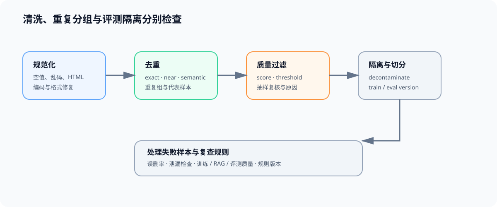

# 02 清洗、去重与质量证据链

## 学习问题

清洗不是把文本变短，而是用可复查规则去除无法服务下游任务的内容，并保留“为什么删掉或保留”的证据。质量规则只有在独立评测或下游训练/RAG 结果中得到验证，才值得继续使用。

## 不同处理层分别缩小什么风险

| 层 | 要处理的风险 | 常见方法 | 必须保存的证据 |
|:---|:---|:---|:---|
| 规范化 | 空值、乱码、HTML 残留、编码或格式异常 | 解码修复、正文抽取、长度与字符规则 | 原始状态、规则版本与变更原因 |
| 精确与近似去重 | 完全重复、模板重复、轻微改写 | 哈希、指纹、相似度阈值 | 重复组、代表样本与阈值 |
| 质量过滤 | 垃圾内容、低信息密度、格式错误 | 启发式、分类器、抽样复核 | 质量分数、阈值、过滤理由与抽样结果 |
| 去污染与切分 | 评测泄漏、同源近重复与未来信息 | 与评测集匹配、来源或时间隔离 | 数据切分、匹配规则与例外处理 |

## 质量判断契约

| 问题 | 不能只看什么 | 还要检查什么 |
|:---|:---|:---|
| 样本是否干净 | 是否通过单一正则 | 解析状态、语言、长度、格式与人工抽样 |
| 去重是否有效 | 删除比例 | 重复组、语义近似、长尾样本是否被误删 |
| 质量分数是否可信 | 分类器分数或困惑度 | 下游质量、误删率与跨来源稳定性 |
| 评测是否可信 | 测试集准确率 | 训练/评测隔离、泄漏检查与版本记录 |

## 评测数据怎样保持独立

评测集进入模型比较前，也要经过身份、污染和切片检查。这里固定的是“用哪些样本比较”，不是“采用哪一种指标”：评分器是否可靠、质量是否提升和候选是否采用，仍由下游评测协议判断。

| 检查对象 | 必须固定的内容 | 失败证据与处理 |
|:---|:---|:---|
| 数据身份 | 数据集 ID、版本、来源、冻结时间与样本指纹 | 身份缺失时停止跨运行比较 |
| 切分关系 | 训练集、验证集、测试集、外部基准与在线反馈池 | 记录精确重复、近似重复、同源和时间穿越命中 |
| 输入协议 | 提示模板、分词器、上下文拼接与最大长度 | 协议变化时建立新评测快照，不沿用旧分数 |
| 评测切片 | 任务、领域、语言、长度、难度与安全类别 | 保存每个切片的样本 ID、数量与覆盖缺口 |
| 失败样本 | 无法解析、截断、评分失败、冲突标注与无法判定 | 单独登记失败状态，不静默丢弃或记为零分 |

基线与候选必须读取同一评测快照。样本、切分、模板或过滤规则任一变化，都要生成新版本并重新计算双方结果；否则分数变化无法归因于模型变化。

## 质量规则怎样接受下游验证

| 需要补的能力 | 入口 | 本页如何使用 |
|:---|:---|:---|
| SFT 数据与质量项目 | [Part 02 · 32 SFT 数据准入与长度审计](../../02_PyTorch_Algorithms/32_Data_Engineering_for_SFT.md)、[Part 02 · 64 数据质量项目](../../02_PyTorch_Algorithms/64_SFT_Data_Quality_Project.md) | 将质量规则连接到训练样本与独立验证 |
| 偏好数据与评测隔离 | [Part 02 · 50 偏好数据与评测](../../02_PyTorch_Algorithms/50_Preference_Data_and_Evaluation.md) | 处理优选/拒选回答质量、标注一致性、评测快照与泄漏 |
| 后训练项目 | [后训练优化](../post_training_optimization/intro.md) | 用下游质量与失败案例验证过滤规则 |

## 什么时候可以接受一条质量规则

只有清洗规则、重复关系、质量分数、抽样复核、评测快照、污染命中和下游结果能够回查到同一数据版本时，质量规则才具备采用条件。被污染或处理结果不稳定的数据不能进入配比实验。
