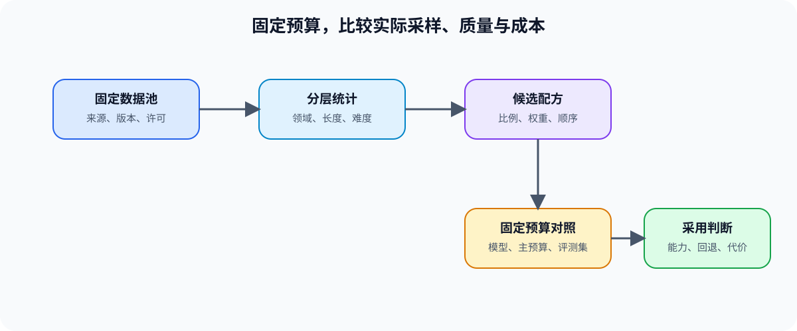

# 03 数据配比与难度递进

## 学习问题

清洗与切分确定了哪些数据可以使用，采样决定它们在训练中出现多少次。数据配方是来源、长度、难度、采样比例和呈现顺序的组合；同一数据池，按样本数或词元数配比，模型读到的内容可能相差很大。

下面直接比较两组长度不同的训练样本，演算样本比例怎样转成词元比例。训练数据池、验证集与最终测试集分别固定，配比选择使用验证集；演算数量仅用于说明计量差异。

## 一半样本为什么可能占九成词元

假设通用组和领域组各有1000条可用样本，使用相同分词器与模板后，每条分别恰好有100和900个非填充输入词元。两组各抽一半样本时，每对样本贡献100与900个词元，领域组占全部输入词元的90%。若希望两组各占一半词元，通用样本数就要是领域样本数的9倍。

把两种配方都限制为180000个非填充输入词元，可以得到下面的演算。这里的计数包含提示、回答和模板中的非填充位置，尚未计算各条样本实际参与损失的目标数。

| 配方 | 抽取的样本数 | 通用组／领域组输入词元 | 合计 |
|:---|:---|:---|:---|
| 按样本数各半 | 通用180条，领域180条 | 18000／162000 | 360条，180000词元 |
| 按输入词元数各半 | 通用900条，领域100条 | 90000／90000 | 1000条，180000词元 |

## 采样概率与实际读入量分别记录

真实样本长度有波动。先选择来源、再在组内抽样时，设定的是抽样概率；实际词元占比还取决于抽到了哪些长度、截断删除了多少内容，以及达到预算时怎样结束最后一个批次。因此同时记录目标概率、各组实际抽取次数、不同样本数量和处理后的词元总数。有放回采样允许同一条记录多次出现，重复次数也会改变它对训练的影响。

输入词元数、有效监督目标数和填充后位置数分别回答不同问题：模型实际读入多少内容、多少预测进入损失、批次占用了多少位置。仅回答监督时，较长的提示会增加输入量，却未必增加有效目标。主预算可以选择其中一种并说明理由，其他计数同步报告；批大小相同时，固定训练步数也未必固定词元量。

## 预训练怎样把语料比例落实到读取过程

预训练语料可以按来源分成若干文件分片，每个分片保存一部分文档。采样器先决定读哪个来源，再按既定顺序读取文档、分词并组成训练窗口。来源比例因而要按实际读入的词元统计：短文被补齐、长文被切成多个窗口、文档之间加入结束标记，都会影响最终数量。跨文档是否允许互相读取、剩余不足一窗口的内容怎样处理，也随输入规则记录。

假设一份文档处理后有10个词元，窗口最多容纳4个，且此例按每次前进4个词元组织内容。读完前两个窗口后，还剩第9、10个词元；恢复时仅记“这份文档处理过”会漏掉尾部，仅从文档开头重读则会重复前8个词元。需要保存文档内位置、尚未组成窗口的余量，以及来源选择、打乱顺序和随机状态。多进程加载时还要区分已经预取的数据与真正用于更新的数据，恢复记录与训练检查点对应保存。

模型与优化器、随机状态的保存可先用[Part 00 · 10 状态与恢复](../../00_Prerequisites/10_PyTorch_State_dict_and_Persistence.md)核对；全序列目标继续在[Part 02 · 56 持续预训练](../../02_PyTorch_Algorithms/56_Continual_Pretraining_and_Retention.md)练习。将语料游标与实际更新绑定，是这两个已有入口之外还需验证的内容。

## 在线训练怎样选择下一批任务

在线RL和OPD通常仍从一个有版本的任务池选题，但回答由采样模型当场生成。学生或策略更新后，同一道题的回答长度、成功率和教师反馈都可能变化。除了题目抽样比例，还要记录每题生成几次、得到多少完整回答、评分是否完成、最后使用了多少记录；这样才能解释增加计算后，究竟多看了任务，还是重复尝试了已有任务。

若根据成功率调节难度或采样权重，保存用于调节的训练或验证反馈，以及调整前后的权重。最终测试集继续用于独立比较。比较采样方案时，同时报告题目覆盖、生成词元和训练使用量，避免把更大的生成预算误当成配比本身的收益。

## 按来源、长度或难度安排训练顺序

来源比例决定模型经常见到哪类任务，长度比例决定它有多少机会处理较长上下文，难度比例则改变简单与复杂任务出现的频率。长样本可能只是提示更长，难度标签应有任务依据，例如所需步骤或人工标注。稀有任务被提高采样权重后，既检查覆盖是否增加，也检查同一批样本是否被过度重复。

难度递进是按训练阶段改变顺序或比例，例如先短后长。比较顺序本身的影响时，可以让两侧使用相同抽样成员和出现次数，只改变排列顺序；同时改变成员、权重和顺序时，按整套配方解释结果。分阶段训练还要记录阶段边界和学习率推进规则，便于分清样本顺序与训练配置的共同影响。

## 改变配方后比较什么

配比从清洗后实际可用的数据池出发。若某类来源在解析或过滤时大量丢失，单纯提高其采样权重会反复抽取少数剩余成员。先根据[处理前后的覆盖统计](./02_cleaning_quality_chain.md#filtering-coverage)查明原因，再一起比较实际词元占比、不同样本数和重复次数，判断需要补数、修正规则还是调整权重。

在同一模型、模板、优化器和主预算下，先比较一个明确变化，例如领域组的抽样概率。用验证集选择配方，再在固定最终测试集上比较目标任务与通用任务，保存各类失败和训练成本。若领域得分提高但通用任务退化，按预先设定的容许范围判断取舍；改变长样本比例时还要观察峰值内存、每个有效目标的耗时及输入等待。

训练样本打包（packing）将多条样本放入一个计算窗口以减少填充，还需要保留样本边界、注意力规则和标签。具体长度与边界处理见[Part 02 · 30](../../02_PyTorch_Algorithms/30_Long_Context_Fine_Tuning.md)，输入准备、填充和搬运时间见[PERF-INPUT](../../02_PyTorch_Algorithms/PERF-INPUT_Training_Input_Pipeline_Performance.md)。模型质量比较可沿[模型架构与训练](../model_architecture_and_training/intro.md)或[后训练优化](../post_training_optimization/intro.md)的对应任务继续；RAG的文档抽样则另用查询集比较召回与回答质量。

确定抽取哪些样本后，进入[05 训练输入与采样记录](./05_post_training_data_interfaces.md)核对文本、词元与有效目标的对应关系。
