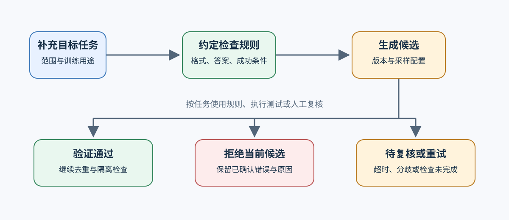
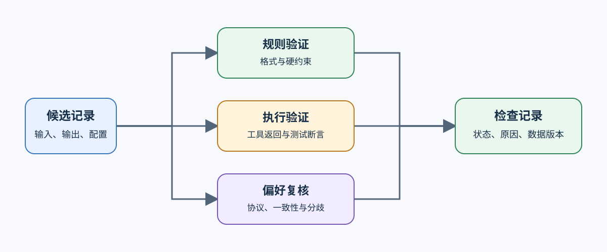

# 04 示范、合成与轨迹验证

## 学习问题

一条示范可以由人编写，也可以由模型或规则生成；工具交互还会留下执行过程与反馈。先把任务要求说明白，再分别检查格式、答案、偏好依据与执行状态。保留候选总量、通过数量、分歧和失败原因，才能判断新增数据覆盖了哪些问题。

下面用一个独立的教学例子：生成分数加法问答，要求回答只包含一个最简分数。题目、候选和处理结果均为构造示例，用来说明验证过程。

## 生成前先确定任务与检查方法

任务说明写明题目范围、输入输出格式、可用工具和判定方法。例如，生成器接收“计算3/4+1/8，只输出一个最简分数”，验证器根据题目独立计算结果，而不是把生成器附带的答案当成标准答案。生成时使用的模型或规则版本、提示模板和采样配置随候选保存，便于解释哪些条件产生了错误。

先划定训练题目范围，保留验证与最终测试任务，再生成训练候选。用于筛选提示、验证规则和生成配方的样本属于开发过程；最终测试题目及其参考答案保持独立。任务改写、数字变体怎样分组，按希望检验的能力约定，并保留实际匹配与复核结果。

## 人工示范和偏好标注怎样保持一致

人工编写示范时，先给出任务要求、可用资料和可接受回答，再用少量样本试标。例如分数题要求“只输出最简分数”，示范回答就同时满足数值与格式；遇到题目含糊或资料不足，标明需要补充信息，再决定是否作为训练示范。编写者、规则版本和复核结果随样本保存，便于发现同一类要求是否被不同人理解成不同意思。

偏好标注还要比较同一问题下的两个回答。若一人认为14/16数值正确应优选，另一人认为它不满足最简格式，应先回到“正确性与格式怎样排序”的规则，保留原判断、分歧原因和复核结论，再决定标签。支持相当、无法判断或需复核的状态，能避免把模糊比较硬写成一对优选与拒选；如果调换候选顺序会改变判断，也把这种差异纳入抽查。具体成对记录检查可用[Part 02 · 50 偏好数据与评测](../../02_PyTorch_Algorithms/50_Preference_Data_and_Evaluation.md)练习。

## 同一道题的候选怎样分流

对3/4+1/8，先检查回答能否解析为分数、分母是否有效、是否满足最简形式，再与独立计算的7/8比较。格式与答案分别记录：14/16数值正确，却未满足本例的最简格式要求；8/9格式合格，答案却错误。生成或验证超时表示结果尚缺，需要重试或复核，不能直接当作错误答案训练。

| 候选或运行结果 | 格式检查 | 答案检查 | 本例处理 |
|:---|:---|:---|:---|
| 7/8 | 单个最简分数 | 等于独立计算结果 | 进入去重与切分检查 |
| 8/9 | 单个最简分数 | 与结果不符 | 拒绝当前回答，保存错误原因 |
| 14/16 | 可解析，但未约为最简 | 数值相等 | 按本例格式要求拒绝；若另行修正，保留原回答与修正方式 |
| 生成或验证超时 | 依阶段可能尚无结果 | 尚未完成 | 记录超时阶段，重试或人工复核 |

## 规则、执行和人工检查各看什么

验证器是执行检查的程序或评审过程。分数题可以用精确算术判断；代码题可以执行测试，但测试通过所说明的是这些输入与断言已满足。工具任务还要检查调用参数、工具返回、执行顺序和最终回答是否对应：程序运行成功，与任务完成正确是两项检查。

开放式回答通常没有唯一标准答案，可以先检查可核实事实，再按预先约定的评分规则做人工或模型评审。模型评审受版本、提示和回答顺序影响；保留评审配置、分歧与抽样复核结果，遇到无法确认的候选就留在待复核集合。下图展示按任务选择的检查分支，它们分别产生结果与失败记录。

## 检查结果怎样成为奖励

奖励是训练中按指定规则对回答或动作给出的数值反馈，可以来自精确计算、代码测试、环境结果，也可以来自学习了人工偏好的奖励模型。以分数题为例，可以约定“数值正确且为最简格式得1分，其余已完成检查的回答得0分”。这样7/8得1分，8/9和14/16都得0分，但两条零分记录的原因分别是答案错误和格式不符。保留格式、正确性等原始检查结果，才能解释总分，也便于比较另一种评分规则。

这个规则同时奖励正确性与格式，换成只检查数值是否相等时，14/16的分数就会改变。因此每次评分都记录规则或奖励模型版本、所评回答及检查状态。验证器超时表示评分未完成，先单独保存；若任务明确把某类超时计为惩罚，还需说明是哪类超时、采用什么分数，避免把评分服务故障混入模型答错的统计。

## 工具交互为什么要保留中间步骤

轨迹是一道任务从开始到结束的过程记录。模型按当前上下文选择下一词元或工具动作的方式称为策略；保存策略版本，可以找回当时用哪个模型生成了记录。一次调用计算器的过程可能是：模型请求计算3/4+1/8，工具返回7/8，模型再输出最终回答。记录中既要保留调用参数、工具返回和最终回答，也要知道每一步当时看到了哪些信息。

在Agentic RL中，任务成功可能到最后才获得奖励，而模型已经做出了多次动作。保存动作顺序、工具与环境版本，以及任务完成、执行失败或达到步数上限等结束原因，有助于训练侧判断反馈对应哪些步骤。一个写好的成功示范可用于模仿；在线更新则还要核对实际采样策略和算法所需的概率等信息。检查字段完整之后，奖励怎样影响动作更新可继续阅读[后训练的奖励、回报与优势](../post_training_optimization/06_rlhf_and_ppo_system_cost.md)。

受控环境的终止、截断和动作回报可在[Part 02 · PT-AGENTIC-RL](../../02_PyTorch_Algorithms/PT-AGENTIC-RL_Environment_Trajectory_and_Credit_Assignment.md)练习；同一条轨迹怎样预留给一次更新、怎样检查版本，则进入[Part 02 · PT-ROLLOUT-LIFECYCLE](../../02_PyTorch_Algorithms/PT-ROLLOUT-LIFECYCLE_Rollout_and_Policy_Freshness.md)。两者分别处理环境交互与训练使用状态。

## 学生生成、教师反馈需要关联哪些记录

在策略蒸馏（On-Policy Distillation，OPD）可以先让当前学生模型生成回答，再由教师对学生已经走过的上下文提供反馈。例如，学生计算分数时写出了错误的中间步骤，教师仍可在这个前缀下给出下一词元的概率分布。先保存学生实际生成的序列，再关联教师看到的上下文、教师版本与反馈位置，才能找回本次训练比较了什么。

这里的教师反馈可以是概率或分布，具体形式按蒸馏方法选择；它与上一节给整条回答打出的正确性分数承担不同作用。已有固定示范和当前学生采样也要分别标记来源，保存采样模型、模板、分词器、生成配置和结束状态。失败重试时保留原尝试；只重做教师反馈与让学生重新生成回答，会得到不同的记录。

## 通过验证后怎样整理成训练数据

### 把分数例子做成一次完整流程

先用固定训练题目生成多条尝试，为每次尝试分配ID，并保存生成规则与原回答。例如同一道题分别产生7/8、14/16和8/9时，验证程序用精确分数运算独立求值，同时检查最简格式。格式检查、数值检查、运行失败分别保存，后续筛选只读取这些检查结果，原始尝试继续保留。

通过筛选后，按题目身份去重与切分：同一道分数题的措辞变体归入同一组，分配到同一数据集合。另留从未用于改提示或改规则的题目检查生成配方，报告尝试数、完成检查数、通过数、去重后可用数和独立题目覆盖。生成与验证耗时分别记录，再计算每条最终可用样本的成本。CPU练习先用确定性规则生成，之后替换为模型生成器时，继续使用相同的验证与记录流程。

这段是待建设CPU闭环的操作说明；当前[合成指令练习](../../02_PyTorch_Algorithms/PT-SYNTHETIC-DATA_Instruction_Generation_and_Verifier_Admission.md)检查给定候选与验证记录。完整生成、执行验证和切分的运行入口及结果在[实验资产表](./experiment_assets.md)另行登记。

### 按训练方法选择记录

7/8通过本例检查后，还要核对该题与训练池、验证集和最终测试集的重复关系。同一题换一种措辞时保留其任务关联，按既定隔离规则选择成员；大量相似变体则统计来源、题型和难度分布。错误回答、待复核回答与通过回答分别保存，比较生成配置时同时报告总量、通过量及失败类型。

通过的回答可以成为SFT示范；构造偏好对时，还要确认两个回答对应同一上下文，且优选、拒选的依据可靠。在线强化学习另外要求算法所需的实际采样轨迹、策略版本、奖励和终止状态。OPD则保留学生实际访问的前缀及教师反馈；其中答错的前缀也可能是训练所需内容，按蒸馏方法选择成员，并单独保留正确性检查结果。

生成配置和验证分流可结合[Part 02 · 合成指令生成与验证](../../02_PyTorch_Algorithms/PT-SYNTHETIC-DATA_Instruction_Generation_and_Verifier_Admission.md)练习。候选返回[02 清洗与评测隔离](./02_cleaning_quality_chain.md)，再按[05 训练输入与采样记录](./05_post_training_data_interfaces.md)准备学习所需字段；涉及工具调用时，继续核对[智能体轨迹中的执行记录](../agent/01_agent_trajectory_data.md)。
