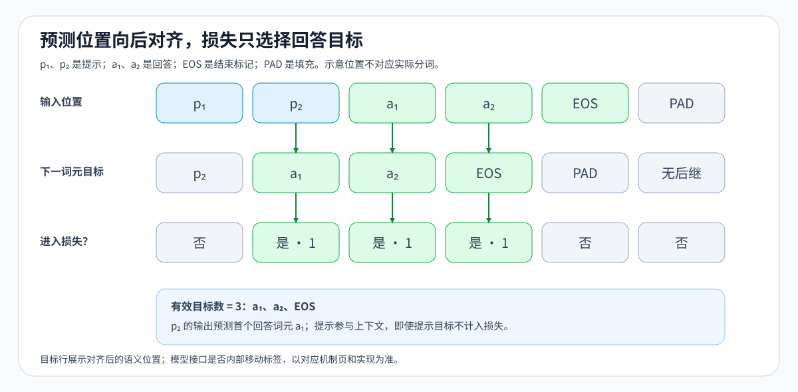

# 05 训练输入与采样记录

## 学习问题

相同的来源记录，用于训练、检索或模型评测时，要变成不同输入。本页先按用途选择分支，再展开训练样本和在线记录；已有模型的评分比较可直接进入09／10。

<a id="task-input-branches"></a>

## 输入准备好后，怎样进入所选任务

一份服务时间说明可以变成三类对象：训练时是带标签的问答，检索时是带来源的片段，评测时则是问题、参考依据与评分规则。先选本次用途，再核对实际送入程序的对象；运行结果也分别保存为训练统计、检索返回或逐题评分。

| 本次用途 | 输入与结果怎样对应 | 继续阅读 |
|:---|:---|:---|
| 训练与在线更新 | 文本或采样记录 → 词元、目标位置和有效数量 → 损失与更新 | 继续本页下文 |
| 检索语料 | 文档与访问条件 → 片段、索引 → 查询返回及原文位置 | [07 检索切块与索引](./07_retrieval_chunks_and_index_updates.md) |
| 模型评测 | 独立问题与参考依据 → 实际回答 → 评分、失败及同题比较 | [09 逐样本评分](./09_model_evaluation_metrics_and_scoring.md) → [10 基线比较](./10_baseline_comparison_and_regression.md) |

## 训练分支从文本与采样记录开始

一条经过清洗的记录，要按学习目标准备不同输入：自回归预训练把语料组织为预测后续词元的序列，监督微调（SFT）根据示范构造目标，偏好学习比较同一上下文下的候选，在线训练还记录实际采样与反馈。内容从文本变成词元后，需要重新检查预测位置、样本边界和有效数量。

用“问题：1+1等于几？回答：2”作为简短问答示例，观察它怎样经过模板和分词变成模型输入，再区分哪些位置可以被关注、哪些预测参与损失。下图展示不同学习目标需要检查的记录，在线分支使用实际采样轨迹。


## 文本怎样变成词元与标签

对话模板先将角色与消息拼成模型约定的格式，分词器再转成词元编号。角色标记、回答边界和结束标记都可能占用位置，因此长度在应用模板并分词后统计。将处理结果反解或逐位置查看，核对问题、回答与结束标记是否符合预期，再构造标签。

用下面六个位置表示一条简化样本：p1、p2代表提示部分，a1、a2代表回答，EOS是结束标记，PAD是为批处理补齐的填充。这些符号只表示位置关系，不对应真实中文分词。示例采用右侧填充、仅回答监督且包含结束标记；标签按输入位置保存，由计算损失的一侧完成一次下一词元移位。

```text
input_ids:      [p1,   p2,   a1, a2, EOS,  PAD]
labels:         [-100, -100, a1, a2, EOS, -100]
attention_mask: [1,     1,    1,  1,   1,    0]
position_ids:   [0,     1,    2,  3,   4,    0]
```

`input_ids`保存词元编号，`labels`保存待预测的目标，本例用−100表示忽略该目标位置。`position_ids`标识有效序列中的位置，填充位置的0只是本例约定。训练接口若已在内部移动标签，数据侧就保持上述对齐方式；接口要求预先对齐时，按其约定构造，并检查实际损失使用了哪一对位置，避免移动两次。

<a id="tokenization-checks"></a>

## 分词后怎样发现内容和模板问题

固定分词器、词表及模板版本后，对照原文本查看实际词元、角色边界、结束标记和截断位置。例如模板已经添加结束标记，数据侧又手动添加一次，就会多出一个目标；模型要求的角色标记被当成普通文本处理时，输入边界也可能变化。保留实际生成的词元编号与配置，抽样反解查看内容；反解时忽略特殊标记或空白规范化会影响显示，因此同时检查词元序列，而不是只凭反解文本判断。

按来源和语言比较分词后的长度，查看异常变长、未知词元或替换字符等现象。相同字符数量产生不同词元数有时来自语言与编码方式，也可能来自损坏文本或错误模板，先回查具体样本再调整规则。截断后继续核对回答、表格条件或工具观察是否保留，填充位置则按实际掩码处理；分词器把填充与结束标记设为相同编号时，单看编号无法区分二者。

## 上下文可见与参与损失分别控制

本例的一维`attention_mask`区分有效输入与填充；有效位置之间另按因果规则，只能读取当前及更早的词元。标签掩码则选择进入损失的目标。提示虽被标为−100，仍提供回答所需上下文；把提示从注意力中排除，会使模型读不到问题。

下一词元预测把提示末尾p2的输出与a1比较，a1的输出与a2比较，a2的输出与EOS比较。本例因此有5个非填充输入位置、6个填充后位置，以及3个有效预测目标。它们分别用于统计输入量、计算窗口大小和损失平均的分母。下图展示移位后的预测关系，与上面按输入位置保存的标签相对应。



<a id="pretraining-and-sft-targets"></a>

## 预训练与SFT怎样选择预测目标

自回归预训练通常直接处理语料文本，输入形式按模型训练方案确定，对话模板只是其中一种选择。用t1、t2、t3表示一段文档的三个词元，接一个结束标记，再补一个填充位置。沿用本页“标签按输入位置保存、损失侧移位一次”的约定，可以写成下面的教学例子。首位置的−100明确表示本窗口没有为t1提供更早的预测上下文。

```text
input_ids:      [t1,   t2, t3, EOS,  PAD]
labels:         [-100, t2, t3, EOS, -100]
attention_mask: [1,     1,  1,   1,    0]
```

移位后比较t1预测t2、t2预测t3、t3预测EOS，共3个有效目标。前面的SFT例子也有3个目标，但它们是回答a1、a2和EOS：问题保留为上下文，按仅回答监督规则排除问题目标。因此只看目标数量相同，还需要逐位置查看模型实际学的是哪些内容。完整序列参与损失的SFT也有相应用途，监督范围按训练选择声明。

多篇文档组成窗口时，另选跨文档连续预测或文档间隔离等规则，再配套设置注意力、位置与边界标签。结束标记提供文档结束信息，真正限制跨文档读取的是相应注意力规则。窗口切法还会决定哪些词元有前文可用于预测，应与来源、文档内位置和实际有效目标一起记录。

全序列标签和有效目标计数可用[Part 02 · 56 持续预训练与能力保留](../../02_PyTorch_Algorithms/56_Continual_Pretraining_and_Retention.md)练习，再与[Part 02 · 13 SFT监督边界与损失](../../02_PyTorch_Algorithms/13_SFT_Training_Loop.md)比较。56中的恢复字段检查用于发现缺项，实际语料读取进度与续训一致性仍需单独核对。

## 不同学习目标需要哪些样本字段

| 数据类型 | 基本对象 | 要检查什么 | 主要风险 |
|:---|:---|:---|:---|
| 自回归预训练 | 语料、文档边界、词元窗口及采样进度 | 目标移位、文档连接规则、来源词元量与读取位置 | 窗口遗漏或重复、跨文档规则不一致、来源比例偏离 |
| SFT | 原始问题/消息与示范回答；处理后生成`input_ids`、`labels`等 | 模板与标签对齐，有效目标符合所选监督范围 | 模板错位、答案截断、重复指令 |
| 偏好 | `prompt`、`chosen`、`rejected` | 同一上下文下的可比较候选；偏好来源可追溯 | 候选质量接近、标注不一致、泄漏 |
| 推理过程示范 | 问题、示范过程、答案、验证记录 | 若作为SFT，核对哪些回答位置参与损失，以及过程和答案是否通过检查 | 过程错误、答案泄漏、只拟合表面格式 |
| 在线强化学习轨迹 | 提示、生成序列、策略版本、奖励与终止状态；工具任务另含动作和观察 | 按所选算法保留采样概率等训练所需量，核对奖励来源及轨迹是否仍可用于当前更新 | 策略版本过旧、奖励失效、轨迹不完整或重复使用 |
| 学生在策略蒸馏 | 学生生成序列、教师反馈、双方版本与预测位置 | 核对教师和学生所处理的上下文、词元对应及参与训练的位置 | 教师反馈对应了另一条回答，位置错移，或混淆固定轨迹与当前采样 |

<a id="reward-return-advantage"></a>

## 奖励、回报和优势分别告诉训练什么

奖励记录一次反馈的分数；回报汇总从某个动作开始的后续奖励，采用折扣时还会降低较远奖励的权重；优势则衡量动作或回答相对某个比较基准表现如何。比如一道任务需要先调用工具、再作答，成功奖励只在最后给出时，前面的动作也可能通过后续回报得到学习信号。训练侧怎样传播这个信号，取决于更新方法和任务的结束方式。

先看更简单的整条回答比较：同一问题采样三个回答，任务奖励为0、1、1。若选择这组奖励的均值2/3作为基准，仅做中心化，三个相对分数就是−2/3、1/3、1/3。它们表示相对同组平均的表现。采用标准差缩放、排除当前回答后求均值，或用价值模型估计预期回报，会得到不同的优势计算方式，具体过程见[后训练的组内奖励与优势](../post_training_optimization/07_grpo_and_groupwise_alignment.md)和[PPO的价值与优势](../post_training_optimization/06_rlhf_and_ppo_system_cost.md)。

数据侧先保存任务与回答编号、实际采样组成员、奖励明细、评分状态和策略版本；优势由训练侧按选定算法计算。上例若有一条评分超时，就先保留未完成状态，再按约定重试或处理整组，不能静默填0后沿用原组比较。若保存了已经计算的优势，还要附上计算配置及其所用的组成员或价值估计，避免混用不同分组和规则的结果。

<a id="distillation-positions"></a>

## 教师反馈怎样对应学生的预测位置

假设学生已经生成a1、a2，教师对“提示加a1”给出的下一词元反馈，应对应学生在同一前缀下预测a2的位置。把它配到预测a1的输出上，就改变了比较的上下文。若比较完整词表分布，还需确认两侧每一维对应同一个词元；不同分词器需要明确的映射或其他蒸馏方案。保存原始文本并不能自动解决词元位置的差异。

提示、填充和工具返回可以为后续生成提供上下文，参与蒸馏的位置则按训练规则另选。例如工具给出了7/8，模型据此输出最终回答时，可以保留工具返回作为上下文，只在模型生成的位置计算目标。有效位置数用于归约所选损失，具体掩码和分布比较见[Part 02 · DISTILL-OPD 在策略蒸馏与GKD](../../02_PyTorch_Algorithms/DISTILL-OPD_On_Policy_Distillation_and_GKD.md)。

## 截断和样本打包会改变什么

对示例序列保留到a1时，只剩一个有效回答目标；只保留p1、p2时，则没有回答目标。截断后重新检查回答保留量与结束状态，选择拒绝、重新组织上下文或其他已声明的处理方式。结束标记表示回答完成，截断出的半段回答应按截断状态处理，避免误教模型提前结束。

样本打包把多条短序列放进一个窗口，可以减少PAD。独立问答拼在一起时，还要限制每条只读取本样本的上下文，并核对跨样本处的下一词元目标。单独插入EOS不会自动建立注意力隔离。位置编号是否重新开始、边界标签怎样处理，也按选定的独立样本或连续文档训练方式声明；现成的模型接口或计算内核需要支持相应规则，才能按该方式执行。

## 评测数据如何交给后训练决策

把评测样本、内容版本、提示处理方式和各类失败记录一起保存，训练前后才能读取同一批问题。验证集用于选择配置，最终测试集在选择完成后比较模型；若改变了评测模板或最大长度，记录变化并重新计算受影响的对照结果。

| 交付对象 | 数据工程需要提供 | 后训练侧据此判断 |
|:---|:---|:---|
| 冻结评测快照 | 数据版本、冻结时间、样本 ID 与内容指纹 | 基线与候选是否比较同一批样本 |
| 污染报告 | 与训练、偏好、轨迹和调参样本的精确 / 近似命中 | 当前评测是否仍可作为独立证据 |
| 输入协议 | 提示或对话模板、分词器、上下文与截断规则 | 输入变化是否被误判为模型变化 |
| 切片清单 | 任务、语言、长度、难度、安全类别及样本数量 | 总体均值是否掩盖局部退化 |
| 失败样本集 | 解析失败、截断、评分冲突、超时与无法判定状态 | 失败是否触发补数、复评或拒绝候选 |

## “假学会”如何诊断

如果损失下降、独立任务却没有改善，回查模型实际训练了哪些位置。例如，提示也被误计入损失时，较容易预测的提示词可能影响总体平均值；回答被截断时，目标任务的有效监督可能很少。分别统计目标位置、重复关系与任务类别，再结合评测失败区分数据处理和训练设置问题。

| 观察到的现象 | 数据工程优先检查 | 后训练侧继续验证 |
|:---|:---|:---|
| 训练损失很低、验证无提升 | 重复、污染、切分与标签对齐 | 独立评测与行为回归 |
| 格式正确、内容质量差 | 指令/答案质量与任务配比 | SFT 配置与模型能力边界 |
| 偏好训练不稳定 | 优选与拒选回答的可比性及标注一致性 | 偏好目标参数、参考模型与损失计算 |
| 推理过程冗长但答案错误 | 过程验证、结果验证与长度偏差 | 奖励与评审器设计 |

## 从输入检查进入训练与复测

标签与损失对齐见[Part 02 · 13](../../02_PyTorch_Algorithms/13_SFT_Training_Loop.md)，长度、截断和独立样本打包见[Part 02 · 30](../../02_PyTorch_Algorithms/30_Long_Context_Fine_Tuning.md)，有效目标数怎样影响梯度累积见[模型架构与训练的损失归约](../backpropagation_training_mechanism/03_loss_reduction_gradient_accumulation_effective_update.md)。在线分支另读[轨迹与策略版本](../../02_PyTorch_Algorithms/PT-ROLLOUT-LIFECYCLE_Rollout_and_Policy_Freshness.md)，训练后的质量与能力保持按[后训练独立评测](../post_training_optimization/10_evaluation_and_adoption_decision.md)比较；数据版本与处理变更继续在[06 流水线与下游验证](./06_pipeline_lineage_and_downstream_validation.md)中汇总。
