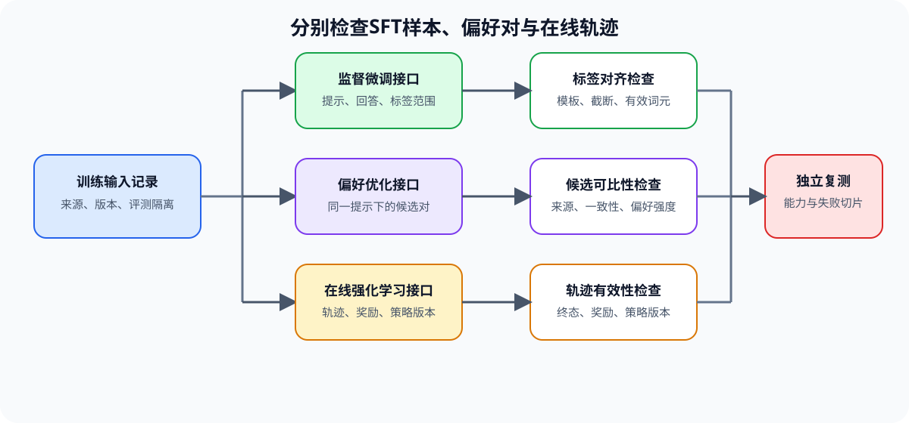

# 05 后训练数据接口与诊断

## 学习问题

后训练数据不是“文本拼成 JSONL”即可使用。SFT、偏好和推理数据共享来源、版本、去污染与评测隔离，但监督信号、格式契约和失败模式不同。本页将上游数据处理连接到训练可消费的接口与独立质量验证。

## 三类监督信号需要什么数据接口

| 数据类型 | 最小对象 | 核心契约 | 主要风险 |
|:---|:---|:---|:---|
| SFT | `prompt` / `messages`、`response`、`labels` | 对话模板与标签掩码对齐；不训练无关词元 | 模板错位、答案截断、重复指令 |
| 偏好 | `prompt`、`chosen`、`rejected` | 同一上下文下的可比较候选；偏好来源可追溯 | 候选质量接近、标注不一致、泄漏 |
| 推理过程 | 问题、过程、答案、验证信号 | 过程粒度可解释，结果可由规则或独立评测核验 | 过程伪造、答案泄漏、只拟合表面格式 |

## 训练前的最小检查

| 检查 | 需要确认 | 失败时的处理 |
|:---|:---|:---|
| 字段结构 | 必填字段、类型、消息顺序与模板 | 拒绝写入训练集，保留失败原因 |
| 分词器与标签 | 截断、特殊词元、损失掩码与目标词元 | 用小批样本逐项检查标签对齐 |
| 数据切分与去污染 | 训练、验证、测试与外部基准隔离 | 记录匹配规则、重复组和例外 |
| 数据分布 | 领域、长度、语言、难度与安全类别 | 调整配比或补充缺失样本 |
| 下游质量 | 独立任务、行为回归与人工失败样本 | 不以训练损失单独接受数据版本 |

## 评测数据如何交给后训练决策

后训练项目不能只接收一个测试文件路径。数据侧需要交付冻结快照、输入协议、切片和失败样本，使 SFT、DPO、PPO 或 GRPO 候选能够在相同输入条件下复测。

| 交付对象 | 数据工程需要提供 | 后训练侧据此判断 |
|:---|:---|:---|
| 冻结评测快照 | 数据版本、冻结时间、样本 ID 与内容指纹 | 基线与候选是否比较同一批样本 |
| 污染报告 | 与训练、偏好、轨迹和调参样本的精确 / 近似命中 | 当前评测是否仍可作为独立证据 |
| 输入协议 | 提示或对话模板、分词器、上下文与截断规则 | 输入变化是否被误判为模型变化 |
| 切片清单 | 任务、语言、长度、难度、安全类别及样本数量 | 总体均值是否掩盖局部退化 |
| 失败样本集 | 解析失败、截断、评分冲突、超时与无法判定状态 | 失败是否触发补数、复评或拒绝候选 |

质量指标、评审器一致性、安全门槛和 `accept / tune / reject` 由[后训练独立评测与采用决策](../post_training_optimization/10_evaluation_and_adoption_decision.md)处理；数据接口保证这些判断读取的是同一份、未污染且可追溯的输入。

## “假学会”如何诊断

训练损失下降只说明模型更能拟合当前标签。若独立任务没有提升、输出模板看似正确但事实或工具结果错误，先检查数据泄漏、模板、标签范围、重复样本和评测覆盖，而不是先提高训练步数。

| 观察到的现象 | 数据工程优先检查 | 后训练侧继续验证 |
|:---|:---|:---|
| 训练损失很低、验证无提升 | 重复、污染、切分与标签对齐 | 独立评测与行为回归 |
| 格式正确、内容质量差 | 指令/答案质量与任务配比 | SFT 配置与模型能力边界 |
| 偏好训练不稳定 | 优选与拒选回答的可比性及标注一致性 | β、参考模型与目标函数 |
| 推理过程冗长但答案错误 | 过程验证、结果验证与长度偏差 | 奖励与评审器设计 |

## 数据版本何时可以进入训练比较

一份 SFT、偏好或推理数据集需要同时提供字段结构、样本版本、污染检查、标签检查、分布摘要、冻结评测快照和失败样本记录。[后训练优化](../post_training_optimization/intro.md)在这些输入固定后比较训练候选；质量指标、评审器一致性和采用门槛由[独立评测与采用决策](../post_training_optimization/10_evaluation_and_adoption_decision.md)统一检查。
