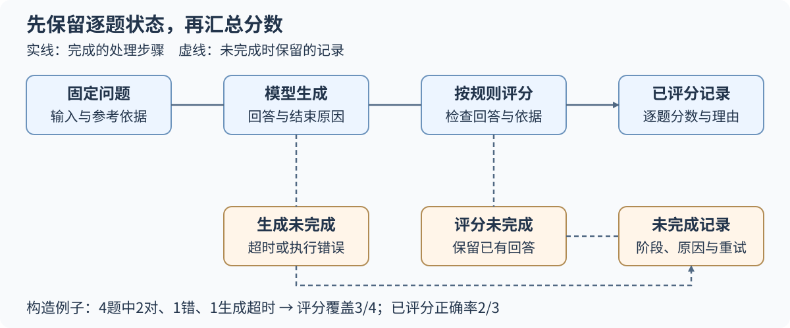

# 09 模型评测目标、指标与逐样本评分

## 学习问题

一个模型回答更流畅，是否也更准确？工具返回成功，是否意味着任务完成？模型评测先把“希望模型做到什么”写成可观察的要求，再用独立问题检查回答与行动。

以下使用构造的设备问答：既问工作日与周末的服务条件，也问资料没有提供的信息。先看怎样判断一条回答，再解释分数、失败和样本数量怎样汇总。实际模型是否改善，需要按这些约定运行后再比较。

## 先把使用目标变成可检查的要求

如果任务是根据说明回答服务时间，目标至少包括事实正确、适用条件完整，以及资料不足时如实说明。问题集中既要有直接查找，也要有“周六是否提供支持”这样的条件判断。若目标还包括工具调用，就检查模型是否调用了合适工具、参数是否正确、返回内容是否支持最终结论。

评测单位可以是一条回答、一次完整任务或一次工具动作，先明确选哪种。同一任务采样多次时，再声明比较单次成功、平均成功还是固定次数内至少成功一次；采样次数改变，就同时改变了完成任务的机会和运行成本。时间、词元与工具调用量随任务结果一起记录。

## 一条回答怎样得到分数

先写出参考依据和评分规则，再执行模型。对“周六是否提供支持”，参考说明若明确周末不提供，回答就要保留这个条件；对资料没有说明的问题，可以接受明确说明未知并提出合理的补充信息需求。开放式问答允许多种正确措辞，逐字相等更适合有严格格式要求的输出。

不同任务可以采用不同评分方式，选择时看它能检查什么，并保留无法确认的情况。多个维度分别评分时，先保存各项结果；总分如何加权、哪些要求必须满足，在看候选结果之前确定。

| 评分方式 | 适合检查什么 | 需要保留的依据 |
|:---|:---|:---|
| 规则或精确答案 | 分数计算、字段、严格格式 | 原问题、规范化规则、正确性和格式各项结果 |
| 执行测试 | 代码行为、工具操作或环境任务 | 实际输入、测试与环境版本、执行结果及覆盖的断言 |
| 人工或模型评审 | 有多种可接受回答的任务 | 评分准则、参考资料、评审版本、原判断和复核记录 |

## 答错、运行失败和未能评分分别怎样统计

设计划评测4道题：模型在其中2道答对、1道答错，另1道生成超时。若3条完整回答都评分完成，可评分覆盖为3/4，已评分回答的正确率为2/3。若任务还要求每题在时限内给出正确回答，则按预先约定的完成标准，总体任务成功率为2/4。报告指标名称与分母，读者才能区分回答质量与运行可靠性。

若第4道其实生成了回答，只是评分服务超时，就保留回答和未评分状态，重试或复核；这与生成未完成是不同原因。缺失结果不直接填成普通零分。需要把失败纳入某项任务指标时，明确适用的失败类型与规则，并同时报告覆盖和失败数量。全部未评分时保留未知状态，再修复采集或评分过程。

## 总分之外还要保留哪些分类

按任务、语言、输入长度、资料是否充分或工具类型分别汇总，称为评测切片。例如总体答对更多，但“资料不足”这一类仍不断编造答案，就应保留该类的问题数、成功数和具体错误。样本很少的类别先报告原始数量，再决定是否补充评测，避免用一个百分比掩盖它只有两道题。

常规任务质量、安全要求和拒答情况也分别记录。对于应拒绝的问题检查是否安全处理，对于正常请求检查是否误拒。最终是否满足使用要求，由任务或项目预先定义的条件判断，而不是把所有差异压成一个平均数。

## 训练反馈怎样与独立评测配合

训练奖励用于构造更新信号，OPD的教师反馈用于指导学生；独立评测则检查模型在留出任务上的行为。即使采用类似算术规则，也分别保存训练任务、验证任务与最终测试的用途及版本。用验证结果选择规则或模型，候选确定后再进行最终比较。

对于RAG，先检查相关资料是否被找回，再检查回答是否有依据且正确；资料找到了，模型仍可能误读条件。对于Agent，动作文本合理之外还要核对环境结果。逐题保存实际回答、评分依据与失败阶段，就能在发现低分时回查原因：模型误读、工具未完成，还是评分本身出了问题。

读完后，先为一个具体问题写出参考依据与评分规则，再对照图中四题例子，算出评分覆盖、已评分正确率和限时任务成功率。[Part 02 · 50 偏好数据与评测](../../02_PyTorch_Algorithms/50_Preference_Data_and_Evaluation.md)提供已有成对分数的统计与评分一致性练习；逐条回答的评分规则由具体任务确定，50节不负责生成回答或执行通用评分器。

训练后的专项要求见[后训练独立评测](../post_training_optimization/10_evaluation_and_adoption_decision.md)。准备基线与候选比较时，继续阅读[10 基线比较、评分复核与能力回归](./10_baseline_comparison_and_regression.md)。
