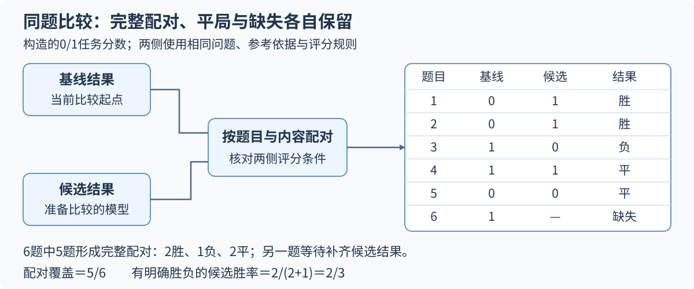

# 10 基线比较、评分复核与能力回归

## 学习问题

候选总分高了，但它是否在同一批题上比较，原来会做的问题是否退化？先把双方回答对应到同一道题，再检查评分、任务类别和重复运行中的变化，才能解释差异来自哪里。

下面用构造的成对结果比较胜负、平局与缺失，再观察总体改善怎样掩盖工具任务退化。实际比较前，先说明希望改善什么，以及哪些能力和资源条件需要保持。

## 先让两侧结果对应同一道题

基线是固定的比较起点，候选是要研究的改动。先按题目编号找回双方回答，确认题目内容与参考依据相同，再看回答怎样生成和评分。例如候选多获得一次工具查询，分数差异就同时包含工具帮助；评分器中途换了版本，同一回答也可能得到不同分数。记录这些变化，才能判断比较的是模型本身，还是模型、工具与输入组成的整套方案。

比较模型本身时尽量保持其他条件一致；有意比较不同模板、工具或检索方案时，则按声明的变化解释结果。两种模型需要不同分词器时，保存各自实际输入，再核对内容是否相同；字符或词元数量相同也可能对应不同信息。

假设5道题都有双方可比较的分数，候选在2道更高、1道更低、2道相同。非平局胜率为2/3，平局仍占已评分比较的2/5。如果原计划还有第6道题，但任一侧评分缺失，则成对覆盖为5/6；保留缺失原因，再决定补测。只展示2/3会遗漏平局与覆盖信息。

全部平局时，先报告完成数量与平局数量，此时没有胜负可用于计算非平局胜率。读取实现结果时同时查看明确判决数：有些接口用0作占位值，解释结果时仍按“没有明确判决”处理，不能把这个0当作候选全输。

## 每题差值与分类结果怎样一起看

当评分含义与尺度相同时，可以先逐题计算“候选减基线”，再对相同成员求平均。例如两道题的差值分别为1和−1，平均差为0，但实际发生了一项改善与一项退化。除了平均差，还保留每题变化、胜负平数量与任务类别；不同评分尺度的类别先分别报告，再按预定方式合成。

成员缺失时可以另报完整配对部分的差异，同时保留全体计划的覆盖与失败；不能悄悄删去候选失败的题目后只比较剩余部分。重复任务、同源改写和同一任务的多次生成也要标明关系，避免把许多相关结果解释成同等数量的独立问题。

## 怎样发现评分器自己的变化

选择一批相同回答重复评分，再交换基线与候选的展示顺序。交换后先把判断重新对应到原模型，再按同一任务比较，而不是只看两次总体胜率是否接近。如果原本优选A，交换位置后又优选了展示在前面的B，就需要检查位置偏好或评分准则是否含糊。

保存评审模型或人工规则版本、提示、参考依据、原始判断与抽检结论。重复判断一致，说明这组条件下评分比较稳定；判断是否符合任务要求，还要与有依据的人工复核或可执行结果对照。评分器可以稳定地误判，尤其需要检查难例、边界样本与模型互有胜负的情况。

## 差异会怎样受到样本和重复运行影响

随机生成、工具环境与评分过程都可能带来变化。固定配置进行有界重复，分别记录每次结果，而不是挑选最高分。种子能帮助复查部分随机过程，仍需保存实际回答及运行环境；重复同一批问题主要观察运行波动，增加独立问题则是在补充任务覆盖，两者作用不同。

如果采用重采样或置信区间来描述差异，先说明抽样单位、配对方式和适用假设。同一道任务的两侧结果保持配对；同源或重复生成的记录需要考虑其关联。区间描述所选数据与计算方法下的不确定性，目标场景遗漏、评分偏差与测试污染仍要另外检查。第一轮比较可以先报告数量、逐题差异和重复结果，再按决策风险补充统计分析。

## 总体改善时怎样检查能力退化

能力回归在这里指原有任务表现退化。设100个任务中有20个工具任务：基线分别答对15个工具任务和60个其他任务，总体75%；候选分别答对10个和70个，总体80%。总体提高5个百分点，工具任务成功率却从75%降到50%。因此目标任务之外，还需保存希望保持的任务集，按类别比较。

| 比较结果 | 接下来检查什么 | 结论如何限定 |
|:---|:---|:---|
| 目标任务改善，其他必需类别与资源要求满足 | 复核失败记录与重复结果 | 按已测任务和运行条件保存候选 |
| 总体改善，但某类必需能力下降 | 回查该类输入、回答、评分与变化来源 | 按事先约定的容许范围决定调整或保留原方案 |
| 差异很小、覆盖不足或评分分歧较多 | 补对应类别与复核，保留原始数量 | 记录当前尚不能判断的原因，补测后再比较 |

## 把质量变化带回实际使用条件

模型压缩可能以容许的质量损失换取更低存储或运行成本，能力提升任务则可能要求明确增益。先按目标定义质量和资源条件，再查看相应设备、后端与负载下的测量。例如压缩后延迟下降，但工具任务已低于预定成功率，就保留基线并回查退化；调整后继续在同一比较条件下复测。

成对记录、平局与评分一致性见[Part 02 · 50](../../02_PyTorch_Algorithms/50_Preference_Data_and_Evaluation.md)。训练候选的取舍见[后训练评测与采用](../post_training_optimization/10_evaluation_and_adoption_decision.md)，架构和训练实现变化见[模型架构与训练](../model_architecture_and_training/intro.md)，请求性能则按[推理比较规则](../inference_optimization/07_benchmark_and_decision.md)检查。当前练习与结果范围见[实验资产表](./experiment_assets.md)。
