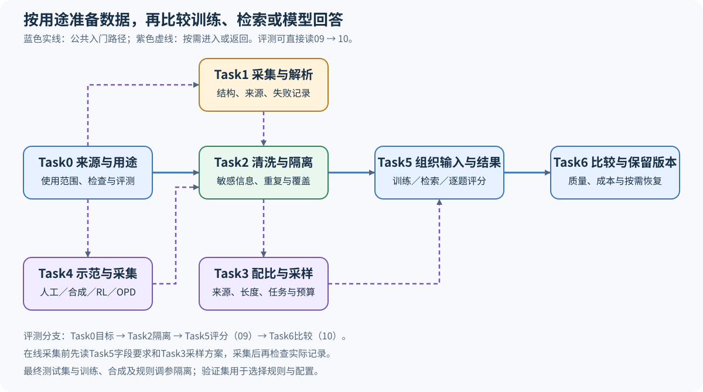
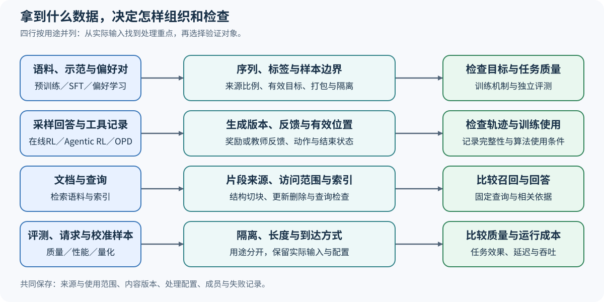

# 数据工程与模型评测（Data Engineering and Model Evaluation）

> 专题类型：横向工程专题　学习目标：准备可复查的数据，用独立任务和明确评分比较模型与方案。

一批网页、文档或历史对话，可以成为预训练语料、微调示范、检索资料或评测题目。一次工具交互也可以留下供强化学习使用的记录。用途决定要保留什么：预训练关心模型读到了多少词元、文档在哪里结束；微调要保留问题与回答的对应关系；检索要保留标题和原文位置；评测要把调参用的问题与最终测试分开。

数据准备解释内容怎样进入训练、检索与测试；模型评测继续检查模型答了什么、任务是否完成，以及改动后哪些能力改善或退化。两者通过独立任务集、实际输入和逐题结果连接。学完后，你应能找回一次运行使用的数据，解释处理改变了什么，并用对应任务比较质量与运行成本。

## 学习路线

首次学习可以用几条已有问答走 Task0 → Task2 → Task5 → Task6：记录来源，检查内容与重复，再查看问答怎样变成训练输入，最后保存版本并复查结果。随后按自己的任务选择下表中的分支。需要从网页或文件提取内容时加入 Task1；比较来源比例和长度时进入 Task3；需要生成示范或采集交互记录时进入 Task4。

已有模型、希望比较回答质量时，先读[09 评测目标与逐样本评分](./09_model_evaluation_metrics_and_scoring.md)，再读[10 成对比较与能力回归](./10_baseline_comparison_and_regression.md)。对应Task0确定目标、Task2检查隔离、Task5运行并评分、Task6比较结果；需要设计输入集合时回补08，需要编写示范或采集新回答时再进入Task4。

Task0先决定怎样留出评测数据，Task2再落实分组、去重与切分。Task4生成的新样本也回到Task2检查重复和泄漏，在线轨迹另按采样策略与算法要求检查。Task6所需的版本和处理记录从第一步开始保存；验证集用于选择规则，最终测试集用于选择完成后的比较。

在线分支采集前，先按Task5确定训练需要的字段，再参考Task3选择任务和采样量；采集后返回Task5检查实际记录。这样可以提前发现工具观察、采样概率或教师反馈等缺项，再开始一批生成。

连续阅读可用[问题链](./walkthrough.md)，已有异常可查[判断手册](./casebook.md)；概念与直接学习入口见[术语表](./glossary.md)，配比及有效位置计数见[公式索引](./formula_reference.md)。

| Task / 主题 | 本阶段要回答的问题 | 学习入口与验证出口 | 学习顺序 | 主要正文入口 |
|:---|:---|:---|:---|:---|
| Task0 · 数据用途与评测目标 | 当前要准备什么数据，或检查模型的哪种能力？ | 核心：[Part 00 · 04 配置与数据入口](../../00_Prerequisites/04_Python_Config_and_Data_Entry.md)、[09 评测目标](./09_model_evaluation_metrics_and_scoring.md#evaluation-goals) | 确定用途和目标 → 核对来源 → 选择检查与比较方式 | [00 数据来源、处理与使用](./00_data_lifecycle_and_contract.md) |
| Task1 · 采集、解析与来源记录 | 异构文件怎样变成保留来源和失败状态的统一记录？ | 扩展：[Part 00 · 04 配置与读写基础](../../00_Prerequisites/04_Python_Config_and_Data_Entry.md)；解析结果按正文与原文抽样对照 | 内容检测 → 选择解析方式 → 核对结构 → 保存失败样本 | [01 采集、解析与来源记录](./01_collection_parsing_contract.md) |
| Task2 · 清洗、去重与评测隔离 | 怎样保留有效内容，并隔离训练与最终测试的关联样本？ | 核心：[Part 02 · 32 SFT 数据准入](../../02_PyTorch_Algorithms/32_Data_Engineering_for_SFT.md)、[Part 02 · 50 偏好数据与评测](../../02_PyTorch_Algorithms/50_Preference_Data_and_Evaluation.md) | 内容修复 → 重复与来源分组 → 切分 → 用验证集检查规则 | [02 清洗、去重与评测隔离](./02_cleaning_quality_chain.md) |
| Task3 · 数据分布、采样与长度组织 | 各类任务、实际样本与词元数量怎样影响训练和测试？ | 核心：[Part 02 · 30 长度与打包](../../02_PyTorch_Algorithms/30_Long_Context_Fine_Tuning.md)、[Part 02 · 56 全序列目标](../../02_PyTorch_Algorithms/56_Continual_Pretraining_and_Retention.md)；评测分类见[09 任务切片](./09_model_evaluation_metrics_and_scoring.md#evaluation-slices) | 查看分布 → 选择采样或测试成员 → 记录数量、重复与长度 | [03 数据配比与难度递进](./03_data_mixture_and_curriculum.md) |
| Task4 · 示范、合成与交互记录验证 | 示范、反馈与实际执行记录怎样得到可信的检查结果？ | 核心：[Part 02 · PT-SYNTHETIC-DATA 合成候选](../../02_PyTorch_Algorithms/PT-SYNTHETIC-DATA_Instruction_Generation_and_Verifier_Admission.md)、[Part 02 · PT-AGENTIC-RL 环境轨迹](../../02_PyTorch_Algorithms/PT-AGENTIC-RL_Environment_Trajectory_and_Credit_Assignment.md)；扩展：[Part 02 · 50 偏好标注](../../02_PyTorch_Algorithms/50_Preference_Data_and_Evaluation.md) | 约定任务与标注规则 → 编写、生成或采集 → 检查结果与分歧 | [04 示范、合成与轨迹验证](./04_synthetic_data_and_trajectory_validation.md) |
| Task5 · 按用途组织输入与运行结果 | 处理后的记录怎样进入所选任务？ | 核心：训练用[Part 02 · 13 标签与损失](../../02_PyTorch_Algorithms/13_SFT_Training_Loop.md)，检索用[07 切块与索引](./07_retrieval_chunks_and_index_updates.md)，评测用[09 逐样本评分](./09_model_evaluation_metrics_and_scoring.md)；扩展：[08 性能负载与校准输入](./08_evaluation_workloads_and_calibration.md) | 按用途组织输入 → 核对实际处理对象 → 保存输出、评分或失败 | [05 任务输入分流](./05_post_training_data_interfaces.md#task-input-branches) |
| Task6 · 比较变化与保留可用版本 | 改变数据或模型后，是否值得保留这次变化？ | 核心：[10 成对比较与能力回归](./10_baseline_comparison_and_regression.md)，数据更新另查[06 版本与恢复](./06_pipeline_lineage_and_downstream_validation.md)；项目：[Part 02 · 64 训练数据检查](../../02_PyTorch_Algorithms/64_SFT_Data_Quality_Project.md)；性能参照：[Part 02 · 66 推理基线](../../02_PyTorch_Algorithms/66_Inference_Performance_Comparison.md) | 同题对应 → 检查覆盖与波动 → 比较质量和成本 → 保留候选或恢复对应版本 | [10 基线比较与能力回归](./10_baseline_comparison_and_regression.md) |

## 扩展与跨专题入口

以自回归语言模型为例，预训练把语料变成预测后续词元的序列；监督微调（SFT）根据示范回答构造训练目标。在线强化学习（RL）则随着策略更新继续采样，保存实际生成的回答、奖励及策略版本。Agentic RL进一步让模型调用工具、接收环境反馈，形成多步交互记录。在策略蒸馏（OPD）也可以由当前学生生成回答，再由教师对这些上下文提供概率或分布反馈。反馈怎样用于更新，分别按所选方法解释。

检索增强生成（RAG）先找回相关资料，再把资料放进模型上下文。文档切块与索引更新会改变找回的内容；推理测试中的输入长度、共享前缀和请求到达方式，也会改变缓存与调度的效果。按下面四类用途选择学习路径，具体练习和已验证范围见[实验资产表](./experiment_assets.md)。

例如，数据工程记录一组测试请求的输入长度和共享前缀；推理优化再控制并发与执行配置，比较这些请求的完成时间。检索任务则先检查相关片段能否被找回，再检查模型回答。训练输入的读取、打包和搬运耗时可继续在[性能优化](../performance_optimization/intro.md)中分析。

| 使用场景 | 建议路径 | 数据工程准备与检查什么 | 下游继续判断什么 |
|:---|:---|:---|:---|
| 训练语料与示范数据：预训练、SFT、偏好学习 | Task0 → Task2 → Task3 → Task5 → Task6；原始文件加入Task1，合成示范加入Task4 | 来源与重复、实际词元配比、文档和样本边界、模板与预测目标 | [模型架构与训练](../model_architecture_and_training/intro.md)解释前向与更新；[后训练优化](../post_training_optimization/intro.md)比较微调和偏好学习效果 |
| 在线采样与交互记录：在线RL、Agentic RL、OPD | Task0后先读Task5字段要求与Task3任务采样，再走Task4 → Task2 → Task5 → Task6 | 采样模型、实际回答、反馈及结束状态；工具任务保存动作与观察，OPD对应教师反馈与学生预测位置 | [后训练优化](../post_training_optimization/intro.md)解释更新与质量；[Part 02 · DISTILL-OPD](../../02_PyTorch_Algorithms/DISTILL-OPD_On_Policy_Distillation_and_GKD.md)检查蒸馏位置；[智能体基础设施](../agent/intro.md)解释工具交互 |
| 检索语料与索引 | Task0 → Task1 → Task2 → Task5 → Task6 | 文档结构、片段来源、索引成员及更新和删除，按[07 检索切块与索引](./07_retrieval_chunks_and_index_updates.md)展开 | RAG任务检查召回与回答质量；[推理优化](../inference_optimization/intro.md)分析模型请求执行 |
| 模型评测、性能测试与量化校准 | 评测走Task0 → Task2 → Task5 → Task6，正文先读09 → 10；任务分布回看Task3 | [08](./08_evaluation_workloads_and_calibration.md)区分数据用途，[09](./09_model_evaluation_metrics_and_scoring.md)说明评分，[10](./10_baseline_comparison_and_regression.md)比较模型；性能测试与校准按所选方法准备输入 | 各主线解释专项指标，各项目判断质量与成本取舍；[推理优化](../inference_optimization/intro.md)与[性能优化](../performance_optimization/intro.md)测量执行成本 |

按需回补入口：

- 配置、路径与运行清单：[Part 00 · 04](../../00_Prerequisites/04_Python_Config_and_Data_Entry.md)；
- 分词器、标签和损失接口：[Part 02 · 13](../../02_PyTorch_Algorithms/13_SFT_Training_Loop.md)；有效更新与训练状态：[Part 02 · 15](../../02_PyTorch_Algorithms/15_End_to_End_Fine_Tuning_Experiment.md)；
- 长度、打包与训练预算：[Part 02 · 30](../../02_PyTorch_Algorithms/30_Long_Context_Fine_Tuning.md)与[Part 02 · 33](../../02_PyTorch_Algorithms/33_Fine_Tuning_Readiness.md)；
- 数据质量和评测隔离：[Part 02 · 50](../../02_PyTorch_Algorithms/50_Preference_Data_and_Evaluation.md)与[Part 02 · 64](../../02_PyTorch_Algorithms/64_SFT_Data_Quality_Project.md)。

## 实验与项目出口

| 验证层级 | 运行条件 | 可以确认的结论 | 不能替代的证据 |
|:---|:---|:---|:---|
| CPU 机制 | Python、PyTorch 或分词器替身 | 字段、解析路由、去重、切分、长度和规则逻辑 | 真实训练收益与服务质量 |
| 单卡训练 | Transformers、Datasets、PEFT | 打包、数据加载、训练格式与局部质量变化 | 多卡吞吐与生产稳定性 |
| 检索与服务 | 检索组件和推理后端 | 文档处理对召回、延迟、成本和失败样本的影响 | 训练候选的采用判断 |
| 工程化项目 | 数据版本库、编排器和观测工具 | 数据血缘、增量运行、失败恢复与可复现交付 | 未固定数据版本时的跨运行比较 |

- 想沿一份数据连续推进：阅读[数据工程问题链](./walkthrough.md)；
- 已有数据集、训练结果或检索失败样本：阅读[数据工程判断手册](./casebook.md)；
- 想练习独立的后训练流程：进入[Part 05 · MiniMind 后训练项目](../../05_Integrated_Projects_and_Decisions/02_Post_Training_Delivery/index.md)，使用项目自产的固定数据比较训练分支。评估本专题的数据版本变更时，另需固定消费者、训练或检索配置及独立评测集，再比较变更前后的结果。

检查结论按对象记录：字段和成员检查说明处理是否符合预期；训练、检索或推理收益，则通过保存的数据版本、对应任务的评测集和运行条件比较。
