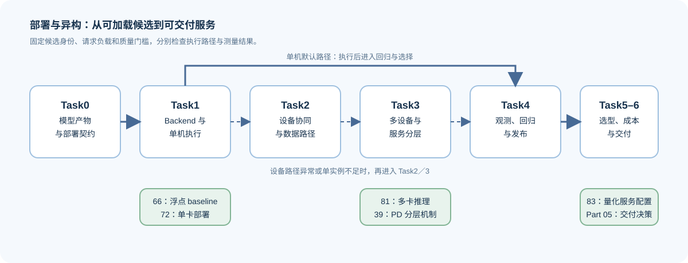
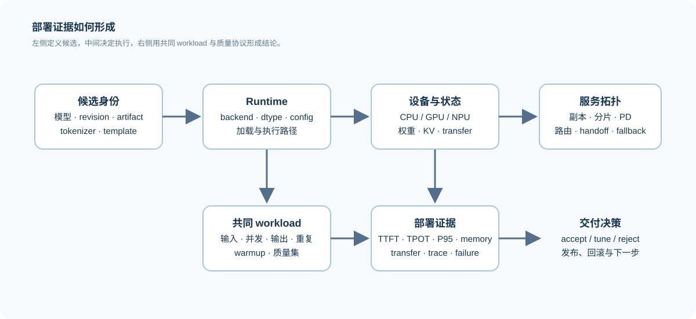

# 模型部署与异构执行（Model Deployment and Heterogeneous Execution）

> 专题类型：横向工程专题　学习目标：把模型产物、推理后端、设备能力和服务约束转化为可复测的部署方案。

模型能够完成一次前向计算，不等于它能在目标设备和服务环境中稳定交付。部署需要依次确认候选身份、加载能力、实际执行路径、状态放置、服务拓扑和回退条件，最后在固定质量门槛与工作负载下比较容量、延迟、吞吐和成本。

量化、注意力和并行机制为部署提供候选产物与执行约束；本专题把这些输入接到目标运行时和设备上，判断候选能否正确执行，以及应该采用、继续调优还是回退。

## 学习路线

下表是按问题查找入口的全景图。首次学习可以先走“候选—单机—证据—选择”主线；设备路径异常或单实例无法满足目标时，再进入对应扩展。连续追踪一个候选可读[部署问题链](./walkthrough.md)，已有故障时查[部署决策手册](./casebook.md)，术语差异见[专题术语表](./glossary.md)。

| 学习阶段 | 推荐入口 | 完成后能回答什么 | 环境 |
|:---|:---|:---|:---|
| 入门主线 | [01 候选契约](./01_model_artifact_and_deployment_contract.md) → [02 后端兼容](./02_backend_compatibility_and_single_node_execution.md) → [05 回归证据](./05_observability_regression_and_release.md) → [06 候选选择](./06_heterogeneous_selection_and_cost_decision.md) | 候选身份是否完整、后端是否按预期执行、证据是否足以选择 | 阅读无需安装；运行 CPU 检查使用 `BASE-CPU` |
| 单机验证 | [Part 02 · 72 单卡部署比较](../../02_PyTorch_Algorithms/72_Multi_Model_Deployment_Comparison.md) | 单卡容量、请求质量和服务指标是否达标 | GPU 可选；需要真实服务测量时使用 `INF-VLLM-011-CU128` |
| 故障诊断 | [07 加速器与运行时兼容性](./07_accelerator_runtime_compatibility.md)、[03 设备协同与数据路径](./03_device_coordination_and_data_path.md) | 是否发生能力不匹配、执行回退、搬运或同步阻塞 | 可先读；真实设备路径需对应硬件 |
| 扩展部署 | [04 多设备与服务分层](./04_multi_device_and_service_tiers.md) → [08 端—边—云放置](./08_edge_cloud_placement_and_handoff.md) → [Part 02 · 81 分布式推理](../../02_PyTorch_Algorithms/81_Distributed_Inference_Project.md) | 何时复制、切分、分离阶段或改变部署位置 | 真实多卡验证至少需要双卡；端边云结论需要对应节点与网络 |

| Task / 主题 | 本阶段要回答的问题 | 学习入口与验证出口 | 学习顺序 | 主要正文入口 |
|:---|:---|:---|:---|:---|
| Task0 · 候选身份与部署契约 | 哪些文件、版本和输入输出条件共同定义一个可追溯的部署候选？ | 核心：[Part 00 · 10 状态与持久化](../../00_Prerequisites/10_PyTorch_State_dict_and_Persistence.md)；量化分支：[Part 02 · 82 量化产物准入](../../02_PyTorch_Algorithms/82_Quantization_Artifact_Evaluation_Project.md) | 模型来源 → 产物清单与哈希 → 分词器和模板 → 输入输出协议 → 加载前检查 | [01 模型产物与部署契约](./01_model_artifact_and_deployment_contract.md) |
| Task1 · 推理后端与单机执行 | 同一候选在不同推理后端上为什么具有不同的加载条件和执行路径？ | 核心：[Part 02 · 66 浮点服务基线](../../02_PyTorch_Algorithms/66_Inference_Performance_Comparison.md)；项目：[Part 02 · 72 单卡部署比较](../../02_PyTorch_Algorithms/72_Multi_Model_Deployment_Comparison.md) | 语义参考路径 → 后端加载 → 能力声明 → 实际数据类型与计算内核 → 配对请求 | [02 推理后端兼容性与单机执行](./02_backend_compatibility_and_single_node_execution.md) |
| Task2 · 设备能力与数据路径 | 目标设备是否支持候选，输入、权重、缓存和输出在哪里搬运、驻留与同步？ | 核心：[Part 01 · 34 异构加速器与运行时约束](../../01_Hardware_Math_and_Systems/34_Heterogeneous_Accelerators_and_Runtime_Constraints.md)；扩展：[性能优化](../performance_optimization/intro.md) | 设备能力门槛 → 运行时和计算内核支持 → 主机—设备路径 → 驻留对象 → 搬运与同步时间 | [03 设备协同与数据路径](./03_device_coordination_and_data_path.md) |
| Task3 · 多设备与分层服务 | 单实例不满足容量或服务目标时，应该复制、切分、分离阶段还是改变端—边—云放置？ | 核心：[通信与并行](../communication_parallelism/intro.md)、[Part 02 · 39 异构预填充—解码](../../02_PyTorch_Algorithms/39_Hetero_PD_and_Serving_Tiers.md)；项目：[Part 02 · 81 分布式推理](../../02_PyTorch_Algorithms/81_Distributed_Inference_Project.md) | 单实例失败证据 → 状态与请求切分 → 服务层级 → 状态交接 → 降级和恢复 | [04 多设备与服务分层](./04_multi_device_and_service_tiers.md) |
| Task4 · 可观测性与发布回归 | 怎样证明部署命中了预期路径，并在版本或环境变化后发现质量与性能回归？ | 核心：[性能优化 · 基准设计与回归验证](../performance_optimization/methods/06_benchmark_design_and_regression_validation.md)；量化配置项目：[Part 02 · 83 量化服务配置基准](../../02_PyTorch_Algorithms/83_Quantized_Serving_Profile_Benchmark.md) | 运行身份 → 路径事件与资源记录 → 配对回归 → 失败分类 → 阻断、降级或回滚 | [05 可观测性、回归与发布](./05_observability_regression_and_release.md) |
| Task5 · 异构候选与成本门槛 | 质量合格的候选是否同时满足容量、服务目标、成本和维护约束？ | 核心：[Part 01 · 33 总拥有成本模型](../../01_Hardware_Math_and_Systems/33_TCO_and_Cost_Model.md)；扩展：[量化与压缩](../quantization_compression/intro.md) | 淘汰不兼容候选 → 固定质量门槛 → 比较有效吞吐与尾延迟 → 估算单位成本 → 检查回退代价 | [06 异构选型与成本决策](./06_heterogeneous_selection_and_cost_decision.md) |
| Task6 · 部署交付与采用决策 | 哪个候选具备可执行配置、复测证据、降级路径和回滚条件，可以进入交付？ | 项目：[Part 02 · 72 单卡部署比较](../../02_PyTorch_Algorithms/72_Multi_Model_Deployment_Comparison.md)、[Part 02 · 81 分布式推理](../../02_PyTorch_Algorithms/81_Distributed_Inference_Project.md)；出口：[Part 05 · 推理服务综合项目](../../05_Integrated_Projects_and_Decisions/01_Inference_Service_Integrated_Project.md) | 汇总候选身份 → 复核质量与系统证据 → 检查失败和恢复 → 选择采用、调优或拒绝 → 保存交付清单 | [Part 05 · 推理服务综合项目](../../05_Integrated_Projects_and_Decisions/01_Inference_Service_Integrated_Project.md) |

## 扩展与跨专题入口

### 按需回补

| 需要理解的对象 | 优先入口 | 本专题使用的内容 |
|:---|:---|:---|
| 请求阶段、KV Cache 与服务目标 | [推理优化](../inference_optimization/intro.md) | 固定请求工作负载、服务指标和缓存状态 |
| 量化对象、产物和低精度路径 | [量化与压缩](../quantization_compression/intro.md) | 判断候选产物是否可加载、是否命中声明路径 |
| 多卡切分、通信与拓扑 | [通信与并行](../communication_parallelism/intro.md) | 判断多设备候选的状态布局和通信代价 |
| 执行轨迹、驻留对象与回归 | [性能优化 · 时间线与关键路径](../performance_optimization/methods/03_time_breakdown_and_trace_reading.md)、[显存时间线与驻留](../performance_optimization/methods/04_memory_timeline_and_residency.md) | 判断时间、容量和代价转移发生在哪里 |
| 图像、音频和工具调用输入 | [多模态](../multimodal/intro.md)与[智能体基础设施](../agent/intro.md) | 扩展输入协议、质量门槛与失败状态 |

### 两类扩展条件

- 端侧或本地执行需要独立记录模型格式、CPU/GPU 卸载、内存上限和功耗，不能沿用数据中心服务结论；
- 多设备、跨节点或端—边—云候选需要独立记录拓扑、状态交接、网络等待和故障域，单卡结果只能作为语义与功能基线。

## 实验与项目出口

首次运行先按[实验 Quickstart](./quickstart.md)选择阅读、CPU 检查、单卡服务或多卡验证路径，再从[实验资产表](./experiment_assets.md)选择模型、工作负载和结果入口。部署专题复用推理、量化与通信项目的结果；只有候选身份、执行路径、质量协议和工作负载一致时，才把它们合并判断。

| 证据阶段 | 要回答的问题 | 当前入口 |
|:---|:---|:---|
| 契约与兼容性 | 产物、分词器、模板、运行时和设备能力是否匹配？ | 正文 01、02、07；量化产物另查 Part 02 · 82 |
| 单机真实执行 | 候选能否在目标后端正确启动并完成固定请求？ | Part 02 · 66、67、72 |
| 服务配置与回归 | 配置变化是否改善目标指标且没有破坏质量和稳定性？ | Part 02 · 83；正文 05 |
| 多设备与分层服务 | 单机不足时，切分、复制或阶段分离是否带来净收益？ | Part 02 · 39、81；通信与并行实验资产 |
| 综合交付 | 候选是否具备成本、降级、恢复和回滚证据？ | Part 05 · 推理服务综合项目 |

真实部署结果至少固定模型 revision、分词器与模板、产物身份、设备、驱动与运行时、推理后端、实际数据类型、输入输出长度、并发、预热、重复次数、质量集和失败状态。缺少这些条件时，结果只能说明路径可运行，不能支持跨候选选型。
