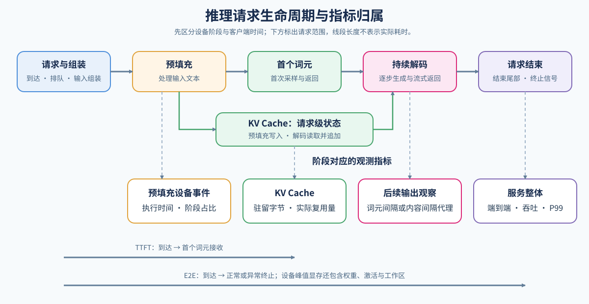

# 01 请求链路与指标（Request Path and Metrics）

## 学习问题

一个请求等了很久才看到首词元，另一个请求首词元很快，后面却不断停顿。两者可能有相近的总耗时，等待发生的位置却不同。请求何时获得执行机会、输入怎样建立缓存、后续生成何时返回，需要放在同一条链路上观察。

先跟踪请求怎样组成执行批次，模型与缓存怎样支持持续生成，再用时间记录区分首词元等待、生成间隔和请求结束。吞吐、尾延迟与失败需要放在明确的负载和服务目标下比较，才能判断一次改动是否有用。

## 输入建立缓存，后续生成继续读写

一条文本生成请求包含提示词和生成规则。提示词经分词转为输入词元，模型从词表中逐步选择输出词元；词元是模型处理的单位，不等同于一个汉字或单词。请求到达后可能先排队，获得准入并准备好输入，才进入模型执行。预填充（Prefill）处理输入词元，在各层建立后续注意力计算要用的键、值缓存（KV Cache），并产生用于首次采样的结果。输入越长，需要处理的位置通常越多，初始缓存也随之增长。

首次采样后，解码（Decode）以新词元继续推进：读取先前缓存，为新位置计算并追加键、值，再得到下一次采样所需的结果。请求因而一边生成，一边增长缓存，内容也可以逐步传回客户端。调度器在这些执行轮次之间决定哪些请求获得资源；KV Cache 贯穿预填充与解码，调度贯穿排队与执行，两者都会影响看到输出的时间。

生成遇到约定的终止词元（EOS）可以正常停止，达到输出长度上限也会结束，但后者可能截断尚未完成的回答。取消、超时和执行失败还要分别保留终止状态，不能都归为成功返回。

## 从请求队列组成一轮执行批次

单请求运行时，时间记录主要描述它自己的处理与返回。加入其他请求后，每条请求仍经过相同状态，但开始执行的时刻、后续生成间隔可能因资源竞争改变。例如，已有请求正在解码，新到达的长输入占用较多本轮时间时，已有请求的下一个词元可能延后。

并发数描述同一时刻尚未结束的请求数，到达率描述单位时间进入多少请求，执行批次（batch）则是本轮实际选中处理的请求集合。设 A、B、C、D 四条请求都已到达且尚未结束：A 正在解码，B 正在分块处理输入，C、D 仍在等待。某轮选中 A 推进一个解码位置、B 处理四个输入词元，便得到两条批次成员、五个待处理词元。并发数为四，不代表本轮 batch 也有四条，更不能据此认定本轮只有四个词元的工作。

从读取队列与状态、选择成员和工作量，到模型执行、必要的采样及状态更新，构成一次服务迭代。一轮迭代可以调用多个计算内核，也不保证每条请求都返回一个新词元：B 的输入尚未处理完时，可能只有缓存进度更新；A 若结束，下轮才有机会将释放的容量分给等待者。空出一个成员位置，也仍要检查缓存和本轮预算是否允许接纳。

| 同一轮中的量 | 例子中的值 | 它描述什么 |
| --- | --- | --- |
| 并发请求数 | 4 条：A、B、C、D | 已到达且尚未结束的请求 |
| 批次成员数 | 2 条：A、B | 本轮实际选中处理的请求 |
| 本轮词元工作量 | 5 个：A 的 1 个位置、B 的 4 个输入词元 | 本轮计划交给模型的词元位置数 |
| 等待请求数 | 2 条：C、D | 本轮没有获得执行机会的请求 |

## 资源与 CPU–GPU 分工怎样影响等待

在普通单实例 GPU 服务中，多个请求通常共享同一组模型权重，各自保留仍需读取的 KV 状态；兼容前缀还可能共享部分缓存。执行时产生的临时激活和工作区也占显存。因此，增加请求既可能提高同一组权重的利用程度，也会增加缓存驻留和本轮工作量，吞吐提高与每条请求更快需要分别观察。

CPU 侧通常承担输入组织、队列管理、批次准备、计算提交和返回处理，GPU 侧主要执行模型的张量计算。前面的 A、B 被选中后，输入和状态信息仍需准备就绪，设备才能开始本轮计算；即使 GPU 计算很短，也可能等待下一批工作。下一轮准备能否与当前计算重叠，取决于数据依赖和执行资源，不能仅靠增加并发消除等待。

观察资源时先区分三类限制：模型计算需要时间，权重与历史状态的读取搬运需要时间，显存容量则限制能保留多少状态。GPU 利用率或一项显存数字无法单独确定是哪一类限制；需要结合执行区间与各类驻留观察。硬件直觉可回补 [Part 01 · 03：GPU 架构与显存](../../01_Hardware_Math_and_Systems/03_GPU_Architecture_and_Memory.md)。

| 资源对象 | 保留到什么时候 | 随请求变化的部分 |
| --- | --- | --- |
| 模型权重 | 通常随模型实例持续驻留 | 请求增多通常不要求为每条请求复制完整权重 |
| KV 状态 | 后续生成仍需读取时保留，终止后按引用与缓存策略释放或复用 | 随上下文和驻留请求数增长，可能共享兼容前缀 |
| 临时激活 | 当前计算的后续操作仍需使用时保留 | 随批次、词元量和计算形状变化 |
| 执行工作区 | 由执行后端申请并可能重复使用 | 随内核与执行路径变化，不等同于某条请求独占的状态 |

## 最后一个词元之后，请求可能尚未结束

构造一条使用同一时钟的记录：请求在 0 ms 到达，12 ms 获得准入，15 ms 输入就绪，首个词元在 45 ms 返回，其余三个词元在 55、65、75 ms 返回，80 ms 收到终止信号。首词元延迟为 45 ms，包含排队、输入准备、预填充和首次返回；三个后续间隔均为 10 ms，首末词元跨度是 30 ms。最后词元后的 5 ms 仍属于等待请求结束的时间，因此端到端延迟是 80 ms。这些数值用于解释边界，不是实测结果。

令 $t_a$ 为到达时间，$t_1$、$t_n$ 为首个、最后一个输出词元的接收时间，$t_e$ 为正常或异常终止时间，$n$ 为输出词元数。时间使用同一时钟与单位；已产生输出且记录完整时，客户端指标为：

$$
\mathrm{TTFT}=t_1-t_a,\qquad
\mathrm{E2E}=t_e-t_a,\qquad
\mathrm{TPOT}=\frac{t_n-t_1}{n-1}\quad(n>1).
$$

在上述例子中，平均每输出词元时间（TPOT）为 $(75-45)/(4-1)=10$ ms。若改用终止时刻计算，则得到 $(80-45)/3\approx11.7$ ms，额外计入了结束尾部。只输出一个词元时没有后续间隔，TPOT 记为不适用；首次输出前取消的请求仍有终止时间，可以计算 E2E，但没有 TTFT 或 TPOT，不能将缺失值补为零。

真实流式接口可能把多个词元放入一个内容块。此时直接记录的是首末内容时刻，即使后端给出准确词元总数，用内容跨度计算的也只是平均间隔代理。平均值还可能掩盖中途的一次较长停顿，需要同时查看逐词元或逐内容块间隔。传输和缓冲会改变内容到达时间，单凭客户端记录无法分离 GPU 计算耗时；预填充的设备时间需要另看后端事件。

## 单条延迟与整批吞吐使用不同样本

延迟描述一条请求，吞吐描述一个观测窗口内完成了多少工作。例如，两条请求都成功完成，共输出 60 个词元，从开始发送到两条请求都终止经过 2 秒，成功请求吞吐为 1 请求／秒（requests/s），输出吞吐为 30 词元／秒（tokens/s）。两项指标使用同一窗口，却计算不同的工作量；输入吞吐也要与输出吞吐分别标明。这个窗口包含排队、传输和结束尾部，将各请求的生成速率取平均，不能替代整批输出吞吐。

失败记录也会影响解释：请求在首次输出前取消时，仍进入终止状态与完成率计数，却不能进入 TTFT 样本。统计 P95（95% 分位数）等指标时，应说明使用正常完成请求还是所有已产生首词元的请求，并保留失败数与样本数。峰值显存则是资源观测，还要区分服务进程占用和包含其他进程的设备总占用。

| 观察 | 时间或资源范围 | 需要一起查看 |
| --- | --- | --- |
| TTFT | 从到达到首个词元返回 | 排队、输入长度、预填充与返回 |
| TPOT | 首词元之后的平均间隔 | 上下文、活跃批次、调度与传输 |
| E2E | 从到达到正常或异常终止 | 末次内容、结束尾部与终止状态 |
| 吞吐 | 一个明确观测窗口内的完成请求或有效输出 | 到达率、并发、失败与实际输出长度 |
| P50／P95／P99 | 同一种请求指标的分位数 | 样本数、请求类型与统计窗口 |
| 峰值显存 | 权重、激活、KV 与工作区的最高驻留 | 并发、长度、执行路径与其他进程 |

## 从指标读出一次改动是否更快

比较前先确定要改善哪段时间：交互请求可能关注首词元等待，长回答可能关注后续生成间隔，离线批任务则可能关注固定窗口内的有效产出。延迟越低越好，吞吐越高越好，因此两类比值的方向不同。对同一种延迟指标和同一统计样本，延迟加速比为“基线耗时 ÷ 候选耗时”；吞吐提升倍数为“候选吞吐 ÷ 基线吞吐”。分母必须大于零，缺失指标保持不适用，不能补成零来计算收益。

例如，一组构造的配对结果中，首词元延迟 P95 从 200 ms 降至 160 ms，加速比为 1.25，延迟下降 20%；若相同负载与统计窗口口径下，输出吞吐从 100 增至 120 词元／秒，则吞吐提高 20%，提升倍数为 1.2。两者回答不同问题，也不保证同时改善。比较 P95 时使用两组样本各自的 P95；先逐请求求比值再取 P95，会得到另一种统计量。

这些比值只有放回工作量与质量条件才有意义。候选若提前截断回答，或者更多请求失败，就可能因少做工作而显得更快；需要一起检查实际输出长度、停止原因、失败与任务质量。显存下降属于资源收益，可以支持更长上下文或更多驻留请求；能否进一步改善吞吐和等待，需要在相应负载下另做比较。一次改动因而要同时说明节省了什么、增加了什么成本，以及它在哪种请求条件下满足目标。

## 同一模型也会形成不同负载

固定负载的单并发测量让请求依次执行，便于先观察输入处理、生成与结束的时间记录，减少同时在途请求之间的竞争。测量完整后，再用多请求对照观察等待和批次变化，才容易区分基础执行成本与竞争带来的额外时间。记录完整、指标可复算说明这份基线可以用于比较；是否满足 SLO，还要另与目标门槛核对。

将示例的输入加长，首词元之前的处理量与初始 KV 通常随之增加；将输出加长，则增加解码轮次，让缓存保留更久。若多个请求短时间内同时到达，即使单条输入不变，也可能因资源竞争排队。重复前缀则提供缓存复用机会，但能否跳过已有计算取决于后端的复用能力与本次命中情况。相同平均长度无法描述这些差异。

强制固定生成长度可以隔离工作量，但不能同时声称验证了自然停止行为；允许自然终止时，则保留实际输出长度和停止原因来解释吞吐。基线与候选共用哪些条件、怎样记录配置差异，见[配对比较方法](./07_benchmark_and_decision.md)。

模型结构也属于比较条件：分组查询注意力（GQA）减少多个查询头所需的 KV 头数，混合专家（MoE）根据路由选择本轮执行的专家。参数量相同的模型，每轮实际计算量与缓存需求仍可能不同。

## 服务目标决定哪些改动值得采用

服务等级目标（SLO）把使用体验或可靠性要求写成可测门槛。它需要同时说明目标负载、观察窗口、指标和阈值。例如，一个构造目标可以是：在约定的一组请求流与统计窗口下，已产生内容请求的首内容延迟 P95 不超过 300 ms，并且全部请求的失败率不超过 1%。这里同时观察较慢请求的等待与全部请求的失败，避免失败记录从延迟样本中消失后掩盖服务问题。这些阈值只用于示例。

若候选增加了整体词元吞吐，却使首内容延迟 P95 超过上述门槛，它仍未满足这个交互服务目标。离线任务可以采用不同的等待与吞吐目标，因此性能排序取决于用途。回答是否正确、格式是否合规，还需使用固定任务样本单独检查；输出非空和请求成功只能说明完成了相应执行，不能替代任务质量。记录足以复算指标，也不等于这些指标已经达到目标。

## 用现象选择下一项观察

| 请求现象 | 先区分什么 | 直接入口 |
| --- | --- | --- |
| 输入越长，首词元越慢 | 排队还是层内计算 | [模型前向](./02_prefill_and_attention_kernel.md) |
| 首词元后持续停顿 | 生成推进、KV 读取还是轮次等待 | [解码](./03_decoding_strategies.md)、[缓存](./04_kv_cache_lifecycle_and_reuse.md) |
| 并发增加后长尾恶化 | 准入、组批与阶段配额 | [服务调度](./05_serving_scheduling_and_pd.md) |
| 权重或状态接近容量 | 哪一类驻留消耗主要预算 | [缓存](./04_kv_cache_lifecycle_and_reuse.md)、[低精度执行](./06_quantized_inference_and_deployment.md) |
| 局部或吞吐改善，整体等待或失败仍超标 | 输入协议、瓶颈转移、SLO 与失败样本 | [统一基准](./07_benchmark_and_decision.md) |

## 相关阅读

用事件回放检查状态与指标，再用真实客户端记录练习测量核验：

- [请求生命周期机制](../../02_PyTorch_Algorithms/INF-REQUEST-LIFECYCLE_Inference_Request_Lifecycle.md)：合法迁移、缺失指标与统计样本。
- [Part 02 · 66：单卡推理测量基线](../../02_PyTorch_Algorithms/66_Inference_Performance_Comparison.md)：内容块时间、逐轮统计与基线可引用条件。
