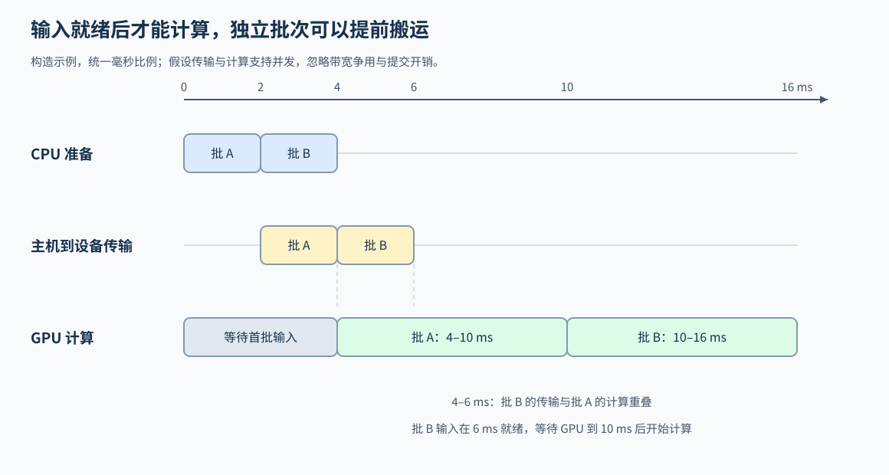
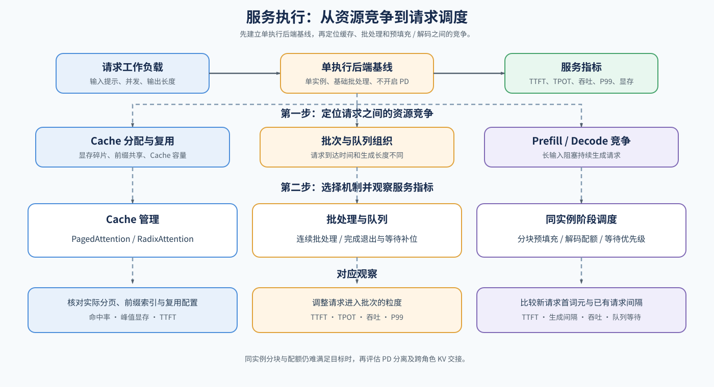

# 05 服务预算、连续批处理与阶段调度（Serving Budgets, Batching and Phase Scheduling）

## 学习问题

三个请求正在逐词元生成，一个长输入请求此时到达。立即处理完整长输入，可能让已有请求等待；一直优先解码，又可能让新请求迟迟拿不到首词元。服务调度要在缓存、词元预算和等待目标之间，决定下一轮运行谁、运行多少。

下面持续跟踪这一组请求，从准入、动态补位和阶段配额进入执行时间线；当单实例安排仍不足时，再比较资源池拆分与路由。

## 下一轮先读队列，也要读缓存

调度器读取等待请求、活跃请求和缓存容量。准入是允许等待请求占用活跃槽位和所需缓存资源，不等同于请求刚到达服务端。请求优先级给出选择偏好，缓存决定能否保留状态，单轮词元预算约束实际工作量。三个条件要共同满足，不能按队列顺序选完请求后才发现无空间写入 KV。

假设三个解码请求每轮各推进一个位置，服务端最多保留四个活跃请求，本轮词元预算为八。在缓存足够容纳新块的前提下，长输入可以进入第四个槽位；若采用先保护已有解码的安排，本轮先为三个请求保留三份工作，剩余五个位置再分给预填充。八是这个例子的服务预算，不是通用硬件常数，保留三个解码位置也不是所有调度策略的固定规则。

| 约束 | 在例子中限制什么 | 超出后的动作 |
| --- | --- | --- |
| 活跃槽位 | 同时保留哪些请求 | 等待或在安全边界暂停 |
| KV 容量 | 新旧状态能否继续驻留 | 先回收可释放状态，再决定准入或抢占 |
| 词元预算 | 本轮预填充与解码的总工作量 | 缩小输入分块或推迟部分请求 |
| 等待目标 | 哪些请求不能继续让位 | 调整优先级、配额或拒绝新压力 |

## 连续批处理在轮次之间补位

固定批次往往等待同批请求完成后才补入新请求。若一个短请求已经结束，而其他请求仍在生成，空出的槽位可能继续闲置。连续批处理在迭代边界，即本轮结果与请求状态更新后、下轮工作确定前，移除完成请求，并把可接纳的等待请求补进来；它改变活跃集合，而不是保证每个请求的单步计算更快。批次补位的机制练习见 [Part 02 · INF-CONTINUOUS-BATCHING 连续批处理](../../02_PyTorch_Algorithms/INF-CONTINUOUS-BATCHING_Continuous_Batching.md)，下面继续观察补位与阶段预算怎样共同影响等待。

接着前面的例子，某个解码请求完成后，其活动引用释放，下一轮可以把槽位和部分词元预算给等待者。调度器先确认哪些块已可重新分配，再判断新成员能否写入状态。请求结束不代表所有关联 KV 都已变成空闲块，共享或缓存保留仍可能占用状态；若完成事件、引用和成员更新不同步，就可能出现重复执行或过早覆盖。

## 分块预填充怎样改变两类等待

如果新请求有二十个未缓存输入词元，可以先按本轮剩余预算处理五个，再在后续轮次继续。已有解码请求因此能在较短间隔内再次获得执行机会；长请求需要更多轮才能完成预填充，其 TTFT 可能上升或下降，取决于排队与每轮成本。

分块太大，仍可能造成长解码间隔；分块太小，又可能降低矩阵效率并增加提交与轮次成本。比较时同时记录长请求首词元、已有请求的生成间隔和整体吞吐，不能只选其中最有利的一项。

缓存命中还会改变本轮实际工作量：二十个输入若已有十五个可复用前缀，只需处理五个后缀。但命中状态必须已完成引用与容量检查，文本相同本身不足以跳过计算。

先看没有前缀命中的情况：三个解码请求记为 A、B、C，新到达的长输入请求记为 D。仍使用八个词元的轮次预算，并假设缓存足够、各轮都能接纳下表的工作。B 在第一轮结束，下一轮只剩两个解码位置需要推进，D 因而可以多处理一个输入位置。表中的结束事件是构造条件，轮次不是等长时间片；预填充完成后能采出首词元，此处不再额外占用一个输入位置。

| 轮次 | 本轮开始时的 D 剩余输入 | 选中的工作 | 本轮结束后的变化 |
| --- | --- | --- | --- |
| 1 | 20 | A、B、C 各解码 1 个位置；D 预填充 5 个位置 | B 结束并释放活动引用；D 剩余 15 |
| 2 | 15 | A、C 各解码 1 个位置；D 预填充 6 个位置 | D 剩余 9 |
| 3 | 9 | A、C 各解码 1 个位置；D 预填充 6 个位置 | D 剩余 3 |
| 4 | 3 | A、C 各解码 1 个位置；D 预填充 3 个位置 | D 完成预填充并采出首词元；后续进入解码 |

## 词元数相同，不保证一轮成本相同

预填充和解码有不同的矩阵形状与历史读取量；上下文、精度和执行路径也会改变成本。词元预算是可控工作量代理，需要实际迭代时间校正。迭代成本可以先用计算与搬运重叠的近似关系形成假设，再根据轨迹定位暴露等待。

例如，构造两轮都处理八个位置：一轮是三个解码位置加五个预填充位置，耗时 6 ms；另一轮是八个长上下文请求各解码一个位置，耗时 10 ms。后者虽然词元数相同，却需要读取更多历史 KV。这里的数值不预测实际设备性能，而是说明：预算约束工作量，轮次完成时间才决定请求何时能再次获得执行机会。因此应把成员、阶段、上下文和轮次时间一起记录。

MoE 还会把同一批词元分成不同大小的专家矩阵。批次词元数不变，专家负载分布仍可能变化。服务调度器选择批次，模型路由器选择专家，专家放置安排设备；三者不能混为一个“路由”。[专家执行机制](../../02_PyTorch_Algorithms/INF-MOE-EXECUTION_MoE_Inference_Dispatch_and_Expert_Execution.md)提供固定路由下的局部比较，跨卡交换则还需专家并行证据。

## 依赖允许时再重叠准备与计算

选定批次后，CPU 准备下一轮输入，GPU 执行当前轮，必要的搬运和状态交接可以与独立计算重叠。本批计算仍必须等待自己的输入就绪；缓冲区也必须保留到使用结束。增加流或线程本身不会消除这些依赖。

下图用两个批次的构造时间展示准备、传输与计算：后批输入可以提前搬运，但计算要等待输入和设备都就绪。被其他工作覆盖的传输仍占用资源；只有它离开关键路径，才可能缩短请求等待。计时应区分总耗时、暴露传输和空闲间隙。

## 什么时候再考虑资源池拆分

单实例中可以先改变阶段配额和分块大小；若两类阶段的资源需求仍难以同时满足，才评估预填充／解码分离（PD 分离），即由不同执行资源分别承担 Prefill 和 Decode。拆分后，KV 要跨角色交接，请求还要等待目标池接纳。原来减少的资源争用可能被传输或池间失衡抵消。

例如，预填充池已经算完长输入，解码池却没有足够容量接纳时，请求仍要等待，源池也可能继续保留 KV。拆分并未消除容量约束，而是增加了交接与目标池接纳这两个条件。异构资源还需要确认两侧的状态格式兼容，失败时能否在原池继续或重算。

注意力与 FFN 解耦（AFD）进一步按层拆开计算角色，传输层间激活；它与预填充完成后交接 KV 的对象和频率不同。跨角色依赖、通信与恢复代价进入[分布式推理](./08_distributed_inference_and_parallelism.md)继续比较。

## 后端比较按机制能力选择

分页、前缀索引、批处理和 PD 属于不同层次。比较两个后端时，应先确认各自实际支持的路径与配置，不能把分页只归给一个后端、前缀复用只归给另一个后端。下面按问题分类，不把后端名称当作互斥机制。

把例子放回真实服务时，用到达、接纳、执行和完成事件解释排队与轮次等待，再对照每轮成员、阶段预算和缓存余量。不同配置的配对、质量与尾延迟比较见[基准与决策](./07_benchmark_and_decision.md)。

## 相关阅读

- [连续批处理](../../02_PyTorch_Algorithms/INF-CONTINUOUS-BATCHING_Continuous_Batching.md)：轮次间成员变化。
- [阶段调度](../../02_PyTorch_Algorithms/38_Prefill_Decode_Scheduling.md)：整段与分块预填充。
- [状态交接与执行重叠](../../02_PyTorch_Algorithms/INF-SERVING-OVERLAP_Serving_Overlap_and_State_Handoff.md)：缓冲区依赖与暴露等待。
- [Attention–FFN 解耦](../../02_PyTorch_Algorithms/INF-AFD_Attention_FFN_Disaggregation.md)：角色拆分与双向载荷。
