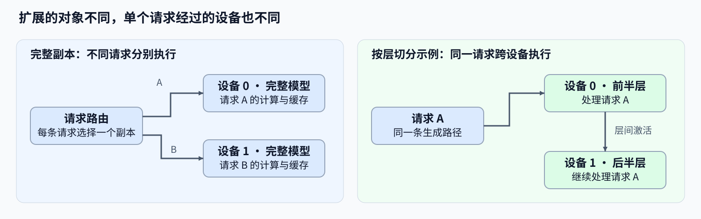

# 08 分布式推理与并行扩展（Distributed Inference and Parallelism）

## 学习问题

模型能够放进一张卡，却无法及时处理到达的请求；另一种模型则连单请求所需的权重和状态都放不下。前者可以考虑复制完整实例，后者需要拆分模型或上下文。两种扩展改变的对象、通信和故障范围不同。

先用容量与时间账本选择分支，再比较增加设备后省下的计算、引入的通信和请求等待。下图以完整副本和按层切分为例：副本让不同请求分别执行，按层切分让同一请求经过多个设备；张量并行和上下文并行还会引入不同的层内交换。

## 模型放得下时，先区分排队与单请求计算

设一个构造的服务平均每秒到达 12 个请求，单实例只能稳定完成 8 个。如果请求彼此独立，增加一个相同副本可以分担到达流，但每个请求仍由一个完整实例处理。它可能缩短排队，却没有直接缩短单请求的模型前向。

两个副本合计每秒 16 个请求只是忽略路由、负载不均与状态局部性的理想容量。共享前缀若分散到两个缓存池，每个实例可能重新预填充；固定会话到同一实例又可能形成热点。因此，副本路由需要同时考虑队列、缓存和会话连续性，而不是只轮流分发请求。

## 模型放不下时，切分也要保留工作区

再看一个构造的账本：权重占 18 GiB，每卡可用预算为 12 GiB，目标请求的 KV、激活和工作区还需额外容量。把权重平均分为两份，只能推出每卡权重约 9 GiB，不能推出每卡总占用小于 12 GiB。缓存怎样切分、哪些张量重复驻留、通信缓冲占多少，都由并行方案决定。

| 分支 | 同一请求怎样执行 | 主要新增代价 |
| --- | --- | --- |
| 流水线并行（PP） | 依次经过不同设备上的模型层 | 阶段间激活传输、阶段不均与流水线空转 |
| 张量并行（TP） | 多设备共同完成层内矩阵计算 | 层内集合通信与同步 |
| 上下文并行（CP） | 上下文或注意力工作集分布到设备 | 注意力所需的跨分片状态交换 |
| 专家并行（EP） | 词元被送往承载选中专家的设备 | 分发、汇合与专家负载不均 |

单卡放不下原模型时，先保存容量失败与目标模型的资源估算，再建立可运行的最小并行配置作为后续比较基线。缩小模型可以帮助检查切分正确性，但它的时间不能充当原模型的单卡性能。

## 多卡为何不一定缩短一次迭代

假设可运行的单设备参考迭代耗时 20 ms；一个构造的双卡方案将设备计算缩短为 11 ms，却增加了 7 ms 无法被计算覆盖的通信与等待，关键路径约为 18 ms，加速只有约 1.11 倍。若暴露通信增至 12 ms，总时间约为 23 ms，反而更慢。这里假定两侧完成相同工作，数字只解释计算与通信的取舍。

通信总时长与暴露通信不同：部分传输可以和独立计算同时发生，只有未被覆盖、阻塞后继计算的部分直接延长关键路径。同步还会等待最慢参与者，因此平均计算时间不足以解释多卡迭代。应对照各设备的完成时刻、通信区间和空闲间隙。

MoE 尤其需要保留各专家与各设备的分配数。若一批词元集中到少数专家，空闲设备不能自动接管不属于它的权重；跨卡分发成本和最热设备的计算可能共同决定本轮时间。专家放置与路由语义不同，不能通过随意改选专家来制造均衡收益。

## 扩展后怎样处理请求失败

独立副本失效时，新请求可以改派健康实例；已输出部分内容的请求则还要判断输入、生成进度和 KV 是否可恢复。直接重试可能重新生成内容，不能把重试成功等同于无中断续接。

故障域指一次故障会影响的执行范围。模型内部并行通常有更大的故障域：同一请求依赖的一个成员失效，整个并行组可能停止。恢复需要重建成员与通信状态，再决定从已有状态继续、重算还是返回失败。预填充／解码分离还要确认 KV 交接完成与否及其所有权，避免源池和目标池重复推进同一请求。

| 比较问题 | 保留的观察 | 判断范围 |
| --- | --- | --- |
| 请求容量是否增加 | 同一到达流下的完成率、排队、吞吐与尾延迟 | 副本扩展与路由收益 |
| 单实例是否装得下且更快 | 每卡峰值、计算、通信、空转与完整迭代 | 模型切分的容量与时间代价 |
| 状态是否能安全恢复 | 失败请求、输出进度、重建时间与额外计算 | 故障转移和请求恢复 |

按上述容量或排队问题选择[通信与并行机制](../communication_parallelism/intro.md)，记录目标拓扑中各设备的计算、通信和请求完成时间。实验输入与已有结果见[资产表](./experiment_assets.md)，请求配对和采用判断见[基准与决策](./07_benchmark_and_decision.md)。

## 相关阅读

按容量与吞吐约束选择 [Part 01 · 26 并行策略决策框架](../../01_Hardware_Math_and_Systems/26_Parallel_Strategy_Decision_Framework.md)中的分支：请求分担进入 [Part 02 · PAR-REPLICA Serving 副本与请求路由](../../02_PyTorch_Algorithms/PAR-REPLICA_Serving_Replica_Routing.md)，模型切分进入 [Part 02 · 87 模型内部并行基准](../../02_PyTorch_Algorithms/87_Model_Internal_Parallel_Benchmark.md)，专家跨卡进入 [Part 02 · 80 MoE 专家并行基准](../../02_PyTorch_Algorithms/80_MoE_Expert_Parallel_Benchmark.md)。目标拓扑的逻辑检查见 [Part 02 · 81 分布式推理逻辑验证](../../02_PyTorch_Algorithms/81_Distributed_Inference_Project.md)，实际多卡执行还需对应设备验证。

- [Part01·28 故障容错与检查点](../../01_Hardware_Math_and_Systems/28_Fault_Tolerance_and_Checkpointing.md)
- [Part02·47 通信观测](../../02_PyTorch_Algorithms/47_Communication_Profiling_with_NCCL.md)
- [Part02·49 并行策略选择](../../02_PyTorch_Algorithms/49_Parallelism_Strategy_Selection.md)
- [NCCL](https://github.com/NVIDIA/nccl)
