# 推理优化问题链：跟踪一组请求的等待、状态与执行

同一个服务中，三个请求正在生成，一个长输入请求随后到达。长请求可能迟迟得不到首词元，已有请求也可能出现生成停顿。下面持续跟踪这组请求，区分层内计算、历史状态和共享资源，再选择需要比较的候选。

先记录请求时间与质量要求，按观测进入相应分支；每次改动后都回到同一请求协议重新测量。理解指标可先读[请求链路](./01_request_path_and_metrics.md)，具体机制与实验入口由各段链接提供。

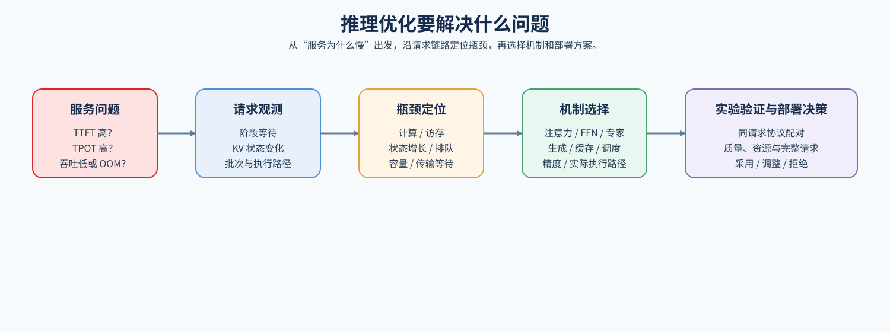

## 首词元等待发生在哪一段

长请求从到达到首次输出，要经过排队、接纳、预填充和返回。若大部分时间在排队，即使缩短注意力计算也可能没有明显改善；若接纳后仍花很久，才继续查看层内前向。客户端首词元时间与设备阶段时间因此需要分别记录。

预填充建立初始 KV，解码继续读取和追加。已有请求的状态占用，还会影响长请求能否被接纳。下图把计算阶段和贯穿生成的状态分开。

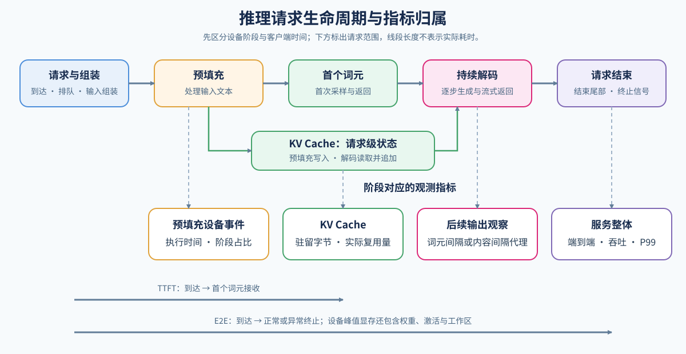

## 已经接纳，为什么预填充仍然很长

沿同一解码器层读取注意力、投影、前馈和归一化时间。显式注意力的中间矩阵可能增加读写；稠密前馈包含门控与多个投影，很多短计算也可能消耗在提交与中间值写回上。先用[模型前向与执行](./02_prefill_and_attention_kernel.md)区分这些成本，再选择编译、融合或内核候选。

下图沿一个 LLaMA 类层展开注意力、两次残差与前馈计算，再区分内核读写、矩阵形状和计算提交。这里的 FFN 是前馈网络，Pre-Norm 表示子层计算前归一化，Graph 重放则重复提交已捕获的设备工作。

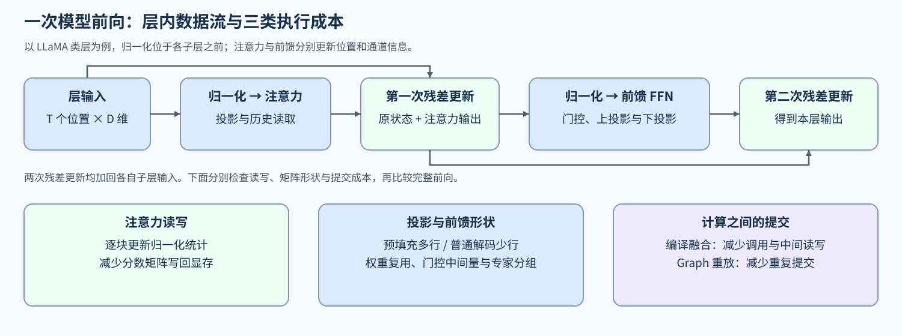

## 模型使用专家时，词元怎样重新组成批次

把这个服务换成 MoE 模型后，同一轮词元会被模型路由器分给不同专家。路由决定算哪些专家，执行器再按专家重排输入，计算后恢复原词元顺序并加权合并。偏斜可能形成少数较大矩阵，也可能造成跨卡等待，实际时间需要结合执行方式解释。

[MoE 专家执行](../../02_PyTorch_Algorithms/INF-MOE-EXECUTION_MoE_Inference_Dispatch_and_Expert_Execution.md)保持专家选择和权重不变，比较逐词元与按专家执行。固定路由计划复用的结果，仍需另外计算动态计划构造成本，才能放回真实模型。

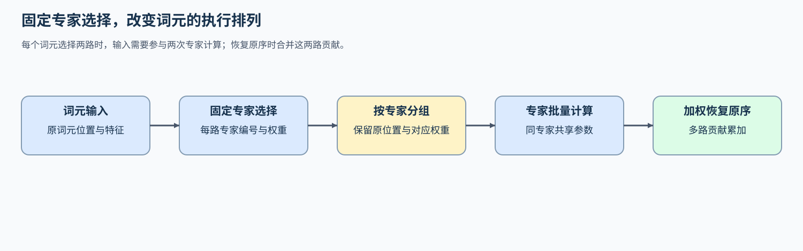

## 首词元返回后，后续生成为什么还会停顿

已有请求需要反复前向、读取历史 KV，并等待下一轮获得资源。先对照单轮计算与轮次间等待；前者进入执行与缓存分析，后者进入批次和阶段配额。普通采样与投机生成也有不同的工作组成。

若选择投机生成，草稿要经过连续接受与拒绝修正，整段接受后还可能追加目标词元。接受率高但草稿、验证和修正成本更高时，完整请求仍可能变慢；[解码策略](./03_decoding_strategies.md)通过最终提交量与总成本解释这个取舍。

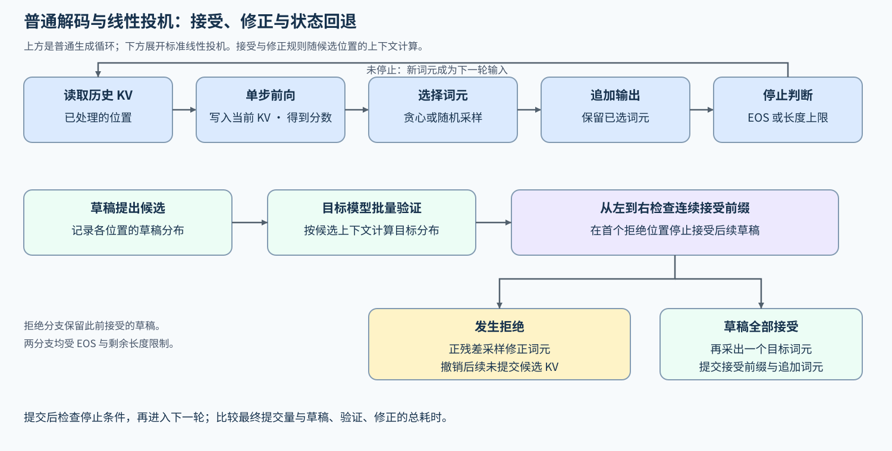

## 生成、缓存与调度怎样相互限制

三个解码请求继续生成时，候选预算决定本轮可能验证多少位置、申请多少临时状态；实际接受量又决定哪些状态保留、哪些回退。缓存池提供可用块、共享引用和恢复代价，调度器据此选择本轮成员与工作量。即使某条请求用更长候选能少调用几次目标模型，也可能因占用更多缓存和验证时间而推迟其他请求。

图中实线表示需求、状态反馈或动作，虚线表示容量与预算约束。每条边都参与后续迭代，Task 编号表示学习入口，而不是请求依次通过的三个模块；抢占和释放必须通过缓存管理接口执行。

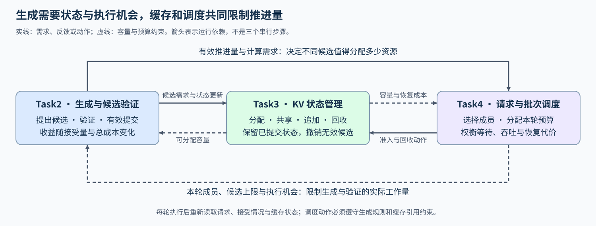

## 缓存增加怎样改变可接纳请求

三个解码请求继续增长历史状态，长请求预填充又要申请新块。逻辑缓存随词元增长，物理块在跨页时申请；请求结束后，仍被共享引用的块不能立即回收。空闲槽位和可用缓存因此是不同条件。

先根据层数、KV 头数、长度与精度估算逻辑容量，再对照块表、引用和实际分配。状态异常先修复分配与回收，容量确实不足时再比较抢占、重算或更紧凑的表示。

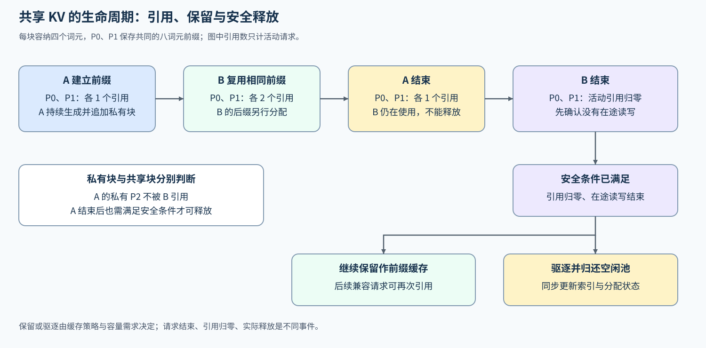

## 长请求带着重复前缀时能跳过多少计算

如果长请求与已有缓存共享连续前缀，可以只处理未命中后缀。复用前需核对词元序列、模型权重、位置、适配器和缓存表示，并确认访问权限；匹配成功后还要增加引用，保护正在使用的块。索引找到节点后，设备是否少处理了这些前缀位置，可以由实际复用词元数核对。

分页决定逻辑位置对应哪个物理块，前缀索引决定哪些已计算状态可被共享；两者可以组合。[缓存正文](./04_kv_cache_lifecycle_and_reuse.md)将命中词元、未命中后缀、容量占用与 TTFT 联系起来。

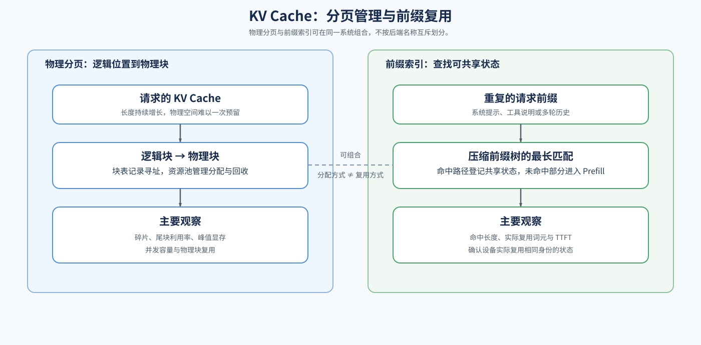

## 长输入怎样与已有解码分享下一轮

假设一轮最多处理八个词元，三个解码请求各占一个。缓存允许新请求进入时，长请求本轮可以先处理五个输入词元，再等待后续轮次。已有请求较早重新获得生成机会，长请求却需要更多轮才能完成预填充，二者的等待要一起比较。

完成请求退出后，连续批处理利用释放的槽位补入等待者；队列优先级、缓存和词元预算共同限制成员。下图从缓存、批次与阶段竞争分类，[服务调度](./05_serving_scheduling_and_pd.md)再展开具体轮次。

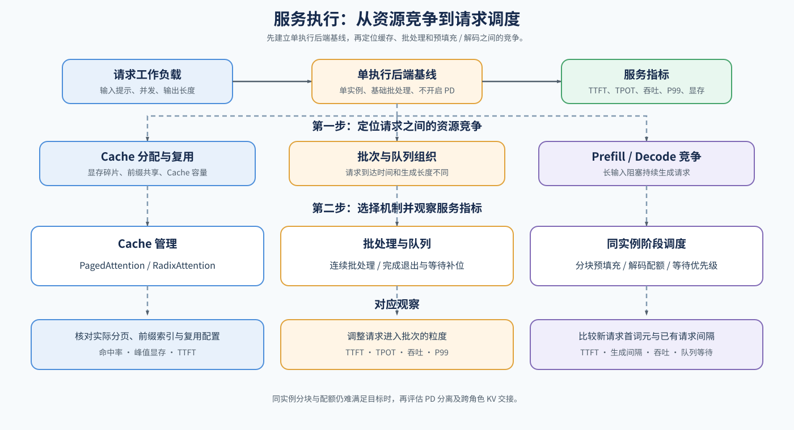

## 下一轮准备能否提前完成

选定成员后，CPU 准备、设备传输和计算还有各自依赖。后批输入可以在前批计算时搬运，但本批计算必须等自己的输入就绪，缓冲区也要等使用结束后才能覆盖。新增流或线程，需要时间线确认它真正减少了暴露等待。

下图是两个批次的构造例子：后批传输与前批计算重叠，后批仍要等 GPU 可用。实际实验分别记录总时间、传输与空闲，不把传输总量减少当作已经缩短请求等待。

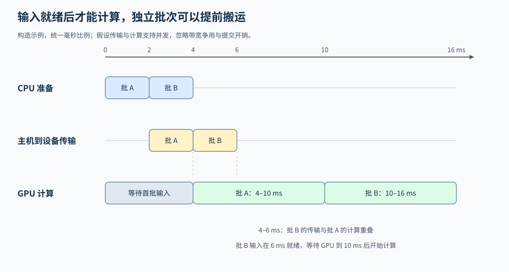

## 容量仍然受限时，低比特改变了什么

权重驻留挤占缓存时，可以评估权重表示；计算或激活读写成本突出时，比较激活缩放与低精度计算；历史状态随上下文增长时，则观察 KV 表示。权重候选需要核对产物与加载器，运行配置需要确认实际内核，缓存候选还要检查每步追加与恢复。转换、缩放或反量化都可能增加执行成本。

使用相同任务与请求规则，分别检查输出长度、终止、质量、资源和延迟。[量化部署](./06_quantized_inference_and_deployment.md)关注既有候选在目标后端的表现，校准与位宽选择进入量化专题。

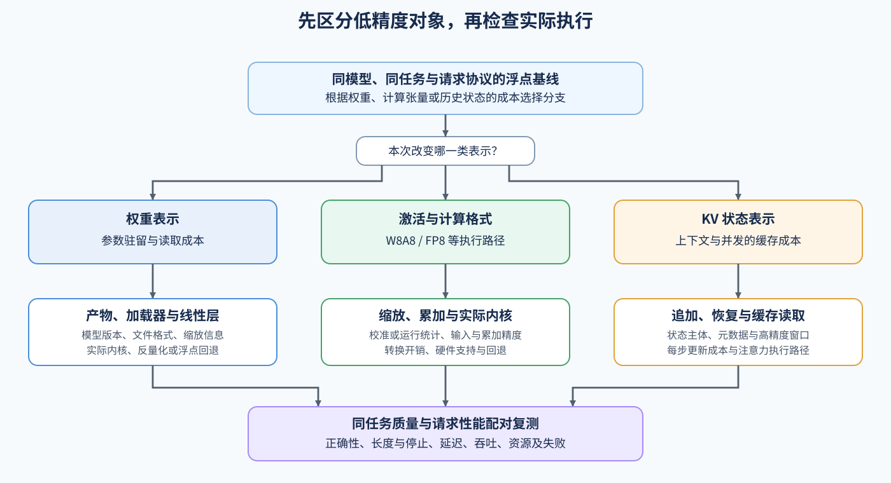

## 哪个候选适合保留

回到同一组请求，读取长请求首词元、已有请求生成间隔、有效吞吐、峰值与失败。单项开关解释机制，组合配置只说明整套方案的收益；首次准备、冷缓存和热复用也要分开。候选更快但回答不完整时，不能把减少的输出计成同工作量加速。

[基准与决策](./07_benchmark_and_decision.md)把质量、SLO 和资源门槛放在排序之前。专项结果可提供候选来源；独立综合项目自行固定模型与请求并重新测量，单卡也可以完成采用判断。容量或吞吐仍不足时，再按[分布式推理](./08_distributed_inference_and_parallelism.md)比较副本或模型内部切分，额外测量通信、负载与恢复代价。

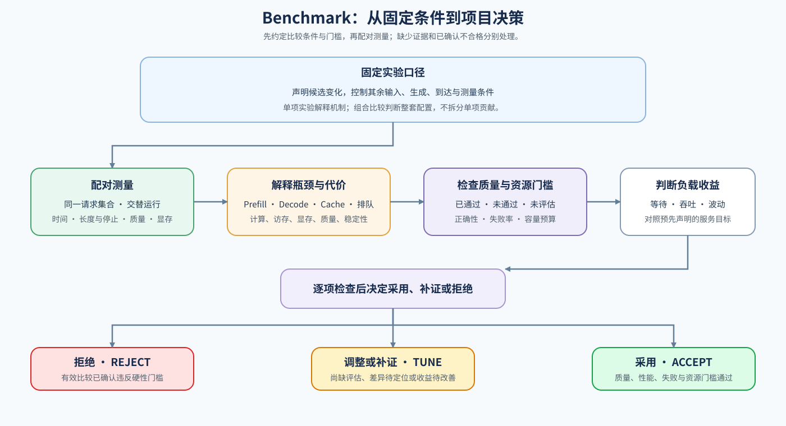

## 单实例不足后，增加的是副本还是模型分片

模型能够完整驻留而请求排队时，副本可以分别处理不同请求；权重与状态超出单卡预算时，则需要拆分模型或上下文。下图用按层切分说明后一种路径：同一请求跨设备推进，还要等待层间激活传输。两种扩展分别比较路由与缓存局部性、切分后的通信与容量，具体取舍见[分布式推理](./08_distributed_inference_and_parallelism.md)。

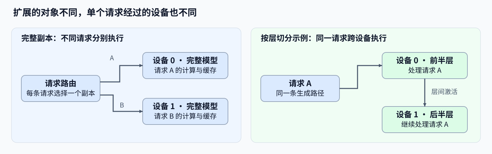
