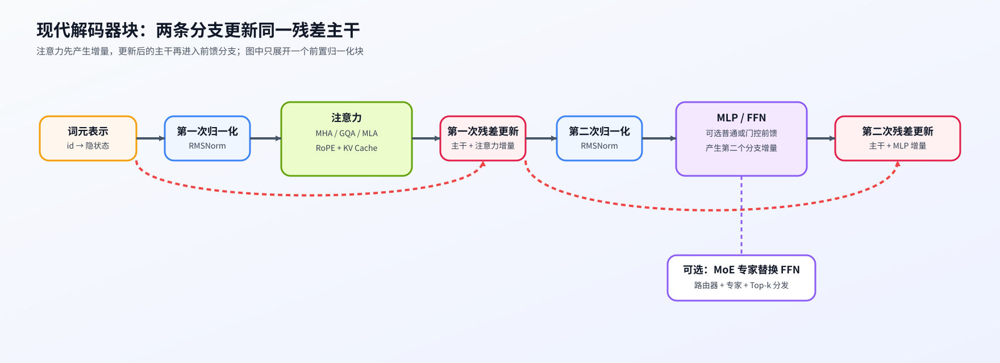

# 01 仅解码器主干（Decoder-only Backbone）

## 学习问题

给出一段文字，模型怎样逐个预测后续词元？仅解码器模型把词元编号变成隐状态，也就是每个位置的一组特征，再经过多个解码器块产生预测分数。因果掩码限制每个位置只能读取自身与此前允许的位置，避免训练时提前看到待预测内容。

## 核心机制

### 下一词元预测怎样组织输入与输出

自回归生成以已有词元为条件预测下一个词元。例如，已给定 A、B、C 时，训练可同时计算 A 后预测 B、A/B 后预测 C 的损失；生成时则在已有前缀后选择新词元，再继续下一轮。输出头给出词表中各候选的未归一化分数（logits），再由概率转换和采样规则决定输出。

编码器—解码器将输入先编码，再通过交叉注意力把输入表示交给生成侧；仅解码器则在同一条因果序列中组织上下文与预测。两者是任务与结构选择，不是后者必然取代前者的升级关系。

| 结构 | 信息路径 | 典型目标 | 主要代价 |
|:---|:---|:---|:---|
| 编码器—解码器 | 编码器表示经交叉注意力进入解码器 | 翻译、条件生成 | 两套主干与跨模块接口更复杂 |
| 仅解码器 | 所有词元沿因果路径进入同一组 Transformer 块 | 下一词元预测、生成 | 长上下文注意力与状态成本持续增长 |

### 一个 Transformer 块如何更新主干状态

以常见的前置归一化块为例，注意力混合不同词元的信息，前馈网络（FFN，也常称 MLP）逐位置变换特征；两个分支的输出分别加回主干，这条持续相加的状态路径称为残差流。归一化控制分支读入的特征尺度，多个块堆叠则形成模型深度。下图只展开一个块，整体模型还包含块的重复与词表输出头。

固定模型快照后，训练前向与生成使用同一组模型参数，但保存状态的用途不同：训练通常并行处理一段序列，保留反向仍要使用的中间量；生成先处理已有提示词，这一阶段称为预填充，随后逐词元解码，并缓存历史键和值（KV Cache）供新查询读取。模块组成与执行阶段的保存状态因此要分别说明。

| 组件 | 结构职责 | 训练状态 | 生成状态 | 后续演进问题 |
|:---|:---|:---|:---|:---|
| 归一化 + 残差 | 稳定深层状态更新 | 激活与反向所需中间量 | 当前词元的主干状态 | Pre-Norm、RMSNorm、残差缩放 |
| 注意力 | 读取上下文并混合词元信息 | Q/K/V 与注意力中间量 | 历史 KV 或递推状态 | MHA/GQA/MLA、稀疏访问、混合记忆 |
| MLP / FFN | 重组单个词元的通道表示 | 门控与中间激活 | 当前步中间激活 | SwiGLU、MoE、专家稀疏激活 |
| 输出头 | 将隐状态映射到词表分数 | 词元级训练目标 | 下一词元 logits | 权重共享、采样与生成循环 |

## 选择条件与验证证据

“采用仅解码器结构”只能确定主干范式，不能直接推出训练稳定性、长上下文质量或推理速度。结构审计还需要记录 Transformer 块数量、隐藏维度、归一化位置、注意力表示、MLP 类型、上下文长度以及执行后端，再用对应证据验证质量和成本。

先用 [Part 02 · 00 PyTorch 热身](../../02_PyTorch_Algorithms/00_PyTorch_Warmup.md)建立最小接口，再在 [Part 02 · 05 LLaMA3 Block](../../02_PyTorch_Algorithms/05_LLaMA3_Block_Tutorial.md)组装两次残差更新；配置审计进入 [Part 02 · 08](../../02_PyTorch_Algorithms/08_Architecture_Tricks.md)，多层稳定性对照进入 [Part 02 · 60](../../02_PyTorch_Algorithms/60_Decoder_Block_Stability_Benchmark.md)。

## 相关阅读

- [Attention Is All You Need](https://arxiv.org/abs/1706.03762)
- [LLaMA: Open and Efficient Foundation Language Models](https://arxiv.org/abs/2302.13971)
- [Mistral 7B](https://arxiv.org/abs/2310.06825)
