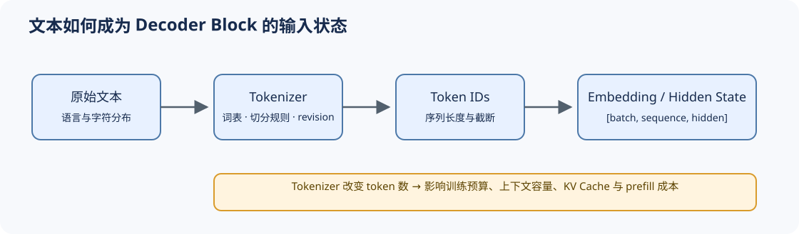

# 02 分词与输入表示（Tokenization and Embedding）

## 学习问题

同一段文字为什么在两个模型中占用不同的上下文长度？分词器（tokenizer）先按规则把文字切成词元并赋予编号，模型再查嵌入表得到向量。切分、编号和查表必须配套，否则相同文字会变成不同的输入或错误的特征。

## 核心机制

### 词表覆盖与序列长度如何平衡

整词切分往往需要很大的词表，未收录的词还需额外处理；字符或字节切分使用更小单元，通常产生更长序列。子词（Subword）用可组合的片段折中词表规模和序列长度，具体片段由训练语料与切分规则决定。

| 表示粒度 | 优势 | 主要代价 |
|:---|:---|:---|
| 词级 | 序列较短、语义单位直观 | 词表膨胀，稀有词与多语言覆盖差 |
| 子词（Subword） | 词表与长度较均衡，工程成熟 | 切分仍依赖训练语料与规则 |
| 字符 / 字节 | 细粒度表达；字节编码可覆盖任意字节序列 | 字符表仍需覆盖输入，细粒度序列通常更长 |

### 词元编号如何进入模型

设词表大小为 $V$、隐藏维度为 $d$，嵌入表形状为 $V\times d$；编号为 $j$ 的词元读取第 $j$ 行。两个词元编号 3、7 因而变成两个 $d$ 维向量，批量输入再组织成“批量、序列位置、特征”的张量。配置中的 `vocab_size` 和 `hidden_size` 分别对应 $V$、$d$。输入嵌入与输出词表头还可能共享权重，位置机制则继续让顺序参与模型计算。

序列起始、结束和填充常分别使用 BOS、EOS、PAD 等特殊词元；聊天模板还规定角色标记与消息如何拼接。这些编号、截断方向、填充规则与嵌入行数共同构成输入契约。任一项改变，都可能让相同文本对应不同的预测目标、停止条件或计算长度。

| 契约对象 | 必须固定的事实 | 漂移后的直接影响 |
|:---|:---|:---|
| 分词器资产 | 词表、合并规则、规范化规则与版本 | 词元序列和长度改变 |
| 特殊词元 | BOS、EOS、PAD 与对话边界编号 | 停止条件、填充掩码或监督边界错误 |
| 聊天模板 | 角色标记与消息拼接规则 | 训练格式与推理输入不一致 |
| 嵌入 / 输出头 | `vocab_size × hidden_size` 与权重共享关系 | 加载失败、未训练词元或输出空间错位 |

## 选择条件与验证证据

比较模型时必须同时记录分词器版本、模板、词元数和上下文截断策略。相同文本在不同分词器下可能产生不同长度，进而改变训练词元预算、KV Cache 容量、预填充延迟与计费结果；不能用字符数替代词元数比较上下文成本。

需要回补注意力输入时阅读 [Part 00 · 16](../../00_Prerequisites/16_Attention_Mechanism_Intro.md)；输入契约在 [Part 02 · 00](../../02_PyTorch_Algorithms/00_PyTorch_Warmup.md)验证，并在 [Part 02 · 05](../../02_PyTorch_Algorithms/05_LLaMA3_Block_Tutorial.md)接入完整 Transformer 块。

## 相关阅读

- [Neural Machine Translation of Rare Words with Subword Units](https://arxiv.org/abs/1508.07909)
- [SentencePiece](https://arxiv.org/abs/1808.06226)
- [ByT5](https://arxiv.org/abs/2105.13626)
